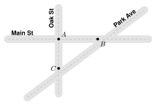
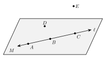
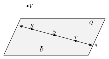

# 1.1 - Points, Lines, Segments, and Angles {.unnumbered}

Look at this map. Three straight streets cross each other.

{width=380px fig-align="center"}

Each corner is one exact spot on the map. Each street is straight. Where two streets cross, they make a corner that opens a certain amount.

Geometry has a word for each of these things. A corner is a **point**. A straight street is part of a **line**. Two streets that leave the same corner make an **angle**. In this lesson you learn these words and the symbols we use to write them.

:::{.objectives}
- [ ] I can name points, lines, segments, rays, and planes.
- [ ] I can write segments, rays, lines, and angles with the correct symbols.
- [ ] I can name an angle and classify it as acute, right, obtuse, or straight.
- [ ] I can tell what a figure shows for sure and what it only seems to show.
:::

:::{.vocab}
,
,
,
,
,
,
,
,
,
,
,
,
,
,
,

:::

:::{.guided-notes-link}
[Printable Guided Notes for this lesson](/guided_notes/Unit_1/1.1_Points_Lines_Segments_and_Angles.html){target="_blank"} (fill-in notes to print and write on)
:::



1. Plot the points $A(3, 2)$, $B(-3, 2)$, and $C(-3, -4)$ on a coordinate plane.

2. Draw a path from $A$ to $B$. Then draw a path from $B$ to $C$. What kind of corner does the path make at $B$?

3. Solve $x + 35 = 90$.



### 1.1.1 - Points, Lines, and Planes

The tip of a sharp pencil makes a tiny dot. In geometry, a **point** is an exact location. It has no size at all. We name a point with a capital letter.

A **line** is straight and goes on forever in both directions. We draw an arrow on each end to show that it never stops.

A **plane** is a flat surface that goes on forever in every direction. A floor or a wall is part of a plane.

| Object | Picture | Name | Symbol |
|:---:|:---:|:---:|:---:|
| point | {width=160px} | point $A$ | $A$ |
| line | {width=160px} | line $AB$, or one small letter like line $\ell$ | $\overleftrightarrow{AB}$ |
| plane | {width=160px} | plane $P$, or three points in it that are not on one line | |

:::{.remember title="Two points make one line"}
Through any two points there is exactly one line.
:::

Points that lie on the same line are **collinear**. Points that lie in the same plane are **coplanar**.

***

**Example 1:** Points, lines, and planes

{width=400px fig-align="center"}

a. Name line $\ell$ another way.

   Use any two points on the line: $\overleftrightarrow{AB}$. ($\overleftrightarrow{AC}$ and $\overleftrightarrow{BC}$ also work.)

b. Name three collinear points.

   $A$, $B$, and $C$. They are all on line $\ell$.

c. Are $A$, $B$, and $D$ collinear?

   No. Point $D$ is not on line $\ell$.

d. Name a point that is not in plane $M$.

   Point $E$.

:::{.you-try-m title="Use the figure in Example 1"}
a. Name line $\ell$ using points $B$ and $C$.

b. Name three points in plane $M$ that are **not** collinear.
:::

:::{.answer title="Answer"}
a. $\overleftrightarrow{BC}$ (or $\overleftrightarrow{CB}$)

b. $A$, $B$, and $D$. (Any two of $A$, $B$, $C$ with point $D$ also work.)
:::

***

### 1.1.2 - Segments and Rays

A real street does not go on forever. It starts at one corner and stops at another. In geometry, part of a line with two ends is a **segment**. The two ends are its **endpoints**.

A flashlight beam starts at the flashlight and keeps going. In geometry, part of a line that starts at one endpoint and goes on forever in one direction is a **ray**.

| Object | Picture | Name | Symbol |
|:---:|:---:|:---:|:---:|
| segment | {width=160px} | segment $AB$ | $\overline{AB}$ |
| ray | {width=160px} | ray $AB$ | $\overrightarrow{AB}$ |

:::{.gotcha title="Order matters for a ray"}
$\overline{AB}$ and $\overline{BA}$ are the same segment.

$\overrightarrow{AB}$ and $\overrightarrow{BA}$ are **different** rays. $\overrightarrow{AB}$ starts at $A$. $\overrightarrow{BA}$ starts at $B$. The first letter of a ray is always its endpoint.
:::

:::{.remember title="Segment or length?"}
$\overline{AB}$, with a bar, is the segment. It is something you can draw.

$AB$, with no bar, is the **length** of the segment. It is a number, like $AB = 5$.
:::

***

**Example 2:** Opposite rays

{width=400px fig-align="center"}

a. Name the two rays that start at $Q$.

   $\overrightarrow{QP}$ and $\overrightarrow{QR}$.

   These two rays have the same endpoint and go in opposite directions. Together they make a line. They are **opposite rays**.

b. Name every segment in the figure.

   $\overline{PQ}$, $\overline{QR}$, and $\overline{PR}$.

:::{.you-try-m title="Use the figure in Example 2"}
a. Is $\overrightarrow{PQ}$ the same ray as $\overrightarrow{PR}$?

b. Is $\overrightarrow{QP}$ the same ray as $\overrightarrow{PQ}$?
:::

:::{.answer title="Answer"}
a. **Yes.** Both start at $P$ and go to the right forever. They pass through the same points.

b. **No.** $\overrightarrow{QP}$ starts at $Q$ and goes left. $\overrightarrow{PQ}$ starts at $P$ and goes right.
:::

***

### 1.1.3 - Angles

Look at corner $A$ on the street map. Main St and Oak St both leave corner $A$, in two different directions. That makes an angle.

An **angle** is two rays with the same endpoint. The rays are the **sides** of the angle. The shared endpoint is the **vertex**.

{width=380px fig-align="center"}

You can name this angle three ways:

* $\angle ABC$ or $\angle CBA$: three letters, with the vertex in the **middle**
* $\angle B$: the vertex only
* $\angle 1$: the number written inside the angle

We measure angles in **degrees** ($^\circ$). One full turn is $360^\circ$. This angle measures $130^\circ$. We write $m\angle ABC = 130^\circ$. Read it as "the measure of angle $ABC$ is 130 degrees."

***

**Example 3:** Angles that share a vertex

{width=300px fig-align="center"}

Name the three angles that have their vertex at $B$.

$\angle ABC$, $\angle CBD$, and $\angle ABD$.

:::{.gotcha title="When one letter is not enough"}
In Example 3, the name $\angle B$ could mean any of the three angles. When two or more angles share a vertex, always use three letters.
:::

:::{.you-try-m title="Use the figure in Example 3"}
a. Name $\angle CBD$ another way with three letters.

b. Which of the three angles is the largest?
:::

:::{.answer title="Answer"}
a. $\angle DBC$

b. $\angle ABD$. It is made of the other two angles together.
:::

***

### 1.1.4 - Classifying Angles

We sort angles into four types by their measure.

{width=600px fig-align="center"}

| Type | Measure |
|:---|:---|
| acute | more than $0^\circ$ and less than $90^\circ$ |
| right | exactly $90^\circ$ |
| obtuse | more than $90^\circ$ and less than $180^\circ$ |
| straight | exactly $180^\circ$ |

A small square at the vertex means the angle is a right angle.

***

**Example 4:** Angles on a clock

{width=180px fig-align="center"}

The hands of a clock make an angle. What angle do they make at 2:00?

A full turn is $360^\circ$, and a clock has 12 hour marks. So the angle from one hour mark to the next is

$$
360^\circ \div 12 = 30^\circ.
$$

At 2:00 the hands are 2 hour marks apart:

$$
2 \times 30^\circ = 60^\circ.
$$

$60^\circ$ is less than $90^\circ$, so the angle is **acute**.

:::{.you-try title="What angle do the hands make at 5:00? Classify the angle."}
The hands are 5 hour marks apart: $5 \times 30^\circ = 150^\circ$.

$150^\circ$ is between $90^\circ$ and $180^\circ$, so the angle is **obtuse**.
:::

***

### 1.1.5 - What a Figure Shows

A drawing can fool your eyes. In geometry, we only trust two things: what we are **told**, and what the figure **marks**.

* A small square at a vertex means a right angle.
* Matching tick marks mean segments have the same length.

**Example 5:** Marks and looks

{width=560px fig-align="center"}

a. Which angle is a right angle for sure?

   $\angle 1$. It has the square mark.

b. Is $\angle 2$ a right angle?

   We **cannot tell**. It looks close to $90^\circ$, but it has no mark. (It really measures $86^\circ$.)

c. Which segments have the same length for sure?

   $\overline{AB}$ and $\overline{CD}$. They have matching tick marks, so $AB = CD$.

d. Do $\overline{EF}$ and $\overline{GH}$ have the same length?

   We **cannot tell**. They have no marks. ($\overline{GH}$ is a little longer.)

Remember that lines go on forever. A drawing shows only part of a line.

{width=420px fig-align="center"}

:::{.think title="Do lines $\\ell$ and $m$ intersect?"}
**Yes.** On the page they do not touch. But lines go on forever. These two lines get closer as they go to the right, so they meet past the edge of the page.

{width=420px fig-align="center"}
:::



**Use the figure for problems 1 to 4.**

{width=400px fig-align="center"}

1. Name line $n$ two other ways.

2. Name three collinear points.

3. Name a point in plane $Q$ that is not on line $n$.

4. Name a point that is not in plane $Q$.

***

**Write the symbol.**

5. The segment with endpoints $R$ and $S$.

6. The ray that starts at $T$ and goes through $U$.

7. The line through $M$ and $N$.

8. The length of the segment with endpoints $X$ and $Y$.

***

**True or false? Explain your answer.**

9. $\overline{GH}$ and $\overline{HG}$ are the same segment.

10. $\overrightarrow{GH}$ and $\overrightarrow{HG}$ are the same ray.

***

**Use the figure for problems 11 to 14.**

{width=320px fig-align="center"}

11. Name the three angles that have their vertex at $K$.

12. Why is $\angle K$ not a good name for any of these angles?

13. Classify $\angle LKM$ as acute, right, obtuse, or straight.

14. Classify $\angle JKM$ as acute, right, obtuse, or straight.

***

**Classify each angle as acute, right, obtuse, or straight.**

15. $12^\circ$

16. $90^\circ$

17. $145^\circ$

18. $180^\circ$

***

**Find the angle between the hands of a clock. Then classify the angle.**

19. 3:00

20. 4:00

21. 6:00

22. 1:00

***

**What does the figure show?** The figure looks like a square. For problems 23 to 26, write **must be true** or **cannot tell**.

{width=220px fig-align="center"}

23. $\angle A$ is a right angle.

24. $\angle C$ is a right angle.

25. $AB = BC$

26. $CD = DA$

27. Is $ABCD$ a square? Explain how you know.

***

**Test practice**

28. Points $A$, $B$, and $C$ are collinear, and point $B$ is between $A$ and $C$. Which statement is true?

    A. $\overrightarrow{BA}$ and $\overrightarrow{BC}$ are opposite rays.\
    B. $\overrightarrow{AB}$ and $\overrightarrow{BC}$ are opposite rays.\
    C. $\overrightarrow{BA}$ and $\overrightarrow{AB}$ are the same ray.\
    D. $\overline{AB}$ is longer than $\overline{AC}$.

29. The measure of an angle is 3 times $32^\circ$. Which word describes the angle?

    A. acute\
    B. right\
    C. obtuse\
    D. straight

***

**Challenge**

30. Four points lie in a plane. No three of them are collinear. How many different lines can you draw through two of the points? Draw a picture to check.
