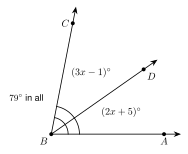
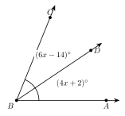
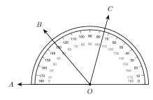
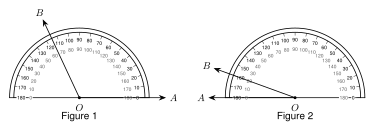

# 1.2 - Segment and Angle Addition {.unnumbered}

A truck driver leaves Town A and drives 13 miles to Town B. Then she drives 4 more miles to Town C. How far is it from A to C?

{width=420px fig-align="center"}

You add: $13 + 4 = 17$ miles. The whole is the sum of its parts. This is true for segments, and it is also true for angles. In this lesson you use that idea to write equations and find missing lengths and angles.

:::{.objectives}
- [ ] I can find the length of a segment on a number line.
- [ ] I can use segment addition and midpoints to write and solve equations.
- [ ] I can use angle addition and angle bisectors to write and solve equations.
- [ ] I can read the measure of an angle on a protractor.
:::

:::{.vocab}
,
,
,
,

:::

:::{.guided-notes-link}
[Printable Guided Notes for this lesson](/guided_notes/Unit_1/1.2_Segment_and_Angle_Addition.html){target="_blank"} (fill-in notes to print and write on)
:::



1. Write the symbol for segment $AB$. Then write the symbol for the length of segment $AB$.

2. Solve $3x + 4 = 25$.

3. Solve $5x - 6 = 2x + 9$.



### 1.2.1 - Length on a Number Line

A ruler is a number line. To find the length of a segment, subtract the two numbers at its ends.

**Example 1:** Length on a number line

{width=520px fig-align="center"}

Point $A$ is at $-3$. Point $B$ is at $4$. Find $AB$.

$$
AB = |4 - (-3)| = |7| = 7
$$

You can also count the steps from $-3$ to $4$. There are 7.

:::{.remember title="Length is never negative"}
A length is a distance. We use absolute value so the answer is never negative. For points at $a$ and $b$, the length is
$$
AB = |a - b|.
$$
The order does not matter. $|4 - (-3)| = 7$ and $|-3 - 4| = 7$.
:::

:::{.you-try-m title="Find each length"}
a. Point $P$ is at $-6$ and point $Q$ is at $2$. Find $PQ$.

b. Point $R$ is at $5$ and point $S$ is at $-1.5$. Find $RS$.
:::

:::{.answer title="Answer"}
a. $|2 - (-6)| = 8$

b. $|-1.5 - 5| = 6.5$
:::

***

### 1.2.2 - Segment Addition

Look at the truck driver again. Town $B$ is **between** Town $A$ and Town $C$, and all three towns are on one straight road. Then the two short pieces add up to the whole.

:::{.remember title="Segment Addition"}
If $B$ is between $A$ and $C$ on a line, then
$$
AB + BC = AC.
$$
:::

**Example 2:** Segment addition with $x$

{width=420px fig-align="center"}

Point $B$ is between $A$ and $C$. $AB = 2x + 3$, $BC = x - 1$, and $AC = 17$. Find $x$, $AB$, and $BC$.

Step 1. Write the equation.

$$
(2x + 3) + (x - 1) = 17
$$

Step 2. Combine like terms.

$$
3x + 2 = 17
$$

Step 3. Solve.

$$
3x = 15 \quad\text{so}\quad x = 5
$$

Step 4. Put $x = 5$ back in to find each length.

$$
AB = 2(5) + 3 = 13 \qquad BC = 5 - 1 = 4
$$

Step 5. Check. $13 + 4 = 17$. It works.

:::{.you-try-m title="Segment addition"}
Point $E$ is between $D$ and $F$. $DE = x + 6$, $EF = 3x - 2$, and $DF = 32$. Find $x$, $DE$, and $EF$.
:::

:::{.answer title="Answer"}
$(x + 6) + (3x - 2) = 32$, so $4x + 4 = 32$ and $x = 7$.

$DE = 13$ and $EF = 19$. Check: $13 + 19 = 32$.
:::

:::{.gotcha title="The point must be between"}
Segment addition only works when $B$ is on the line **between** $A$ and $C$. If $AB = 7$ and $BC = 5$, then $AC$ is $12$ only when $B$ is between them. If $B$ is on the other side of $A$, then $AC = 2$.
:::

***

### 1.2.3 - Congruent Segments and Midpoints

Two segments can have the same length. Then we say they are **congruent**. We use the symbol $\cong$.

$$
\overline{AB} \cong \overline{CD} \quad\text{means}\quad AB = CD
$$

Use $\cong$ for figures, like segments. Use $=$ for numbers, like lengths. Tick marks on a figure show which segments are congruent.

The **midpoint** of a segment is the point exactly halfway between the endpoints. It cuts the segment into two congruent segments. A **segment bisector** is any point, line, ray, or segment that goes through the midpoint.

**Example 3:** A midpoint

{width=480px fig-align="center"}

$M$ is the midpoint of $\overline{AB}$. $AM = 3x + 4$ and $MB = 5x - 6$. Find $x$ and $AB$.

Step 1. The two halves are equal.

$$
3x + 4 = 5x - 6
$$

Step 2. Solve.

$$
10 = 2x \quad\text{so}\quad x = 5
$$

Step 3. Find each half. $AM = 3(5) + 4 = 19$. $MB = 5(5) - 6 = 19$.

Step 4. Add the halves. $AB = 19 + 19 = 38$.

:::{.you-try-m title="A midpoint"}
$M$ is the midpoint of $\overline{PQ}$. $PM = 4x - 3$ and $MQ = 2x + 9$. Find $x$ and $PQ$.
:::

:::{.answer title="Answer"}
$4x - 3 = 2x + 9$, so $2x = 12$ and $x = 6$.

$PM = 21$, so $PQ = 42$.
:::

***

**Example 4:** Looks or marks?

{width=420px fig-align="center"}

Which point is the midpoint for sure?

$M$ in Figure 1. The tick marks show $\overline{AM} \cong \overline{MB}$.

We cannot tell for $N$ in Figure 2. It looks close to the middle, but there are no marks. (It is really a little left of the middle.)

***

### 1.2.4 - Angle Addition and Angle Bisectors

Angles add the same way segments do. A point $D$ is in the **interior** of $\angle ABC$ when it is between the two sides of the angle.

:::{.remember title="Angle Addition"}
If $D$ is in the interior of $\angle ABC$, then
$$
m\angle ABD + m\angle DBC = m\angle ABC.
$$
:::

**Example 5:** Angle addition with $x$

{width=420px fig-align="center"}

$m\angle ABD = (2x + 5)^\circ$, $m\angle DBC = (3x - 1)^\circ$, and $m\angle ABC = 79^\circ$. Find $x$ and each angle.

$$
(2x + 5) + (3x - 1) = 79 \quad\text{so}\quad 5x + 4 = 79 \quad\text{so}\quad x = 15
$$

$m\angle ABD = 2(15) + 5 = 35^\circ$ and $m\angle DBC = 3(15) - 1 = 44^\circ$. Check: $35 + 44 = 79$.

:::{.you-try-m title="Angle addition"}
$m\angle XYW = (x + 20)^\circ$, $m\angle WYZ = (2x + 4)^\circ$, and $m\angle XYZ = 90^\circ$. Find $x$ and each angle.
:::

:::{.answer title="Answer"}
$3x + 24 = 90$, so $x = 22$.

$m\angle XYW = 42^\circ$ and $m\angle WYZ = 48^\circ$. Check: $42 + 48 = 90$.
:::

An **angle bisector** is a ray that cuts an angle into two congruent angles.

**Example 6:** An angle bisector

{width=420px fig-align="center"}

Ray $\overrightarrow{BD}$ bisects $\angle ABC$. $m\angle ABD = (4x + 2)^\circ$ and $m\angle DBC = (6x - 14)^\circ$. Find $x$ and $m\angle ABC$.

The two parts are equal: $4x + 2 = 6x - 14$, so $16 = 2x$ and $x = 8$.

Each part is $4(8) + 2 = 34^\circ$. The whole angle is $34 + 34 = 68^\circ$.

:::{.you-try-m title="An angle bisector"}
Ray $\overrightarrow{QS}$ bisects $\angle PQR$. $m\angle PQS = (5x - 7)^\circ$ and $m\angle SQR = (3x + 13)^\circ$. Find $x$ and $m\angle PQR$.
:::

:::{.answer title="Answer"}
$5x - 7 = 3x + 13$, so $2x = 20$ and $x = 10$.

Each part is $43^\circ$, so $m\angle PQR = 86^\circ$.
:::

***

**Reading a protractor.** A protractor measures an angle in degrees. It has two scales, an outer scale and an inner scale. One scale starts at $0$ on the right. The other starts at $0$ on the left. Put one side of the angle on a $0$. Then read the scale that starts at that $0$.

**Example 7:** A protractor

{width=460px fig-align="center"}

Find $m\angle AOB$.

Side $\overrightarrow{OA}$ points left, along the $0$ of the **inner** scale. Read the inner scale where $\overrightarrow{OB}$ crosses it: $50^\circ$.

The outer scale says $130^\circ$ at the same place. That is the wrong scale. The angle looks small, so $50^\circ$ makes sense. It is acute.

:::{.you-try-m title="Use the protractor in Example 7"}
a. Find $m\angle AOC$.

b. Find $m\angle BOC$. (Hint: use angle addition.)
:::

:::{.answer title="Answer"}
a. $\overrightarrow{OC}$ is at $75^\circ$ on the outer scale, so it is $105^\circ$ on the inner scale. $m\angle AOC = 105^\circ$.

b. $m\angle AOB + m\angle BOC = m\angle AOC$, so $m\angle BOC = 105 - 50 = 55^\circ$.
:::



**Find the length on a number line.**

1. $A$ is at $-7$ and $B$ is at $2$. Find $AB$.

2. $C$ is at $-4$ and $D$ is at $-11$. Find $CD$.

3. $E$ is at $5.5$ and $F$ is at $-2.5$. Find $EF$.

4. $P$ is at $3$ and $PQ = 10$. Where could $Q$ be? Give both answers.

***

**Segment addition.** Use the figure for problems 5 to 7.

{width=420px fig-align="center"}

5. Find $PR$.

6. Find $QS$.

7. Find $PS$.

***

**Segment addition with $x$.**

8. $B$ is between $A$ and $C$. $AB = 3x + 1$, $BC = 2x + 4$, and $AC = 35$. Find $x$, $AB$, and $BC$.

9. $D$ is between $C$ and $E$. $CD = x + 9$, $DE = 4x - 3$, and $CE = 51$. Find $x$, $CD$, and $DE$.

10. Kofi's farm is at mile marker 14 on a straight highway. The gas station is at mile marker 31. The lake is at mile marker 52. How far is it from Kofi's farm to the lake? How far is it from the gas station to the lake?

11. Amira says $AB = 7$, $BC = 5$, and $AC = 15$ for three points on a line. Can she be right if $B$ is between $A$ and $C$? Explain.

***

**Congruent segments and midpoints.**

12. $M$ is the midpoint of $\overline{AB}$ and $AM = 12$. Find $AB$.

13. $M$ is the midpoint of $\overline{XY}$ and $XY = 30$. Find $MY$.

14. $M$ is the midpoint of $\overline{CD}$. $CM = 2x + 1$ and $MD = 4x - 9$. Find $x$ and $CD$.

15. $M$ is the midpoint of $\overline{ST}$. $ST = 6x - 8$ and $SM = 11$. Find $x$.

16. Line $\ell$ bisects $\overline{PQ}$ at $R$. $PR = 3x + 2$ and $RQ = 5x - 12$. Find $x$ and $PQ$.

17. $AB = 9$ and $CD = 9$. Write one statement with $=$ and one statement with $\cong$.

***

**What does the figure show?** Use the figure for problems 18 and 19.

{width=420px fig-align="center"}

18. Is $G$ the midpoint of $\overline{EF}$? How do you know?

19. Is $K$ the midpoint of $\overline{HJ}$? How do you know?

***

**Find the mistake.**

20. $B$ is between $A$ and $C$. $AB = 4x - 2$, $BC = 2x + 8$, and $AC = 42$. Diego writes $4x - 2 = 2x + 8$ and gets $x = 5$. What mistake did he make? Find the correct $x$.

***

**Angle addition and bisectors.**

21. $D$ is in the interior of $\angle ABC$. $m\angle ABD = 28^\circ$ and $m\angle DBC = 47^\circ$. Find $m\angle ABC$.

22. $W$ is in the interior of $\angle XYZ$. $m\angle XYZ = 112^\circ$ and $m\angle XYW = 70^\circ$. Find $m\angle WYZ$.

23. $m\angle ABD = (3x + 2)^\circ$, $m\angle DBC = (2x + 8)^\circ$, and $m\angle ABC = 100^\circ$. Find $x$ and each angle.

24. Ray $\overrightarrow{BD}$ bisects $\angle ABC$. $m\angle ABD = (7x - 5)^\circ$ and $m\angle DBC = (5x + 9)^\circ$. Find $x$ and $m\angle ABC$.

25. Ray $\overrightarrow{BD}$ bisects $\angle ABC$ and $m\angle ABC = 126^\circ$. Find $m\angle ABD$.

***

**Protractors.** Find the measure of each angle $\angle AOB$ and classify it. Use the figure for problems 26 and 27.

{width=560px fig-align="center"}

26. Figure 1

27. Figure 2

***

**Test practice**

28. Point $B$ is between $A$ and $C$ on a line. $AB = x + 4$, $BC = 2x - 1$, and $AC = 24$. What is $BC$?

    A. $7$\
    B. $11$\
    C. $13$\
    D. $24$

29. Ray $\overrightarrow{BD}$ bisects $\angle ABC$. $m\angle ABD = (3x + 6)^\circ$ and $m\angle ABC = (10x - 8)^\circ$. What is $m\angle DBC$?

    A. $5^\circ$\
    B. $21^\circ$\
    C. $42^\circ$\
    D. $15^\circ$

***

**Challenge**

30. Points $A$, $B$, and $C$ are on a line. $AB = 12$ and $BC = 7$. Find every possible value of $AC$. Draw a picture for each one.

31. $M$ is the midpoint of $\overline{AB}$. $N$ is the midpoint of $\overline{AM}$. $AN = 5$. Find $AB$.
