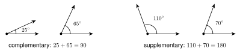
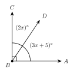
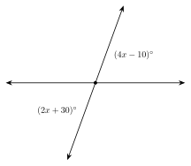
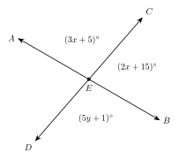
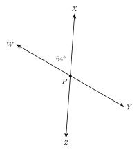

# 1.3 - Complementary, Supplementary, and Vertical Angles {.unnumbered}

Hold a pair of scissors. Open them a little. The two blades make an angle. Now open them wider. The angle between the blades grows, and the angle between the handles grows by exactly the same amount.

{width=300px fig-align="center"}

Some pairs of angles always have a special link. Two crossing lines make four angles. The angles across from each other are always equal. In this lesson you learn the names of these pairs and use them to find missing angles.

:::{.objectives}
- [ ] I can find the complement and the supplement of an angle.
- [ ] I can name adjacent angles, linear pairs, and vertical angles.
- [ ] I can explain why vertical angles are equal.
- [ ] I can write and solve equations to find missing angles.
:::

:::{.vocab}
,
,
,
,

:::

:::{.guided-notes-link}
[Printable Guided Notes for this lesson](/guided_notes/Unit_1/1.3_Complementary_Supplementary_and_Vertical_Angles.html){target="_blank"} (fill-in notes to print and write on)
:::



1. A ray $\overrightarrow{BD}$ is inside $\angle ABC$. $m\angle ABD = 30^\circ$ and $m\angle DBC = 45^\circ$. Find $m\angle ABC$.

2. Solve $4x - 10 = 2x + 30$.

3. Solve $(5x + 10) + (3x - 6) = 180$.



### 1.3.1 - Complementary and Supplementary Angles

Two angles are **complementary** if their measures add to $90^\circ$. Two angles are **supplementary** if their measures add to $180^\circ$.

{width=600px fig-align="center"}

The angles do not have to touch. $25^\circ$ and $65^\circ$ are complementary even when they are in different places.

To find the **complement** of an angle, subtract it from $90^\circ$. To find the **supplement**, subtract it from $180^\circ$.

**Example 1:** Complement and supplement

a. Find the complement of $38^\circ$.

   $90 - 38 = 52$. The complement is $52^\circ$.

b. Find the supplement of $38^\circ$.

   $180 - 38 = 142$. The supplement is $142^\circ$.

c. Find the complement and the supplement of $x^\circ$.

   The complement is $(90 - x)^\circ$. The supplement is $(180 - x)^\circ$.

:::{.you-try-m title="Find each answer"}
a. The complement of $63^\circ$.

b. The supplement of $63^\circ$.

c. The supplement of $105^\circ$.
:::

:::{.answer title="Answer"}
a. $90 - 63 = 27$, so $27^\circ$.

b. $180 - 63 = 117$, so $117^\circ$.

c. $180 - 105 = 75$, so $75^\circ$.
:::

:::{.gotcha title="Complement and supplement"}
An angle that is more than $90^\circ$ has no complement. The complement would be negative. A way to remember: **C** comes before **S** in the alphabet, and $90$ comes before $180$.
:::

***

### 1.3.2 - Adjacent Angles and Linear Pairs

Two angles are **adjacent** if they share a vertex and one side, and they do not overlap.

{width=520px fig-align="center"}

**Example 2:** Adjacent angles

Look at the two figures. In Figure 1, $\angle 1$ and $\angle 2$ share the vertex $B$ and the side $\overrightarrow{BD}$. They do not overlap. They are adjacent.

In Figure 2, $\angle ABD$ and $\angle ABC$ share the vertex and the side $\overrightarrow{BA}$. But $\angle ABD$ is inside $\angle ABC$, so they overlap. They are **not** adjacent.

A **linear pair** is two adjacent angles whose outside sides are opposite rays. Together they make a straight line.

:::{.remember title="A linear pair is supplementary"}
The angles in a linear pair add to $180^\circ$, because together they make a straight angle.
:::

**Example 3:** A linear pair

{width=380px fig-align="center"}

$A$, $B$, and $C$ are on a line. $m\angle 1 = 62^\circ$. Find $m\angle 2$.

$\angle 1$ and $\angle 2$ are a linear pair, so $m\angle 1 + m\angle 2 = 180^\circ$.

$$
m\angle 2 = 180 - 62 = 118
$$

:::{.you-try-m title="Use the figure in Example 3"}
Suppose $m\angle 1 = 47^\circ$. Find $m\angle 2$.
:::

:::{.answer title="Answer"}
$180 - 47 = 133$, so $m\angle 2 = 133^\circ$.
:::

***

### 1.3.3 - Vertical Angles

Two lines that cross make four angles. **Vertical angles** are the two angles that are across from each other. They share only the vertex.

{width=300px fig-align="center"}

$\angle 1$ and $\angle 3$ are vertical angles. $\angle 2$ and $\angle 4$ are also vertical angles.

**Example 4:** Vertical angles

$m\angle 1 = 60^\circ$. Find $m\angle 2$, $m\angle 3$, and $m\angle 4$.

* $\angle 1$ and $\angle 2$ are a linear pair, so $m\angle 2 = 180 - 60 = 120^\circ$.
* $\angle 3$ is vertical to $\angle 1$, so $m\angle 3 = 60^\circ$.
* $\angle 4$ is vertical to $\angle 2$, so $m\angle 4 = 120^\circ$.

:::{.you-try-m title="Use the figure above"}
Suppose $m\angle 2 = 135^\circ$. Find $m\angle 1$, $m\angle 3$, and $m\angle 4$.
:::

:::{.answer title="Answer"}
$m\angle 1 = 180 - 135 = 45^\circ$. $m\angle 3 = 45^\circ$. $m\angle 4 = 135^\circ$.
:::

:::{.think title="Why are vertical angles equal?"}
Do not just trust the picture. Look at the figure below. Call the first angle $x$.

{width=340px fig-align="center"}

The top angle makes a linear pair with the first angle. So the top angle is $180 - x$.

The left angle makes a linear pair with the top angle. So the left angle is $180 - (180 - x) = x$.

The left angle and the first angle are vertical angles. Both are $x$.

This works for any $x$. Vertical angles are always equal.
:::

***

### 1.3.4 - Solving for $x$

Now we use the pairs to write equations. First decide which pair you have. Then pick the rule.

| Pair | Rule | Equation |
|:---|:---|:---|
| complementary | add to $90^\circ$ | $\text{angle} + \text{angle} = 90$ |
| supplementary or linear pair | add to $180^\circ$ | $\text{angle} + \text{angle} = 180$ |
| vertical | equal | $\text{angle} = \text{angle}$ |

**Example 5:** Complementary angles

{width=360px fig-align="center"}

$\angle ABC$ is a right angle. $m\angle ABD = (3x + 5)^\circ$ and $m\angle DBC = (2x)^\circ$. Find $x$ and each angle.

The two angles are complementary.

$$
(3x + 5) + 2x = 90 \quad\text{so}\quad 5x + 5 = 90 \quad\text{so}\quad x = 17
$$

$m\angle ABD = 3(17) + 5 = 56^\circ$ and $m\angle DBC = 2(17) = 34^\circ$. Check: $56 + 34 = 90$.

:::{.you-try-m title="Complementary angles"}
Two complementary angles measure $(5x + 6)^\circ$ and $(3x + 12)^\circ$. Find $x$ and each angle.
:::

:::{.answer title="Answer"}
$8x + 18 = 90$, so $x = 9$. The angles are $51^\circ$ and $39^\circ$.
:::

***

**Example 6:** Vertical angles

{width=380px fig-align="center"}

The two marked angles are vertical angles. Find $x$ and the marked angles.

Vertical angles are equal.

$$
4x - 10 = 2x + 30 \quad\text{so}\quad 2x = 40 \quad\text{so}\quad x = 20
$$

Each angle is $4(20) - 10 = 70^\circ$. Check: $2(20) + 30 = 70$. The other two angles are $180 - 70 = 110^\circ$.

:::{.you-try-m title="Vertical angles"}
Two vertical angles measure $(6x + 1)^\circ$ and $(4x + 31)^\circ$. Find $x$ and the angles.
:::

:::{.answer title="Answer"}
$6x + 1 = 4x + 31$, so $x = 15$. Each angle is $91^\circ$.
:::

***

**Example 7:** Find the mistake

Lucía has two vertical angles, $(3x + 10)^\circ$ and $(5x - 30)^\circ$. She writes $(3x + 10) + (5x - 30) = 180$ and gets $x = 25$. What did she do wrong?

Lucía used the rule for a linear pair. Vertical angles are not a linear pair. They are **equal**.

Check her answer. With $x = 25$ the angles are $85^\circ$ and $95^\circ$. They are not equal, so $x = 25$ cannot be right.

The correct equation is $3x + 10 = 5x - 30$. Then $40 = 2x$ and $x = 20$. Each angle is $70^\circ$.

***

**Example 8:** Three expressions

{width=420px fig-align="center"}

Lines $\overleftrightarrow{AB}$ and $\overleftrightarrow{CD}$ cross at $E$. Find $x$, $y$, and the three angles.

Step 1. $\angle AEC$ and $\angle CEB$ are a linear pair.

$$
(3x + 5) + (2x + 15) = 180 \quad\text{so}\quad 5x + 20 = 180 \quad\text{so}\quad x = 32
$$

$m\angle AEC = 3(32) + 5 = 101^\circ$ and $m\angle CEB = 2(32) + 15 = 79^\circ$.

Step 2. $\angle BED$ is vertical to $\angle AEC$, so they are equal.

$$
5y + 1 = 101 \quad\text{so}\quad 5y = 100 \quad\text{so}\quad y = 20
$$

:::{.you-try-m title="Three expressions"}
Use the same figure. Now $m\angle AEC = (2x + 9)^\circ$, $m\angle CEB = (3x + 1)^\circ$, and $m\angle BED = (4y - 3)^\circ$. Find $x$, $y$, and the three angles.
:::

:::{.answer title="Answer"}
$5x + 10 = 180$, so $x = 34$. $m\angle AEC = 77^\circ$ and $m\angle CEB = 103^\circ$.

$4y - 3 = 77$, so $y = 20$. $m\angle BED = 77^\circ$.
:::



**Complements and supplements.**

1. Find the complement of $35^\circ$.

2. Find the complement of $72^\circ$.

3. Find the complement of $8^\circ$.

4. Find the complement of $x^\circ$.

5. Find the supplement of $35^\circ$.

6. Find the supplement of $108^\circ$.

7. Find the supplement of $90^\circ$.

8. Find the supplement of $x^\circ$.

9. Two angles measure $40^\circ$ and $50^\circ$. They are far apart on the page. Are they complementary? Explain.

10. Can an obtuse angle have a complement? Explain.

***

**Pairs of angles.** Lines $\overleftrightarrow{WY}$ and $\overleftrightarrow{XZ}$ cross at $P$. Use the figure for problems 11 to 15.

{width=320px fig-align="center"}

11. Name a pair of vertical angles.

12. Name a linear pair.

13. Find $m\angle XPY$.

14. Find $m\angle YPZ$.

15. Find $m\angle ZPW$.

***

**Solve for $x$.**

16. Vertical angles measure $(5x + 4)^\circ$ and $(3x + 20)^\circ$. Find $x$ and the angles.

17. Vertical angles measure $(7x - 12)^\circ$ and $(4x + 21)^\circ$. Find $x$ and the angles.

18. Complementary angles measure $(4x + 3)^\circ$ and $(2x + 9)^\circ$. Find $x$ and the angles.

19. Supplementary angles measure $(6x + 4)^\circ$ and $(3x + 5)^\circ$. Find $x$ and the angles.

20. A linear pair measures $(4x - 5)^\circ$ and $(2x + 17)^\circ$. Find $x$ and the angles.

21. Two lines cross. $m\angle 1 = (3x + 7)^\circ$ and $m\angle 2 = (2x + 8)^\circ$ are a linear pair. $m\angle 3 = (6y - 8)^\circ$ is vertical to $\angle 1$. Find $x$, $y$, and the three angles.

22. An angle is $20^\circ$ more than its complement. Find the angle.

***

**Real problems.**

23. Mohammed builds a sawhorse. The legs cross in an X. One angle between the legs is $68^\circ$. Find the other three angles.

24. A pair of scissors has handles that make an angle of $38^\circ$. The blades make an angle vertical to it. Find the angle between the blades. Then find the angle next to it.

***

**Find the mistake.**

25. Samir has a linear pair, $(2x + 10)^\circ$ and $(3x - 20)^\circ$. He writes $2x + 10 = 3x - 20$ and gets $x = 30$. What did he do wrong? Find the correct $x$.

***

**What does the figure show?**

26. In a drawing, $A$, $B$, and $C$ look like they are on one line, and $D$ is a point off the line. The problem does not say $A$, $B$, and $C$ are collinear. Can you say $\angle ABD$ and $\angle DBC$ are supplementary? Explain.

***

**Test practice**

27. Two angles are supplementary. One angle is 3 times as large as the other. What is the measure of the smaller angle?

    A. $30^\circ$\
    B. $45^\circ$\
    C. $60^\circ$\
    D. $135^\circ$

28. Two lines cross. One angle measures $(4x + 6)^\circ$. The angle vertical to it measures $(7x - 21)^\circ$. What is the measure of an angle next to them?

    A. $42^\circ$\
    B. $48^\circ$\
    C. $132^\circ$\
    D. $138^\circ$

***

**Challenge**

29. Three lines cross at one point. How many pairs of vertical angles are there? Draw a picture.

30. The complement of an angle is $10^\circ$ less than half of its supplement. Find the angle.
