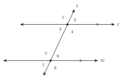
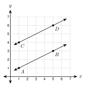
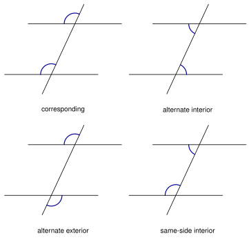
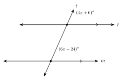
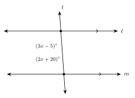
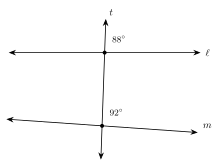
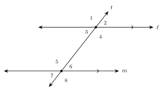
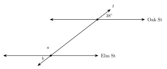

# 1.4 - Parallel Lines and Transversals {.unnumbered}

Look at the stripes in a parking lot. They run side by side and never meet. Now look at the line along the edge of the lot. It crosses every stripe.

{width=420px fig-align="center"}

When one line crosses two others, it makes eight angles. If the two lines are parallel, these angles follow a pattern. In this lesson you learn the pattern and use it to find missing angles.

:::{.objectives}
- [ ] I can tell parallel, perpendicular, and skew lines apart.
- [ ] I can name the pairs of angles made by a transversal.
- [ ] I can find angles when parallel lines are cut by a transversal.
- [ ] I can use angle measures to decide if two lines are parallel.
:::

:::{.vocab}
,
,
,
,
,
,
,

:::

:::{.guided-notes-link}
[Printable Guided Notes for this lesson](/guided_notes/Unit_1/1.4_Parallel_Lines_and_Transversals.html){target="_blank"} (fill-in notes to print and write on)
:::



1. Two angles are a linear pair. One measures $65^\circ$. Find the other.

2. Solve $4x + 6 = 6x - 24$.

3. Solve $(3x - 5) + (2x + 20) = 180$.



### 1.4.1 - Parallel, Perpendicular, and Skew Lines

**Parallel lines** are in the same plane and never meet. We write $\ell \parallel m$. Matching arrows on a figure show that lines are parallel.

**Perpendicular lines** cross to make right angles. We write $p \perp q$. A small square shows the right angle.

{width=520px fig-align="center"}

**Skew lines** are in space, not in one plane. They do not meet, and they are not parallel. A box shows them well.

**Example 1:** Lines on a box

{width=380px fig-align="center"}

Each edge of the box is part of a line.

a. Name an edge parallel to $\overline{AB}$.

   $\overline{DC}$. (Also $\overline{EF}$ and $\overline{HG}$.) They go in the same direction and never meet.

b. Name an edge perpendicular to $\overline{AB}$.

   $\overline{AD}$. (Also $\overline{BC}$.) They meet at a right angle.

c. Name an edge skew to $\overline{AB}$.

   $\overline{CG}$. It does not meet $\overline{AB}$, and it does not go in the same direction.

:::{.you-try-m title="Use the box in Example 1"}
a. Name an edge parallel to $\overline{AD}$.

b. Name an edge skew to $\overline{BC}$.
:::

:::{.answer title="Answer"}
a. $\overline{BC}$. (Also $\overline{EH}$ and $\overline{FG}$.)

b. $\overline{AE}$. (Also $\overline{DH}$, $\overline{EF}$, and $\overline{HG}$.)
:::

***

**On the coordinate plane.** On a grid, two lines are parallel when they go up and over by the same amount. They have the same slope.

**Example 2:** Parallel on a grid

{width=300px fig-align="center"}

Are $\overleftrightarrow{AB}$ and $\overleftrightarrow{CD}$ parallel? $A(1, 1)$, $B(5, 3)$, $C(1, 4)$, $D(5, 6)$.

Slope of $\overleftrightarrow{AB}$: $\dfrac{3 - 1}{5 - 1} = \dfrac{2}{4} = \dfrac{1}{2}$.

Slope of $\overleftrightarrow{CD}$: $\dfrac{6 - 4}{5 - 1} = \dfrac{2}{4} = \dfrac{1}{2}$.

The slopes are equal, so the lines are parallel.

:::{.you-try-m title="Parallel on a grid"}
$J(0, 2)$, $K(4, 4)$, $L(1, 0)$, $M(4, 3)$. Are $\overleftrightarrow{JK}$ and $\overleftrightarrow{LM}$ parallel?
:::

:::{.answer title="Answer"}
Slope of $\overleftrightarrow{JK}$ is $\frac{2}{4} = \frac{1}{2}$. Slope of $\overleftrightarrow{LM}$ is $\frac{3}{3} = 1$. The slopes are different, so the lines are **not** parallel.
:::

***

### 1.4.2 - Angles Made by a Transversal

A **transversal** is a line that crosses two or more other lines. In the figure, line $t$ is a transversal of lines $\ell$ and $m$. It makes eight angles.

{width=420px fig-align="center"}

Angles **between** $\ell$ and $m$ are **interior**. Angles **outside** are **exterior**. These are the four kinds of pairs.

{width=480px fig-align="center"}

| Pair | Where they are | Example |
|:---|:---|:---|
| **corresponding** | same position at each crossing | $\angle 1$ and $\angle 5$ |
| **alternate interior** | between the lines, opposite sides of $t$ | $\angle 3$ and $\angle 6$ |
| **alternate exterior** | outside the lines, opposite sides of $t$ | $\angle 1$ and $\angle 8$ |
| **same-side interior** | between the lines, same side of $t$ | $\angle 3$ and $\angle 5$ |

**Example 3:** Name the pair

Use the figure above.

a. $\angle 2$ and $\angle 6$: both are in the upper right position. They are **corresponding**.

b. $\angle 4$ and $\angle 6$: both are between the lines, on the right side of $t$. They are **same-side interior**.

:::{.you-try-m title="Name the pair"}
a. $\angle 2$ and $\angle 7$

b. $\angle 3$ and $\angle 7$

c. $\angle 4$ and $\angle 5$
:::

:::{.answer title="Answer"}
a. alternate exterior

b. corresponding

c. alternate interior
:::

***

### 1.4.3 - Parallel Lines and the Eight Angles

:::{.remember title="When the lines are parallel"}
If $\ell \parallel m$, then:

* corresponding angles are **equal**
* alternate interior angles are **equal**
* alternate exterior angles are **equal**
* same-side interior angles are **supplementary** (they add to $180^\circ$)
:::

**Example 4:** Find all eight angles

$\ell \parallel m$ in the figure above, and $m\angle 1 = 115^\circ$. Find the other seven angles.

| Angle | Measure | Reason |
|:---:|:---:|:---|
| $\angle 2$ | $65^\circ$ | linear pair with $\angle 1$ |
| $\angle 3$ | $65^\circ$ | vertical to $\angle 2$ |
| $\angle 4$ | $115^\circ$ | vertical to $\angle 1$ |
| $\angle 5$ | $115^\circ$ | corresponding to $\angle 1$ |
| $\angle 6$ | $65^\circ$ | corresponding to $\angle 2$ |
| $\angle 7$ | $65^\circ$ | vertical to $\angle 6$ |
| $\angle 8$ | $115^\circ$ | vertical to $\angle 5$ |

Every angle is either $115^\circ$ or $65^\circ$. The two numbers add to $180^\circ$.

:::{.you-try-m title="Parallel lines and a transversal"}
Two parallel lines are cut by a transversal. One angle is $48^\circ$. How many of the eight angles measure $48^\circ$? What do the others measure?
:::

:::{.answer title="Answer"}
Four angles measure $48^\circ$. The other four measure $180 - 48 = 132^\circ$.
:::

***

**Example 5:** Corresponding angles

{width=380px fig-align="center"}

$\ell \parallel m$. Find $x$ and the angles.

The marked angles are corresponding, so they are equal.

$$
4x + 6 = 6x - 24 \quad\text{so}\quad 30 = 2x \quad\text{so}\quad x = 15
$$

Each angle is $4(15) + 6 = 66^\circ$. Check: $6(15) - 24 = 66$.

**Example 6:** Same-side interior angles

{width=380px fig-align="center"}

$\ell \parallel m$. Find $x$ and the angles.

The marked angles are same-side interior, so they add to $180^\circ$.

$$
(3x - 5) + (2x + 20) = 180 \quad\text{so}\quad 5x + 15 = 180 \quad\text{so}\quad x = 33
$$

The angles are $3(33) - 5 = 94^\circ$ and $2(33) + 20 = 86^\circ$. Check: $94 + 86 = 180$.

:::{.you-try-m title="Solve for $x$"}
$\ell \parallel m$.

a. Alternate interior angles measure $(2x + 25)^\circ$ and $(3x - 5)^\circ$. Find $x$ and the angles.

b. Same-side interior angles measure $(4x + 2)^\circ$ and $(2x + 16)^\circ$. Find $x$ and the angles.
:::

:::{.answer title="Answer"}
a. They are equal. $2x + 25 = 3x - 5$, so $x = 30$. Each angle is $85^\circ$.

b. They add to $180$. $6x + 18 = 180$, so $x = 27$. The angles are $110^\circ$ and $70^\circ$.
:::

***

### 1.4.4 - Are the Lines Parallel?

The rules also work backward. If a transversal makes **equal corresponding angles**, the lines are parallel. The same is true for equal alternate interior angles, equal alternate exterior angles, and same-side interior angles that add to $180^\circ$.

**Example 7:** Use angles to decide

{width=420px fig-align="center"}

The lines look parallel. The marked angles are corresponding. Are $\ell$ and $m$ parallel?

$88^\circ \ne 92^\circ$. The corresponding angles are not equal, so the lines are **not** parallel.

(The picture is drawn to scale. The bottom line leans just $4^\circ$.)

**Example 8:** Looks or marks?

{width=420px fig-align="center"}

Are $\ell$ and $m$ parallel?

We cannot tell. There are no arrow marks and no angle measures. A drawing that only looks parallel is not enough.

:::{.you-try-m title="Are the lines parallel?"}
a. A transversal makes same-side interior angles of $104^\circ$ and $76^\circ$.

b. A transversal makes alternate interior angles of $65^\circ$ and $115^\circ$.
:::

:::{.answer title="Answer"}
a. $104 + 76 = 180$, so the lines **are** parallel.

b. $65 \ne 115$, so the lines are **not** parallel.
:::



**Parallel, perpendicular, and skew.** Use the box in Example 1 for problems 1 to 3.

1. Name an edge parallel to $\overline{AE}$.

2. Name an edge perpendicular to $\overline{DC}$.

3. Name an edge skew to $\overline{DC}$.

***

**On the coordinate plane.** Decide if the lines are parallel, perpendicular, or neither.

4. The line through $(0, 0)$ and $(6, 2)$, and the line through $(0, -3)$ and $(6, -1)$.

5. The line through $(0, 0)$ and $(3, 6)$, and the line through $(0, 0)$ and $(-4, 2)$.

6. The line through $(1, 2)$ and $(5, 8)$, and the line through $(2, 4)$ and $(6, 9)$.

***

**Name the pair.** Use the figure for problems 7 to 12.

{width=420px fig-align="center"}

7. $\angle 4$ and $\angle 8$

8. $\angle 2$ and $\angle 7$

9. $\angle 4$ and $\angle 5$

10. $\angle 3$ and $\angle 5$

***

**Find the angles.** $\ell \parallel m$ in the figure above.

11. $m\angle 1 = 128^\circ$. Find $m\angle 5$, $m\angle 6$, and $m\angle 3$.

12. $m\angle 7 = 52^\circ$. Find $m\angle 2$, $m\angle 4$, and $m\angle 8$.

***

**Solve for $x$.** $\ell \parallel m$.

13. Alternate interior angles measure $(5x - 8)^\circ$ and $(3x + 14)^\circ$.

14. Corresponding angles measure $(8x - 3)^\circ$ and $(6x + 17)^\circ$.

15. Same-side interior angles measure $(7x + 4)^\circ$ and $(3x + 6)^\circ$.

16. Alternate exterior angles measure $(3x + 12)^\circ$ and $(5x - 18)^\circ$.

17. In the figure above, $m\angle 2 = (4x + 8)^\circ$, $m\angle 6 = (6x - 14)^\circ$, and $m\angle 4 = (3y + 2)^\circ$. Find $x$, $y$, and the three angles.

***

**Real problems.**

18. A diagonal avenue crosses two parallel streets, Oak St and Elm St. The avenue makes a $38^\circ$ angle with Oak St, as shown. Find the angles $a$ and $b$.

    {width=420px fig-align="center"}

19. Two rails of a train track are parallel. A cable crosses both rails. One of the eight angles measures $72^\circ$. Every angle is one of two numbers. What are they?

***

**Find the mistake.**

20. $\ell \parallel m$. Ana has same-side interior angles $(2x + 10)^\circ$ and $(3x - 5)^\circ$. She says same-side interior angles are equal, so $2x + 10 = 3x - 5$ and $x = 15$. What did she do wrong? Find the correct $x$.

***

**Are the lines parallel?**

21. A transversal makes corresponding angles of $74^\circ$ and $74^\circ$.

22. A transversal makes alternate interior angles of $65^\circ$ and $115^\circ$.

23. Same-side interior angles measure $(3x + 10)^\circ$ and $(2x + 20)^\circ$. Find $x$ so that the lines are parallel.

24. Two lines in a drawing look parallel. No arrows and no angles are given. Can you say they are parallel? Explain.

***

**Test practice**

25. $\ell \parallel m$. Alternate interior angles measure $(5x - 20)^\circ$ and $(3x + 16)^\circ$. What is the measure of each angle?

    A. $18^\circ$\
    B. $54^\circ$\
    C. $70^\circ$\
    D. $110^\circ$

26. Two parallel lines are cut by a transversal. Which statement must be true?

    A. Corresponding angles are supplementary.\
    B. Alternate interior angles are equal.\
    C. Same-side interior angles are equal.\
    D. Vertical angles are supplementary.

***

**Challenge**

27. Two parallel lines are cut by a transversal. One of the eight angles is $90^\circ$. What are the other seven? What does this tell you about the transversal?

28. The line through $(0, 0)$ and $(4, 3)$ is given. Line $n$ goes through $(1, -1)$. Find a second point on $n$ so that $n$ is parallel to the given line. Then find a second point so that $n$ is perpendicular to it.
