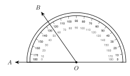
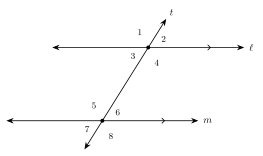

# Unit 1 Review {.unnumbered}

:::{.guided-notes-link}
[Printable Unit 1 Review](/guided_notes/Unit_1/Unit_1_Review.html){target="_blank"} (fill-in review to print and write on)
:::



### 1.1 - Points, Lines, Segments, and Angles

**Example 1:** Write the symbol for the ray that starts at $K$ and goes through $L$. Write the symbol for the line through $K$ and $L$. Classify an angle of $137^\circ$.

Ray: $\overrightarrow{KL}$. Line: $\overleftrightarrow{KL}$. $137^\circ$ is between $90^\circ$ and $180^\circ$, so it is obtuse.

### 1.2 - Segment and Angle Addition

**Example 2:** $B$ is between $A$ and $C$. $AB = 5x - 2$, $BC = 3x + 6$, and $AC = 44$. Find $x$, $AB$, and $BC$.

$(5x - 2) + (3x + 6) = 44$, so $8x + 4 = 44$ and $x = 5$. $AB = 23$ and $BC = 21$. Check: $23 + 21 = 44$.

### 1.3 - Complementary, Supplementary, and Vertical Angles

**Example 3:** Two supplementary angles measure $(7x + 3)^\circ$ and $(5x + 9)^\circ$. Find $x$ and the angles.

$(7x + 3) + (5x + 9) = 180$, so $12x + 12 = 180$ and $x = 14$. The angles are $101^\circ$ and $79^\circ$.

### 1.4 - Parallel Lines and Transversals

**Example 4:** $\ell \parallel m$. Alternate interior angles measure $(5x + 12)^\circ$ and $(8x - 18)^\circ$. Find $x$ and the angles.

Alternate interior angles are equal. $5x + 12 = 8x - 18$, so $30 = 3x$ and $x = 10$. Each angle is $62^\circ$.

### 1.5 - Angles in Triangles and Polygons

**Example 5:** Each angle of a regular polygon is $144^\circ$. Find the number of sides and the angle sum.

Exterior angle: $180 - 144 = 36^\circ$. $n = 360 \div 36 = 10$. Angle sum: $(10 - 2) \cdot 180 = 1440^\circ$.



**1.1 - I can name and write points, lines, segments, rays, and angles, and classify angles.**

1. Write the symbol for the line through $P$ and $Q$.

2. Write the symbol for the segment with endpoints $M$ and $N$.

3. Write the symbol for the ray that starts at $R$ and goes through $S$.

4. Classify an angle of $98^\circ$ as acute, right, obtuse, or straight.

5. Find the angle between the hands of a clock at 11:00. Then classify it.

6. A figure shows $\angle 1$ with a right angle mark. It shows $\angle 2$ with no mark, but it looks square. Is $\angle 2$ a right angle? Explain.

**1.2 - I can use segment addition, midpoints, angle addition, and bisectors to find lengths and angles.**

7. $A$ is at $-9$ and $B$ is at $4$ on a number line. Find $AB$.

8. $B$ is between $A$ and $C$. $AB = 4x + 1$, $BC = x + 8$, and $AC = 39$. Find $x$, $AB$, and $BC$.

9. $M$ is the midpoint of $\overline{ST}$. $SM = 5x - 4$ and $MT = 3x + 10$. Find $x$ and $ST$.

10. $D$ is inside $\angle ABC$. $m\angle ABD = (2x + 9)^\circ$, $m\angle DBC = (4x - 3)^\circ$, and $m\angle ABC = 90^\circ$. Find $x$ and each angle.

11. Ray $\overrightarrow{BD}$ bisects $\angle ABC$ and $m\angle ABC = 148^\circ$. Find $m\angle ABD$.

{width=320px fig-align="center"}

12. Find $m\angle AOB$ on the protractor.

**1.3 - I can use complementary, supplementary, and vertical angles to find missing angles.**

13. Find the complement and the supplement of $64^\circ$.

14. Complementary angles measure $(3x + 7)^\circ$ and $(2x + 3)^\circ$. Find $x$ and the angles.

15. Vertical angles measure $(6x - 7)^\circ$ and $(4x + 15)^\circ$. Find $x$ and the angles.

16. A linear pair measures $(5x + 8)^\circ$ and $(7x + 4)^\circ$. Find $x$ and the angles.

17. Two lines cross. $m\angle 1 = (2x + 14)^\circ$ and $m\angle 2 = (3x + 1)^\circ$ are a linear pair. $m\angle 3 = (5y)^\circ$ is vertical to $\angle 1$. Find $x$, $y$, and the three angles.

18. Dana has vertical angles $(4x + 10)^\circ$ and $(6x - 20)^\circ$. She adds them, sets the sum equal to $180$, and gets $x = 19$. What did she do wrong? Find the correct $x$.

**1.4 - I can use parallel lines and transversals to find angles and to decide if lines are parallel.**

{width=320px fig-align="center"}

19. Name the pair: $\angle 4$ and $\angle 6$.

20. Name the pair: $\angle 1$ and $\angle 5$.

21. $\ell \parallel m$ in the figure above and $m\angle 1 = 122^\circ$. Find $m\angle 6$ and $m\angle 8$.

22. $\ell \parallel m$. Alternate exterior angles measure $(4x + 6)^\circ$ and $(6x - 14)^\circ$. Find $x$ and the angles.

23. $\ell \parallel m$. Same-side interior angles measure $(5x + 9)^\circ$ and $(3x + 11)^\circ$. Find $x$ and the angles.

24. A transversal makes corresponding angles of $115^\circ$ and $118^\circ$. Are the two lines parallel? Explain.

25. Are the line through $(0, 1)$ and $(4, 3)$ and the line through $(0, -2)$ and $(6, 1)$ parallel?

**1.5 - I can find angles in triangles and polygons.**

26. A triangle has angles of $47^\circ$ and $86^\circ$. Find the third angle.

27. The angles of a triangle are $(3x + 4)^\circ$, $(x + 30)^\circ$, and $(2x - 10)^\circ$. Find $x$ and each angle.

28. An isosceles triangle has a base angle of $72^\circ$. Find the angle at the top.

29. An exterior angle of a triangle is $125^\circ$. One remote angle is $48^\circ$. Find the other remote angle.

30. Find the angle sum of a regular 12-gon. Then find one angle.

31. Each exterior angle of a regular polygon is $20^\circ$. How many sides does it have?

32. A pentagon has angles $100^\circ$, $110^\circ$, $120^\circ$, $90^\circ$, and $x^\circ$. Find $x$.

***

**Test practice**

33. $B$ is between $A$ and $C$. $AB = 2x + 1$, $BC = x + 8$, and $AC = 36$. What is $BC$?

    A. $9$\
    B. $17$\
    C. $19$\
    D. $36$

34. Two angles are complementary. One angle is 5 times the other. What is the measure of the smaller angle?

    A. $15^\circ$\
    B. $18^\circ$\
    C. $30^\circ$\
    D. $75^\circ$

35. Two lines cross. Two vertical angles measure $(3x + 12)^\circ$ and $(5x - 18)^\circ$. What is the measure of one of the other two angles?

    A. $33^\circ$\
    B. $57^\circ$\
    C. $90^\circ$\
    D. $123^\circ$

36. $\ell \parallel m$. Same-side interior angles measure $(4x)^\circ$ and $(2x + 30)^\circ$. What is the measure of the larger angle?

    A. $25^\circ$\
    B. $80^\circ$\
    C. $100^\circ$\
    D. $130^\circ$

37. The angles of a triangle are $x^\circ$, $(x + 20)^\circ$, and $(x + 40)^\circ$. What is the largest angle?

    A. $60^\circ$\
    B. $80^\circ$\
    C. $100^\circ$\
    D. $120^\circ$

38. The interior angles of a polygon add to $2340^\circ$. How many sides does the polygon have?

    A. $15$\
    B. $13$\
    C. $14$\
    D. $16$

39. An exterior angle of a triangle measures $112^\circ$. One remote angle is 3 times the other. What is the larger remote angle?

    A. $28^\circ$\
    B. $56^\circ$\
    C. $112^\circ$\
    D. $84^\circ$

