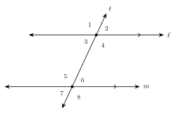

# Unit 1 Summary {.unnumbered}

:::{.guided-notes-link}
[Printable Unit 1 Summary](/guided_notes/Unit_1/Unit_1_Summary.html){target="_blank"} (a reference sheet to print and keep)
:::

## 1.1 - Points, Lines, Segments, and Angles

* A **point** is an exact location. A **line** goes on forever both ways. A **plane** is a flat surface that goes on forever.
* **Segment** $\overline{AB}$: two endpoints. **Ray** $\overrightarrow{AB}$: starts at $A$, goes on forever. **Line** $\overleftrightarrow{AB}$. **Length** $AB$ is a number.
* $\overrightarrow{AB}$ and $\overrightarrow{BA}$ are different rays. The first letter is the endpoint.
* An **angle** has two sides and a vertex. Name it $\angle ABC$ with the vertex in the middle. Write the measure as $m\angle ABC$.
* **Acute**: less than $90^\circ$. **Right**: $90^\circ$. **Obtuse**: between $90^\circ$ and $180^\circ$. **Straight**: $180^\circ$.
* Trust what is **told** and what is **marked**: square marks, tick marks, arrows. Do not trust how a figure looks.

{width=300px fig-align="center"}

**Example:** Clock hands at 4:00: $4 \cdot 30^\circ = 120^\circ$, obtuse.

## 1.2 - Segment and Angle Addition

* Length on a number line: $AB = |a - b|$. Length is never negative.
* **Segment addition**: if $B$ is between $A$ and $C$, then $AB + BC = AC$.
* **Congruent** ($\cong$) is for figures. $=$ is for numbers. $\overline{AB} \cong \overline{CD}$ means $AB = CD$.
* A **midpoint** makes two congruent segments. A **segment bisector** goes through the midpoint.
* **Angle addition**: if $D$ is inside $\angle ABC$, then $m\angle ABD + m\angle DBC = m\angle ABC$. An **angle bisector** makes two congruent angles.
* **Protractor**: put one side on a $0$. Read the scale that starts at that $0$.

{width=300px fig-align="center"}

**Example:** $AB = 2x + 3$, $BC = x - 1$, $AC = 17$. $3x + 2 = 17$, so $x = 5$, $AB = 13$, $BC = 4$.

## 1.3 - Complementary, Supplementary, and Vertical Angles

* **Complementary** angles add to $90^\circ$. **Supplementary** angles add to $180^\circ$. They do not have to touch.
* Complement of $x^\circ$: $(90 - x)^\circ$. Supplement of $x^\circ$: $(180 - x)^\circ$.
* **Adjacent** angles share a vertex and a side and do not overlap. A **linear pair** is adjacent with outside sides that are opposite rays. A linear pair is supplementary.
* **Vertical angles** are across from each other. They are equal.
* To solve for $x$: name the pair, then write angle $+$ angle $= 90$ (complementary), $= 180$ (supplementary or linear pair), or angle $=$ angle (vertical).

{width=300px fig-align="center"}

**Example:** Vertical angles $(4x - 10)^\circ$ and $(2x + 30)^\circ$. $4x - 10 = 2x + 30$, so $x = 20$ and each angle is $70^\circ$.

## 1.4 - Parallel Lines and Transversals

* **Parallel** ($\parallel$): same plane, never meet. **Perpendicular** ($\perp$): right angles. **Skew**: not in one plane, never meet.
* A **transversal** crosses two lines and makes 8 angles. Pairs: corresponding, alternate interior, alternate exterior, same-side interior.
* If the lines are parallel: corresponding, alternate interior, and alternate exterior angles are **equal**. Same-side interior angles are **supplementary**.
* The rules work backward. Equal corresponding or alternate angles, or same-side interior angles that add to $180^\circ$, show the lines are parallel.
* On a grid, parallel lines have the same slope.

{width=300px fig-align="center"}

**Example:** $\ell \parallel m$. Corresponding angles $(4x + 6)^\circ$ and $(6x - 24)^\circ$. $x = 15$, each angle $66^\circ$.

## 1.5 - Angles in Triangles and Polygons

* The angles of a triangle add to $180^\circ$.
* By sides: **scalene**, **isosceles** (two equal), **equilateral** (three equal). By angles: acute, right, obtuse, equiangular. Base angles of an isosceles triangle are equal.
* An **exterior angle** of a triangle equals the sum of the two remote interior angles.
* A polygon with $n$ sides: angle sum $(n - 2) \cdot 180^\circ$. Exterior angles of a convex polygon add to $360^\circ$.
* **Regular** polygon: each exterior angle is $\dfrac{360}{n}$ and each interior angle is $180$ minus that.

{width=300px fig-align="center"}

**Example:** Regular pentagon: $(5 - 2) \cdot 180 = 540$, and $540 \div 5 = 108^\circ$.

