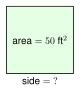
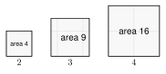
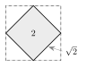

# 2.1 - Square Roots and Simplifying Radicals {.unnumbered}

{width=260px fig-align="center"}

A gardener has a square flower bed. The bed covers 50 square feet. How long is each side?

You need a number that gives 50 when you multiply it by itself. That number is not a whole number. It is a **square root**. In this lesson you learn to find square roots, estimate them, and write them in the simplest way. You will use them in every lesson of this unit.

:::{.objectives}
- [ ] I can find square roots of perfect squares.
- [ ] I can estimate a square root and find it with a calculator.
- [ ] I can simplify a square root.
- [ ] I can multiply and add square roots, and rationalize a simple denominator.
:::

:::{.vocab}
,
,
,
,
,

:::

:::{.guided-notes-link}
[Printable Guided Notes for this lesson](/guided_notes/Unit_2/2.1_Square_Roots_and_Simplifying_Radicals.html){target="_blank"} (fill-in notes to print and write on)
:::



1. Find $9^2$ and $13^2$.

2. Write 36 as a product of prime numbers.

3. Solve $4x - 7 = 21$.



### 2.1.1 - Perfect Squares and Square Roots

A square tile is 3 inches on each side. Its area is $3 \times 3 = 9$ square inches. The number 9 is a **perfect square**. A perfect square is the square of a whole number.

Now go backward. A square has area 9 square inches. How long is its side? It is 3 inches. We say 3 is the **square root** of 9, and we write $\sqrt{9} = 3$. The symbol $\sqrt{\ \ }$ is the **radical** sign. The number under it is the **radicand**.

{width=420px fig-align="center"}

Here are the perfect squares you should know. Learn them. You will see them all unit long.

| $n$ | 1 | 2 | 3 | 4 | 5 | 6 | 7 | 8 | 9 | 10 | 11 | 12 | 13 | 14 | 15 |
|:--|--|--|--|--|--|--|--|--|--|--|--|--|--|--|--|
| $n^2$ | 1 | 4 | 9 | 16 | 25 | 36 | 49 | 64 | 81 | 100 | 121 | 144 | 169 | 196 | 225 |

:::{.remember title="The positive root"}
$\sqrt{49} = 7$. We do not write $-7$. Both $7 \cdot 7$ and $(-7) \cdot (-7)$ equal 49, but the radical sign asks for the positive root only.
:::

***

**Example 1:** Find each square root.

a. $\sqrt{64}$. Think: what number times itself is 64? $8 \cdot 8 = 64$, so $\sqrt{64} = 8$.

b. $\sqrt{144} = 12$, because $12 \cdot 12 = 144$.

c. A square tile has area 81 square inches. Its side length is $\sqrt{81} = 9$ inches.

:::{.you-try-m title="Find each square root."}
a. $\sqrt{121}$

b. $\sqrt{225}$
:::

:::{.answer title="Answer"}
a. $\sqrt{121} = 11$

b. $\sqrt{225} = 15$
:::

Most numbers are not perfect squares. Look at this tilted square on a grid. Its corners sit on the grid points. Cut off the four small triangles and the area is 2 square units. So the side length is $\sqrt{2}$. No whole number times itself gives 2.

{width=260px fig-align="center"}

### 2.1.2 - Estimating Square Roots

The area of the garden is 50 square feet, and 50 is not a perfect square. But $49 < 50 < 64$, so $7 < \sqrt{50} < 8$. The side is a little more than 7 feet.

To decide if the root is closer to 7 or to 8, test the middle, $7.5$. Since $7.5^2 = 56.25$, a radicand less than $56.25$ has a root closer to 7.

{width=420px fig-align="center"}

***

**Example 3:** Estimate $\sqrt{50}$. Then use a calculator and round to the nearest tenth.

$7^2 = 49$ and $8^2 = 64$. So $\sqrt{50}$ is between 7 and 8.

Test the middle: $7.5^2 = 56.25$. Since $50 < 56.25$, $\sqrt{50}$ is closer to 7.

Calculator: $\sqrt{50} \approx 7.071$. To the nearest tenth, $\sqrt{50} \approx 7.1$.

:::{.you-try title="Estimate $\\sqrt{45}$. Then round it to the nearest tenth with a calculator."}
$6^2 = 36$ and $7^2 = 49$, so $\sqrt{45}$ is between 6 and 7. Since $6.5^2 = 42.25$ and $45 > 42.25$, it is closer to 7. Calculator: $\sqrt{45} \approx 6.7$.
:::

:::{.gotcha title="Not half"}
$\sqrt{40}$ is not $40 \div 2$. Square roots are much smaller than the number. $6^2 = 36$ and $7^2 = 49$, so $\sqrt{40}$ is a little more than 6.
:::

### 2.1.3 - Simplifying Square Roots

The garden side $\sqrt{50}$ can be written a shorter way. $50 = 25 \cdot 2$, and 25 is a perfect square. So $\sqrt{50} = \sqrt{25} \cdot \sqrt{2} = 5\sqrt{2}$.

The rule: $\sqrt{a \cdot b} = \sqrt{a} \cdot \sqrt{b}$ for $a$ and $b$ that are 0 or more. A radical is **simplified** when the radicand has no perfect square factor except 1. We usually give answers in this form. We call it the exact answer.

***

**Example 5:** Simplify $\sqrt{72}$ two ways.

Method 1: perfect square factor. $72 = 36 \cdot 2$.

$$
\sqrt{72} = \sqrt{36} \cdot \sqrt{2} = 6\sqrt{2}
$$

Method 2: prime factors. $72 = 2 \cdot 2 \cdot 2 \cdot 3 \cdot 3$. Circle the pairs: $(2 \cdot 2)$ and $(3 \cdot 3)$. One 2 is left over.

$$
\sqrt{72} = 2 \cdot 3 \cdot \sqrt{2} = 6\sqrt{2}
$$

***

**Example 6:** Simplify each square root.

a. $\sqrt{48}$. The largest perfect square factor is 16. $\sqrt{48} = \sqrt{16} \cdot \sqrt{3} = 4\sqrt{3}$.

b. $\sqrt{180}$. Prime factors: $180 = 2 \cdot 2 \cdot 3 \cdot 3 \cdot 5$. The pairs give $2 \cdot 3 = 6$, and 5 is left over. So $\sqrt{180} = 6\sqrt{5}$.

c. $\sqrt{30}$. The factors of 30 are 1, 2, 3, 5, 6, 10, 15, 30. None of them is a perfect square except 1. So $\sqrt{30}$ is already simplified.

:::{.you-try-m title="Simplify each square root."}
a. $\sqrt{98}$

b. $\sqrt{150}$
:::

:::{.answer title="Answer"}
a. $\sqrt{98} = \sqrt{49} \cdot \sqrt{2} = 7\sqrt{2}$

b. $\sqrt{150} = \sqrt{25} \cdot \sqrt{6} = 5\sqrt{6}$
:::

:::{.real-world title="Check the garden"}
The side of the garden is $\sqrt{50} = 5\sqrt{2}$ feet. That is about $5 \cdot 1.414 = 7.07$ feet, which agrees with the estimate between 7 and 8.
:::

:::{.remember title="A number in front"}
A number in front of a radical means multiply. $5\sqrt{2}$ is $5 \cdot \sqrt{2}$. To simplify $3\sqrt{8}$, first simplify $\sqrt{8} = 2\sqrt{2}$. Then multiply: $3 \cdot 2\sqrt{2} = 6\sqrt{2}$.
:::

### 2.1.4 - Multiplying, Adding, and Rationalizing

**Multiply** radicals by multiplying the numbers in front and multiplying the radicands: $\sqrt{3} \cdot \sqrt{12} = \sqrt{36} = 6$. Then simplify.

**Add** radicals only when the radicands are the same. These are **like radicals**, like $3x + 5x = 8x$. So $3\sqrt{2} + 5\sqrt{2} = 8\sqrt{2}$. If the radicands differ, simplify first. You may find they match.

**Rationalize**: a simplified answer has no radical in the denominator. Multiply the top and bottom by that radical. In Unit 6 we need this step often.

***

**Example 8:** Multiply and simplify: $2\sqrt{3} \cdot 5\sqrt{6}$.

Numbers in front: $2 \cdot 5 = 10$. Radicands: $\sqrt{3} \cdot \sqrt{6} = \sqrt{18}$.

$\sqrt{18} = \sqrt{9} \cdot \sqrt{2} = 3\sqrt{2}$.

$$
2\sqrt{3} \cdot 5\sqrt{6} = 10 \cdot 3\sqrt{2} = 30\sqrt{2}
$$

***

**Example 9:** Add: $\sqrt{8} + \sqrt{18}$.

The radicands differ, so simplify first. $\sqrt{8} = 2\sqrt{2}$ and $\sqrt{18} = 3\sqrt{2}$.

Now they are like radicals: $2\sqrt{2} + 3\sqrt{2} = 5\sqrt{2}$.

***

**Example 10:** Rationalize the denominator: $\dfrac{6}{\sqrt{2}}$.

$$
\dfrac{6}{\sqrt{2}} \cdot \dfrac{\sqrt{2}}{\sqrt{2}} = \dfrac{6\sqrt{2}}{2} = 3\sqrt{2}
$$

We multiplied by $\dfrac{\sqrt{2}}{\sqrt{2}}$, which equals 1, so the value did not change.

:::{.you-try-m title="Do each one."}
a. $\sqrt{2} \cdot \sqrt{14}$

b. $4\sqrt{5} + 2\sqrt{5}$

c. $\dfrac{9}{\sqrt{3}}$
:::

:::{.answer title="Answer"}
a. $\sqrt{28} = 2\sqrt{7}$

b. $6\sqrt{5}$

c. $\dfrac{9\sqrt{3}}{3} = 3\sqrt{3}$
:::

:::{.gotcha title="Error analysis: Jamal's mistake"}
Jamal writes $\sqrt{9 + 16} = \sqrt{9} + \sqrt{16} = 3 + 4 = 7$.

Find his mistake. First add: $9 + 16 = 25$, and $\sqrt{25} = 5$. The rule $\sqrt{a \cdot b} = \sqrt{a} \cdot \sqrt{b}$ works for **multiplying**. It does **not** work for adding. $\sqrt{9+16}$ is not $\sqrt{9} + \sqrt{16}$.
:::



**Find each square root.**

1. $\sqrt{25}$

2. $\sqrt{100}$

3. $\sqrt{169}$

4. $\sqrt{196}$

5. $\sqrt{\dfrac{49}{64}}$

6. $\sqrt{400}$

***

**Squares and square roots in shapes.**

7. A square patio has area 400 square feet. Mohammed wants to walk along one side. How long is one side?

8. A square has area 169 square centimeters. Find its perimeter.

9. Solve $x^2 = 81$. How many answers does the equation have? Which one could be a side length?

***

**Estimate. Name the two whole numbers each root is between. Then use a calculator and round to the nearest tenth.**

10. $\sqrt{20}$

11. $\sqrt{70}$

12. $\sqrt{115}$

13. $\sqrt{3}$

***

**Real problems. Round to the nearest tenth.**

14. A square sign has area 30 square feet. Find the length of one side.

15. Fatima says $\sqrt{40}$ is about 20 because $40 \div 2 = 20$. Use perfect squares to show why she is wrong.

***

**Simplify each square root.**

16. $\sqrt{8}$

17. $\sqrt{12}$

18. $\sqrt{18}$

19. $\sqrt{20}$

20. $\sqrt{27}$

21. $\sqrt{32}$

22. $\sqrt{54}$

23. $\sqrt{63}$

24. $\sqrt{80}$

25. $3\sqrt{12}$

26. $\sqrt{300}$ (use prime factors)

27. $\sqrt{125}$

***

**Multiply, add, or rationalize. Simplify every answer.**

28. $\sqrt{5} \cdot \sqrt{20}$

29. $\sqrt{6} \cdot \sqrt{8}$

30. $3\sqrt{2} \cdot 4\sqrt{10}$

31. $2\sqrt{7} + 6\sqrt{7}$

32. $\sqrt{12} + \sqrt{27}$

33. $5\sqrt{8} - \sqrt{2}$

34. $\dfrac{10}{\sqrt{5}}$

35. $\dfrac{4}{\sqrt{6}}$

***

**Find the mistake.**

36. Kofi writes $\sqrt{18} + \sqrt{2} = \sqrt{20} = 2\sqrt{5}$. What is wrong? What is the correct answer?

***

**Test practice**

37. A square garden has an area of 147 square feet. Lucía wants the exact length of one side of the garden. Which answer is correct?

    A. $7\sqrt{3}$ feet\
    B. $3\sqrt{7}$ feet\
    C. $21\sqrt{7}$ feet\
    D. $73.5$ feet

38. Which expression is the product $3\sqrt{5} \cdot 2\sqrt{10}$ written in simplest form?

    A. $6\sqrt{15}$\
    B. $30\sqrt{2}$\
    C. $6\sqrt{50}$\
    D. $30\sqrt{5}$

***

**Challenge**

39. Show that $\sqrt{8} + \sqrt{18} = \sqrt{50}$.

40. One square has area 72 and another has area 18. How many times as long is the side of the larger square?
