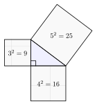
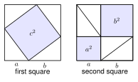

# 2.2 - The Pythagorean Theorem and Its Converse {.unnumbered}

A builder wants a square corner for a new room. She marks 3 feet along one wall and 4 feet along the other wall. Then she measures between the two marks. If the distance is exactly 5 feet, the corner is square.

Why does this work? It works because of a rule about right triangles, the **Pythagorean theorem**. It is the most useful rule in this book. In this lesson you learn the rule and how to use it in both directions.

:::{.objectives}
- [ ] I can name the legs and the hypotenuse of a right triangle.
- [ ] I can use the Pythagorean theorem to find a missing side.
- [ ] I can recognize Pythagorean triples.
- [ ] I can decide if a triangle is right, acute, or obtuse from its side lengths.
:::

:::{.vocab}
,
,
,
,
,

:::

:::{.guided-notes-link}
[Printable Guided Notes for this lesson](/guided_notes/Unit_2/2.2_The_Pythagorean_Theorem_and_Its_Converse.html){target="_blank"} (fill-in notes to print and write on)
:::



1. Simplify $\sqrt{75}$.

2. Find $8^2 + 15^2$.

3. Solve $x^2 + 36 = 100$.



### 2.2.1 - Parts of a Right Triangle

A right triangle has one right angle. The two sides that make the right angle are the **legs**. The side across from the right angle is the **hypotenuse**. The hypotenuse is always the longest side.

The legs can be turned any way. The hypotenuse is still the side that does not touch the right angle.

{width=300px fig-align="center"}

***

**Example 1:** Name the legs and the hypotenuse of $\triangle PQR$. The right angle is at $Q$.

{width=280px fig-align="center"}

The legs touch the right angle. They are $\overline{PQ}$ and $\overline{QR}$, so the legs are $\overline{PQ}$ and $\overline{QR}$.

The hypotenuse is across from $Q$. It is $\overline{PR}$.

:::{.you-try title="Use the triangle in Example 1. Which side is the longest? How do you know?"}
$\overline{PR}$ is the longest because it is the hypotenuse.
:::

### 2.2.2 - The Pythagorean Theorem

Look at a right triangle with legs 3 and 4. Build a square on each side. The areas are $3^2 = 9$, $4^2 = 16$, and the big square has area 25. Notice that $9 + 16 = 25$.

This is true for every right triangle. If the legs are $a$ and $b$ and the hypotenuse is $c$, then $a^2 + b^2 = c^2$.

{width=360px fig-align="center"}

{width=460px fig-align="center"}

:::{.think title="Why does it work?"}
Take two big squares with the same side length $a + b$. In each one, place four copies of the same right triangle.

In the first square, the space left over is one tilted square with area $c^2$. In the second square, the space left over is two squares with areas $a^2$ and $b^2$.

Both big squares have the same area. Both have four triangles. So what is left over must match: $c^2 = a^2 + b^2$.
:::

### 2.2.3 - Finding a Missing Side

Write the theorem. Put in the two sides you know. Solve for the third. The hypotenuse $c$ is always alone on one side of the equation.

Leave an exact answer as a simplified radical (Lesson 2.1). Then give a decimal when the problem asks.

***

**Example 3:** Find the hypotenuse of a right triangle with legs 5 and 7. Give the exact answer and round to the nearest tenth.

$$
5^2 + 7^2 = c^2
$$

$$
25 + 49 = c^2 \quad\text{so}\quad c^2 = 74
$$

$c = \sqrt{74}$. Since $74 = 2 \cdot 37$, it does not simplify. $c \approx 8.6$.

***

**Example 4:** A right triangle has hypotenuse 12 and one leg 8. Find the other leg. Give the exact answer and round to the nearest tenth.

$$
8^2 + b^2 = 12^2
$$

$$
64 + b^2 = 144 \quad\text{so}\quad b^2 = 80
$$

$b = \sqrt{80} = \sqrt{16} \cdot \sqrt{5} = 4\sqrt{5} \approx 8.9$.

{width=260px fig-align="center"}

***

**Example 5:** The legs of a right triangle are $x$ and $x + 7$. The hypotenuse is 13. Find $x$.

$$
x^2 + (x + 7)^2 = 13^2
$$

$$
x^2 + x^2 + 14x + 49 = 169 \quad\text{so}\quad 2x^2 + 14x - 120 = 0
$$

Divide by 2: $x^2 + 7x - 60 = 0$. Factor: $(x + 12)(x - 5) = 0$. So $x = 5$ or $x = -12$.

A length cannot be negative. The legs are 5 and 12. Check: $25 + 144 = 169$.

:::{.you-try-m title="Round to the nearest tenth. Give the exact answer too."}
a. Find the hypotenuse when the legs are 4 and 9.

b. Find the other leg when the hypotenuse is 11 and one leg is 6.
:::

:::{.answer title="Answer"}
a. $c = \sqrt{16 + 81} = \sqrt{97} \approx 9.8$

b. $b = \sqrt{121 - 36} = \sqrt{85} \approx 9.2$
:::

### 2.2.4 - Pythagorean Triples

Some right triangles have whole number sides. Three whole numbers $a$, $b$, $c$ with $a^2 + b^2 = c^2$ form a **Pythagorean triple**. The triangle with sides 3, 4, 5 is the best known one.

Multiply every number of a triple by the same number and you get another triple. 3-4-5 times 2 is 6-8-10. Times 3 is 9-12-15.

***

**Example 7:** Two legs of a right triangle are 15 and 36. Find the hypotenuse.

Is it a multiple of a triple? $15 = 3 \cdot 5$ and $36 = 3 \cdot 12$. So it is $3 \cdot (5, 12, 13)$.

The hypotenuse is $3 \cdot 13 = 39$. Check: $225 + 1296 = 1521 = 39^2$.

:::{.you-try title="A right triangle has hypotenuse 25 and one leg 15. Find the other leg without a calculator."}
$25 = 5 \cdot 5$ and $15 = 5 \cdot 3$. It is $5 \cdot (3, 4, 5)$. The other leg is $5 \cdot 4 = 20$.
:::

### 2.2.5 - The Converse: Is It a Right Triangle?

The **converse** of a rule turns it around. The theorem says: right triangle, then $a^2 + b^2 = c^2$. The converse says: if $a^2 + b^2 = c^2$, then the triangle is a right triangle. The converse is also true.

Let $c$ be the longest side. Compare $c^2$ with $a^2 + b^2$. Equal means right. If $a^2 + b^2$ is bigger, the triangle is acute. If $a^2 + b^2$ is smaller, it is obtuse.

First check that the three lengths can make a triangle. The **triangle inequality** says the two shorter sides must add to more than the longest side.

***

**Example 9:** Is a triangle with sides 7, 24, and 25 a right triangle?

The longest side is 25. Test: $7^2 + 24^2 = 49 + 576 = 625$.

$25^2 = 625$. They are equal, so the triangle is a right triangle.

***

**Example 10:** Sides 5, 6, and 8. Is the triangle right, acute, or obtuse?

First: $5 + 6 = 11 > 8$, so it is a triangle.

$5^2 + 6^2 = 25 + 36 = 61$ and $8^2 = 64$.

$61 < 64$, so the triangle is obtuse.

{width=300px fig-align="center"}

:::{.note title="Shows or suggests?"}
This triangle looks like a right triangle. The picture only **suggests** it. The numbers **show** the truth: the largest angle is about $93^\circ$, so it is obtuse. Always check with numbers, as in Example 7.
:::

***

**Example 11:** Can lengths 3, 4, and 9 make a triangle?

$3 + 4 = 7$, and $7 < 9$. The short sides are not longer than the long side.

So no, these lengths cannot make a triangle.

:::{.you-try-m title="Decide: right, acute, obtuse, or not a triangle."}
a. 9, 40, 41

b. 6, 7, 10
:::

:::{.answer title="Answer"}
a. $81 + 1600 = 1681 = 41^2$. Right.

b. $36 + 49 = 85 < 100$. Obtuse.
:::



**Use the figure.**

{width=260px fig-align="center"}

1. Name the legs of the triangle.

2. Name the hypotenuse.

***

**Find the hypotenuse. Give the exact answer, then round to the nearest tenth when it is not a whole number.**

3. Legs 8 and 15

4. Legs 7 and 9

5. Legs 2 and 6

***

**Find the missing leg. Give the exact answer, then round to the nearest tenth when it is not a whole number.**

6. Hypotenuse 20, leg 12

7. Hypotenuse 9, leg 4

8. Hypotenuse 25, leg 24

***

**Pythagorean triples. Find the missing side with no calculator.**

9. Legs 12 and 16. Find $c$.

10. Hypotenuse 34, leg 30. Find the other leg.

11. Hypotenuse 51, leg 45. Find the other leg.

***

**Solve for $x$. Show the equation.**

12. The legs are $x$ and $x + 1$. The hypotenuse is 5. Find $x$.

13. The legs are 6 and $x$. The hypotenuse is $x + 2$. Find $x$ and the hypotenuse.

***

**Right, acute, or obtuse? Check that it is a triangle first.**

14. 9, 12, 15

15. 8, 10, 12

16. 7, 8, 12

17. 20, 21, 29

18. Can 4, 5, and 10 make a triangle? Explain.

19. Can 6, 8, and 13 make a triangle? Explain.

***

**What does the figure show?**

{width=260px fig-align="center"}

20. The triangle is drawn to scale. Moses says it is a right triangle because it looks like one. Is he right? Use the side lengths to decide.

***

**Find the mistake.**

21. Samir tests the sides 6, 7, and 10. He writes $6^2 + 7^2 = 85$, and $85 \neq 100$, so "the triangle is acute." What is his mistake? What is the correct answer?

***

**Test practice**

22. A right triangle has legs of length 9 inches and 12 inches. Esperanza wants to find the length of the hypotenuse. Which is the length of the hypotenuse?

    A. 7.5 inches\
    B. 15 inches\
    C. 21 inches\
    D. 225 inches

23. The side lengths of a triangle are 11 centimeters, 12 centimeters, and 16 centimeters. Which statement about the triangle is true?

    A. It is a right triangle.\
    B. It is an acute triangle.\
    C. It is an obtuse triangle.\
    D. It is not a triangle.

***

**Challenge**

24. A square has side 6. Find its diagonal. Then show that the diagonal of any square with side $s$ is $s\sqrt{2}$.

25. For whole numbers $m > n$, the numbers $m^2 - n^2$, $2mn$, and $m^2 + n^2$ form a Pythagorean triple. Find the triple when $m = 5$ and $n = 2$. Check it.
