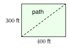
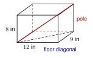

# 2.3 - The Pythagorean Theorem in the Real World {.unnumbered}

A ladder leans on a wall. A TV is sold by the length of its screen from corner to corner. A builder checks a corner with a tape measure. All of these are right triangles in disguise.

In this lesson you use the Pythagorean theorem on real problems. Every time, do the same three things. **Draw** and label the right triangle first. **Solve** with the theorem. **Answer** in a sentence with units.

:::{.objectives}
- [ ] I can square a corner with a 3-4-5 triangle and check a rectangle with its diagonal.
- [ ] I can solve ladder, screen, and shortcut problems.
- [ ] I can solve a two-step problem in a box.
- [ ] I can draw and label a right triangle first, then answer in a sentence with units.
:::

:::{.vocab}

:::

:::{.guided-notes-link}
[Printable Guided Notes for this lesson](/guided_notes/Unit_2/2.3_The_Pythagorean_Theorem_in_the_Real_World.html){target="_blank"} (fill-in notes to print and write on)
:::



1. Find the hypotenuse of a right triangle with legs 6 and 8.

2. Simplify $\sqrt{52}$.

3. Solve $3x + 2 = 4(x - 1)$.



### 2.3.1 - Squaring a Corner

Builders need square corners for decks, floors, and walls. They use the 3-4-5 triangle. Measure 3 feet along one edge and 4 feet along the other. If the marks are exactly 5 feet apart, the corner is a right angle. For a big slab they use 6-8-10 or 9-12-15, because longer measures are more exact.

A rectangle has four right angles. A **diagonal** is a segment that joins two corners that are not next to each other. If the diagonal is the right length, the corner is square.

***

**Example 1:** A deck is 10 ft by 24 ft. Kofi measures the diagonal and gets 26 ft 2 in. Is the deck square?

{width=300px fig-align="center"}

Draw the rectangle. The diagonal and two sides make a right triangle.

The diagonal should be $c = \sqrt{10^2 + 24^2} = \sqrt{676} = 26$ ft.

Kofi measured 26 ft 2 in, which is 2 inches too long. The deck is **not** square. The corner needs to be pushed in.

:::{.you-try title="A slab is 15 ft by 20 ft. How long should its diagonal be if the slab is square?"}
$c = \sqrt{15^2 + 20^2} = \sqrt{625} = 25$ ft. (It is $5 \cdot (3, 4, 5)$.)
:::

### 2.3.2 - Ladders

A ladder against a wall makes a right triangle. The wall is one leg, the ground is the other leg, and the ladder is the hypotenuse. The base of the ladder should not be too close to the wall. The **4-to-1 rule**: the base should be 1 foot from the wall for every 4 feet of height.

***

**Example 3:** A 20 ft ladder has its base 5 ft from a wall. How high does it reach? Does it follow the 4-to-1 rule? Round to the nearest tenth.

{width=200px fig-align="center"}

$$
5^2 + h^2 = 20^2 \quad\text{so}\quad h^2 = 375
$$

$h = \sqrt{375} = 5\sqrt{15} \approx 19.4$ ft.

Rule: $19.4 \div 4 \approx 4.9$. The base needs to be at least 4.9 ft out. It is 5 ft out, so the ladder follows the rule.

:::{.you-try title="A 24 ft ladder has its base 6 ft from a wall. How high does it reach? Round to the nearest tenth."}
$h = \sqrt{24^2 - 6^2} = \sqrt{540} = 6\sqrt{15} \approx 23.2$ ft.
:::

### 2.3.3 - Screens

TVs, phones, and monitors are measured on the **diagonal**, from one corner to the opposite corner. A "55 inch TV" has a screen diagonal of 55 inches. The width and the height are the legs.

***

**Example 5:** A TV screen is 40 in wide and 22.5 in tall. What is its screen size? Round to the nearest tenth.

{width=280px fig-align="center"}

$$
d^2 = 40^2 + 22.5^2 = 1600 + 506.25 = 2106.25
$$

$d = \sqrt{2106.25} \approx 45.9$. It is a 45.9 inch screen (sold as a 46 inch TV).

:::{.you-try title="A monitor has a 24 in diagonal and is 12 in tall. How wide is it? Round to the nearest tenth."}
$w = \sqrt{24^2 - 12^2} = \sqrt{432} = 12\sqrt{3} \approx 20.8$ in.
:::

### 2.3.4 - Shortcuts and Distances

A straight path is the shortest path. When a path goes across a rectangle, it is the diagonal. Compare it with walking along the sides.

***

**Example 7:** A park is 300 ft by 400 ft. Moses walks from one corner to the opposite corner. How much shorter is the diagonal path than walking along two sides?

{width=260px fig-align="center"}

Along two sides: $300 + 400 = 700$ ft.

Diagonal: $\sqrt{300^2 + 400^2} = \sqrt{250000} = 500$ ft. (It is $100 \cdot (3, 4, 5)$.)

$700 - 500 = 200$. The diagonal path is 200 ft shorter.

***

**Example 8:** A baseball diamond is a square with 90 ft between bases. How far is it from home plate to second base? Round to the nearest tenth.

Home to first and first to second are the legs. Home to second is the diagonal.

$d = \sqrt{90^2 + 90^2} = \sqrt{16200} = 90\sqrt{2} \approx 127.3$ ft.

:::{.you-try title="A ramp rises 3 ft over a ground distance of 36 ft. How long is the ramp? Round to the nearest tenth."}
$\sqrt{36^2 + 3^2} = \sqrt{1305} \approx 36.1$ ft.
:::

### 2.3.5 - Two Steps: Boxes

How long is the longest pole that fits in a box? It runs from one bottom corner to the opposite top corner. You need two right triangles. First find the diagonal of the floor. Then use that diagonal as a leg of a second right triangle.

***

**Example 10:** A box is 12 in long, 9 in wide, and 8 in tall. Find the longest pole that fits.

{width=300px fig-align="center"}

Step 1, the floor: $f = \sqrt{12^2 + 9^2} = \sqrt{225} = 15$ in.

Step 2, the pole: $p = \sqrt{15^2 + 8^2} = \sqrt{289} = 17$ in.

The longest pole is 17 in.

:::{.you-try title="A closet is 4 ft by 4 ft and 7 ft tall. How long is the longest rod that fits?"}
Floor: $\sqrt{16 + 16} = \sqrt{32}$. Rod: $\sqrt{32 + 49} = \sqrt{81} = 9$ ft.
:::



**Squaring corners.**

1. Hnin marks 6 ft along one edge of a slab and 8 ft along the other edge. How far apart should the marks be if the corner is square?

2. A frame is 5 ft by 12 ft. The diagonal measures 13 ft 1 in. Is the frame square? Explain.

3. Daniel builds a 9 ft by 12 ft platform. How long should each diagonal be?

4. A floor is 20 ft by 21 ft and its diagonal is 29 ft. Is the floor square? Show the check.

***

**Ladders. Round to the nearest tenth when needed.**

5. A 13 ft ladder has its base 5 ft from a wall. How high does it reach?

6. A 16 ft ladder has its base 4 ft from a wall. How high does it reach?

7. Ana needs to reach a gutter 20 ft up. By the 4-to-1 rule, how far from the wall should the base be? How long a ladder does she need? 

8. Ahmad's 10 ft ladder reaches 9 ft up the wall. How far is the base from the wall? Does it follow the 4-to-1 rule?

***

**Screens. Round to the nearest tenth when needed.**

9. A TV screen is 32 in wide and 18 in tall. What is the screen size?

10. A laptop screen has a diagonal of 15.6 in and a width of 13.6 in. How tall is it?

11. A tablet has a 10 in diagonal and is 6 in wide. How tall is it?

12. Thu says a TV that is 48 in wide and 27 in tall is a "55 inch" TV. Is she right? Explain.

***

**Shortcuts and distances. Round to the nearest tenth when needed.**

13. A field is 120 yd by 50 yd. Olena walks the diagonal. How many yards shorter is that than walking along two sides?

14. A wire runs from the top of a 15 ft pole to a point on the ground 8 ft from the bottom of the pole. How long is the wire?

15. A ramp rises 1.5 ft over a ground distance of 15 ft. How long is the ramp?

16. A hiker walks 5 miles west and then 12 miles south. How far is she from her start in a straight line?

***

**Two steps.**

17. A box is 3 ft by 4 ft by 12 ft. Find the longest pole that fits inside.

18. A room is 15 ft by 20 ft with a 12 ft ceiling. How long is the longest straight rod that fits in the room? Round to the nearest tenth.

***

**Find the mistake.**

19. Moses says: "A 15 ft ladder has its base 9 ft from the wall, so it reaches $15 - 9 = 6$ ft up." What is wrong? What is the correct height?

***

**Test practice**

20. Diego places the bottom of a 25 foot ladder 7 feet from the base of a vertical wall. The ladder touches the wall at a point $h$ feet above the ground. What is the value of $h$?

    A. 18\
    B. 24\
    C. 26\
    D. 32

21. A rectangular park is 240 yards long and 70 yards wide. Amira walks from one corner to the opposite corner along the diagonal path instead of walking along the two sides. How many yards shorter is the diagonal path than the path along the two sides?

    A. 40\
    B. 60\
    C. 70\
    D. 250

***

**Challenge**

22. A 10 ft ladder leans on a wall with its base 6 ft from the wall. The top slides down 1 ft. How far does the base move out? Round to the nearest tenth.
