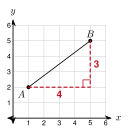
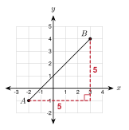
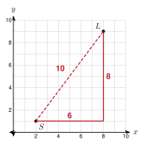

# 2.4 - Distance on the Coordinate Plane {.unnumbered}

A map app shows the school at one point and the library at another. Each square on the map is 1 mile. A car must follow the streets. A drone can fly in a straight line. Which trip is shorter, and by how much?

To answer, you need the distance between two points. In this lesson you find it with the Pythagorean theorem. Then you write the steps as one formula.

:::{.objectives}
- [ ] I can find the distance between two points on a horizontal or vertical line.
- [ ] I can find the distance between any two points with a right triangle.
- [ ] I can use the distance formula.
- [ ] I can use distance to compare points, check a triangle, and find a missing coordinate.
:::

:::{.vocab}
,

:::

:::{.guided-notes-link}
[Printable Guided Notes for this lesson](/guided_notes/Unit_2/2.4_Distance_on_the_Coordinate_Plane.html){target="_blank"} (fill-in notes to print and write on)
:::



1. Find the hypotenuse of a right triangle with legs 5 and 12.

2. Evaluate $(-2 - 4)^2 + (5 - 1)^2$.

3. Plot $A(-3, 2)$ and $B(4, 2)$. How many units apart are they?



### 2.4.1 - Horizontal and Vertical Distance

Points on the same horizontal line have the same $y$-coordinate. Count the units between them, or subtract the $x$-coordinates. The distance is never negative, so use the absolute value: $|x_2 - x_1|$.

Points on the same vertical line have the same $x$-coordinate. The distance is $|y_2 - y_1|$.

{width=300px fig-align="center"}

***

**Example 1:** Use the figure. Find $AB$ and $CD$.

$A(-3, 2)$ and $B(4, 2)$ have the same $y$. $AB = |4 - (-3)| = 7$.

$C(5, -4)$ and $D(5, 2)$ have the same $x$. $CD = |2 - (-4)| = 6$.

:::{.you-try-m title="Find each distance."}
a. $P(-5, -1)$ and $Q(3, -1)$

b. $R(-2, 6)$ and $S(-2, -3)$
:::

:::{.answer title="Answer"}
a. $|3 - (-5)| = 8$

b. $|6 - (-3)| = 9$
:::

### 2.4.2 - Slanted Distance: Draw a Right Triangle

Most pairs of points are not on a horizontal or vertical line. Draw a horizontal segment and a vertical segment to make a right triangle. The slanted segment is the hypotenuse. The legs are the horizontal change and the vertical change.

***

**Example 3:** Find the distance from $A(1, 2)$ to $B(5, 5)$.

{width=260px fig-align="center"}

Draw the right triangle with the right angle at $(5, 2)$.

Horizontal leg: $5 - 1 = 4$. Vertical leg: $5 - 2 = 3$.

$AB^2 = 4^2 + 3^2 = 25$, so $AB = 5$.

***

**Example 4:** Find the distance from $A(-2, -1)$ to $B(3, 4)$. Give the exact answer and round to the nearest tenth.

{width=260px fig-align="center"}

Horizontal leg: $3 - (-2) = 5$. Vertical leg: $4 - (-1) = 5$.

$AB^2 = 5^2 + 5^2 = 50$. $AB = \sqrt{50} = 5\sqrt{2} \approx 7.1$.

:::{.you-try title="Draw the right triangle. Find the distance from $P(-3, 4)$ to $Q(2, -8)$."}
Legs: $2 - (-3) = 5$ and $|-8 - 4| = 12$. $PQ = \sqrt{25 + 144} = 13$.
:::

### 2.4.3 - The Distance Formula

The steps in 2.4.2 are always the same. Subtract the $x$'s. Subtract the $y$'s. Square both. Add. Take the square root. The **distance formula** writes those steps with symbols.

:::{.gotcha title="Careful with negatives"}
Subtracting a negative number adds. For $x_1 = -4$ and $x_2 = 2$: $x_2 - x_1 = 2 - (-4) = 6$, not $-2$. Put the second point in parentheses.
:::

***

**Example 6:** Find the distance from $A(-4, 3)$ to $B(2, -5)$.

$$
d = \sqrt{(2 - (-4))^2 + (-5 - 3)^2} = \sqrt{6^2 + (-8)^2}
$$

$$
d = \sqrt{36 + 64} = \sqrt{100} = 10
$$

***

**Example 7:** Find the distance from $(1, -2)$ to $(-3, 4)$. Give the exact answer and round to the nearest tenth.

$$
d = \sqrt{(-3 - 1)^2 + (4 - (-2))^2} = \sqrt{16 + 36} = \sqrt{52}
$$

$\sqrt{52} = 2\sqrt{13} \approx 7.2$.

:::{.you-try title="Find the distance from $(2, -6)$ to $(-4, 1)$. Round to the nearest tenth."}
$d = \sqrt{(-4 - 2)^2 + (1 - (-6))^2} = \sqrt{36 + 49} = \sqrt{85} \approx 9.2$
:::

### 2.4.4 - Using Distance

Distance helps you decide things. You can find which point is closer, check if a triangle has two equal sides, or find a missing coordinate. When a coordinate is missing, write the distance formula, square both sides, and solve. There can be two answers.

***

**Example 9:** Which point is closer to $M(1, 1)$: $P(4, 5)$ or $Q(-5, 4)$?

$MP = \sqrt{3^2 + 4^2} = 5$.

$MQ = \sqrt{(-6)^2 + 3^2} = \sqrt{45} \approx 6.7$.

$5 < 6.7$, so $P$ is closer.

***

**Example 10:** Is the triangle with $A(1, 1)$, $B(7, 1)$, and $C(4, 5)$ isosceles?

$AB = |7 - 1| = 6$.

$AC = \sqrt{3^2 + 4^2} = 5$ and $BC = \sqrt{(-3)^2 + 4^2} = 5$.

Because $AC = BC$, triangle $ABC$ is isosceles.

***

**Example 11:** The point $(1, k)$ is 5 units from $(4, 2)$. Find $k$.

$$
\sqrt{(1 - 4)^2 + (k - 2)^2} = 5 \quad\text{so}\quad 9 + (k - 2)^2 = 25
$$

$(k - 2)^2 = 16$, so $k - 2 = 4$ or $k - 2 = -4$. Then $k = 6$ or $k = -2$.

There are two points: $(1, 6)$ and $(1, -2)$.

***

**Example 12:** A town map has 1 mile for each grid unit. The school is at $S(2, 1)$ and the library is at $L(8, 9)$. A car follows the streets. A drone flies straight. How much shorter is the drone's trip?

{width=280px fig-align="center"}

Streets: $6$ miles east and $8$ miles north is $6 + 8 = 14$ miles.

Drone: $\sqrt{6^2 + 8^2} = 10$ miles.

The drone's trip is $14 - 10 = 4$ miles shorter.

:::{.you-try title="The point $(k, 2)$ is 10 units from $(-2, -4)$. Find $k$."}
$(k + 2)^2 + 36 = 100$, so $(k + 2)^2 = 64$ and $k + 2 = \pm 8$. Then $k = 6$ or $k = -10$.
:::



**Find each distance. Same row or column.**

1. $A(-7, 3)$ and $B(2, 3)$

2. $C(4, -6)$ and $D(4, 5)$

3. $E(-8, -2)$ and $F(-1, -2)$

4. $G(0, -9)$ and $H(0, -1)$

***

**Draw the right triangle on graph paper. Give the exact distance, and round to the nearest tenth when it is not a whole number.**

5. $(0, 0)$ and $(5, 12)$

6. $(-2, 3)$ and $(4, -5)$

7. $(0, 0)$ and $(7, 24)$

8. $(-3, -1)$ and $(2, 3)$

9. $(3, 5)$ and $(-2, -4)$

***

**Use the distance formula. Give the exact distance and round to the nearest tenth when needed.**

10. $(-1, 6)$ and $(3, -2)$

11. $(5, 1)$ and $(-3, -2)$

12. $(-6, 0)$ and $(0, -6)$

13. $(3, -7)$ and $(-2, 5)$

***

**Use distance to decide.**

14. Which point is closer to the origin, $A(3, -4)$ or $B(-2, 5)$? Round to the nearest tenth.

15. Is the triangle with $X(0, 0)$, $Y(8, 0)$, and $Z(4, 3)$ isosceles? Show the lengths.

16. The point $(x, 1)$ is 5 units from $(2, 5)$. Find $x$.

***

**Real problems. Each grid unit is 1 mile.**

17. The park is at $(-3, -2)$ and the mall is at $(5, 4)$. How long is a drone's straight trip? How long is the trip by streets?

18. A drone flies from $(1, 1)$ to $(13, 6)$. A car goes 12 miles east and 5 miles north. How many miles shorter is the drone's trip?

***

**Find the mistake.**

19. Mohammed says the distance from $(2, 3)$ to $(5, 7)$ is $(5 - 2) + (7 - 3) = 7$. What is wrong? What is the distance?

***

**Test practice**

20. On a coordinate grid, point $R$ is at $(-2, 6)$ and point $T$ is at $(10, -3)$. What is the distance, in units, from $R$ to $T$?

    A. 3\
    B. 15\
    C. 21\
    D. 225

21. Triangle $ABC$ has vertices $A(0, 1)$, $B(6, 1)$, and $C(3, 5)$. Which statement about the triangle is true?

    A. The triangle is equilateral.\
    B. The triangle is isosceles with two sides of length 5.\
    C. The triangle is scalene.\
    D. The triangle has a right angle at $C$.

***

**Challenge**

22. Find the point on the $x$-axis that is the same distance from $A(1, 3)$ and $B(5, -1)$.
