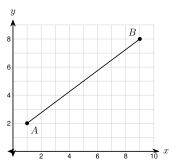
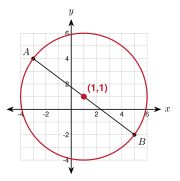

# 2.5 - Midpoint {.unnumbered}

Fatima lives at one point on the town map. Jamal lives at another. They want to meet at the point exactly halfway between their homes. Where is it?

The halfway point of a segment is its **midpoint**. You can find it by averaging the coordinates. This is one of the tools you will use again and again.

:::{.objectives}
- [ ] I can find the midpoint on a number line.
- [ ] I can use the midpoint formula.
- [ ] I can find a missing endpoint from the midpoint.
- [ ] I can use the midpoint to solve problems and to check a point.
:::

:::{.vocab}

:::

:::{.guided-notes-link}
[Printable Guided Notes for this lesson](/guided_notes/Unit_2/2.5_Midpoint.html){target="_blank"} (fill-in notes to print and write on)
:::



1. Find the average of 4 and 10.

2. Find the distance between $(0, 0)$ and $(6, 8)$.

3. Solve $\dfrac{x + 5}{2} = 4$.



### 2.5.1 - Midpoint on a Number Line

The number halfway between two numbers is their average. Add them and divide by 2.

What number is halfway between $-3$ and $9$? $(-3 + 9) \div 2 = 6 \div 2 = 3$. Check by distance: from $-3$ to $3$ is 6, and from $3$ to $9$ is 6.

{width=420px fig-align="center"}

***

**Example 1:** Find the number halfway between $-8$ and $-2$.

$\dfrac{-8 + (-2)}{2} = \dfrac{-10}{2} = -5$.

Check: the distance from $-8$ to $-5$ is 3, and from $-5$ to $-2$ is 3.

:::{.you-try title="Find the number halfway between $-7$ and $4$."}
$\dfrac{-7 + 4}{2} = \dfrac{-3}{2} = -1.5$
:::

### 2.5.2 - The Midpoint Formula

On the plane, the midpoint is halfway across and halfway up. So average the $x$-coordinates, and average the $y$-coordinates.

{width=300px fig-align="center"}

:::{.note title="Look at the picture"}
From $A(1, 2)$ to $B(9, 8)$ you go 8 right and 6 up. Half of that is 4 right and 3 up. $A$ plus that step is $(1 + 4, 2 + 3) = (5, 5)$. The formula gives the same point: $\left(\dfrac{1 + 9}{2}, \dfrac{2 + 8}{2}\right) = (5, 5)$.
:::

***

**Example 3:** Find the midpoint of $A(-2, 4)$ and $B(6, -2)$.

$$
M = \left( \dfrac{-2 + 6}{2},\ \dfrac{4 + (-2)}{2} \right) = \left( \dfrac{4}{2},\ \dfrac{2}{2} \right) = (2,\ 1)
$$

***

**Example 4:** Find the midpoint of $(1, -5)$ and $(-6, 2)$.

$$
M = \left( \dfrac{1 + (-6)}{2},\ \dfrac{-5 + 2}{2} \right) = \left( \dfrac{-5}{2},\ \dfrac{-3}{2} \right) = (-2.5,\ -1.5)
$$

:::{.you-try title="Find the midpoint of $(-7, 2)$ and $(3, -6)$."}
$\left(\dfrac{-7 + 3}{2}, \dfrac{2 + (-6)}{2}\right) = (-2, -2)$
:::

:::{.gotcha title="Error analysis: Amira's mistake"}
Amira finds the midpoint of $(2, 6)$ and $(8, 2)$. She writes $\left(\dfrac{8 - 2}{2}, \dfrac{6 - 2}{2}\right) = (3, 2)$.

She **subtracted**. The midpoint is an average, so add: $\left(\dfrac{2 + 8}{2}, \dfrac{6 + 2}{2}\right) = (5, 4)$. Check: $(3, 2)$ is not even between the two points.
:::

### 2.5.3 - Finding a Missing Endpoint

Sometimes you know the midpoint and one endpoint. Find the other endpoint. There are two ways.

***

**Example 6:** $M(3, 1)$ is the midpoint of $\overline{AB}$. $A$ is $(-1, 4)$. Find $B$.

Way 1. From $A$ to $M$: $x$ goes $3 - (-1) = 4$ and $y$ goes $1 - 4 = -3$. Take the same step from $M$: $B = (3 + 4,\ 1 + (-3)) = (7,\ -2)$.

Way 2. $\dfrac{-1 + x}{2} = 3$ gives $x = 7$. $\dfrac{4 + y}{2} = 1$ gives $y = -2$.

Both ways give $B(7, -2)$.

:::{.you-try title="$M(-2, 5)$ is the midpoint of $\\overline{PQ}$. $P$ is $(4, -1)$. Find $Q$."}
$\dfrac{4 + x}{2} = -2$ gives $x = -8$. $\dfrac{-1 + y}{2} = 5$ gives $y = 11$. $Q(-8, 11)$.
:::

### 2.5.4 - Using the Midpoint

The midpoint helps you find meeting places, the center of a circle, and it lets you check a claim. To prove that $M$ is the midpoint of $\overline{AB}$ by computation, show two things: $M$ is the **same distance** from $A$ and $B$, **and** $M$ is on the line through $A$ and $B$.

***

**Example 8:** Fatima lives at $(2, 3)$ and Jamal lives at $(10, 7)$. Each unit is 1 mile. Where do they meet halfway? How far does each walk? Round to the nearest tenth.

$M = \left(\dfrac{2 + 10}{2}, \dfrac{3 + 7}{2}\right) = (6, 5)$.

The distance between their homes is $\sqrt{8^2 + 4^2} = \sqrt{80}$. Each walks half: $\dfrac{\sqrt{80}}{2} = \sqrt{20} = 2\sqrt{5} \approx 4.5$ miles.

***

**Example 9:** The ends of a diameter of a circle are $(-3, 4)$ and $(5, -2)$. Find the center and the radius.

{width=260px fig-align="center"}

Center: $\left(\dfrac{-3 + 5}{2}, \dfrac{4 + (-2)}{2}\right) = (1, 1)$.

Diameter: $\sqrt{8^2 + 6^2} = 10$. Radius: $10 \div 2 = 5$.

***

**Example 10:** Is $M(2, 2)$ the midpoint of $A(-1, -2)$ and $B(5, 6)$? Is $N(3, 4)$ the midpoint of $A(0, 0)$ and $B(6, 0)$?

Part 1. $AM = \sqrt{3^2 + 4^2} = 5$ and $MB = \sqrt{3^2 + 4^2} = 5$. The slope of $\overline{AM}$ is $\dfrac{4}{3}$ and the slope of $\overline{MB}$ is $\dfrac{4}{3}$, so the three points are on one line.

Because $AM = MB$ and the points are collinear, $M$ is the midpoint.

Part 2. $AN = \sqrt{3^2 + 4^2} = 5$ and $NB = \sqrt{3^2 + 4^2} = 5$. The distances are equal, but $N$ is not on the line through $A$ and $B$. So $N$ is not the midpoint. Equal distances alone are not enough.

:::{.you-try title="The ends of a diameter are $(-5, 2)$ and $(7, -6)$. Find the center."}
$\left(\dfrac{-5 + 7}{2}, \dfrac{2 + (-6)}{2}\right) = (1, -2)$
:::



**Find the number halfway between each pair.**

1. 2 and 10

2. $-12$ and $-4$

3. $-5$ and $2$

4. $-1.5$ and $6.5$

***

**Find the midpoint of each segment.**

5. $(0, 0)$ and $(8, 6)$

6. $(-4, 7)$ and $(6, 1)$

7. $(3, -5)$ and $(-9, -1)$

8. $(-2, -6)$ and $(5, 4)$

9. $(0.5, 2)$ and $(3.5, -4)$

10. $(1, 1)$ and $(2, 2)$

***

**Find the missing endpoint.**

11. $M(2, 3)$ is the midpoint of $\overline{AB}$. $A$ is $(5, -1)$. Find $B$.

12. $M(-1, -4)$ is the midpoint of $\overline{CD}$. $C$ is $(0, 2)$. Find $D$.

13. $M(4, 0)$ is the midpoint of $\overline{EF}$. $F$ is $(-3, 6)$. Find $E$.

***

**Real problems.**

14. Diego lives at $(-4, 3)$ and Esperanza lives at $(8, -1)$. Each unit is 1 mile. Where is the point halfway between them? How far does each person walk to get there? Round to the nearest tenth.

15. A round pond has a diameter with ends at $(-6, 1)$ and $(4, -9)$. Find the center. Then find the radius, rounded to the nearest tenth.

***

**Check it with distance and slope.**

16. Is $N(2, 5)$ the midpoint of $P(-1, 1)$ and $Q(5, 9)$? Use the formula.

17. $A(0, 0)$, $B(10, 0)$, and $M(5, 12)$. Joseph says $M$ is the midpoint of $\overline{AB}$ because $AM = MB = 13$. Is he right? Explain.

***

**Find the mistake.**

18. Hnin finds the midpoint of $(-4, 2)$ and $(6, 8)$. She writes $\left(\dfrac{6 - 4}{2}, \dfrac{8 - 2}{2}\right) = (1, 3)$. Find her mistake. What is the correct midpoint?

***

**Test practice**

19. The endpoints of segment $AB$ are $A(-6, 4)$ and $B(2, -8)$. What are the coordinates of the midpoint of segment $AB$?

    A. $(-2, -2)$\
    B. $(-4, -6)$\
    C. $(4, -6)$\
    D. $(-8, 12)$

20. Point $M(1, -3)$ is the midpoint of segment $PQ$. Point $P$ has coordinates $(-5, 2)$. What are the coordinates of point $Q$?

    A. $(-2, -0.5)$\
    B. $(7, -8)$\
    C. $(-11, 7)$\
    D. $(-4, -1)$

***

**Challenge**

21. Triangle $ABC$ has $A(0, 0)$, $B(8, 2)$, and $C(2, 6)$. Find the midpoint $D$ of $\overline{AB}$ and the midpoint $E$ of $\overline{BC}$. Show that $DE$ is half as long as $AC$.
