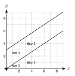
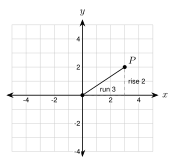
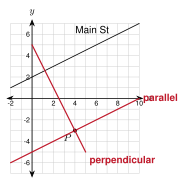

# 2.6 - Slope, Parallel Lines, and Perpendicular Lines {.unnumbered}

Look at a city map. Main Street runs at a slant. A new road must run side by side with it and never cross it. Another new road must cross it in a perfect square corner.

How can you tell, using only coordinates? The answer is in the **slope**. In this lesson you use slope to decide if lines are parallel or perpendicular, and to write equations for new lines.

:::{.objectives}
- [ ] I can find the slope of a line from two points and from an equation.
- [ ] I can use slope to decide if two lines are parallel, perpendicular, or neither.
- [ ] I can write the equation of a line through a point that is parallel or perpendicular to a given line.
:::

:::{.vocab}
,
,
,

:::

:::{.guided-notes-link}
[Printable Guided Notes for this lesson](/guided_notes/Unit_2/2.6_Slope_Parallel_Lines_and_Perpendicular_Lines.html){target="_blank"} (fill-in notes to print and write on)
:::



1. Find the slope of the line through $(1, 2)$ and $(5, -6)$.

2. Solve $2x + 3y = 6$ for $y$.

3. Solve $3 = -2(4) + b$.



### 2.6.1 - Slope Review

The **slope** of a line tells how steep it is. It is the rise over the run: the change in $y$ divided by the change in $x$. You learned slope in Algebra 1. We need it often in geometry, so here it is again.

***

**Example 1:** Find each slope. a. The line through $(-2, 5)$ and $(4, -1)$. b. The line $y = -\dfrac{3}{4}x + 2$. c. The line $y = 3$. d. The line $x = 4$.

a. $m = \dfrac{-1 - 5}{4 - (-2)} = \dfrac{-6}{6} = -1$.

b. The slope is the number in front of $x$: $-\dfrac{3}{4}$.

c. $y = 3$ is horizontal. The slope is 0.

d. $x = 4$ is vertical. The slope is undefined. (The run is 0, and you cannot divide by 0.)

:::{.you-try title="Find the slope of the line through $(-3, -4)$ and $(3, 0)$."}
$m = \dfrac{0 - (-4)}{3 - (-3)} = \dfrac{4}{6} = \dfrac{2}{3}$
:::

### 2.6.2 - Parallel Lines

**Parallel** lines stay the same distance apart. They never meet. In the picture both lines go up 2 for every 3 to the right. The steps match all along the lines. That is why they never meet.

{width=300px fig-align="center"}

***

**Example 3:** Is the line through $A(1, 2)$ and $B(4, 6)$ parallel to the line through $C(-2, -1)$ and $D(1, 3)$?

Slope of $\overline{AB}$: $\dfrac{6 - 2}{4 - 1} = \dfrac{4}{3}$.

Slope of $\overline{CD}$: $\dfrac{3 - (-1)}{1 - (-2)} = \dfrac{4}{3}$.

The slopes are equal. Is it the same line? The line through $A$ and $B$ at $x = -2$ has $y = -2$, not $-1$. So $C$ is not on it.

Because the slopes are equal and the lines are different, the lines are parallel.

:::{.you-try title="Are the lines $y = 3x - 2$ and $y = 3x + 5$ parallel? How do you know?"}
Yes. Both have slope 3 and the $y$-intercepts $-2$ and $5$ are different, so the lines are different.
:::

### 2.6.3 - Perpendicular Lines

**Perpendicular** lines meet at a right angle. Take a slope step with run 3 and rise 2. Turn the step $90^\circ$ counterclockwise. Now the run is $-2$ and the rise is 3. The new slope is $\dfrac{3}{-2} = -\dfrac{3}{2}$. The slope $\dfrac{2}{3}$ became $-\dfrac{3}{2}$: flip it and change the sign.

{width=300px fig-align="center"}

***

**Example 5:** Find the slope of a line perpendicular to a line with slope $\dfrac{3}{4}$. Then for slope $-5$.

Slope $\dfrac{3}{4}$: flip to $\dfrac{4}{3}$ and change the sign: $-\dfrac{4}{3}$. Check: $\dfrac{3}{4} \cdot \left(-\dfrac{4}{3}\right) = -1$.

Slope $-5 = \dfrac{-5}{1}$: flip to $\dfrac{1}{-5}$ and change the sign: $\dfrac{1}{5}$. Check: $-5 \cdot \dfrac{1}{5} = -1$.

:::{.you-try title="Find the slope of a line perpendicular to a line with slope $\\dfrac{7}{2}$."}
$-\dfrac{2}{7}$
:::

### 2.6.4 - Parallel, Perpendicular, or Neither?

Find the slope of each line. Put an equation in the form $y = mx + b$ first. Then compare.

***

**Example 7:** Decide: parallel, perpendicular, or neither?

a. $y = 2x + 1$ and $4x - 2y = 6$. Rewrite the second: $-2y = -4x + 6$, so $y = 2x - 3$. Slopes: $2$ and $2$. The $y$-intercepts differ, so the lines are parallel.

b. $2x + 3y = 6$ and $3x - 2y = 4$. First: $y = -\dfrac{2}{3}x + 2$, slope $-\dfrac{2}{3}$. Second: $y = \dfrac{3}{2}x - 2$, slope $\dfrac{3}{2}$. Product: $-\dfrac{2}{3} \cdot \dfrac{3}{2} = -1$. The lines are perpendicular.

c. The line through $(0, 0)$ and $(4, 2)$, and the line through $(1, 5)$ and $(3, 1)$. Slopes: $\dfrac{2}{4} = \dfrac{1}{2}$ and $\dfrac{1 - 5}{3 - 1} = -2$. Product: $-1$. The lines are perpendicular.

:::{.you-try-m title="Decide: parallel, perpendicular, or neither?"}
a. $y = 3x$ and $y = -3x$

b. $y = -\dfrac{1}{2}x + 1$ and $y = 2x + 4$
:::

:::{.answer title="Answer"}
a. Slopes $3$ and $-3$. Neither. (The product is $-9$.)

b. Slopes $-\dfrac{1}{2}$ and $2$. Perpendicular.
:::

### 2.6.5 - Writing Equations

To write the equation of a line through a point, you need the slope and a point. Find the slope from the given line (the same for parallel, the opposite reciprocal for perpendicular). Then put the point in $y = mx + b$ and solve for $b$.

***

**Example 9:** Write the equation of the line through $(3, -1)$ that is parallel to $y = 2x + 5$.

The slope is $2$ (same slope). Put in the point: $-1 = 2(3) + b$, so $b = -7$.

The equation is $y = 2x - 7$.

***

**Example 10:** Main Street is the line $y = \dfrac{1}{2}x + 2$ on a city grid. A new road goes through $P(4, -3)$. Write the equation of the road that is parallel to Main Street. Then write the equation of the road that is perpendicular to it.

{width=280px fig-align="center"}

Parallel: $m = \dfrac{1}{2}$. $-3 = \dfrac{1}{2}(4) + b$, so $b = -5$. The road is $y = \dfrac{1}{2}x - 5$.

Perpendicular: $m = -2$. $-3 = -2(4) + b$, so $b = 5$. The road is $y = -2x + 5$.

:::{.you-try title="Write the equation of the line through $(4, 1)$ that is perpendicular to $y = 2x + 5$."}
$m = -\dfrac{1}{2}$. $1 = -\dfrac{1}{2}(4) + b$, so $b = 3$. $y = -\dfrac{1}{2}x + 3$.
:::



**Find the slope.**

1. $(2, -3)$ and $(6, 5)$

2. $(-4, 1)$ and $(2, -2)$

3. $(0, 5)$ and $(0, -1)$

4. $(-3, 4)$ and $(5, 4)$

5. $y = -3x + 4$

6. $5x + 2y = 10$

***

**A line has the slope shown. Give the slope of a parallel line and of a perpendicular line.**

7. $\dfrac{3}{5}$

8. $-4$

9. $0$

***

**Parallel, perpendicular, or neither? Show the slopes.**

10. $y = 3x - 2$ and $y = 3x + 5$

11. $y = -\dfrac{1}{2}x + 1$ and $y = 2x + 4$

12. $3x + 4y = 8$ and $4x - 3y = 6$

13. $2x - y = 5$ and $4x - 2y = 3$

14. $y = 5x$ and $y = -5x$

15. The line through $(1, 1)$ and $(4, 7)$, and the line through $(0, -3)$ and $(2, 1)$

16. The line through $(-2, 0)$ and $(2, 3)$, and the line through $(0, 4)$ and $(3, 0)$

***

**Write the equation of the line.**

17. Through $(2, 5)$, parallel to $y = -3x + 1$

18. Through $(-1, 4)$, perpendicular to $y = \dfrac{1}{4}x - 2$

19. Through $(6, -2)$, parallel to $2x + 3y = 12$

20. Through $(5, 3)$, perpendicular to $5x - 2y = 10$

***

**Find the mistake.**

21. Kofi says a line perpendicular to a line with slope $\dfrac{2}{3}$ has slope $\dfrac{3}{2}$. What is wrong? What is the correct slope?

***

**Test practice**

22. Line $m$ has the equation $y = \dfrac{2}{5}x + 3$. Which equation represents the line that is perpendicular to line $m$ and passes through the point $(0, -1)$?

    A. $y = \dfrac{2}{5}x - 1$\
    B. $y = -\dfrac{5}{2}x - 1$\
    C. $y = -\dfrac{2}{5}x - 1$\
    D. $y = \dfrac{5}{2}x - 1$

23. Which pair of equations represents parallel lines?

    A. $y = 2x + 1$ and $y = -2x + 1$\
    B. $3x - y = 4$ and $y = 3x + 7$\
    C. $y = \dfrac{1}{2}x$ and $y = -2x$\
    D. $x + y = 5$ and $x - y = 5$

***

**Challenge**

24. The line through $(1, 2)$ and $(3, k)$ is parallel to $y = 2x$. Find $k$. Then find $k$ if the line is perpendicular to $y = 2x$.
