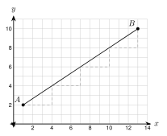
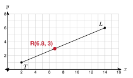

# 2.7 - Dividing a Segment in a Ratio {.unnumbered}

A hiking trail runs in a straight line from the trailhead to a lookout. The park wants a rest stop part of the way along the trail, say two fifths of the way. Where on the map does the rest stop go?

The midpoint is one special case: it is halfway. In this lesson you find a point at any fraction of the way along a segment. You use the same idea of steps you used for the midpoint.

:::{.objectives}
- [ ] I can find the point that is a fraction of the way from one number to another.
- [ ] I can find the point that divides a segment in a given ratio on the coordinate plane.
- [ ] I can explain why the order of the endpoints matters.
- [ ] I can use distance to check a point.
:::

:::{.vocab}

:::

:::{.guided-notes-link}
[Printable Guided Notes for this lesson](/guided_notes/Unit_2/2.7_Dividing_a_Segment_in_a_Ratio.html){target="_blank"} (fill-in notes to print and write on)
:::



1. Find $\dfrac{2}{5}$ of 30.

2. Find the midpoint of $(2, 6)$ and $(10, -2)$.

3. Solve $2(x + 4) = 3x - 1$.



### 2.7.1 - On a Number Line

Find the point $\dfrac{1}{3}$ of the way from 2 to 14. The distance from 2 to 14 is 12. One third of 12 is 4. So the point is $2 + 4 = 6$.

A ratio $a:b$ splits a segment into two parts in the ratio $a$ to $b$. The part next to the start is $a$ parts, and the whole segment is $a + b$ parts. So the point is $\dfrac{a}{a + b}$ of the way from the start.

{width=420px fig-align="center"}

***

**Example 1:** Find the point that divides the segment from 4 to 20 in the ratio $3:1$.

$k = \dfrac{3}{3 + 1} = \dfrac{3}{4}$.

The distance is $20 - 4 = 16$. $\dfrac{3}{4} \cdot 16 = 12$.

The point is $4 + 12 = 16$. Check: from 4 to 16 is 12, and from 16 to 20 is 4. The ratio is $12:4 = 3:1$.

:::{.you-try title="Find the point $\\dfrac{2}{5}$ of the way from $-5$ to 20."}
The distance is 25. $\dfrac{2}{5} \cdot 25 = 10$. The point is $-5 + 10 = 5$.
:::

### 2.7.2 - On the Coordinate Plane

On the plane, go from $A$ to $B$ in two directions: a run and a rise. Take the same fraction of each. Add them to $A$. Think of the segment as one big staircase. Cut it into equal small steps. The point is a certain number of small steps from $A$.

{width=330px fig-align="center"}

***

**Example 3:** Find the point $P$ that divides $\overline{AB}$ in the ratio $1:3$ for $A(1, 2)$ and $B(13, 10)$.

$k = \dfrac{1}{1 + 3} = \dfrac{1}{4}$. Run: $13 - 1 = 12$. Rise: $10 - 2 = 8$.

$P = \left(1 + \dfrac{1}{4}(12),\ 2 + \dfrac{1}{4}(8)\right) = (1 + 3,\ 2 + 2) = (4,\ 4)$.

***

**Example 4:** Find the point $\dfrac{2}{5}$ of the way from $A(-3, 5)$ to $B(7, -5)$.

Run: $7 - (-3) = 10$. Rise: $-5 - 5 = -10$.

$P = \left(-3 + \dfrac{2}{5}(10),\ 5 + \dfrac{2}{5}(-10)\right) = (-3 + 4,\ 5 + -4) = (1,\ 1)$.

***

**Example 5:** Find the point that divides $\overline{AB}$ in the ratio $2:3$ for $A(-4, -2)$ and $B(6, 8)$.

$k = \dfrac{2}{5}$. Run $= 10$ and rise $= 10$.

$P = (-4 + 4,\ -2 + 4) = (0,\ 2)$.

:::{.you-try title="Find the point that divides $\\overline{AB}$ in the ratio $1:2$ for $A(0, -6)$ and $B(9, 6)$."}
$k = \dfrac{1}{3}$. Run 9, rise 12. $P = (0 + 3,\ -6 + 4) = (3, -2)$.
:::

### 2.7.3 - Order Matters

"From $A$ to $B$" and "from $B$ to $A$" are different. The ratio $3:1$ from $A$ to $B$ puts the point close to $B$. The ratio $3:1$ from $B$ to $A$ puts it close to $A$. Always find out which endpoint you start from.

***

**Example 7:** $A(1, 1)$ and $B(9, 5)$. Find the point that divides the segment in the ratio $3:1$ from $A$ to $B$. Then find the point in the ratio $3:1$ from $B$ to $A$.

From $A$ to $B$: $k = \dfrac{3}{4}$. Run 8, rise 4. $P = (1 + 6,\ 1 + 3) = (7,\ 4)$.

From $B$ to $A$: start at $B$. Run $1 - 9 = -8$, rise $1 - 5 = -4$. $Q = (9 + \dfrac{3}{4}(-8),\ 5 + \dfrac{3}{4}(-4)) = (3,\ 2)$.

$P$ is near $B$. $Q$ is near $A$. They are different points on the same segment.

:::{.you-try title="Same segment as Example 5. Find the point that is $\\dfrac{1}{4}$ of the way from $A$ to $B$. Which of $P$ or $Q$ is it?"}
$(1 + 2,\ 1 + 1) = (3, 2)$. It is $Q$. Going $\dfrac{3}{4}$ of the way from $B$ is the same as going $\dfrac{1}{4}$ of the way from $A$.
:::

### 2.7.4 - Using Ratios and Checking

You can check an answer with the distance formula. The two parts should add up to the whole, and they should match the ratio.

***

**Example 9:** A trail goes from the trailhead $T(2, 1)$ to the lookout $L(14, 6)$. Each unit is 1 mile. A rest stop is $\dfrac{2}{5}$ of the way from $T$ to $L$. Find the rest stop $R$. Then check with distances.

{width=300px fig-align="center"}

Run 12, rise 5. $R = \left(2 + \dfrac{2}{5}(12),\ 1 + \dfrac{2}{5}(5)\right) = (2 + 4.8,\ 1 + 2) = (6.8,\ 3)$.

$TL = \sqrt{12^2 + 5^2} = 13$ miles.

$TR = \sqrt{4.8^2 + 2^2} = \sqrt{27.04} = 5.2$ miles. And $\dfrac{2}{5} \cdot 13 = 5.2$. It matches.

$RL = \sqrt{7.2^2 + 3^2} = \sqrt{60.84} = 7.8$ miles. $5.2 + 7.8 = 13$ and $5.2 : 7.8 = 2 : 3$. It checks.

:::{.you-try title="A cable runs from the top of a tower at $A(0, 12)$ to the top of a tower at $B(20, 4)$. A hanger is placed so it divides the cable $3:1$ from $A$ to $B$. Find the hanger's position."}
$k = \dfrac{3}{4}$. Run 20, rise $-8$. $(0 + 15,\ 12 - 6) = (15, 6)$.
:::



**Number line. Find the point.**

1. $\dfrac{1}{4}$ of the way from 0 to 20

2. $\dfrac{3}{5}$ of the way from $-10$ to 15

3. Ratio $1:2$ from 3 to 15

4. Ratio $2:3$ from $-6$ to 14

***

**Find the point that is the given fraction of the way from $A$ to $B$.**

5. $A(0, 0)$, $B(12, 8)$, $\dfrac{1}{4}$

6. $A(0, 0)$, $B(12, 8)$, $\dfrac{3}{4}$

7. $A(2, -4)$, $B(8, 11)$, $\dfrac{1}{3}$

8. $A(-5, 3)$, $B(5, -7)$, $\dfrac{3}{10}$

9. $A(1, 1)$, $B(-9, 6)$, $\dfrac{2}{5}$

***

**Find the point that divides $\overline{AB}$ in the given ratio from $A$ to $B$.**

10. $A(-6, 2)$, $B(6, 14)$, ratio $1:3$

11. $A(-6, 2)$, $B(6, 14)$, ratio $1:2$

12. $A(4, -3)$, $B(-6, 7)$, ratio $3:2$

13. $A(0, 5)$, $B(15, -10)$, ratio $2:1$

***

**Order matters.**

14. $A(1, -2)$ and $B(11, 8)$. Find the point $P$ that divides $\overline{AB}$ in the ratio $3:2$ from $A$ to $B$. Then find the point $Q$ that divides it in the ratio $3:2$ from $B$ to $A$.

***

**Real problems.**

15. A trail runs from $(0, 0)$ to $(20, 15)$. Each unit is 1 mile. A water station is $\dfrac{1}{5}$ of the way from the start. Find its position. Check with the distance formula.

16. A bridge deck goes from $(0, 10)$ to $(24, 6)$. A support divides the deck in the ratio $3:1$ from the left end. Find where the support is.

17. Is $P(4, 2)$ the point $\dfrac{1}{3}$ of the way from $A(1, -1)$ to $B(10, 8)$? Use distances to check.

***

**Find the mistake.**

18. Samir says the point that divides a segment in the ratio $2:3$ is $\dfrac{2}{3}$ of the way from the start. What is wrong? What fraction is correct?

***

**Test practice**

19. Point $P$ lies on segment $AB$. Point $A$ is $(-4, 2)$ and point $B$ is $(8, -10)$. Point $P$ is $\dfrac{1}{3}$ of the way from $A$ to $B$. What are the coordinates of $P$?

    A. $(0, -2)$\
    B. $(4, -6)$\
    C. $(-2, 0)$\
    D. $(2, -4)$

20. Segment $MN$ has endpoints $M(2, 5)$ and $N(14, -1)$. Point $Q$ divides segment $MN$ in the ratio $2:1$ from $M$ to $N$. What are the coordinates of $Q$?

    A. $(6, 3)$\
    B. $(10, 1)$\
    C. $(8, 2)$\
    D. $(12, 0)$

***

**Challenge**

21. In what ratio does the point $(3, 5)$ divide the segment from $A(1, 1)$ to $B(6, 11)$ from $A$ to $B$?
