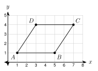
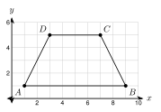
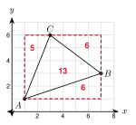
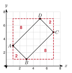

# 2.8 - Perimeter and Area on the Coordinate Plane {.unnumbered}

A property map shows a garden with its corners on a grid. The fence goes around the garden. The mulch covers the inside. How much fence do you need? How many square feet of mulch?

The fence is a **perimeter**. The mulch is an **area**. In this lesson you find both from the coordinates of the corners.

:::{.objectives}
- [ ] I can find the perimeter of a polygon from its vertices.
- [ ] I can find the area of a figure with horizontal and vertical sides.
- [ ] I can find the area of a slanted figure with the box method.
- [ ] I can find the area of a slanted square or rectangle two ways.
:::

:::{.vocab}
,
,

:::

:::{.guided-notes-link}
[Printable Guided Notes for this lesson](/guided_notes/Unit_2/2.8_Perimeter_and_Area_on_the_Coordinate_Plane.html){target="_blank"} (fill-in notes to print and write on)
:::



1. Find the distance from $(0, 0)$ to $(3, 4)$.

2. Find the area of a triangle with base 6 and height 4.

3. Simplify $\sqrt{45}$.



### 2.8.1 - Perimeter from Vertices

The **perimeter** of a polygon is the distance around it. Find the length of each side with the distance formula. Then add the lengths. Sides that are horizontal or vertical are quick: subtract the coordinates.

***

**Example 1:** Find the perimeter of triangle $ABC$ with $A(-2, 1)$, $B(4, 1)$, and $C(4, 5)$. Give the exact answer and round to the nearest tenth.

$AB = |4 - (-2)| = 6$. $BC = |5 - 1| = 4$.

$AC = \sqrt{6^2 + 4^2} = \sqrt{52} = 2\sqrt{13}$.

Perimeter $= 6 + 4 + 2\sqrt{13} = 10 + 2\sqrt{13} \approx 17.2$.

***

**Example 2:** Find the perimeter of quadrilateral $ABCD$ with $A(1, 1)$, $B(5, 1)$, $C(7, 4)$, and $D(3, 4)$. Round to the nearest tenth.

{width=260px fig-align="center"}

$AB = 4$ and $CD = 4$.

$BC = \sqrt{2^2 + 3^2} = \sqrt{13}$ and $DA = \sqrt{(-2)^2 + (-3)^2} = \sqrt{13}$.

Perimeter $= 8 + 2\sqrt{13} \approx 15.2$.

:::{.you-try title="Find the perimeter of the triangle with vertices $P(-1, 0)$, $Q(4, 0)$, and $R(4, 3)$. Round to the nearest tenth."}
$PQ = 5$, $QR = 3$, $PR = \sqrt{25 + 9} = \sqrt{34}$. Perimeter $= 8 + \sqrt{34} \approx 13.8$.
:::

### 2.8.2 - Area with Horizontal and Vertical Sides

**Area** is the number of square units inside a figure. When the sides are horizontal or vertical, the base and height come straight from the coordinates.

***

**Example 4:** Find the area of the trapezoid with vertices $A(1, 1)$, $B(9, 1)$, $C(7, 5)$, and $D(3, 5)$.

{width=260px fig-align="center"}

$\overline{AB}$ and $\overline{DC}$ are horizontal, so they are parallel. $b_1 = 9 - 1 = 8$ and $b_2 = 7 - 3 = 4$. The height is $5 - 1 = 4$.

$A = \dfrac{1}{2}(8 + 4)(4) = 24$ square units.

***

**Example 5:** Find the area of the right triangle with vertices $(1, 1)$, $(6, 1)$, and $(6, 4)$.

Base: $6 - 1 = 5$. Height: $4 - 1 = 3$.

$A = \dfrac{1}{2}(5)(3) = 7.5$ square units.

:::{.you-try title="Find the area of the triangle with vertices $(-2, -1)$, $(4, -1)$, and $(4, 3)$."}
Base $= 6$, height $= 4$. $A = \dfrac{1}{2}(6)(4) = 12$ square units.
:::

### 2.8.3 - Slanted Figures: The Box Method

What if no side is horizontal or vertical? Draw the smallest rectangle around the figure. Its sides are on the grid lines. This is the **bounding box**. The figure's area is the box's area minus the area of the corner triangles (and rectangles) outside the figure.

***

**Example 7:** Find the area of the triangle with vertices $A(1, 1)$, $B(7, 3)$, and $C(3, 6)$.

{width=260px fig-align="center"}

Bounding box: $x$ from 1 to 7 and $y$ from 1 to 6. Area $= 6 \cdot 5 = 30$.

Corner triangles: bottom right, legs 6 and 2: $\dfrac{1}{2}(6)(2) = 6$. Top right, legs 4 and 3: $\dfrac{1}{2}(4)(3) = 6$. Top left, legs 2 and 5: $\dfrac{1}{2}(2)(5) = 5$.

Total outside: $6 + 6 + 5 = 17$. Area of $\triangle ABC = 30 - 17 = 13$ square units.

:::{.you-try title="Find the area of the triangle with vertices $(0, 0)$, $(7, 1)$, and $(3, 6)$ by the box method."}
Box: $7 \cdot 6 = 42$. Corners: $\dfrac{1}{2}(7)(1) = 3.5$, $\dfrac{1}{2}(4)(5) = 10$, $\dfrac{1}{2}(3)(6) = 9$. Total $22.5$. Area $= 42 - 22.5 = 19.5$ square units.
:::

### 2.8.4 - Slanted Squares and Rectangles

A tilted square or rectangle has a simple area: side times side, or length times width. Find the side lengths with the distance formula. Then check your answer with the box method. Two methods that agree give you confidence.

***

**Example 9:** Find the area of the rectangle with vertices $A(1, 3)$, $B(3, 1)$, $C(7, 5)$, and $D(5, 7)$. Use two methods.

{width=260px fig-align="center"}

Method 1, side lengths. $AB = \sqrt{2^2 + 2^2} = \sqrt{8} = 2\sqrt{2}$. $BC = \sqrt{4^2 + 4^2} = \sqrt{32} = 4\sqrt{2}$.

$A = 2\sqrt{2} \cdot 4\sqrt{2} = 8 \cdot 2 = 16$ square units.

Method 2, box. The box has $x$ from 1 to 7 and $y$ from 1 to 7. It is $6 \cdot 6 = 36$. The four corner triangles have areas $2$, $8$, $2$, $8$. Their total is $20$. $36 - 20 = 16$.

Both methods give 16.

***

**Example 10:** A garden on a property map has corners $A(0, 0)$, $B(10, 0)$, $C(10, 6)$, and $D(0, 3)$. Each unit is 1 foot. How much fence goes around it? How many square feet of mulch cover it? Round to the nearest tenth.

Sides: $AB = 10$, $BC = 6$, $DA = 3$, and $CD = \sqrt{10^2 + 3^2} = \sqrt{109} \approx 10.4$.

Fence: $10 + 6 + 3 + 10.4 = 29.4$ feet.

The garden is a trapezoid with parallel sides $\overline{DA}$ and $\overline{BC}$ (both vertical) and height 10. Area $= \dfrac{1}{2}(3 + 6)(10) = 45$ square feet of mulch.

:::{.you-try title="A square has vertices $(2, 0)$, $(5, 2)$, $(3, 5)$, and $(0, 3)$. Find its area with the side length. Then check it with the box method."}
Side $= \sqrt{3^2 + 2^2} = \sqrt{13}$, so area $= 13$. Box: $5 \cdot 5 = 25$. Four triangles with legs 3 and 2 have area 3 each, total 12. $25 - 12 = 13$.
:::



**Perimeter. Give the exact answer, then round to the nearest tenth when needed.**

1. $(0, 0)$, $(4, 0)$, $(4, 3)$

2. $(-2, -3)$, $(2, -3)$, $(2, 2)$

3. $(0, 0)$, $(4, 0)$, $(5, 3)$, $(1, 3)$

4. $(-2, 0)$, $(1, 4)$, $(5, 1)$

***

**Area. The sides are horizontal or vertical, or the bases are.**

5. Rectangle $(-5, -2)$, $(3, -2)$, $(3, 1)$, $(-5, 1)$

6. Triangle $(0, 0)$, $(9, 0)$, $(9, 4)$

7. Trapezoid $(0, 0)$, $(10, 0)$, $(8, 5)$, $(3, 5)$

8. Triangle $(-4, 2)$, $(2, 2)$, $(-1, -4)$

***

**Use the box method. Draw a picture.**

9. Triangle $(0, 0)$, $(5, 2)$, $(2, 6)$

10. Quadrilateral $(1, 0)$, $(6, 1)$, $(5, 5)$, $(0, 3)$

***

**Slanted squares. Use the side length. Then check with the box method.**

11. Square $(1, 0)$, $(4, 1)$, $(3, 4)$, $(0, 3)$

***

**Real problems.**

12. A garden has corners at $(0, 0)$, $(20, 0)$, $(20, 10)$, and $(5, 10)$. Each unit is 1 foot. How long is the fence around it? Round to the nearest tenth. Fence costs $\$6$ per foot. What is the cost, to the nearest dollar?

13. Find the area of the garden in the last problem. One bag of mulch covers 10 square feet. How many bags does Ana need?

***

**Find the mistake.**

14. Daniel says the triangle with vertices $(1, 1)$, $(7, 1)$, and $(3, 5)$ has area $6 \cdot 4 = 24$. What is wrong? What is the area?

***

**Test practice**

15. A triangle has vertices at $(0, 0)$, $(8, 0)$, and $(8, 6)$ on a coordinate grid. What is the perimeter of the triangle, in units?

    A. 14\
    B. 24\
    C. 28\
    D. 48

16. A square has vertices at $(2, 0)$, $(6, 3)$, $(3, 7)$, and $(-1, 4)$ on a coordinate grid. What is the area of the square, in square units?

    A. 20\
    B. 25\
    C. 50\
    D. 100

***

**Challenge**

17. Triangle $ABC$ has $A(0, 0)$, $B(8, 0)$, and $C(4, k)$. The area is 20 square units. Find $k$. There are two answers.
