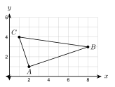
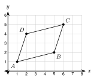
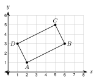
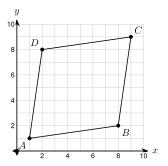
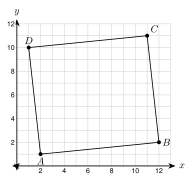
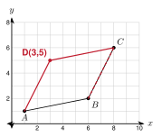

# 2.9 - Checking Shapes with Coordinates {.unnumbered}

A builder tells you, "This frame is a rectangle." You look at it, and it looks like a rectangle. Is it? A picture can fool your eyes. A frame can be off by a small amount and still look right.

In geometry, "it looks true" is not enough. We want to know it is true **for sure**. When a shape sits on a coordinate plane, we can **check it with numbers**: slopes and distances. If the numbers say yes, no one can argue. This is called **computation as proof**. In this lesson you use it on triangles and four-sided shapes.

:::{.objectives}
- [ ] I can show that a triangle is a right triangle in two ways.
- [ ] I can decide if a triangle is isosceles or equilateral from its side lengths.
- [ ] I can decide if a quadrilateral is a parallelogram, rectangle, rhombus, or square.
- [ ] I can tell what a figure only looks like from what it is, and find the fourth vertex of a parallelogram.
:::

:::{.vocab}
,
,
,
,
,

:::

:::{.guided-notes-link}
[Printable Guided Notes for this lesson](/guided_notes/Unit_2/2.9_Checking_Shapes_with_Coordinates.html){target="_blank"} (fill-in notes to print and write on)
:::



1. Find the slope of the line through $(-1, 2)$ and $(3, 5)$.

2. Find the distance from $(-2, 1)$ to $(1, 5)$.

3. Solve $2x - 3 = x + 5$.



### 2.9.1 - Is It a Right Triangle?

A right triangle has a $90^\circ$ angle. There are two ways to check for it with coordinates.

**Way 1: slopes.** Two sides are perpendicular if their slopes are opposite reciprocals (the product is $-1$). Find the slope of each side at a corner.

**Way 2: distances.** Find all three side lengths. Use the converse of the Pythagorean theorem (Lesson 2.2): the sum of the squares of the two short sides must equal the square of the longest side.

Every time, finish with a sentence that starts with "Because." This sentence is the proof.

***

**Example 1:** Show that triangle $ABC$ with $A(2, 1)$, $B(8, 3)$, and $C(1, 4)$ is a right triangle. Use both ways.

{width=280px fig-align="center"}

Way 1. Slope of $\overline{AB}$: $\dfrac{3 - 1}{8 - 2} = \dfrac{1}{3}$. Slope of $\overline{AC}$: $\dfrac{4 - 1}{1 - 2} = -3$.

The product is $\dfrac{1}{3} \cdot (-3) = -1$.

Way 2. $AB^2 = 6^2 + 2^2 = 40$. $AC^2 = (-1)^2 + 3^2 = 10$. $BC^2 = (-7)^2 + 1^2 = 50$.

$AB^2 + AC^2 = 40 + 10 = 50 = BC^2$.

**Because** the slopes of $\overline{AB}$ and $\overline{AC}$ have a product of $-1$ (and $AB^2 + AC^2 = BC^2$), $\overline{AB} \perp \overline{AC}$. Triangle $ABC$ is a right triangle with the right angle at $A$.

***

**Example 2:** Is triangle $PQR$ with $P(0, 0)$, $Q(6, 2)$, and $R(4, 6)$ a right triangle?

Slopes: $\overline{PQ}$: $\dfrac{2}{6} = \dfrac{1}{3}$. $\overline{PR}$: $\dfrac{6}{4} = \dfrac{3}{2}$. $\overline{QR}$: $\dfrac{6 - 2}{4 - 6} = -2$.

Products: $\dfrac{1}{3} \cdot \dfrac{3}{2} = \dfrac{1}{2}$, $\dfrac{1}{3} \cdot (-2) = -\dfrac{2}{3}$, $\dfrac{3}{2} \cdot (-2) = -3$. None is $-1$.

Check by distance: $PQ^2 = 40$, $PR^2 = 52$, $QR^2 = 20$. $40 + 20 = 60$, which is not 52.

**Because** no pair of sides is perpendicular, triangle $PQR$ is **not** a right triangle.

:::{.you-try title="Show that the triangle with vertices $D(0, 0)$, $E(4, 2)$, and $F(-1, 2)$ is a right triangle. Use slopes. Write the 'Because' sentence."}
Slope of $\overline{DE}$ is $\dfrac{1}{2}$. Slope of $\overline{DF}$ is $\dfrac{2}{-1} = -2$. The product is $-1$. Because $\overline{DE} \perp \overline{DF}$, the triangle is a right triangle with the right angle at $D$.
:::

### 2.9.2 - Isosceles or Equilateral?

An **isosceles** triangle has two sides of equal length. An **equilateral** triangle has three. Find the three side lengths with the distance formula and compare them.

***

**Example 4:** Is triangle $ABC$ with $A(1, 1)$, $B(7, 1)$, and $C(4, 5)$ isosceles? Is it equilateral?

$AB = |7 - 1| = 6$.

$AC = \sqrt{3^2 + 4^2} = 5$. $BC = \sqrt{(-3)^2 + 4^2} = 5$.

**Because** $AC = BC = 5$, triangle $ABC$ is isosceles. It is not equilateral, because $AB = 6$ is different.

***

**Example 5:** Show that the triangle with $A(1, 1)$, $B(5, 1)$, and $C(3, 1 + 2\sqrt{3})$ is equilateral.

$AB = 4$.

$AC = \sqrt{2^2 + (2\sqrt{3})^2} = \sqrt{4 + 12} = 4$. $BC = \sqrt{(-2)^2 + (2\sqrt{3})^2} = \sqrt{16} = 4$.

**Because** $AB = AC = BC = 4$, triangle $ABC$ is equilateral.

:::{.you-try title="Is the triangle with vertices $P(1, 1)$, $Q(5, 1)$, and $R(3, 5)$ isosceles? Write the 'Because' sentence."}
$PQ = 4$. $PR = \sqrt{4 + 16} = \sqrt{20}$. $QR = \sqrt{4 + 16} = \sqrt{20}$. Because $PR = QR$, triangle $PQR$ is isosceles.
:::

### 2.9.3 - Four-Sided Shapes

Here are the definitions we use to check shapes. (In Unit 4 you learn many more facts about them.)

| Shape | What to check with coordinates |
|:--|:--|
| Parallelogram | Opposite sides have equal slopes (both pairs) |
| Rectangle | A parallelogram, and two sides at a corner have slopes with product $-1$ |
| Rhombus | All four sides have the same length (distance formula) |
| Square | A rectangle and a rhombus together |

***

**Example 7:** Is $ABCD$ with $A(1, 1)$, $B(5, 2)$, $C(6, 5)$, $D(2, 4)$ a parallelogram? A rectangle? A rhombus?

{width=260px fig-align="center"}

Slopes: $\overline{AB}$: $\dfrac{2 - 1}{5 - 1} = \dfrac{1}{4}$. $\overline{DC}$: $\dfrac{5 - 4}{6 - 2} = \dfrac{1}{4}$. $\overline{AD}$: $\dfrac{4 - 1}{2 - 1} = 3$. $\overline{BC}$: $\dfrac{5 - 2}{6 - 5} = 3$.

**Because** both pairs of opposite sides have equal slopes, $ABCD$ is a parallelogram.

Rectangle? $\dfrac{1}{4} \cdot 3 = \dfrac{3}{4}$, not $-1$. The corner at $A$ is not a right angle. It is not a rectangle.

Rhombus? $AB = \sqrt{17}$ and $AD = \sqrt{10}$. They are not equal. It is not a rhombus.

**So** $ABCD$ is a parallelogram and nothing more specific.

***

**Example 8:** Is $ABCD$ with $A(2, 1)$, $B(6, 3)$, $C(5, 5)$, $D(1, 3)$ a rectangle? A square?

{width=260px fig-align="center"}

Slopes: $\overline{AB}$ and $\overline{DC}$ are both $\dfrac{1}{2}$. $\overline{AD}$ and $\overline{BC}$ are both $-2$. It is a parallelogram.

At $A$: $\dfrac{1}{2} \cdot (-2) = -1$. There is a right angle.

**Because** $ABCD$ is a parallelogram with a right angle, it is a rectangle.

Square? $AB = \sqrt{20}$ and $AD = \sqrt{5}$. Not equal. **So** it is a rectangle but not a square.

***

**Example 9:** Is $ABCD$ with $A(1, 1)$, $B(6, 1)$, $C(9, 5)$, $D(4, 5)$ a rhombus? A square?

$AB = 5$. $BC = \sqrt{3^2 + 4^2} = 5$. $CD = 5$. $DA = \sqrt{(-3)^2 + (-4)^2} = 5$.

**Because** all four sides have length 5, $ABCD$ is a rhombus.

Square? $\overline{AB}$ is horizontal (slope 0). $\overline{AD}$ has slope $\dfrac{4}{3}$. They are not perpendicular. **So** it is a rhombus but not a square.

:::{.you-try title="The vertices are $A(-2, -1)$, $B(2, -1)$, $C(2, 3)$, and $D(-2, 3)$. What is the most specific name? Write the 'Because' sentence."}
$AB = 4$ and $BC = 4$, and all sides are 4. $\overline{AB}$ is horizontal and $\overline{BC}$ is vertical, so they are perpendicular. Because $ABCD$ has four equal sides and a right angle, it is a square.
:::

### 2.9.4 - Looks Like, or Is?

Drawings can look right and be wrong. Only the numbers tell. Look at these two shapes.

***

**Example 11:** The shape $ABCD$ with $A(1, 1)$, $B(8, 2)$, $C(9, 9)$, $D(2, 8)$ looks like a tilted square. Is it a square?

{width=260px fig-align="center"}

$AB = \sqrt{7^2 + 1^2} = \sqrt{50}$. $BC = \sqrt{1^2 + 7^2} = \sqrt{50}$. $CD = \sqrt{50}$. $DA = \sqrt{50}$. All four sides are equal, so it is a rhombus.

Slope of $\overline{AB}$: $\dfrac{1}{7}$. Slope of $\overline{AD}$: $\dfrac{7}{1} = 7$. The product is $\dfrac{1}{7} \cdot 7 = 1$, not $-1$.

**Because** $\overline{AB}$ and $\overline{AD}$ are not perpendicular, $ABCD$ is **not** a square. It is a rhombus.

***

**Example 12:** The shape $ABCD$ with $A(2, 1)$, $B(12, 2)$, $C(11, 11)$, $D(1, 10)$ looks like a rectangle. Is it?

{width=300px fig-align="center"}

Slopes: $\overline{AB}$ and $\overline{DC}$ are both $\dfrac{1}{10}$. $\overline{AD}$ and $\overline{BC}$ are both $\dfrac{9}{-1} = -9$. It is a parallelogram.

At $A$: $\dfrac{1}{10} \cdot (-9) = -\dfrac{9}{10}$. This is close to $-1$, but it is not $-1$.

**Because** the product is $-\dfrac{9}{10}$, there is no right angle. $ABCD$ is **not** a rectangle. It is a parallelogram.

:::{.gotcha title="Counterexample: four equal sides"}
Does "four equal sides" make a square? No. The rhombus in the example has four equal sides and is not a square. One example that breaks a rule is a **counterexample**. It is enough to show the rule is false.
:::

:::{.gotcha title="Error analysis: Hnin's mistake"}
Hnin says: "$ABCD$ with $A(1, 1)$, $B(5, 2)$, $C(6, 5)$, $D(2, 4)$ is a rectangle because its opposite sides are equal."

The opposite sides are equal, but that is also true for a parallelogram that is not a rectangle. The missing check is a **right angle**. Here $\dfrac{1}{4} \cdot 3 = \dfrac{3}{4}$, so there is no right angle. It is not a rectangle.
:::

:::{.you-try title="A quadrilateral has four equal sides. Maria says it is a square. Give a counterexample with coordinates."}
Use the rhombus $A(1, 1)$, $B(6, 1)$, $C(9, 5)$, $D(4, 5)$. All sides are 5, but the corner at $A$ is not a right angle (slopes 0 and $\dfrac{4}{3}$).
:::

### 2.9.5 - Finding the Fourth Vertex

In a parallelogram, going from $B$ to $C$ is the same step as going from $A$ to $D$. If you know $A$, $B$, and $C$, take the step from $B$ to $C$ and add it to $A$ to get $D$.

***

**Example 14:** Three vertices of parallelogram $ABCD$ are $A(1, 1)$, $B(6, 2)$, and $C(8, 6)$. Find $D$. Check your answer.

{width=260px fig-align="center"}

Step from $B$ to $C$: $(8 - 6,\ 6 - 2) = (2,\ 4)$.

$D = (1 + 2,\ 1 + 4) = (3,\ 5)$.

Check with slopes: $\overline{AB}$: $\dfrac{1}{5}$ and $\overline{DC}$: $\dfrac{6 - 5}{8 - 3} = \dfrac{1}{5}$. $\overline{AD}$: $\dfrac{4}{2} = 2$ and $\overline{BC}$: $\dfrac{4}{2} = 2$.

**Because** both pairs of opposite sides have equal slopes, $ABCD$ with $D(3, 5)$ is a parallelogram.

:::{.you-try title="Three vertices of parallelogram $PQRS$ are $P(0, 0)$, $Q(5, 1)$, and $R(7, 5)$. Find $S$."}
Step from $Q$ to $R$: $(2, 4)$. $S = P + (2, 4) = (2, 4)$.
:::



**Right triangle? Use slopes or distances. Write the "Because" sentence.**

1. $A(0, 0)$, $B(4, 2)$, $C(-1, 2)$

2. $P(-2, 1)$, $Q(2, 3)$, $R(4, -1)$

3. $X(0, 0)$, $Y(5, 1)$, $Z(2, 4)$

***

**Isosceles, equilateral, or neither? Find all three side lengths.**

4. $(-4, 0)$, $(2, 0)$, $(-1, 5)$

5. $(0, 0)$, $(4, 0)$, $(1, 3)$

6. $(0, 0)$, $(6, 0)$, $(3, 3\sqrt{3})$

***

**Name each quadrilateral as specifically as you can: parallelogram, rectangle, rhombus, square, or none of these. Show your checks.**

7. $A(0, 0)$, $B(6, 0)$, $C(8, 3)$, $D(2, 3)$

8. $A(0, 0)$, $B(3, 4)$, $C(8, 4)$, $D(5, 0)$

9. $A(1, 2)$, $B(5, 0)$, $C(7, 4)$, $D(3, 6)$

10. $A(0, 0)$, $B(4, 0)$, $C(5, 3)$, $D(0, 3)$

***

**Looks like, or is?**

11. The shape looks like a rectangle. Is it? Use slopes. ($P(0, 0)$, $Q(8, 1)$, $R(7, 8)$, $S(-1, 7)$)

12. Kofi says every quadrilateral with four equal sides is a square. Give a counterexample with coordinates.

13. Moses says $A(0, 0)$, $B(5, 1)$, $C(6, 6)$, $D(1, 5)$ is a square because all sides are $\sqrt{26}$. Find his mistake.

***

**Find the fourth vertex.**

14. Parallelogram $ABCD$ has $A(0, 0)$, $B(7, 1)$, $C(9, 5)$. Find $D$.

15. Rectangle $ABCD$ has $A(-3, 1)$, $B(1, -1)$, $C(3, 3)$. Show that the corner at $B$ is a right angle. Find $D$.

***

**Test practice**

16. Triangle $ABC$ has vertices $A(-1, 2)$, $B(5, 2)$, and $C(2, 6)$. Which statement about the triangle is true?

    A. It is an equilateral triangle.\
    B. It is an isosceles triangle that is not equilateral.\
    C. It is a right triangle.\
    D. It is a scalene triangle.

17. Quadrilateral $PQRS$ has vertices $P(0, 0)$, $Q(4, 2)$, $R(2, 6)$, and $S(-2, 4)$. What is the most specific name for $PQRS$?

    A. parallelogram\
    B. rectangle\
    C. rhombus\
    D. square

***

**Challenge**

18. Rectangle $ABCD$ has $A(0, 0)$, $B(4, 3)$, and $D(-3, 4)$. Find $C$. Then show that the diagonals $\overline{AC}$ and $\overline{BD}$ have the same length.

19. Three vertices of a parallelogram are $(0, 0)$, $(4, 1)$, and $(1, 3)$. There are three different points that can be the fourth vertex. Find all three.
