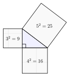
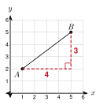
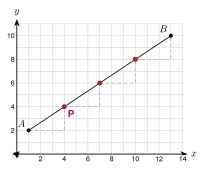

# Unit 2 Summary {.unnumbered}

:::{.guided-notes-link}
[Printable Unit 2 Summary](/guided_notes/Unit_2/Unit_2_Summary.html){target="_blank"} (a reference sheet to print and keep)
:::

## 2.1 - Square Roots and Simplifying Radicals

* A **perfect square** is the square of a whole number: 1, 4, 9, 16, 25, 36, 49, 64, 81, 100, 121, 144, 169, 196, 225.
* $\sqrt{49} = 7$. In geometry we use the positive root.
* To estimate $\sqrt{50}$: $7^2 = 49$ and $8^2 = 64$, so it is between 7 and 8. Test the middle, $7.5^2 = 56.25$. Since $50 < 56.25$, it is closer to 7.
* To simplify, take out the largest perfect square factor: $\sqrt{72} = \sqrt{36} \cdot \sqrt{2} = 6\sqrt{2}$.
* Multiply: $2\sqrt{3} \cdot 5\sqrt{6} = 10\sqrt{18} = 30\sqrt{2}$. Add like radicals: $3\sqrt{2} + 5\sqrt{2} = 8\sqrt{2}$.
* Rationalize: $\dfrac{6}{\sqrt{2}} = \dfrac{6\sqrt{2}}{2} = 3\sqrt{2}$.
* $\sqrt{9 + 16}$ is not $\sqrt{9} + \sqrt{16}$.

**Example:** Simplify $\sqrt{48} + \sqrt{12}$. $4\sqrt{3} + 2\sqrt{3} = 6\sqrt{3}$

## 2.2 - The Pythagorean Theorem and Its Converse

* In a right triangle, the **legs** make the right angle. The **hypotenuse** is across from it and is the longest side.
* **Pythagorean theorem**: $a^2 + b^2 = c^2$, where $c$ is the hypotenuse.
* **Pythagorean triples**: 3-4-5, 5-12-13, 8-15-17, 7-24-25, and their multiples.
* **Converse**: let $c$ be the longest side. If $a^2 + b^2 = c^2$, the triangle is right. If $a^2 + b^2 > c^2$, it is acute. If $a^2 + b^2 < c^2$, it is obtuse.
* **Triangle inequality**: the two shorter sides must add to more than the longest side.

{width=300px fig-align="center"}

**Example:** Legs 6 and 8. Find $c$. $36 + 64 = 100$, so $c = 10$

## 2.3 - The Pythagorean Theorem in the Real World

* Always: draw and label the right triangle, solve, and answer in a sentence with units.
* **Squaring a corner**: mark 3 and 4. The marks must be 5 apart. Check a rectangle by its **diagonal**.
* **Ladders**: the ladder is the hypotenuse. 4-to-1 rule: the base is at least height $\div$ 4 from the wall.
* **Screens**: the size is the diagonal. Width and height are the legs.
* **Boxes**: floor diagonal first, then the box diagonal.

**Example:** A 13 ft ladder has its base 5 ft from a wall. How high does it reach? $\sqrt{169 - 25} = 12$ ft

## 2.4 - Distance on the Coordinate Plane

* Same $y$: distance is $|x_2 - x_1|$. Same $x$: distance is $|y_2 - y_1|$.
* Slanted: draw a right triangle. The legs are the horizontal and vertical changes.
* **Distance formula**: $d = \sqrt{(x_2 - x_1)^2 + (y_2 - y_1)^2}$.
* Use it to compare distances, to check for equal sides, and to find a missing coordinate (there can be two answers).

{width=260px fig-align="center"}

**Example:** Distance from $(1, 2)$ to $(5, 5)$. $\sqrt{4^2 + 3^2} = 5$

## 2.5 - Midpoint

* **Midpoint formula**: $M = \left(\dfrac{x_1 + x_2}{2},\ \dfrac{y_1 + y_2}{2}\right)$. Average the $x$'s and average the $y$'s.
* Missing endpoint: take the same step again from the midpoint, or solve $\dfrac{x_1 + x}{2} = x_M$.
* The center of a circle is the midpoint of a diameter.
* To check that $M$ is a midpoint, show $AM = MB$ **and** that $A$, $M$, $B$ are collinear.

**Example:** Midpoint of $(-2, 4)$ and $(6, -2)$. $(2, 1)$

## 2.6 - Slope, Parallel Lines, and Perpendicular Lines

* **Slope**: $m = \dfrac{y_2 - y_1}{x_2 - x_1}$. Horizontal lines have slope 0. Vertical lines have undefined slope.
* **Parallel** lines have equal slopes (and are different lines).
* **Perpendicular** lines have slopes that are opposite reciprocals. The product is $-1$.
* To write a line through a point: find the slope, put the point in $y = mx + b$, solve for $b$.

**Example:** A line has slope $\dfrac{3}{4}$. Give the slope of a perpendicular line. $-\dfrac{4}{3}$

## 2.7 - Dividing a Segment in a Ratio

* Ratio $a:b$ from $A$ to $B$: the point is $k = \dfrac{a}{a + b}$ of the way.
* $P = \left(x_1 + k(x_2 - x_1),\ y_1 + k(y_2 - y_1)\right)$.
* Order matters. The same ratio from $B$ to $A$ gives a different point.
* Check with distance: $AP = k \cdot AB$.

{width=330px fig-align="center"}

**Example:** Ratio $1:3$ from $A(1, 2)$ to $B(13, 10)$. $k = \dfrac{1}{4}$. $P = (4, 4)$

## 2.8 - Perimeter and Area on the Coordinate Plane

* **Perimeter**: add the side lengths. Use the distance formula for slanted sides.
* **Area**: rectangle $bh$, triangle $\dfrac{1}{2}bh$, trapezoid $\dfrac{1}{2}(b_1 + b_2)h$.
* **Box method**: area of the bounding box minus the corner triangles.
* Slanted rectangle or square: length times width from the distance formula. Check with the box method.

**Example:** Area of the triangle with vertices $(0, 0)$, $(6, 0)$, $(6, 8)$. $\dfrac{1}{2}(6)(8) = 24$

## 2.9 - Checking Shapes with Coordinates

* **Computation as proof**: use slopes and distances to show a fact for sure. End with "Because ..., the shape is a ...".
* **Right triangle**: two sides have slopes with product $-1$, or the side squares satisfy $a^2 + b^2 = c^2$.
* **Isosceles**: two equal sides. **Equilateral**: three equal sides.
* **Looks vs is**: a shape that looks like a square can be a rhombus. Check slopes and lengths. A counterexample shows a rule is false.
* **Fourth vertex** of a parallelogram $ABCD$: $D = A + C - B$.

**Example:** What do you check to show a parallelogram is a rectangle? Show two sides at a corner have slopes with a product of $-1$.

| Shape | What to check |
|:--|:--|
| Parallelogram | Opposite sides have equal slopes |
| Rectangle | A parallelogram with a right angle (slopes with product $-1$) |
| Rhombus | Four equal sides |
| Square | A rectangle and a rhombus |

