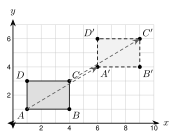
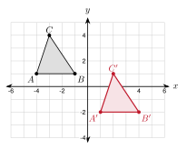
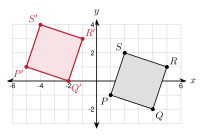
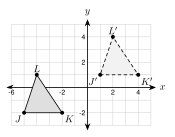
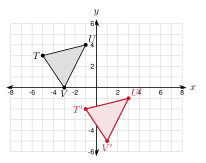
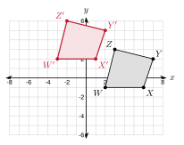

# 3.1 - Translations {.unnumbered}

Open a floor plan on a screen. Drag a desk to a new spot. The whole desk slides. It does not turn. It does not change size.

{width=400px fig-align="center"}

Every corner of the desk moves the same way. Here each corner moves 5 units right and 3 units up. In this lesson you write that move as a rule. Then you use the rule on the coordinate plane.

:::{.objectives}
- [ ] I can name the preimage and image of a transformation.
- [ ] I can write and use a translation rule like $(x, y) \rightarrow (x + 3, y - 2)$.
- [ ] I can graph the image of a figure after a translation.
- [ ] I can use distance and slope to show what a translation keeps the same.
:::

:::{.vocab}
,
,
,
,

:::

:::{.guided-notes-link}
[Printable Guided Notes for this lesson](/guided_notes/Unit_3/3.1_Translations.html){target="_blank"} (fill-in notes to print and write on)
:::



1. Plot $A(1, 2)$ and $B(5, 5)$ on a coordinate plane. Find the distance $AB$.

2. Find the slope of the line through $A(1, 2)$ and $B(5, 5)$.

3. Solve $-2 + a = 4$.



### 3.1.1 - Moving a Figure

A **transformation** moves a figure, or changes its size, by a rule. A **translation** is the simplest one. It slides the whole figure.

* The starting figure is the preimage. The new figure is the image.
* The image of point $A$ is $A'$. Read it as "A prime".
* A **translation** slides every point the same distance in the same direction.

***

**Example 1:** Preimage and image

{width=380px fig-align="center"}

The desk $ABCD$ slides to $A'B'C'D'$ (see the figure).

a. Name the image of $C$. $C'$

b. $A$ is at $(1, 1)$ and $A'$ is at $(6, 4)$. How far did $A$ move? 5 right and 3 up

c. $D$ is at $(1, 3)$. Where is $D'$? $(6, 6)$. Every point moves the same way.

:::{.you-try-m title="Use the desk figure"}
a. Name the preimage of $B'$.

b. $C$ is at $(4, 3)$. Where is $C'$?
:::

:::{.answer title="Answer"}
a. $B$

b. $(9, 6)$
:::

### 3.1.2 - Translation Rules

Moving 5 right and 3 up adds 5 to every $x$ and 3 to every $y$. We write that as a **rule**:

$$(x, y) \rightarrow (x + 5, y + 3)$$

* The rule $(x, y) \rightarrow (x + a, y + b)$ slides a figure.
* If $a$ is positive, move right. If $a$ is negative, move left.
* If $b$ is positive, move up. If $b$ is negative, move down.

| Move | Rule |
|:---:|:---:|
| 3 right | $(x + 3, y)$ |
| 5 down | $(x, y - 5)$ |
| 2 left and 6 up | $(x - 2, y + 6)$ |
| 7 right and 1 down | $(x + 7, y - 1)$ |

***

**Example 2:** Use a rule

Apply $(x, y) \rightarrow (x - 3, y + 5)$ to $P(2, -4)$.

$x$: $2 - 3 = -1$

$y$: $-4 + 5 = 1$

$P' = (-1, 1)$

***

**Example 3:** Find the rule

$A(-2, 3)$ moves to $A'(4, -1)$. Write the rule.

Change in $x$: $4 - (-2) = 6$

Change in $y$: $-1 - 3 = -4$

Rule: $(x, y) \rightarrow (x + 6, y - 4)$

In words: 6 right and 4 down.

:::{.gotcha title="Image minus preimage"}
To find the change, always do **image minus preimage**. If you subtract the other way, you get the wrong direction.
:::

:::{.you-try-m title="Try it"}
a. Apply $(x, y) \rightarrow (x + 7, y - 2)$ to $Q(-5, -3)$.

b. $B(1, -6)$ moves to $B'(-3, 0)$. Write the rule and say it in words.
:::

:::{.answer title="Answer"}
a. $Q' = (2, -5)$

b. $-3 - 1 = -4$ and $0 - (-6) = 6$. Rule: $(x - 4, y + 6)$. 4 left and 6 up.
:::

### 3.1.3 - Graphing the Image

To graph the image of a figure, move each vertex with the rule. Then connect the new points in the same order.

* Step 1: Apply the rule to every vertex.
* Step 2: Plot the new points and label them $A'$, $B'$, $C'$.
* Step 3: Connect them in the same order as the preimage.

***

**Example 4:** Translate a triangle

{width=400px fig-align="center"}

Graph the image of $\triangle ABC$ with $A(-4, 1)$, $B(-1, 1)$, $C(-3, 4)$ under $(x, y) \rightarrow (x + 5, y - 3)$.

$A' = (-4 + 5, 1 - 3) = (1, -2)$

$B' = (-1 + 5, 1 - 3) = (4, -2)$

$C' = (-3 + 5, 4 - 3) = (2, 1)$

***

**Example 5:** Translate a quadrilateral

{width=400px fig-align="center"}

Graph the image of $PQRS$ with $P(1, -1)$, $Q(4, -2)$, $R(5, 1)$, $S(2, 2)$ under $(x, y) \rightarrow (x - 6, y + 2)$.

$P' = (-5, 1)$, $Q' = (-2, 0)$

$R' = (-1, 3)$, $S' = (-4, 4)$

:::{.you-try title="Graph triangle $JKL$ with $J(-3, -1)$, $K(0, -2)$, $L(-1, 2)$ under $(x, y) \rightarrow (x + 4, y + 3)$. Give the image coordinates."}
$J'(1, 2)$, $K'(4, 1)$, $L'(3, 5)$
:::

:::{.real-world title="Moves in a game"}
A game screen is a coordinate plane. A character that steps 1 right and 2 up uses the rule $(x, y) \rightarrow (x + 1, y + 2)$. A chess knight that jumps 2 squares right and 1 up uses $(x + 2, y + 1)$.
:::

### 3.1.4 - What Stays the Same

A translation slides a figure. It does not stretch it or turn it. We can check this with the tools from Unit 2.

* A translation keeps every side length and every angle the same.
* Each side is parallel to its image. (They have the same slope.)
* A transformation that keeps lengths and angles is a **rigid motion**. A translation is a rigid motion.

***

**Example 6:** Check with coordinates

In the first triangle example, $A(-4, 1)$ and $C(-3, 4)$ move to $A'(1, -2)$ and $C'(2, 1)$. Compare $\overline{AC}$ and $\overline{A'C'}$.

Length of $\overline{AC}$: $\sqrt{1^2 + 3^2} = \sqrt{10}$

Length of $\overline{A'C'}$: $\sqrt{1^2 + 3^2} = \sqrt{10}$

Slope of $\overline{AC}$: $\dfrac{4 - 1}{-3 - (-4)} = 3$

Slope of $\overline{A'C'}$: $\dfrac{1 - (-2)}{2 - 1} = 3$

The lengths are equal and the slopes are equal. So $\overline{AC} \cong \overline{A'C'}$ and $\overline{AC} \parallel \overline{A'C'}$.

:::{.you-try title="$X(0, 0)$ and $Y(6, 8)$ move to $X'(3, -2)$ and $Y'(9, 6)$. Show that $XY = X'Y'$ and that the slopes are equal."}
$XY = \sqrt{36 + 64} = 10$ and $X'Y' = \sqrt{36 + 64} = 10$. Both slopes are $\dfrac{8}{6} = \dfrac{4}{3}$.
:::



**Use the figure for problems 1 to 4.**

{width=360px fig-align="center"}

1. Name the image of $K$.

2. Name the preimage of $L'$.

3. How far does every point move?

4. Write the translation rule.

***

**Apply the rule to the point.**

5. $(x, y) \rightarrow (x + 4, y + 1)$ to $(2, 3)$.

6. $(x, y) \rightarrow (x - 5, y + 0)$ to $(1, -2)$.

7. $(x, y) \rightarrow (x + 0, y - 6)$ to $(-3, 4)$.

8. $(x, y) \rightarrow (x - 2, y - 7)$ to $(-1, -1)$.

9. $(x, y) \rightarrow (x + 9, y - 4)$ to $(-6, 0)$.

10. $(x, y) \rightarrow (x - 3, y + 8)$ to $(4, -8)$.

***

**Write the rule that moves $A$ to $A'$. Then say it in words.**

11. $A(2, 5) \rightarrow A'(7, 3)$

12. $A(-4, -1) \rightarrow A'(-1, -6)$

13. $A(0, 6) \rightarrow A'(-8, 2)$

14. $A(3, -3) \rightarrow A'(3, 4)$

***

**Graph the image. Give its coordinates.**

{width=340px fig-align="center"}

15. Use $(x, y) \rightarrow (x + 4, y - 5)$ on $\triangle TUV$.

***

**Graph the image. Give its coordinates.**

{width=340px fig-align="center"}

16. Use $(x, y) \rightarrow (x - 5, y + 3)$ on $WXYZ$.

***

**Graph the image on your own grid.**

17. Triangle $MNO$ has $M(1, -4)$, $N(5, -3)$, $O(2, -1)$. Use $(x, y) \rightarrow (x - 3, y + 6)$. Give the image coordinates.

***

**Check with distance and slope.**

18. $A(1, 2)$ and $B(4, 6)$ move to $A'(6, 0)$ and $B'(9, 4)$. Show $AB = A'B'$ and that the slopes are equal.

19. A translation maps $\triangle XYZ$ to $\triangle X'Y'Z'$. $XY = 13$ and $m\angle Y = 72^\circ$. Find $X'Y'$ and $m\angle Y'$.

20. Amira says the triangle with $(0, 0)$, $(4, 0)$, $(0, 3)$ was translated to the triangle with $(5, 1)$, $(9, 1)$, $(5, 5)$ because it looks the same. Is she right? Use lengths to decide.

***

**Solve for the unknown.**

21. The point $(2k, k + 1)$ is moved by $(x, y) \rightarrow (x + 3, y - 2)$ to $(11, 3)$. Find $k$.

22. The image of $P(x, 3)$ under $(x, y) \rightarrow (x - 5, y + 2)$ is $P'(4, 5)$. Find $x$.

***

**Real problems.**

23. On a floor plan, each unit is 1 foot. A table has corners $(2, 1)$, $(6, 1)$, $(6, 4)$, $(2, 4)$. It moves 7 feet right and 3 feet up. Give the new corners and the area before and after.

24. A game character is at $(3, 3)$. Each move uses $(x, y) \rightarrow (x + 2, y + 1)$. Where is the character after 4 moves?

25. Hnin moves a game piece with $(x, y) \rightarrow (x + 2, y - 1)$ three times in a row. Write one rule for all three moves.

***

**Find the mistake.**

26. Diego applies $(x, y) \rightarrow (x - 4, y + 1)$ to $(3, -2)$ and gets $(7, -1)$. What did he do wrong? What is the correct image?

***

**Test practice**

27. The point $P(-3, 5)$ is translated by the rule $(x, y) \rightarrow (x + 6, y - 8)$. What are the coordinates of $P'$?

    A. $(3, -3)$\
    B. $(-9, 13)$\
    C. $(3, 13)$\
    D. $(-9, -3)$

28. Quadrilateral $WXYZ$ is translated to form quadrilateral $W'X'Y'Z'$. $WX = 8$ cm and $m\angle X = 105^\circ$. Which statement must be true?

    A. $W'X' = 8$ cm and $m\angle X' = 105^\circ$\
    B. $W'X' > 8$ cm and $m\angle X' = 105^\circ$\
    C. $W'X' = 8$ cm and $m\angle X' = 75^\circ$\
    D. $W'X' = 8$ cm and $m\angle X'$ cannot be found

***

**Challenge**

29. A translation maps $A(2, 5)$ to $A'(-1, 9)$. The same translation maps $B(-3, k)$ to $B'(m, 1)$. Find $m$ and $k$.

