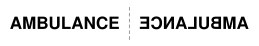
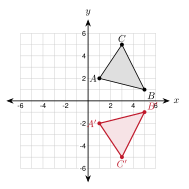
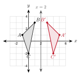
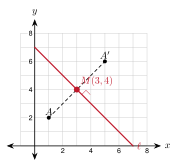
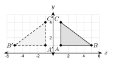
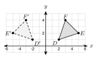
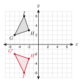
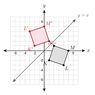

# 3.2 - Reflections {.unnumbered}

Look at the front of an ambulance. The word is printed backward.

{width=380px fig-align="center"}

A driver sees the front of the ambulance in a rear-view mirror. The mirror flips the word, so the driver reads it the right way. A flip like this is a **reflection**. In this lesson you reflect figures over a line on the coordinate plane.

:::{.objectives}
- [ ] I can reflect a point or a figure over the $x$-axis, the $y$-axis, and the lines $y = x$ and $y = -x$.
- [ ] I can reflect a figure over a line like $x = 2$ or $y = -1$.
- [ ] I can find the line of reflection from a point and its image.
- [ ] I can tell what a reflection keeps the same and what it changes.
:::

:::{.vocab}
,
,
,

:::

:::{.guided-notes-link}
[Printable Guided Notes for this lesson](/guided_notes/Unit_3/3.2_Reflections.html){target="_blank"} (fill-in notes to print and write on)
:::



1. Find the midpoint of $A(1, 2)$ and $B(5, 6)$.

2. Find the slope of the line through $A(1, 2)$ and $B(5, 6)$. Then give the slope of a line perpendicular to it.

3. Solve $2a - 4 = 10$.



### 3.2.1 - Reflecting Over the Axes

A **reflection** flips a figure over a line. The line is the **line of reflection**. A point and its image are the same distance from the line, on opposite sides.

* Over the $x$-axis, the $y$-coordinate changes sign: $(x, y) \rightarrow (x, -y)$.
* Over the $y$-axis, the $x$-coordinate changes sign: $(x, y) \rightarrow (-x, y)$.
* Points on the line of reflection do not move.

***

**Example 1:** Reflect a point

Reflect $P(3, -4)$ over the $x$-axis. Then reflect $P$ over the $y$-axis.

Over the $x$-axis: $(x, y) \rightarrow (x, -y)$, so $P' = (3, 4)$.

Over the $y$-axis: $(x, y) \rightarrow (-x, y)$, so $P' = (-3, -4)$.

***

**Example 2:** Reflect a triangle

{width=320px fig-align="center"}

Graph the image of $\triangle ABC$ over the $x$-axis. $A(1, 2)$, $B(5, 1)$, $C(3, 5)$.

$A' = (1, -2)$

$B' = (5, -1)$

$C' = (3, -5)$

:::{.you-try-m title="Try it"}
a. Reflect $Q(-5, 2)$ over the $x$-axis and over the $y$-axis.

b. $R(4, -3)$ has image $R'(-4, -3)$. Over which axis was it reflected? Write the rule.
:::

:::{.answer title="Answer"}
a. $x$-axis: $(-5, -2)$. $y$-axis: $(5, 2)$.

b. The $y$-axis. $(x, y) \rightarrow (-x, y)$.
:::

### 3.2.2 - Other Lines of Reflection

Two diagonal lines are also useful: $y = x$ and $y = -x$. For a vertical line $x = a$ or a horizontal line $y = b$, count the distance to the line.

| Line of reflection | Rule |
|:---:|:---:|
| $x$-axis | $(x, y) \rightarrow (x, -y)$ |
| $y$-axis | $(x, y) \rightarrow (-x, y)$ |
| $y = x$ | $(x, y) \rightarrow (y, x)$ |
| $y = -x$ | $(x, y) \rightarrow (-y, -x)$ |

* For $x = a$ or $y = b$: count how far the point is from the line. Go the same distance to the other side.

***

**Example 3:** Reflect over a diagonal line

Reflect $A(2, 5)$ over $y = x$. Reflect $B(-3, 1)$ over $y = -x$.

$A' = (5, 2)$

$B' = (-y, -x) = (-1, 3)$

***

**Example 4:** Reflect over a vertical line

{width=320px fig-align="center"}

Reflect $\triangle ABC$ over the line $x = 2$. $A(-1, 1)$, $B(1, 3)$, $C(0, -2)$.

$A$ is 3 units left of the line, so $A'$ is 3 units right: $(5, 1)$.

$B$ is 1 unit left, so $B' = (3, 3)$.

$C$ is 2 units left, so $C' = (4, -2)$.

:::{.you-try-m title="Try it"}
a. Reflect $S(-2, -4)$ over the line $y = -1$.

b. Reflect $T(6, 3)$ over $y = -x$.
:::

:::{.answer title="Answer"}
a. $S$ is 3 units below the line, so $S'$ is 3 units above: $(-2, 2)$.

b. $(-3, -6)$
:::

:::{.real-world title="A lake is a mirror"}
Still water reflects a tree. The top of a tree 12 feet above the water has a reflection 12 feet below the water. The water line is the line of reflection.
:::

### 3.2.3 - Finding the Line of Reflection

Look at a point $A$ and its image $A'$. The line of reflection is exactly halfway between them. It also meets $\overline{AA'}$ at a right angle.

* The line of reflection is the **perpendicular bisector** of $\overline{AA'}$.
* It goes through the midpoint of $\overline{AA'}$.
* It is perpendicular to $\overline{AA'}$. The slopes multiply to $-1$.

***

**Example 5:** Find the line

{width=280px fig-align="center"}

$A(1, 2)$ is reflected to $A'(5, 6)$. Find the line of reflection.

Midpoint: $\left(\dfrac{1 + 5}{2}, \dfrac{2 + 6}{2}\right) = (3, 4)$

Slope of $\overline{AA'}$: $\dfrac{6 - 2}{5 - 1} = 1$

Perpendicular slope: $-1$

The line has slope $-1$ and goes through $(3, 4)$: $y - 4 = -(x - 3)$, so $y = -x + 7$.

:::{.you-try title="$P(1, 1)$ is reflected to $P'(1, 7)$. Find the line of reflection."}
Midpoint: $(1, 4)$. The slope of $\overline{PP'}$ is undefined (vertical), so the line is horizontal: $y = 4$.
:::

### 3.2.4 - What a Reflection Keeps and Changes

A reflection keeps lengths and angles. It is a rigid motion. But a reflection **flips** the figure.

* A reflection keeps every length and every angle the same.
* It reverses the **orientation**. Labels that go counterclockwise now go clockwise.
* A reflection is not a translation. You cannot make it by sliding.

***

**Example 6:** Check with distance

{width=360px fig-align="center"}

$\triangle ABC$ has $A(1, 1)$, $B(5, 1)$, $C(1, 4)$. Reflect it over the $y$-axis to get $A'(-1, 1)$, $B'(-5, 1)$, $C'(-1, 4)$.

$AB = 4$ and $A'B' = 4$

$AC = 3$ and $A'C' = 3$

$BC = 5$ and $B'C' = 5$

Going $A \rightarrow B \rightarrow C$ is counterclockwise. Going $A' \rightarrow B' \rightarrow C'$ is clockwise.

:::{.you-try title="Is the slope of $\overline{AB}$ equal to the slope of $\overline{A'B'}$ in the example above? Is $\overline{AC}$ parallel to $\overline{A'C'}$?"}
Both $\overline{AB}$ and $\overline{A'B'}$ are horizontal, so the slopes are equal (0). $\overline{AC}$ and $\overline{A'C'}$ are both vertical, so they are parallel. This works here because the line of reflection is vertical. In general, a side is not parallel to its image.
:::



**Use the figure for problems 1 to 4.**

{width=330px fig-align="center"}

1. What is the line of reflection?

2. Name the image of $E$.

3. Write the rule for the reflection.

4. Find $DE$ and $D'E'$. What do you notice?

***

**Reflect each point over the line.**

5. $(4, -3)$ over the $x$-axis.

6. $(-6, 2)$ over the $y$-axis.

7. $(-1, -8)$ over the $x$-axis.

8. $(7, 0)$ over the $y$-axis.

9. $(3, 8)$ over the line $y = x$.

10. $(-5, 2)$ over the line $y = x$.

11. $(4, -6)$ over the line $y = -x$.

12. $(-2, -3)$ over the line $y = -x$.

13. $(1, 5)$ over the line $x = 3$.

14. $(6, -2)$ over the line $x = -1$.

15. $(-3, 4)$ over the line $y = 1$.

16. $(2, 7)$ over the line $y = -2$.

***

**Graph the image.**

{width=300px fig-align="center"}

17. Reflect $\triangle GHI$ over the $x$-axis. Give the image coordinates.

***

**Graph the image.**

{width=300px fig-align="center"}

18. Reflect $KLMN$ over $y = x$. Give the image coordinates.

***

**Graph the image on your own grid.**

19. Triangle $UVW$ has $U(1, -4)$, $V(4, -2)$, $W(2, -1)$. Reflect it over $y = -x$. Give the image coordinates.

***

**Find the line of reflection.**

20. $A(2, 1)$ reflects to $A'(2, 9)$.

21. $A(-3, 2)$ reflects to $A'(5, 2)$.

22. $A(0, 1)$ reflects to $A'(4, 5)$. Use the midpoint and slope.

***

**Check what stays the same.**

23. $P(1, 2)$ and $Q(5, 5)$ are reflected over the $x$-axis to $P'(1, -2)$ and $Q'(5, -5)$. Find $PQ$ and $P'Q'$. Compare the slopes.

24. Triangle $ABC$ has $A(0, 0)$, $B(4, 0)$, $C(0, 3)$. Going $A \rightarrow B \rightarrow C$ is counterclockwise. Reflect it over the $x$-axis. Which way does $A' \rightarrow B' \rightarrow C'$ go?

25. The point $(2m, m + 3)$ is reflected over the $y$-axis. The image is $(-8, 7)$. Find $m$.

26. The point $(x + 4, 3x)$ is reflected over the $x$-axis. The image is $(7, -9)$. Find $x$.

***

**Real problems.**

27. Which of these capital letters look the same after a reflection over a vertical line: A, B, F, H, M, R, T?

28. The top of a flagpole is 18 feet above a lake. How far below the water does its reflection seem to be?

***

**Find the mistake.**

29. Esperanza reflects $(3, -5)$ over the $y$-axis and writes $(3, 5)$. What did she do wrong? What is the right answer?

***

**Test practice**

30. What are the coordinates of the image of $(-4, 7)$ after a reflection over the line $y = x$?

    A. $(7, -4)$\
    B. $(4, -7)$\
    C. $(-7, 4)$\
    D. $(-4, -7)$

31. Triangle $ABC$ is reflected over a line to form triangle $A'B'C'$. Which statement must be true?

    A. $\triangle A'B'C'$ is the same size and shape as $\triangle ABC$, but its labels go the opposite way around.\
    B. $\triangle A'B'C'$ is larger than $\triangle ABC$.\
    C. $\triangle A'B'C'$ has the same orientation as $\triangle ABC$.\
    D. Each side of $\triangle A'B'C'$ is parallel to its pre-image side.

***

**Challenge**

32. A river runs along the $x$-axis. Hnin is at $A(1, 3)$ and her house is at $B(7, 5)$. She walks to the river and then to the house. Reflect $A$ over the $x$-axis. Use $A'$ and $B$ to find where she should touch the river to walk the shortest path. How long is the path?

