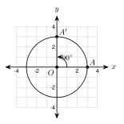
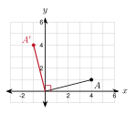
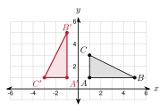
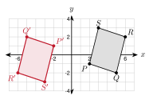
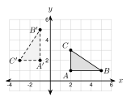
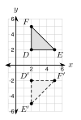
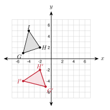
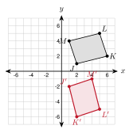

# 3.3 - Rotations {.unnumbered}

A Ferris wheel turns around its center. Every seat moves along a circle. Every seat turns by the same angle.

{width=340px fig-align="center"}

Here a seat at $A(3, 0)$ turns a quarter of the way around and lands at $A'(0, 3)$. A turn like this is a **rotation**. In this lesson you rotate figures about the origin and find the rotation that moves one figure onto another.

:::{.objectives}
- [ ] I can name the center, angle, and direction of a rotation.
- [ ] I can rotate a point or a figure $90^\circ$, $180^\circ$, or $270^\circ$ about the origin.
- [ ] I can use distance and slope to check a rotation.
- [ ] I can find the rotation that maps one figure onto another.
:::

:::{.vocab}
,
,

:::

:::{.guided-notes-link}
[Printable Guided Notes for this lesson](/guided_notes/Unit_3/3.3_Rotations.html){target="_blank"} (fill-in notes to print and write on)
:::



1. Find the distance from the origin to $A(4, 1)$.

2. Find the slope of the line through $(0, 0)$ and $(4, 1)$. Then give the slope of a perpendicular line.

3. Find $-y$ when $y = -3$.



### 3.3.1 - Center, Angle, and Direction

A rotation needs three facts: the **center** it turns about, the **angle** it turns, and the **direction** it turns.

* A **rotation** turns every point of a figure about a fixed point, the center of rotation.
* Counterclockwise is the positive direction. Clockwise is negative.
* A turn of $90^\circ$ clockwise is the same as a turn of $270^\circ$ counterclockwise.

***

**Example 1:** Read a rotation

{width=300px fig-align="center"}

In the Ferris wheel figure, the seat moves from $A(3, 0)$ to $A'(0, 3)$ about $O(0, 0)$.

Center: $O(0, 0)$

Angle: $90^\circ$

Direction: counterclockwise (the arrow turns left, up from the $x$-axis)

***

**Example 2:** Same turn, two names

Write each rotation as a counterclockwise angle.

a. $90^\circ$ clockwise: $360^\circ - 90^\circ = 270^\circ$ counterclockwise

b. $270^\circ$ clockwise: $360^\circ - 270^\circ = 90^\circ$ counterclockwise

c. $180^\circ$ clockwise: $180^\circ$ counterclockwise

:::{.you-try-m title="Try it"}
a. Write $90^\circ$ counterclockwise as a clockwise angle.

b. The minute hand of a clock moves from 12 to 6. What is the angle and direction?
:::

:::{.answer title="Answer"}
a. $360^\circ - 90^\circ = 270^\circ$ clockwise

b. $180^\circ$ clockwise (or $180^\circ$ counterclockwise)
:::

### 3.3.2 - Rotating About the Origin

These rules turn a point $(x, y)$ about the origin $O(0, 0)$.

| Rotation (counterclockwise) | Rule |
|:---:|:---:|
| $90^\circ$ | $(x, y) \rightarrow (-y, x)$ |
| $180^\circ$ | $(x, y) \rightarrow (-x, -y)$ |
| $270^\circ$ (or $90^\circ$ clockwise) | $(x, y) \rightarrow (y, -x)$ |

* A point and its image are the same distance from the center.
* For $90^\circ$, the segments from the center to $A$ and to $A'$ are perpendicular.

***

**Example 3:** Check a rotation with coordinates

{width=300px fig-align="center"}

Rotate $A(4, 1)$ by $90^\circ$ counterclockwise about the origin. Then check.

$A' = (-y, x) = (-1, 4)$

Distance $OA$: $\sqrt{4^2 + 1^2} = \sqrt{17}$. Distance $OA'$: $\sqrt{(-1)^2 + 4^2} = \sqrt{17}$.

Slope of $\overline{OA}$: $\dfrac{1}{4}$. Slope of $\overline{OA'}$: $-4$.

The slopes multiply to $\dfrac{1}{4} \cdot (-4) = -1$, so $\overline{OA} \perp \overline{OA'}$.

***

**Example 4:** Use the rules

a. Rotate $B(-3, 2)$ by $180^\circ$: $(-x, -y) = (3, -2)$.

b. Rotate $C(2, 5)$ by $270^\circ$ counterclockwise: $(y, -x) = (5, -2)$.

:::{.you-try-m title="Try it"}
a. Rotate $P(-2, 6)$ by $90^\circ$ counterclockwise about the origin.

b. Rotate $Q(5, -3)$ by $90^\circ$ clockwise about the origin.
:::

:::{.answer title="Answer"}
a. $(-y, x) = (-6, -2)$

b. $90^\circ$ clockwise is $270^\circ$ counterclockwise: $(y, -x) = (-3, -5)$
:::

### 3.3.3 - Graphing the Image

Rotate each vertex with the rule. Then connect the new points in the same order.

***

**Example 5:** Rotate a triangle

{width=320px fig-align="center"}

Rotate $\triangle ABC$ by $90^\circ$ counterclockwise about the origin. $A(1, 1)$, $B(5, 1)$, $C(1, 3)$.

Use $(x, y) \rightarrow (-y, x)$.

$A' = (-1, 1)$, $B' = (-1, 5)$, $C' = (-3, 1)$

***

**Example 6:** Rotate a quadrilateral

{width=360px fig-align="center"}

Rotate $PQRS$ by $180^\circ$ about the origin. $P(2, -1)$, $Q(5, -2)$, $R(6, 2)$, $S(3, 3)$.

Use $(x, y) \rightarrow (-x, -y)$.

$P' = (-2, 1)$, $Q' = (-5, 2)$

$R' = (-6, -2)$, $S' = (-3, -3)$

:::{.real-world title="A ceiling fan"}
A fan has 4 blades. Turning the fan $90^\circ$ puts each blade where the next blade was. The fan looks the same. You will see this again in 3.5 as rotational symmetry.
:::

:::{.you-try title="Rotate $J(-4, -1)$, $K(-1, -3)$, $L(-2, 2)$ by $270^\circ$ counterclockwise about the origin. Give the image coordinates."}
$(y, -x)$: $J'(-1, 4)$, $K'(-3, 1)$, $L'(2, 2)$
:::

### 3.3.4 - Finding the Rotation

To find a rotation, test one point. Try $90^\circ$, $180^\circ$, and $270^\circ$ until a rule gives the image. Then check a second point.

* A rotation keeps every length and every angle. It is a rigid motion.
* A rotation does not reverse orientation. Labels go the same way around.

***

**Example 7:** Find the rotation

{width=320px fig-align="center"}

$\triangle ABC$ is mapped to $\triangle A'B'C'$. Find the rotation about the origin.

Test $A(2, 1) \rightarrow A'(-1, 2)$.

$90^\circ$ rule: $(-y, x) = (-1, 2)$. It matches.

Check $B(5, 1)$: $(-y, x) = (-1, 5)$. It matches $B'$.

The rotation is $90^\circ$ counterclockwise about the origin.

:::{.you-try-m title="Try it"}
a. $P(3, -2) \rightarrow P'(-3, 2)$. Find the rotation.

b. $Q(4, 1) \rightarrow Q'(1, -4)$. Find the rotation.
:::

:::{.answer title="Answer"}
a. $(-x, -y) = (-3, 2)$. It is a $180^\circ$ rotation.

b. $(y, -x) = (1, -4)$. It is $270^\circ$ counterclockwise, or $90^\circ$ clockwise.
:::



**Use the figure for problems 1 to 4.**

{width=300px fig-align="center"}

1. What is the center of rotation?

2. Name the image of $E$.

3. Is it a $90^\circ$, $180^\circ$, or $270^\circ$ counterclockwise rotation?

4. Write the rule.

***

**Write each rotation as a counterclockwise angle.**

5. $90^\circ$ clockwise

6. $270^\circ$ clockwise

7. $180^\circ$ clockwise

8. $270^\circ$ counterclockwise, as a clockwise angle

***

**Rotate each point about the origin.**

9. $(3, 5)$ by $90^\circ$ counterclockwise.

10. $(-2, 4)$ by $180^\circ$.

11. $(6, -1)$ by $270^\circ$ counterclockwise.

12. $(-4, -3)$ by $90^\circ$ counterclockwise.

13. $(5, 2)$ by $90^\circ$ clockwise.

14. $(0, -6)$ by $180^\circ$.

15. $(-7, 2)$ by $270^\circ$ counterclockwise.

16. $(1, -8)$ by $90^\circ$ clockwise.

***

**Graph the image.**

{width=290px fig-align="center"}

17. Rotate $\triangle GHI$ by $90^\circ$ counterclockwise about the origin. Give the image coordinates.

***

**Graph the image.**

{width=290px fig-align="center"}

18. Rotate $JKLM$ by $90^\circ$ clockwise about the origin. Give the image coordinates.

***

**Graph the image on your own grid.**

19. Triangle $XYZ$ has $X(-1, 2)$, $Y(-4, 3)$, $Z(-2, -4)$. Rotate it $180^\circ$ about the origin. Give the image coordinates.

***

**Find the rotation about the origin.**

20. $A(3, 1) \rightarrow A'(-1, 3)$

21. $B(-2, 6) \rightarrow B'(2, -6)$

22. $C(4, -5) \rightarrow C'(-5, -4)$

***

**Check what stays the same.**

23. $A(5, -2)$ is rotated $90^\circ$ counterclockwise about the origin to $A'(2, 5)$. Show that $OA = OA'$ and that $\overline{OA} \perp \overline{OA'}$.

24. A rotation maps $\triangle XYZ$ to $\triangle X'Y'Z'$. $XY = 7$ and $m\angle Z = 51^\circ$. Find $X'Y'$ and $m\angle Z'$.

25. The point $(3k, k - 2)$ is rotated $180^\circ$ about the origin. The image is $(-12, -2)$. Find $k$.

26. The point $(a, 5)$ is rotated $90^\circ$ counterclockwise about the origin. The image is $(-5, 3)$. Find $a$.

***

**Real problems.**

27. The tip of a clock's minute hand is at $(0, 6)$ at 12:00. Each unit is 1 inch. Where is the tip at 12:15? Use a rotation.

28. A Ferris wheel has its center at the origin. Each unit is 1 meter. A seat is at the bottom, $(0, -10)$. The wheel turns $180^\circ$. How many meters does the seat rise?

***

**Find the mistake.**

29. Ahmad rotates $(2, 3)$ by $90^\circ$ counterclockwise and gets $(3, -2)$. What went wrong? What is the correct image?

***

**Test practice**

30. What are the coordinates of the image of $(-3, 5)$ after a rotation of $90^\circ$ clockwise about the origin?

    A. $(5, 3)$\
    B. $(-5, -3)$\
    C. $(3, -5)$\
    D. $(-3, -5)$

31. Segment $AB$ has endpoints $A(2, 1)$ and $B(6, 1)$. It is rotated $90^\circ$ counterclockwise about the origin to form $\overline{A'B'}$. Which statement is true?

    A. $A'B' = 4$ and $\overline{A'B'}$ is vertical.\
    B. $A'B' = 4$ and $\overline{A'B'}$ is horizontal.\
    C. $A'B' = 5$ and $\overline{A'B'}$ is vertical.\
    D. $A'B' = 8$ and $\overline{A'B'}$ is horizontal.

***

**Challenge**

32. Start with a point $(x, y)$. Apply the $90^\circ$ counterclockwise rule three times in a row. Which single rule do you get?

