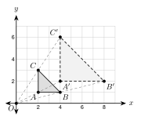
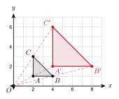
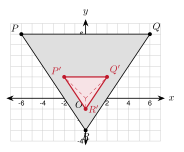
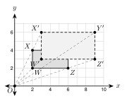
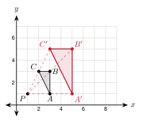
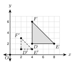
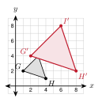
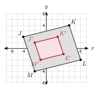

# 3.4 - Dilations {.unnumbered}

A projector shines a small slide onto a big wall. The picture on the wall has the same shape as the slide. It is much bigger.

{width=380px fig-align="center"}

The figure shows the idea. Each point moves along a ray from the center $O$. Each new point is twice as far from $O$ as the old point. This kind of size change is a **dilation**. In this lesson you enlarge and reduce figures on the coordinate plane.

:::{.objectives}
- [ ] I can dilate a point or a figure with a scale factor.
- [ ] I can use distance and slope to show what a dilation changes and what it keeps.
- [ ] I can find the scale factor from a figure and its image.
- [ ] I can dilate a figure from a center that is not the origin.
:::

:::{.vocab}
,
,
,
,

:::

:::{.guided-notes-link}
[Printable Guided Notes for this lesson](/guided_notes/Unit_3/3.4_Dilations.html){target="_blank"} (fill-in notes to print and write on)
:::



1. Find the distance from $(0, 0)$ to $(3, 4)$.

2. Find the slope of the line through $(2, 1)$ and $(4, 3)$.

3. Solve $\dfrac{x}{4} = 6$.



### 3.4.1 - Scale Factor

A dilation makes a figure bigger or smaller. It keeps the shape. The number that tells how much the size changes is the **scale factor**, $k$.

* A **dilation** changes the size of a figure from a fixed point, the center. The shape stays the same.
* If $k > 1$, the image is larger: an enlargement. If $0 < k < 1$, the image is smaller: a reduction.
* With the center at the origin: $(x, y) \rightarrow (kx, ky)$.

***

**Example 1:** Dilate points

The center is the origin. Dilate $P(4, -6)$ with $k = \dfrac{1}{2}$. Dilate $Q(-2, 5)$ with $k = 3$.

$P' = \left(\dfrac{1}{2} \cdot 4, \dfrac{1}{2} \cdot (-6)\right) = (2, -3)$

$Q' = (3 \cdot (-2), 3 \cdot 5) = (-6, 15)$

$P'$ is closer to the origin, so this is a reduction. $Q'$ is farther, so this is an enlargement.

***

**Example 2:** Enlarge a triangle

{width=360px fig-align="center"}

Dilate $\triangle ABC$ with $k = 2$ about the origin. $A(2, 1)$, $B(4, 1)$, $C(2, 3)$.

$A' = (4, 2)$

$B' = (8, 2)$

$C' = (4, 6)$

***

**Example 3:** Reduce a triangle

{width=340px fig-align="center"}

Dilate $\triangle PQR$ with $k = \dfrac{1}{3}$ about the origin. $P(-6, 6)$, $Q(6, 6)$, $R(0, -3)$.

$P' = (-2, 2)$, $Q' = (2, 2)$, $R' = (0, -1)$

:::{.you-try title="Dilate $J(2, -4)$, $K(6, 0)$, $L(4, 4)$ with $k = \dfrac{1}{2}$ about the origin. Give the image coordinates."}
$J'(1, -2)$, $K'(3, 0)$, $L'(2, 2)$
:::

### 3.4.2 - What Changes and What Stays

A dilation changes lengths. It does not change angles. We can check both with coordinates.

* Every length is multiplied by $k$.
* Every angle measure stays the same.
* Each side is parallel to its image. (They have the same slope.)
* A dilation is not a rigid motion, because lengths change (unless $k = 1$).

***

**Example 4:** Check a dilation

{width=320px fig-align="center"}

In the triangle with $A(2, 1)$, $B(4, 1)$, $C(2, 3)$ and $k = 2$, compare the sides.

$AB = 2$ and $A'B' = 4$. $A'B' = 2 \cdot AB$.

$BC = \sqrt{4 + 4} = 2\sqrt{2}$ and $B'C' = \sqrt{16 + 16} = 4\sqrt{2}$. $B'C' = 2 \cdot BC$.

Slope of $\overline{BC}$: $\dfrac{3 - 1}{2 - 4} = -1$. Slope of $\overline{B'C'}$: $\dfrac{6 - 2}{4 - 8} = -1$.

The slopes are equal, so $\overline{BC} \parallel \overline{B'C'}$. The angle at $A$ is $90^\circ$ and the angle at $A'$ is $90^\circ$.

:::{.gotcha title="Same shape, not same size"}
A dilation makes a **similar** figure. It does not make a congruent one. Do not say that a dilation keeps lengths. It multiplies them by $k$.
:::

:::{.you-try title="$P(1, 2)$ and $Q(4, 6)$ are dilated with $k = 3$ about the origin. Find $PQ$, $P'Q'$, and both slopes."}
$P'(3, 6)$, $Q'(12, 18)$. $PQ = 5$ and $P'Q' = 15$. Both slopes are $\dfrac{4}{3}$.
:::

### 3.4.3 - Finding the Scale Factor

Compare a length in the image to the same length in the original.

* $k = \dfrac{\text{image length}}{\text{original length}}$
* If $k$ is more than 1, it is an enlargement. If $k$ is less than 1, it is a reduction.

***

**Example 5:** Find $k$ from a figure

{width=340px fig-align="center"}

Rectangle $WXYZ$ is dilated about the origin to $W'X'Y'Z'$. Find the scale factor.

Original width $WZ = 4$. Image width $W'Z' = 6$.

$k = \dfrac{6}{4} = \dfrac{3}{2}$

Check with a point: $W(2, 2) \rightarrow W'(3, 3)$, and $3 \div 2 = \dfrac{3}{2}$.

$k > 1$, so it is an enlargement.

:::{.you-try-m title="Try it"}
a. A side of 12 cm becomes 30 cm. Find $k$.

b. $A(-4, 6)$ maps to $A'(-2, 3)$ about the origin. Find $k$.
:::

:::{.answer title="Answer"}
a. $k = \dfrac{30}{12} = \dfrac{5}{2} = 2.5$

b. $k = \dfrac{-2}{-4} = \dfrac{1}{2}$. It is a reduction.
:::

:::{.real-world title="Maps and models"}
A model car has a scale of $1:24$. That is $k = \dfrac{1}{24}$. A real car 180 inches long becomes a model $180 \cdot \dfrac{1}{24} = 7.5$ inches long.
:::

### 3.4.4 - A Center That Is Not the Origin

When the center is $C(h, j)$, move the center to the origin first. Then dilate. Then move back.

* Step 1: Subtract the center: $(x - h, y - j)$.
* Step 2: Multiply by $k$.
* Step 3: Add the center back.

***

**Example 6:** Dilate about a point

{width=340px fig-align="center"}

Dilate $\triangle ABC$ with $k = 2$ about the center $P(1, 1)$. $A(3, 1)$, $B(3, 3)$, $C(2, 3)$.

$A$: $(3 - 1, 1 - 1) = (2, 0)$. Times 2: $(4, 0)$. Add back: $A' = (5, 1)$.

$B$: $(2, 2) \rightarrow (4, 4) \rightarrow B' = (5, 5)$.

$C$: $(1, 2) \rightarrow (2, 4) \rightarrow C' = (3, 5)$.

:::{.you-try title="Dilate $B(4, 2)$ with $k = 3$ about the center $(2, 1)$."}
$(4 - 2, 2 - 1) = (2, 1)$. Times 3: $(6, 3)$. Add back: $(8, 4)$.
:::



**Use the figure for problems 1 to 4.**

{width=330px fig-align="center"}

1. What is the center of the dilation?

2. Find the scale factor.

3. Is it an enlargement or a reduction?

4. Find $DE$ and $D'E'$.

***

**Dilate each point about the origin.**

5. $(3, 4)$ with $k = 2$

6. $(-5, 2)$ with $k = 3$

7. $(8, -6)$ with $k = \dfrac{1}{2}$

8. $(-9, 12)$ with $k = \dfrac{1}{3}$

9. $(2, -7)$ with $k = 4$

10. $(10, -5)$ with $k = \dfrac{2}{5}$

11. $(6, -3)$ with $k = \dfrac{3}{2}$

12. $(0, 5)$ with $k = 3$

***

**Graph the image.**

{width=290px fig-align="center"}

13. Dilate $\triangle GHI$ with $k = 2$ about the origin. Give the image coordinates.

***

**Graph the image.**

{width=290px fig-align="center"}

14. Dilate $JKLM$ with $k = \dfrac{1}{2}$ about the origin. Give the image coordinates.

***

**Graph the image on your own grid.**

15. Triangle $UVW$ has $U(1, -1)$, $V(2, 1)$, $W(-1, 1)$. Dilate it with $k = 3$ about the origin. Give the image coordinates.

***

**Find the scale factor.**

16. A side of 4 inches becomes 10 inches.

17. A side of 12 cm becomes 3 cm.

18. $A(2, 5) \rightarrow A'(6, 15)$ about the origin.

19. $A(-8, 6) \rightarrow A'(-2, 1.5)$ about the origin.

***

**Dilate about the given center.**

20. $A(4, 3)$ with $k = 3$, center $(2, 1)$.

21. $A(-1, 5)$ with $k = 2$, center $(1, 2)$.

22. $A(9, 1)$ with $k = \dfrac{1}{2}$, center $(3, -1)$.

***

**Check what changes and what stays.**

23. $A(1, 2)$ and $B(4, 6)$ are dilated with $k = 2$ about the origin. Show that $A'B' = 2 \cdot AB$ and that the slopes are equal.

24. A dilation with $k = 3$ maps $\triangle ABC$ to $\triangle A'B'C'$. $AB = 5$ cm and $m\angle B = 40^\circ$. Find $A'B'$ and $m\angle B'$.

25. A segment has length $3x + 1$. Its image with $k = 2$ has length $5x + 8$. Find $x$.

26. The point $(4m, 2m - 1)$ is dilated with $k = 3$ about the origin. The image is $(24, 9)$. Find $m$.

***

**Real problems.**

27. A photo is 4 inches by 6 inches. It is enlarged with $k = 2.5$. Find the new width and length.

28. A model car has a scale of $1:24$. The real car is 15 feet long. How long is the model in inches?

***

**Find the mistake.**

29. Lucía dilates $(6, -4)$ with $k = \dfrac{1}{2}$ about the origin and writes $(12, -8)$. What did she do wrong? What is the right answer?

***

**Test practice**

30. What are the coordinates of the image of $(-6, 9)$ after a dilation about the origin with scale factor $\dfrac{1}{3}$?

    A. $(-2, 3)$\
    B. $(-18, 27)$\
    C. $(-3, 6)$\
    D. $(2, -3)$

31. Triangle $ABC$ is dilated with scale factor 3 to form triangle $A'B'C'$. $AB = 4$ and $m\angle A = 50^\circ$. Which statement is true?

    A. $A'B' = 12$ and $m\angle A' = 50^\circ$\
    B. $A'B' = 12$ and $m\angle A' = 150^\circ$\
    C. $A'B' = 4$ and $m\angle A' = 50^\circ$\
    D. $A'B' = 7$ and $m\angle A' = 53^\circ$

***

**Challenge**

32. A dilation about the origin maps $A(2, 4)$ to $A'(5, 10)$. It also maps $B(6, m)$ to $B'(15, 25)$. Find the scale factor and $m$.

