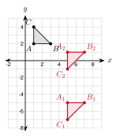
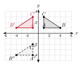
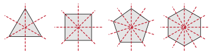
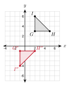
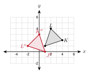
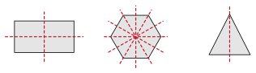

# 3.5 - Sequences of Transformations and Symmetry {.unnumbered}

Look at this hubcap. It has 5 spokes that look the same.

{width=220px fig-align="center"}

Turn the hubcap one fifth of the way around. It looks exactly the same. That turn is a transformation that maps the hubcap onto itself. In this lesson you do two or more transformations in a row. Then you use transformations to find symmetry.

:::{.objectives}
- [ ] I can do a sequence of transformations and write one rule for it.
- [ ] I can show that the order of transformations can matter.
- [ ] I can describe a sequence that maps one figure onto another.
- [ ] I can find the lines of symmetry and the rotational symmetry of a figure.
:::

:::{.vocab}
,
,
,
,

:::

:::{.guided-notes-link}
[Printable Guided Notes for this lesson](/guided_notes/Unit_3/3.5_Sequences_of_Transformations_and_Symmetry.html){target="_blank"} (fill-in notes to print and write on)
:::



1. Reflect $(3, -4)$ over the $y$-axis.

2. Rotate $(2, 5)$ by $90^\circ$ counterclockwise about the origin.

3. Solve $\dfrac{360}{n} = 72$.



### 3.5.1 - One After Another

Do one transformation. Then do another to the image. The first image is $A'$. The second image is $A''$ (read "A double prime").

* A **sequence of transformations** does one transformation after another.
* $A \rightarrow A'\rightarrow A''$. Always do the moves in the order given.
* A **combined rule** shows the whole sequence in one rule.

***

**Example 1:** Do a sequence

Translate $P(2, 5)$ by $(x + 3, y - 2)$. Then reflect the image over the $y$-axis.

Step 1: $P' = (2 + 3, 5 - 2) = (5, 3)$

Step 2: $P'' = (-5, 3)$, so $P'' = (-5, 3)$

Combined rule: $(x, y) \rightarrow (-x - 3, y - 2)$. Check: $(-2 - 3, 5 - 2) = (-5, 3)$.

:::{.you-try-m title="Try it"}
a. Reflect $Q(-4, 1)$ over the $x$-axis. Then translate by $(x + 6, y + 2)$. Find $Q''$.

b. Translate by $(x + 2, y + 5)$. Then translate by $(x - 7, y - 1)$. Write one rule.
:::

:::{.answer title="Answer"}
a. $Q' = (-4, -1)$. $Q'' = (2, 1)$.

b. $(x + 2 - 7, y + 5 - 1) = (x - 5, y + 4)$
:::

### 3.5.2 - Does Order Matter?

Sometimes the order does not change the result. Often it does.

* Two translations in either order give the same image.
* A reflection and a translation, in a different order, often give a different image.
* One example that gives different images is a counterexample to the claim "order never matters."

***

**Example 2:** A counterexample

Use $P(2, 1)$. Do these two moves in both orders: reflect over the $x$-axis, and translate by $(x + 4, y - 3)$.

Reflect first: $(2, -1)$. Then translate: $(6, -4)$.

Translate first: $(6, -2)$. Then reflect: $(6, 2)$.

The images are different. So order matters here.

***

**Example 3:** See it on a triangle

{width=340px fig-align="center"}

$A(1, 2)$, $B(3, 2)$, $C(1, 4)$. Reflect over the $x$-axis, then translate by $(x + 4, y - 3)$. This gives $A_1$, $B_1$, $C_1$. Do the moves in the other order to get $A_2$, $B_2$, $C_2$.

$A_1 = (5, -5)$, $B_1 = (7, -5)$, $C_1 = (5, -7)$

$A_2 = (5, 1)$, $B_2 = (7, 1)$, $C_2 = (5, -1)$

:::{.you-try title="Use $R(3, 4)$. Is "translate by $(x + 2, y)$, then reflect over the $y$-axis" the same as "reflect over the $y$-axis, then translate by $(x + 2, y)$"?"}
First way: $(5, 4) \rightarrow (-5, 4)$. Second way: $(-3, 4) \rightarrow (-1, 4)$. They are not the same.
:::

### 3.5.3 - Describing a Sequence

To describe a sequence, find the moves that take the preimage to the final image. There is often more than one correct answer.

* Look at the orientation. If it reversed, the sequence needs a reflection.
* Compare sizes. If the size changed, the sequence needs a dilation.
* Check your sequence with one or two vertices.

***

**Example 4:** Describe a sequence

{width=340px fig-align="center"}

$\triangle ABC$ with $A(1, 1)$, $B(4, 1)$, $C(1, 3)$ maps to $\triangle A''B''C''$. Describe a sequence.

The labels go the other way around, so the sequence includes a reflection.

Reflect over the $y$-axis: $A' = (-1, 1)$. Then translate: $A'' = (-1, -4)$, which is 5 down: $(x, y - 5)$.

Another answer: translate 5 down first, then reflect over the $y$-axis. It gives the same $\triangle A''B''C''$.

:::{.you-try title="$D(2, 3)$, $E(5, 3)$, $F(2, 5)$ map to $D''(-2, 4)$, $E''(-2, 7)$, $F''(-4, 4)$. Describe a sequence. Hint: try a rotation first."}
Rotate $90^\circ$ counterclockwise about the origin: $D'(-3, 2)$. Then translate $(x + 1, y + 2)$: $D''(-2, 4)$. Check $E$: $(-3, 5) \rightarrow (-2, 7)$.
:::

### 3.5.4 - Rigid Motions and Dilations

Which transformations keep lengths and angles?

| Transformation | Keeps lengths? | Keeps angles? | Rigid motion? |
|:---:|:---:|:---:|:---:|
| translation | yes | yes | yes |
| reflection | yes | yes | yes |
| rotation | yes | yes | yes |
| dilation ($k \ne 1$) | no | yes | no |

* Any sequence of rigid motions is a rigid motion. It keeps lengths and angles.
* A dilation changes lengths. It keeps angles.

***

**Example 5:** Choose the transformation

Which transformation fits each description?

a. Lengths and angles stay the same. The figure is flipped. reflection

b. All lengths double. Angles stay the same. dilation

c. Lengths and angles stay the same. The figure is only moved over. translation

:::{.you-try title="Triangle $ABC$ has sides 3, 4, 5. Triangle $A'B'C'$ has sides 6, 8, 10 and the same angles. Could a sequence of rigid motions map $ABC$ onto $A'B'C'$? Explain."}
No. Rigid motions keep lengths. A dilation with $k = 2$ is needed.
:::

### 3.5.5 - Symmetry

A figure has symmetry if a transformation maps it onto itself.

* **Line symmetry**: a reflection over a line maps the figure onto itself. The line is a line of symmetry.
* **Rotational symmetry**: a rotation of less than $360^\circ$ maps the figure onto itself.
* The **order** $n$ is the number of times it fits in one full turn. The smallest angle is $\dfrac{360^\circ}{n}$.

***

**Example 6:** Symmetry of letters

{width=300px fig-align="center"}

Find the lines of symmetry and the order of rotational symmetry.

**H**: 2 lines (vertical and horizontal). Turn $180^\circ$ and it fits. Order 2.

**S**: 0 lines. Turn $180^\circ$ and it fits. Order 2.

**A**: 1 line (vertical). No turn less than $360^\circ$ fits. Order 1.

***

**Example 7:** Regular polygons

{width=380px fig-align="center"}

A regular polygon with $n$ sides has $n$ lines of symmetry and rotational symmetry of order $n$ (see 1.5).

Equilateral triangle: 3 lines, order 3, smallest angle $\dfrac{360}{3} = 120^\circ$.

Square: 4 lines, order 4, smallest angle $\dfrac{360}{4} = 90^\circ$.

Regular pentagon: 5 lines, order 5, smallest angle $\dfrac{360}{5} = 72^\circ$.

:::{.you-try title="Find the order and the smallest angle of rotation for a regular hexagon. How many lines of symmetry does it have?"}
Order 6, smallest angle $\dfrac{360}{6} = 60^\circ$, and 6 lines of symmetry.
:::

:::{.gotcha title="A rectangle is not a square"}
A rectangle that is not a square has **2** lines of symmetry, not 4. Folding it along a diagonal does not make the halves match.
:::



**Do the moves in order. Give the final image of the point.**

1. $(1, 4)$: translate by $(x + 2, y - 3)$, then reflect over the $x$-axis.

2. $(-3, 2)$: reflect over the $y$-axis, then translate by $(x - 1, y + 4)$.

3. $(4, -1)$: rotate $90^\circ$ counterclockwise about the origin, then reflect over the $x$-axis.

4. $(-2, -5)$: dilate with $k = 2$ about the origin, then translate by $(x + 3, y + 3)$.

5. $(5, 3)$: rotate $180^\circ$ about the origin, then reflect over the $y$-axis.

6. $(0, 6)$: reflect over the line $y = x$, then rotate $270^\circ$ counterclockwise about the origin.

***

**Write one combined rule.**

7. Translate by $(x + 4, y - 1)$. Then reflect over the $y$-axis.

8. Reflect over the $x$-axis. Then dilate with $k = 3$ about the origin.

9. Translate by $(x + 2, y + 5)$. Then translate by $(x - 7, y - 1)$.

10. Rotate $180^\circ$ about the origin. Then translate by $(x + 6, y - 2)$.

***

**Graph the final image.**

{width=280px fig-align="center"}

11. Reflect $\triangle GHI$ over the $x$-axis. Then translate by $(x - 3, y + 2)$. Give the coordinates of $G''$, $H''$, $I''$.

***

**Graph the final image.**

{width=280px fig-align="center"}

12. Rotate $\triangle JKL$ by $90^\circ$ counterclockwise about the origin. Then translate by $(x + 2, y - 1)$. Give the coordinates of $J''$, $K''$, $L''$.

***

**Does order matter?**

13. Use $P(2, 5)$. Show that "translate by $(x + 3, y)$, then reflect over the $y$-axis" is different from "reflect over the $y$-axis, then translate by $(x + 3, y)$".

14. True or false: two translations in either order give the same image. Explain.

15. Diego says "reflect over the $x$-axis, then over the $y$-axis" is the same as a $180^\circ$ rotation about the origin. Test it with $(3, -2)$.

***

**Describe a sequence.**

16. $A(1, 2)$, $B(4, 2)$, $C(1, 5)$ map to $A''(-1, -2)$, $B''(-4, -2)$, $C''(-1, -5)$. Find one transformation that does it.

17. $D(1, 1)$, $E(3, 1)$, $F(1, 4)$ map to $D''(5, 0)$, $E''(7, 0)$, $F''(5, -3)$. Describe a sequence.

18. Describe a different sequence for problem 17.

***

**Classify the transformation.**

19. A transformation keeps all lengths and angles. Which of these could it be: translation, reflection, rotation, dilation?

20. A triangle with sides 3, 4, 5 maps to a triangle with sides 6, 8, 10 and the same angles. Which transformation is it? Is it a rigid motion?

21. True or false: every dilation is a rigid motion. Explain.

***

**Use the figure for problems 22 to 24. How many lines of symmetry does each shape have?**

{width=360px fig-align="center"}

22. The rectangle.

23. The regular hexagon.

24. The isosceles triangle.

***

**Find the order of rotational symmetry and the smallest angle of rotation.**

25. A regular octagon.

26. The letter N.

27. A hubcap with 5 equal spokes.

28. A snowflake with 6 equal arms.

***

**Solve and find the mistake.**

29. A regular polygon has a smallest rotation of $36^\circ$. How many sides does it have?

30. Fatima says a rectangle that is not a square has 4 lines of symmetry because a square has 4. What is wrong?

***

**Test practice**

31. The point $(3, -2)$ is translated by $(x - 4, y + 1)$. Then the image is reflected over the $x$-axis. What are the coordinates of the final image?

    A. $(-1, 1)$\
    B. $(-1, -1)$\
    C. $(1, 1)$\
    D. $(-7, 3)$

32. A regular polygon has rotational symmetry. The smallest angle of rotation that maps it onto itself is $45^\circ$. Which polygon is it?

    A. regular octagon\
    B. regular hexagon\
    C. regular nonagon\
    D. regular decagon

***

**Challenge**

33. Reflect $P(3, 2)$ over the line $x = 1$. Then reflect the image over the line $x = 4$. Find $P''$. Compare $P$ and $P''$. What single translation does this equal? How does its size relate to the distance between the two lines?

