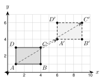
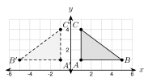
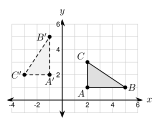
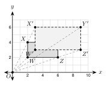
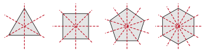

# Unit 3 Summary {.unnumbered}

:::{.guided-notes-link}
[Printable Unit 3 Summary](/guided_notes/Unit_3/Unit_3_Summary.html){target="_blank"} (a reference sheet to print and keep)
:::

## 3.1 - Translations

* A **transformation** moves a figure by a rule. The starting figure is the **preimage**. The new figure is the **image**. Point $A$ becomes $A'$.
* A **translation** slides every point the same distance in the same direction: $(x, y) \rightarrow (x + a, y + b)$.
* Positive $a$ moves right and negative $a$ moves left. Positive $b$ moves up and negative $b$ moves down.
* To find the rule, use **image minus preimage** for $x$ and for $y$.
* To graph an image, move every vertex and connect the new points in the same order.
* A translation keeps lengths and angles. Each side is parallel to its image. It is a **rigid motion**.

{width=300px fig-align="center"}

Example: $(x - 3, y + 5)$ applied to $P(2, -4)$ gives $P' = (-1, 1)$.

## 3.2 - Reflections

* A **reflection** flips a figure over a **line of reflection**. A point and its image are the same distance from the line.
* Over the $x$-axis: $(x, -y)$. Over the $y$-axis: $(-x, y)$. Over $y = x$: $(y, x)$. Over $y = -x$: $(-y, -x)$.
* Over $x = a$ or $y = b$: count the distance to the line and go the same distance to the other side.
* The line of reflection is the **perpendicular bisector** of $\overline{AA'}$. It goes through the midpoint and is perpendicular.
* A reflection is a rigid motion. It reverses **orientation**.

{width=300px fig-align="center"}

Example: reflect $(3, -4)$ over $y = -x$. $(-y, -x) = (4, -3)$.

## 3.3 - Rotations

* A **rotation** turns a figure about a **center** by an angle in a direction. Counterclockwise is positive.
* $90^\circ$ clockwise is the same as $270^\circ$ counterclockwise.
* About the origin: $90^\circ$ is $(-y, x)$. $180^\circ$ is $(-x, -y)$. $270^\circ$ is $(y, -x)$.
* A point and its image are the same distance from the center. For $90^\circ$, the two radii are perpendicular (slopes multiply to $-1$).
* A rotation is a rigid motion. It does not reverse orientation.

{width=300px fig-align="center"}

Example: rotate $(2, 5)$ by $270^\circ$ counterclockwise. $(y, -x) = (5, -2)$.

## 3.4 - Dilations

* A **dilation** has a center and a **scale factor** $k$. About the origin: $(x, y) \rightarrow (kx, ky)$.
* $k > 1$ is an **enlargement**. $0 < k < 1$ is a **reduction**.
* Every length is multiplied by $k$. Angles stay the same. Each side is parallel to its image.
* A dilation is not a rigid motion. $k = \dfrac{\text{image length}}{\text{original length}}$.
* Center $(h, j)$: subtract the center, multiply by $k$, add the center back.

{width=300px fig-align="center"}

Example: dilate $B(4, 2)$ with $k = 3$ about $(2, 1)$. $(2, 1) \rightarrow (6, 3) \rightarrow (8, 4)$.

## 3.5 - Sequences of Transformations and Symmetry

* A **sequence** does one transformation after another: $A \rightarrow A' \rightarrow A''$.
* Order can matter. Two translations commute, but a reflection and a translation usually do not.
* To describe a sequence, check orientation (reflection?) and size (dilation?). Test a vertex. More than one answer can be right.
* Any sequence of translations, reflections, and rotations is a rigid motion. A dilation is not.
* A regular polygon with $n$ sides has $n$ lines of symmetry and rotational symmetry of order $n$. The smallest angle of rotation is $\dfrac{360^\circ}{n}$.

{width=400px fig-align="center"}

Example: translate $(x + 3, y)$, then reflect over the $y$-axis. One rule: $(-x - 3, y)$.
