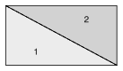
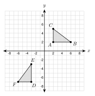
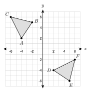
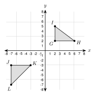
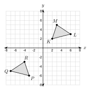

# 4.1 - Congruent Figures and Rigid Motions {.unnumbered}

A shelf maker cuts a board along its diagonal. The cut makes two triangles.

{width=360px fig-align="center"}

Lay piece 1 over piece 2 and they match exactly. They have the same size and the same shape. Figures like this are **congruent**. In this lesson you learn how to tell when figures are congruent. You also use matching parts to find missing lengths and angles.

:::{.objectives}
- [ ] I can use rigid motions to decide if two figures are congruent.
- [ ] I can write a congruence statement and name the corresponding parts.
- [ ] I can use corresponding parts to find missing sides and angles.
- [ ] I can decide on a coordinate grid if two figures are congruent.
:::

:::{.vocab}
,
,
,

:::

:::{.guided-notes-link}
[Printable Guided Notes for this lesson](/guided_notes/Unit_4/4.1_Congruent_Figures_and_Rigid_Motions.html){target="_blank"} (fill-in notes to print and write on)
:::



1. Reflect $(3, -2)$ over the $y$-axis.

2. Find the distance between $(1, 2)$ and $(4, 6)$.

3. Solve $3x - 2 = x + 10$.



### 4.1.1 - Congruent Figures

* Two figures are **congruent** if one can be moved onto the other with rigid motions.
* Rigid motions are translations, reflections, and rotations. They keep every length and every angle the same.
* Congruent figures have the same size and the same shape.
* A dilation changes the size. It can not show that figures are congruent.

***

**Example 1:** Find the rigid motions

{width=300px fig-align="center"}

Is $\triangle DEF$ congruent to $\triangle ABC$? $A(2, 2)$, $B(6, 2)$, $C(2, 5)$, $D(-3, -7)$, $E(-3, -3)$, $F(-6, -7)$.

Step 1: Rotate $90^\circ$ counterclockwise about the origin. $(x, y) \rightarrow (-y, x)$.

$A' = $ $(-2, 2)$, $B' = $ $(-2, 6)$, $C' = $ $(-5, 2)$

Step 2: Translate by $(x - 1, y - 9)$.

$A'' = $ $(-3, -7)$, $B'' = $ $(-3, -3)$, $C'' = $ $(-6, -7)$

The points land on $D$, $E$, and $F$. Both motions are rigid, so the triangles are congruent.

***

**Example 2:** Same shape is not enough

Amira says $\triangle ABC$ and $\triangle GHI$ are congruent because they have the same shape. $\triangle ABC$ has sides $3$, $4$, $5$. $\triangle GHI$ has sides $6$, $8$, $10$. Is she right?

No. Every side of $\triangle GHI$ is 2 times as long as the matching side of $\triangle ABC$.

A dilation with scale factor 2 moves one onto the other. A dilation is not a rigid motion, so the triangles are not congruent.

:::{.you-try-m title="Try it"}
a. A figure is reflected over the $x$-axis and then translated 4 units left. Is the image congruent to the original? Why?

b. A figure is dilated with scale factor $\frac{3}{2}$. Is the image congruent to the original? Why?

:::

:::{.answer title="Answer"}
a. Yes. A reflection and a translation are both rigid motions. They keep size and shape.

b. No. A dilation changes the size. It is not a rigid motion.

:::

### 4.1.2 - Corresponding Parts and Congruence Statements

* **Corresponding parts** are the sides and angles that match when one figure is moved onto the other.
* In a congruence statement, the order of the letters matters. In $\triangle ABC \cong \triangle FDE$, $A$ matches $F$, $B$ matches $D$, and $C$ matches $E$.
* So $\overline{AB}$ matches $\overline{FD}$, and $\angle A$ matches $\angle F$.
* Tick marks on sides and arcs on angles show which parts are congruent.

***

**Example 3:** Match the parts

{width=440px fig-align="center"}

$\triangle ABC \cong \triangle FDE$. Name every pair of corresponding parts.

Sides: $\overline{AB}$ and $\overline{FD}$, $\overline{BC}$ and $\overline{DE}$, $\overline{AC}$ and $\overline{FE}$.

Angles: $\angle A$ and $\angle F$, $\angle B$ and $\angle D$, $\angle C$ and $\angle E$.

Check with the marks. One tick is on $\overline{AB}$ and $\overline{FD}$. Two ticks are on $\overline{BC}$ and $\overline{DE}$. Three ticks are on $\overline{AC}$ and $\overline{FE}$.

:::{.you-try-m title="Try it"}
a. $\triangle JKL \cong \triangle MNP$. Which side matches $\overline{KL}$?

b. Which angle matches $\angle P$?

:::

:::{.answer title="Answer"}
a. $\overline{NP}$

b. $\angle L$

:::

***

**Example 4:** Find the mistake

Kofi looks at the marks in the figure above. He writes $\triangle ABC \cong \triangle DEF$. Find his mistake. Write a correct statement.

The marks show that $\angle A$ matches $\angle F$, not $\angle D$.

Kofi wrote the letters in the order he saw them. The statement must follow the marks.

Correct statement: $\triangle ABC \cong \triangle FDE$

:::{.gotcha title="Order matters"}
$\triangle ABC \cong \triangle DEF$ and $\triangle ABC \cong \triangle FDE$ say different things. Always match the letters in the same positions.
:::

### 4.1.3 - Using Corresponding Parts

* Corresponding parts of congruent figures are congruent. Matching sides have the same length. Matching angles have the same measure.
* To find a missing part, find its corresponding part. Then write an equation.

***

**Example 5:** Find $x$ and $y$

{width=440px fig-align="center"}

$ABCD \cong EFGH$. $AB = 3x - 2$ and $EF = x + 10$. $m\angle C = (4y + 6)^\circ$ and $m\angle G = 78^\circ$. Find $x$, $y$, and $AB$.

$\overline{AB}$ matches $\overline{EF}$, so $3x - 2 = x + 10$.

$2x = 12$, so $x = $ 6

$AB = 3(6) - 2 = $ 16

$\angle C$ matches $\angle G$, so $4y + 6 = 78$.

$4y = 72$, so $y = $ 18

:::{.you-try title="$\triangle PQR \cong \triangle XYZ$. $PQ = 2a + 5$, $XY = 17$, $m\angle R = (3b - 4)^\circ$, $m\angle Z = 59^\circ$. Find $a$ and $b$."}
$2a + 5 = 17$, so $a = 6$. $3b - 4 = 59$, so $b = 21$.
:::

:::{.real-world title="Parts that must match"}
A factory stamps out thousands of the same bracket. Each bracket must be congruent to the plan, or the bolt holes will not line up.
:::

### 4.1.4 - Congruence on a Grid

* On a grid, find the rigid motions that move one figure onto the other.
* Or use the distance formula on every side. If one pair of matching sides has different lengths, the figures are not congruent.
* If all three sides of one triangle match all three sides of another, the triangles are congruent. You will see why in 4.2.

***

**Example 6:** Show with distances

{width=300px fig-align="center"}

Show that $\triangle ABC \cong \triangle DEF$. $A(-4, 2)$, $B(-2, 5)$, $C(-6, 6)$, $D(2, -4)$, $E(5, -6)$, $F(6, -2)$.

$AB = \sqrt{2^2 + 3^2} = $ $\sqrt{13}$ and $DE = \sqrt{3^2 + (-2)^2} = $ $\sqrt{13}$

$BC = \sqrt{(-4)^2 + 1^2} = $ $\sqrt{17}$ and $EF = \sqrt{1^2 + (-4)^2} = $ $\sqrt{17}$

$AC = \sqrt{(-2)^2 + 4^2} = $ $\sqrt{20}$ and $DF = \sqrt{4^2 + 2^2} = $ $\sqrt{20}$

All three pairs match, so $\triangle ABC \cong \triangle DEF$.

***

**Example 7:** Show they are not congruent

{width=300px fig-align="center"}

Are $\triangle GHI$ and $\triangle JKL$ congruent? $G(2, 2)$, $H(6, 2)$, $I(2, 5)$, $J(-7, -3)$, $K(-3, -3)$, $L(-7, -7)$.

$GH = $ 4 and $JK = $ 4. They match.

$GI = $ 3 but $JL = $ 4. They do not match.

One pair of sides is different, so the triangles are not congruent. Both are right triangles, but the sides decide.

:::{.you-try title="$P(2, 3)$, $Q(2, 7)$, $R(5, 3)$, $X(-3, -2)$, $Y(-7, -2)$, $Z(-3, -5)$. Are $\triangle PQR$ and $\triangle XYZ$ congruent? Use distances."}
$PQ = 4$, $PR = 3$, $QR = 5$. $XY = 4$, $XZ = 3$, $YZ = 5$. All three pairs match, so $\triangle PQR \cong \triangle XYZ$.
:::



**Use the figure for problems 1 to 3.**

{width=420px fig-align="center"}

1. Write a congruence statement for the two triangles.

2. Which side matches $\overline{ST}$?

3. Which angle matches $\angle Z$?

***

**$\triangle JKL \cong \triangle MNP$. Complete.**

4. Which side matches $\overline{JL}$?

5. Which angle matches $\angle N$?

6. If $JK = 9$, then $MN = $

7. If $m\angle L = 48^\circ$, then $m\angle P = $

8. Write another correct statement.

***

**$ABCD \cong WXYZ$. Complete.**

9. Which side matches $\overline{CD}$?

10. Which angle matches $\angle B$?

11. Write the statement that starts with $BCDA$.

12. If $AD = 7$, then $WZ = $

***

**Find the variable and the measure.**

13. $\triangle ABC \cong \triangle DEF$. $AB = 5x - 4$ and $DE = 2x + 8$. Find $x$ and $AB$.

14. $\triangle ABC \cong \triangle DEF$. $m\angle A = (4x + 2)^\circ$ and $m\angle D = (6x - 18)^\circ$. Find $x$ and $m\angle A$.

15. $ABCD \cong EFGH$. $BC = 3y + 1$ and $FG = 2y + 9$. Find $y$ and $BC$.

16. $ABCD \cong EFGH$. $m\angle D = (2z + 10)^\circ$ and $m\angle H = (5z - 20)^\circ$. Find $z$ and $m\angle D$.

17. $\triangle PQR \cong \triangle STU$. $PQ = x + 7$, $ST = 3x - 5$, and $QR = 2x$. Find $x$ and $TU$.

***

**Use the figure for problems 18 and 19.**

{width=300px fig-align="center"}

18. Describe rigid motions that move $\triangle KLM$ onto $\triangle PQR$.

19. Show that $KL = PQ$ with the distance formula.

***

**Use distances to decide.**

20. $A(0, 0)$, $B(6, 0)$, $C(0, 8)$ and $D(2, 2)$, $E(2, 8)$, $F(10, 2)$. Are $\triangle ABC$ and $\triangle DEF$ congruent?

21. $G(1, 2)$, $H(4, 2)$, $I(4, 6)$ and $J(-2, -1)$, $K(-2, -5)$, $L(-6, -5)$. Are $\triangle GHI$ and $\triangle JKL$ congruent?

***

**Real problems.**

22. Hnin's folding table has two halves. Each half is a rectangle 48 inches by 30 inches. Which rigid motion moves one half onto the other when the table folds? Are the halves congruent?

23. Esperanza's plan for a bracket is a triangle with sides 5 in, 12 in, and 13 in. A bracket is cut with sides 5 in, 12 in, and 14 in. Is it congruent to the plan? Explain.

***

**Find the mistake.**

24. A rectangle 6 ft by 4 ft and a rectangle 8 ft by 3 ft both have an area of 24 square feet. Moses says they are congruent. Find his mistake.

25. Thu says two triangles are congruent because both have angles $40^\circ$, $60^\circ$, and $80^\circ$. Find her mistake.

***

**Use the figure for problems 26 and 27.**

{width=440px fig-align="center"}

26. Which pairs of parts do the marks tell you are congruent?

27. The triangles look the same. Can you write $\triangle ABC \cong \triangle DEF$ from the marks? Explain.

***

**Test practice**

28. $\triangle LMN \cong \triangle RST$. Which pair of corresponding parts is correct?

    A. $\overline{LM}$ and $\overline{ST}$\
    B. $\angle M$ and $\angle T$\
    C. $\overline{MN}$ and $\overline{ST}$\
    D. $\angle N$ and $\angle R$

29. A student wants to show that two figures are congruent. Which is the best evidence?

    A. They have the same area.\
    B. They have the same number of sides.\
    C. A sequence of translations, reflections, and rotations maps one onto the other.\
    D. They have the same angle measures.

***

**Challenge**

30. $A(0, 0)$, $B(4, 0)$, and $C(1, 3)$. Find two different points $D$ below $\overline{AB}$ so that $\triangle ABD \cong \triangle ABC$. Check one with distances.

31. Is a square with side 5 always congruent to a rhombus with side 5? Draw a counterexample.
