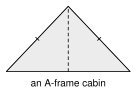
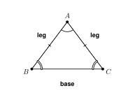
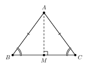
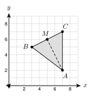

# 4.3 - Isosceles and Equilateral Triangles {.unnumbered}

An A-frame cabin has a roof shaped like a triangle. The two sloping sides are the same length. If you cut the cabin down the middle, the two halves match.

{width=340px fig-align="center"}

A triangle with two equal sides is **isosceles**. Equal sides always come with equal angles. In this lesson you use this fact to find missing angles and sides.

:::{.objectives}
- [ ] I can name the parts of an isosceles triangle.
- [ ] I can use the base angles theorem and its converse to find angles and sides.
- [ ] I can use the fact that an equilateral triangle has three $60^\circ$ angles.
- [ ] I can solve for $x$ in isosceles and equilateral triangles.
- [ ] I can check on a grid that the line from the vertex to the midpoint of the base is perpendicular to the base.
:::

:::{.vocab}
,
,
,
,
,
,

:::

:::{.guided-notes-link}
[Printable Guided Notes for this lesson](/guided_notes/Unit_4/4.3_Isosceles_and_Equilateral_Triangles.html){target="_blank"} (fill-in notes to print and write on)
:::



1. A triangle has angles $50^\circ$ and $70^\circ$. Find the third angle.

2. Solve $2x + 1 = x + 8$.

3. Find the midpoint of $(2, 1)$ and $(8, 5)$.



### 4.3.1 - Parts of an Isosceles Triangle

* An **isosceles triangle** has at least two congruent sides. They are the **legs**. The third side is the **base**.
* The angle between the legs is the **vertex angle**.
* The two angles that touch the base are the **base angles**.

***

**Example 1:** Name the parts

{width=340px fig-align="center"}

$AB \cong AC$ in the figure. Name the legs, the base, the vertex angle, and the base angles.

Legs: $\overline{AB}$ and $\overline{AC}$

Base: $\overline{BC}$

Vertex angle: $\angle A$

Base angles: $\angle B$ and $\angle C$

:::{.you-try title="In $\triangle PQR$, $PQ \cong QR$. Name the legs, the base, the vertex angle, and the base angles."}
Legs: $\overline{PQ}$ and $\overline{QR}$. Base: $\overline{PR}$. Vertex angle: $\angle Q$. Base angles: $\angle P$ and $\angle R$.
:::

### 4.3.2 - The Base Angles Theorem

* **Base angles theorem**: In an isosceles triangle, the base angles are congruent.
* **Converse**: If two angles of a triangle are congruent, the sides across from them are congruent.
* Why it works: fold the triangle along the line from the vertex to the midpoint of the base. This is a reflection (Unit 3). The two halves match, so $\angle B$ lands on $\angle C$.
* The vertex angle and the two base angles add to $180^\circ$.

{width=340px fig-align="center"}

***

**Example 2:** Find the base angles

The vertex angle of an isosceles triangle is $40^\circ$. Find each base angle.

The base angles are equal. Together they measure $180 - 40 = $ $140^\circ$.

Each base angle is $140 \div 2 = $ $70^\circ$.

***

**Example 3:** Find the vertex angle

A base angle of an isosceles triangle is $52^\circ$. Find the vertex angle.

Both base angles are $52^\circ$. Their sum is $2(52) = $ $104^\circ$.

The vertex angle is $180 - 104 = $ $76^\circ$.

***

**Example 4:** Use the converse

{width=300px fig-align="center"}

In $\triangle ABC$, $m\angle B = m\angle C = 65^\circ$ and $AB = 9$. Find $AC$.

$\overline{AC}$ is across from $\angle B$ and $\overline{AB}$ is across from $\angle C$. The angles are equal, so the sides across from them are equal.

$AC = $ 9

:::{.you-try-m title="Try it"}
a. The vertex angle of an isosceles triangle is $80^\circ$. Find each base angle.

b. A base angle of an isosceles triangle is $35^\circ$. Find the vertex angle.

:::

:::{.answer title="Answer"}
a. $(180 - 80) \div 2 = 50^\circ$

b. $180 - 2(35) = 110^\circ$

:::

### 4.3.3 - Equilateral Triangles

* An **equilateral triangle** has three congruent sides. It is also **equiangular**: all three angles are congruent.
* Each angle measures $180 \div 3 = $ $60^\circ$.
* If all three angles of a triangle are $60^\circ$, the triangle is equilateral.

***

**Example 5:** Equilateral with algebra

{width=300px fig-align="center"}

$\triangle ABC$ is equilateral. $AB = 2x + 1$ and $BC = 3x - 4$. Find $x$ and the perimeter.

All sides are equal, so $2x + 1 = 3x - 4$.

$5 = x$, so $x = $ 5.

Each side is $2(5) + 1 = $ 11. The perimeter is $3 \cdot 11 = $ 33.

:::{.you-try title="Each angle of an equilateral triangle is $(5x - 5)^\circ$. Find $x$."}
$5x - 5 = 60$, so $5x = 65$ and $x = 13$.
:::

:::{.real-world title="A yield sign"}
A yield sign is an equilateral triangle. If one side is 36 inches, all three sides are 36 inches, and every angle is $60^\circ$.
:::

### 4.3.4 - Solve for $x$ in Isosceles Triangles

* Equal sides: set the two sides equal. Equal angles: set the two angles equal.
* Use the angle sum, $180^\circ$, when the vertex angle is also needed.
* With two triangles that share a side, find the angles in one triangle at a time.

***

**Example 6:** Angles with $x$

{width=300px fig-align="center"}

$AB \cong AC$. The vertex angle is $50^\circ$. The base angle $\angle B$ is $(3x + 5)^\circ$. Find $x$.

Base angles together: $180 - 50 = 130$. Each base angle is $130 \div 2 = $ 65.

$3x + 5 = 65$, so $3x = 60$ and $x = $ 20.

***

**Example 7:** Sides with $x$

{width=280px fig-align="center"}

$AB \cong AC$. $AB = 2x + 1$, $AC = x + 8$, and $BC = 12$. Find $x$ and the perimeter.

The legs are equal, so $2x + 1 = x + 8$ and $x = $ 7.

Each leg is $7 + 8 = $ 15. The perimeter is $15 + 15 + 12 = $ 42.

***

**Example 8:** Two triangles that share a side

{width=260px fig-align="center"}

$AB \cong BC$ and $AD \cong DC$. $m\angle B = 40^\circ$ and $m\angle D = 100^\circ$. Find $m\angle BAD$.

In $\triangle ABC$, each base angle is $(180 - 40) \div 2 = $ $70^\circ$. So $m\angle BAC = 70^\circ$.

In $\triangle ADC$, each base angle is $(180 - 100) \div 2 = $ $40^\circ$. So $m\angle CAD = 40^\circ$.

$m\angle BAD = 70 + 40 = $ $110^\circ$ (angle addition).

:::{.you-try title="$\triangle ABC$ is isosceles with $AB = AC$. $m\angle B = (4x - 10)^\circ$ and $m\angle C = (2x + 20)^\circ$. Find $x$ and the vertex angle."}
$4x - 10 = 2x + 20$, so $x = 15$. Each base angle is $50^\circ$. The vertex angle is $180 - 100 = 80^\circ$.
:::

### 4.3.5 - Check on a Grid

* In an isosceles triangle, the line from the vertex angle to the midpoint of the base is perpendicular to the base.
* To check: find the midpoint of the base. Then find the slopes. Slopes of perpendicular lines multiply to $-1$.

***

**Example 9:** Show it with slopes

{width=300px fig-align="center"}

$A(7, 2)$, $B(3, 5)$, $C(7, 7)$. Show that $\triangle ABC$ is isosceles with base $\overline{BC}$. Show that the line from $A$ to the midpoint $M$ of $\overline{BC}$ is perpendicular to $\overline{BC}$.

$AB = \sqrt{4^2 + 3^2} = $ 5 and $AC = \sqrt{0^2 + 5^2} = $ 5. The legs are equal.

Midpoint of $\overline{BC}$: $M = $ $(5, 6)$

Slope of $\overline{BC}$: $\dfrac{7 - 5}{7 - 3} = $ $\dfrac{1}{2}$

Slope of $\overline{AM}$: $\dfrac{6 - 2}{5 - 7} = $ $-2$

$\dfrac{1}{2} \cdot (-2) = -1$, so $\overline{AM} \perp \overline{BC}$.

:::{.you-try title="$B(0, 0)$, $C(6, 2)$, $A(4, -2)$. Show that $AB = AC$ and that the line from $A$ to the midpoint of $\overline{BC}$ is perpendicular to $\overline{BC}$."}
$AB = \sqrt{16 + 4} = \sqrt{20}$ and $AC = \sqrt{4 + 16} = \sqrt{20}$. $M = (3, 1)$. Slope of $\overline{AM}$ is $\frac{1 - (-2)}{3 - 4} = -3$. Slope of $\overline{BC}$ is $\frac{1}{3}$. The product is $-1$.
:::



**$\triangle DEF$ has $DE \cong DF$. Complete.**

1. Name the legs.

2. Name the base.

3. Name the vertex angle.

4. Name the base angles.

***

**Find the missing angles in each isosceles triangle.**

5. Vertex angle $30^\circ$. Each base angle is

6. A base angle is $62^\circ$. The vertex angle is

7. Vertex angle $110^\circ$. Each base angle is

8. $XY \cong XZ$ and $m\angle Y = 57^\circ$. Find $m\angle Z$ and $m\angle X$.

***

**Use the converse. Name the congruent sides.**

9. In $\triangle ABC$, $m\angle A = 64^\circ$ and $m\angle B = 64^\circ$. Which two sides are congruent?

10. In $\triangle JKL$, $JK = KL = 7$. Which two angles are congruent?

***

**Equilateral triangles.**

11. $\triangle ABC$ is equilateral. $AB = 4x - 3$ and $BC = 2x + 7$. Find $x$ and the perimeter.

12. Each angle of an equilateral triangle is $(6x)^\circ$. Find $x$.

13. Ahmad says a triangle with sides 5, 5, and 8 is equilateral. Find his mistake.

***

**Solve for the variable.**

14. $AB \cong AC$. $AB = 3x - 1$ and $AC = x + 9$. Find $x$ and $AB$.

15. $AB \cong AC$. $m\angle B = (4x - 10)^\circ$ and $m\angle C = 50^\circ$. Find $x$ and the vertex angle.

16. The vertex angle of an isosceles triangle is $(4x)^\circ$. Each base angle is $(3x + 10)^\circ$. Find $x$ and the three angles.

17. An isosceles triangle has legs $(x + 6)$ and a base $(2x - 3)$. The perimeter is 41. Find $x$ and the three sides.

***

**Use the figure for problems 18 and 19.**

{width=240px fig-align="center"}

18. Find $m\angle BAC$.

19. Find $m\angle D$ and $m\angle BCD$.

***

**On a grid.**

20. $A(1, 1)$, $B(5, 1)$, $C(3, 6)$. Show that $\triangle ABC$ is isosceles. Name the congruent sides.

21. In problem 20, find the midpoint $M$ of $\overline{AB}$. Show that $\overline{CM}$ is perpendicular to $\overline{AB}$.

22. $A(6, -1)$, $B(1, 0)$, $C(7, 4)$. Show that $AB = AC$. Then show that the line from $A$ to the midpoint of $\overline{BC}$ is perpendicular to $\overline{BC}$.

***

**Real problems and mistakes.**

23. A roof gable is an isosceles triangle. The angle at the peak is $110^\circ$. Find each base angle.

24. A yield sign is an equilateral triangle with sides of 36 inches. Find the perimeter and each angle.

25. Kofi says: “The vertex angle is $40^\circ$, so each base angle is $40^\circ$ too.” Find his mistake.

***

**Test practice**

26. In isosceles $\triangle ABC$, $AB \cong AC$ and $m\angle A = 48^\circ$. What is $m\angle B$?

    A. $48^\circ$\
    B. $66^\circ$\
    C. $132^\circ$\
    D. $84^\circ$

27. Which statement must be true for every isosceles triangle?

    A. All three angles are congruent.\
    B. The base angles are congruent.\
    C. The vertex angle measures $60^\circ$.\
    D. All three sides have different lengths.

***

**Challenge**

28. An isosceles triangle has a perimeter of 40. The base is 4 more than each leg. Find the three sides. Check that they make a triangle.

29. $B(0, 0)$ and $C(6, 0)$ are two vertices of an equilateral triangle. Find the third vertex $A$ above the $x$-axis. Round the $y$-coordinate to the nearest tenth. Check with the distance formula.
