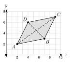
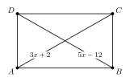

# 4.4 - Quadrilaterals and Their Properties {.unnumbered}

A builder frames a wall. How can she be sure the frame has square corners? She measures both diagonals. If they are the same length, the frame is a rectangle.

{width=360px fig-align="center"}

A rectangle is one kind of **quadrilateral**. In this lesson you learn the family of quadrilaterals and what is always true about each one.

:::{.objectives}
- [ ] I can name the quadrilaterals and place them in the family tree.
- [ ] I can use the properties of parallelograms to find sides and angles, and check a parallelogram with coordinates.
- [ ] I can use the properties of rectangles, rhombuses, and squares.
- [ ] I can use the properties of trapezoids, isosceles trapezoids, and kites.
- [ ] I can decide if a statement is always, sometimes, or never true, and give a counterexample.
:::

:::{.vocab}
,
,
,
,
,
,
,
,
,
,

:::

:::{.guided-notes-link}
[Printable Guided Notes for this lesson](/guided_notes/Unit_4/4.4_Quadrilaterals_and_Their_Properties.html){target="_blank"} (fill-in notes to print and write on)
:::



1. Three angles of a quadrilateral are $90^\circ$, $80^\circ$, and $100^\circ$. Find the fourth angle.

2. Find the midpoint of $(1, 2)$ and $(7, 6)$.

3. Solve $2x + 10 = 4x - 6$.



### 4.4.1 - The Quadrilateral Family

* A **quadrilateral** has 4 sides. Its 4 angles add to $360^\circ$.
* **Trapezoid**: exactly one pair of parallel sides. **Kite**: two pairs of congruent sides that are next to each other.
* **Parallelogram**: both pairs of opposite sides are parallel.
* **Rectangle**: a parallelogram with 4 right angles. **Rhombus**: a parallelogram with 4 congruent sides.
* **Square**: a rectangle and a rhombus. It has 4 right angles and 4 congruent sides.

{width=480px fig-align="center"}

***

**Example 1:** Name the shape

Give the most specific name for each quadrilateral.

a. Four congruent sides and four right angles: square

b. Both pairs of opposite sides parallel, four right angles, sides not all equal: rectangle

c. Exactly one pair of parallel sides: trapezoid

d. Four congruent sides, angles not right angles: rhombus

:::{.you-try-m title="Try it"}
a. A quadrilateral has two pairs of congruent sides that are next to each other. The opposite sides are not congruent. What is it?

b. Is every square a rectangle? Use the family tree.

:::

:::{.answer title="Answer"}
a. A kite.

b. Yes. A square is below rectangle on the tree. It has 4 right angles.

:::

### 4.4.2 - Parallelograms

* Opposite sides of a parallelogram are congruent.
* Opposite angles are congruent.
* Consecutive angles (angles next to each other) are supplementary. They add to $180^\circ$.
* The diagonals bisect each other. They meet at the midpoint of each diagonal.
* The converse works too: if the diagonals of a quadrilateral bisect each other, it is a parallelogram.

***

**Example 2:** Find $x$ and $y$

{width=360px fig-align="center"}

In parallelogram $ABCD$, $AB = 2x + 3$, $CD = 4x - 9$, $m\angle A = (5y - 10)^\circ$, and $m\angle C = 70^\circ$. Find $x$, $y$, and $m\angle B$.

Opposite sides are equal: $2x + 3 = 4x - 9$. So $12 = 2x$ and $x = $ 6.

Opposite angles are equal: $5y - 10 = 70$. So $5y = 80$ and $y = $ 16.

$\angle B$ and $\angle A$ are consecutive: $m\angle B = 180 - 70 = $ $110^\circ$.

***

**Example 3:** Check the diagonals with coordinates

{width=300px fig-align="center"}

$A(2, 2)$, $B(7, 3)$, $C(9, 7)$, $D(4, 6)$. Show that $ABCD$ is a parallelogram.

Midpoint of $\overline{AC}$: $\left(\dfrac{2 + 9}{2}, \dfrac{2 + 7}{2}\right) = $ $(5.5, 4.5)$

Midpoint of $\overline{BD}$: $\left(\dfrac{7 + 4}{2}, \dfrac{3 + 6}{2}\right) = $ $(5.5, 4.5)$

The diagonals have the same midpoint, so they bisect each other. $ABCD$ is a parallelogram.

:::{.you-try title="$E(0, 0)$, $F(4, 1)$, $G(7, 5)$, $H(3, 4)$. Is $EFGH$ a parallelogram? Use the midpoints of the diagonals."}
Midpoint of $\overline{EG}$: $(3.5, 2.5)$. Midpoint of $\overline{FH}$: $(3.5, 2.5)$. They match, so yes.
:::

:::{.real-world title="A parallelogram lift"}
A car jack and the arms of a desk lamp are parallelograms. As the arms move, opposite sides stay parallel and the same length. The top stays level.
:::

### 4.4.3 - Rectangles, Rhombuses, and Squares

* A rectangle has all the properties of a parallelogram. Its diagonals are congruent.
* A rhombus has all the properties of a parallelogram. Its diagonals are perpendicular, and each diagonal bisects a pair of opposite angles.
* A square has all of these properties. Its diagonals are congruent and perpendicular.

***

**Example 4:** Rectangle diagonals

{width=320px fig-align="center"}

$ABCD$ is a rectangle. $AC = 3x + 2$ and $BD = 5x - 12$. Find $x$ and $AC$.

The diagonals of a rectangle are congruent: $3x + 2 = 5x - 12$.

$14 = 2x$, so $x = $ 7.

$AC = 3(7) + 2 = $ 23

***

**Example 5:** Rhombus angles

{width=380px fig-align="center"}

$ABCD$ is a rhombus. $m\angle CAB = 28^\circ$. Find $m\angle DAB$, $m\angle ABC$, and $m\angle AEB$.

Diagonal $\overline{AC}$ bisects $\angle DAB$: $m\angle DAB = 2(28) = $ $56^\circ$.

Consecutive angles add to $180^\circ$: $m\angle ABC = 180 - 56 = $ $124^\circ$.

The diagonals are perpendicular: $m\angle AEB = $ $90^\circ$.

:::{.you-try-m title="Try it"}
a. Rectangle $PQRS$ has diagonal $PR = 18$. Find $QS$.

b. The diagonals of a rhombus cross at $E$. Find $m\angle AEB$.

:::

:::{.answer title="Answer"}
a. $QS = 18$. The diagonals of a rectangle are congruent.

b. $90^\circ$. The diagonals of a rhombus are perpendicular.

:::

:::{.real-world title="Is the frame square?"}
A builder measures both diagonals of a frame. If the opposite sides match and the diagonals match, the frame is a rectangle. The corners are square.
:::

### 4.4.4 - Trapezoids and Kites

* A trapezoid has one pair of parallel sides, the **bases**. The other two sides are the **legs**.
* The **midsegment** of a trapezoid connects the midpoints of the legs. It is parallel to the bases. Its length is the average of the bases: $\dfrac{b_1 + b_2}{2}$.
* **Isosceles trapezoid**: the legs are congruent. Each pair of base angles is congruent. The diagonals are congruent.
* **Kite**: the diagonals are perpendicular. One pair of opposite angles is congruent (the angles between the unequal sides).

***

**Example 6:** Midsegment

{width=300px fig-align="center"}

The bases of a trapezoid are 12 and 28. The midsegment is $(3x + 5)$. Find $x$.

Midsegment $= \dfrac{12 + 28}{2} = $ 20.

$3x + 5 = 20$, so $3x = 15$ and $x = $ 5.

***

**Example 7:** Isosceles trapezoid

{width=300px fig-align="center"}

$ABCD$ is an isosceles trapezoid with $\overline{AB} \parallel \overline{DC}$. $m\angle D = 70^\circ$. Find $m\angle C$, $m\angle A$, and $m\angle B$.

Base angles are congruent: $m\angle C = $ $70^\circ$.

$\angle A$ and $\angle D$ are consecutive angles between parallel lines: $m\angle A = 180 - 70 = $ $110^\circ$.

$m\angle B = $ $110^\circ$

***

**Example 8:** Kite

{width=280px fig-align="center"}

$ABCD$ is a kite. $AB = AD$ and $CB = CD$. $m\angle A = 80^\circ$ and $m\angle B = 110^\circ$. Find $m\angle D$ and $m\angle C$.

The angles between the unequal sides are congruent: $m\angle D = $ $110^\circ$.

The four angles add to $360^\circ$: $m\angle C = 360 - 80 - 110 - 110 = $ $60^\circ$.

:::{.you-try title="In kite $PQRS$, $PQ = PS$ and $RQ = RS$. $m\angle P = 70^\circ$ and $m\angle Q = 100^\circ$. Find $m\angle S$ and $m\angle R$."}
$m\angle S = 100^\circ$. $m\angle R = 360 - 70 - 100 - 100 = 90^\circ$.
:::

### 4.4.5 - Always, Sometimes, or Never?

* A shape is always a member of every group above it on the family tree.
* To show a statement is not always true, find a counterexample: one example where it fails.
* Use one of the four ways to justify: a drawing to scale, a coordinate check, a counterexample, or a mark on a figure.

***

**Example 9:** Decide and explain

a. A square is a rectangle. Always. A square has 4 right angles and opposite sides parallel.

b. A rectangle is a rhombus. Sometimes. A rectangle 2 by 5 is a counterexample: the sides are not all equal. A square is a rectangle that is also a rhombus.

c. A trapezoid is a parallelogram. Never. A trapezoid has exactly one pair of parallel sides. A parallelogram has two.

:::{.you-try-m title="Try it"}
a. A rhombus is a square. Always, sometimes, or never? Explain.

:::

:::{.answer title="Answer"}
a. Sometimes. A rhombus with angles $60^\circ$ and $120^\circ$ is a counterexample. It has no right angles.

:::



**Give the most specific name.**

1. Four sides, exactly one pair of parallel sides.

2. Both pairs of opposite sides parallel, four right angles, sides not all equal.

3. Four congruent sides and no right angles.

4. Two pairs of congruent adjacent sides, opposite sides not congruent.

5. Four congruent sides and four right angles.

***

**Use the figure for problems 6 to 8. $PQRS$ is a parallelogram.**

{width=320px fig-align="center"}

6. Find $x$ and $PQ$.

7. Find $y$.

8. Find $m\angle Q$.

***

**More parallelograms.**

9. The diagonals of parallelogram $ABCD$ meet at $E$. $AE = 3x + 1$ and $EC = 5x - 9$. Find $x$ and $AC$.

10. $J(1, 1)$, $K(5, 2)$, $L(8, 6)$, $M(4, 5)$. Is $JKLM$ a parallelogram? Use the diagonals.

11. $W(0, 0)$, $X(6, 1)$, $Y(8, 5)$, $Z(1, 4)$. Is $WXYZ$ a parallelogram? Use the diagonals.

***

**Rectangles, rhombuses, and squares.**

12. $ABCD$ is a rectangle. $AC = 4x - 3$ and $BD = 2x + 15$. Find $x$ and $AC$.

13. $ABCD$ is a rhombus. $m\angle ABC = 72^\circ$. Find $m\angle BCD$ and $m\angle CBD$.

14. The diagonals of a rhombus are 12 and 16. They cross at right angles and bisect each other. Find the side length.

15. A frame is 12 feet by 5 feet. Both diagonals measure 13 feet. Is the corner square? Check with the Pythagorean theorem.

***

**Trapezoids and kites.**

16. The bases of a trapezoid are 18 and 30. Find the midsegment.

17. The bases of a trapezoid are $(x + 10)$ and $(3x - 2)$. The midsegment is 14. Find $x$ and the bases.

18. $ABCD$ is an isosceles trapezoid with $\overline{AB} \parallel \overline{DC}$. $m\angle D = 65^\circ$. Find $m\angle C$, $m\angle A$, and $m\angle B$.

19. Kite $ABCD$ has $AB = AD$ and $CB = CD$. $m\angle A = 100^\circ$ and $m\angle B = 70^\circ$. Find $m\angle C$.

***

**Always, sometimes, or never? Explain.**

20. A rectangle is a parallelogram.

21. A rhombus is a square.

22. A trapezoid is a parallelogram.

23. A kite is a rhombus.

***

**Find the mistake with a counterexample.**

24. Amira says any quadrilateral with congruent diagonals is a rectangle. Use $A(0, 0)$, $B(6, 0)$, $C(5, 3)$, $D(1, 3)$ to show she is wrong.

25. Diego says any quadrilateral with perpendicular diagonals is a rhombus. Use $K(0, 3)$, $L(-2, 0)$, $M(0, -1)$, $N(2, 0)$ to show he is wrong.

***

**Test practice**

26. Which statement about a rhombus is always true?

    A. The diagonals are congruent.\
    B. The diagonals are perpendicular.\
    C. All four angles are right angles.\
    D. Exactly one pair of sides is parallel.

27. A quadrilateral has two pairs of parallel sides and four congruent sides. Which name does NOT always describe it?

    A. parallelogram\
    B. rhombus\
    C. square\
    D. quadrilateral

***

**Challenge**

28. $A(0, 0)$, $B(6, 0)$, $C(8, 6)$, $D(2, 8)$. Find the midpoints $P$, $Q$, $R$, $S$ of $\overline{AB}$, $\overline{BC}$, $\overline{CD}$, $\overline{DA}$. Show that $PQRS$ is a parallelogram.

29. A rectangle has a diagonal of 13 and one side of 5. Find the other side and the area.
