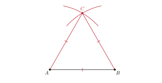
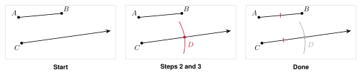
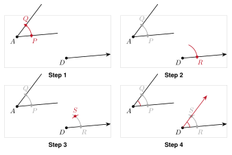
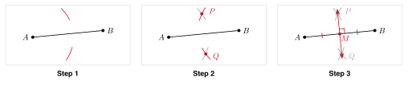
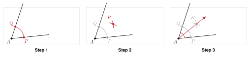
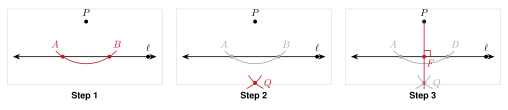
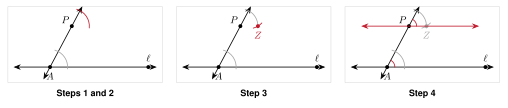
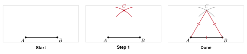
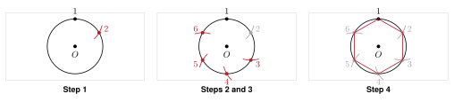

# 4.5 - Constructions {.unnumbered}

Before computers, builders and mapmakers drew exact figures with two tools. A **straightedge** draws straight lines. A **compass** draws arcs and circles. There is no ruler and no protractor.

{width=400px fig-align="center"}

The figure above is an equilateral triangle made with only these two tools. In this lesson you learn eight constructions. For each one you also learn why it works. The reason is always congruent triangles or equal compass widths.

:::{.objectives}
- [ ] I can copy a segment and copy an angle.
- [ ] I can construct a perpendicular bisector and an angle bisector.
- [ ] I can construct a perpendicular line and a parallel line through a point.
- [ ] I can construct an equilateral triangle and a regular hexagon.
- [ ] I can explain why a construction works.
:::

:::{.vocab}
,
,
,
,
,
,

:::

:::{.guided-notes-link}
[Printable Guided Notes for this lesson](/guided_notes/Unit_4/4.5_Constructions.html){target="_blank"} (fill-in notes to print and write on)
:::



1. Segment $AB$ is 6 inches long. $M$ is its midpoint. Find $AM$.

2. An angle measures $74^\circ$. Find half of the angle.

3. Which rule shows that two triangles with sides 5, 7, 9 and 5, 7, 9 are congruent?



### 4.5.1 - Copy a Segment and Copy an Angle

* A **construction** uses only a **compass** (draws arcs and circles) and a **straightedge** (draws straight lines). Keep your arcs. They show your work.
* **Copy a segment** $\overline{AB}$ onto a ray from $C$. Step 1: Set the compass width to the length of $\overline{AB}$.
* Step 2: Put the compass point on $C$. Draw an arc across the ray. Label the point $D$. Now $CD = AB$.
* Why it works: $CD$ and $AB$ are both the same compass width.
* **Copy an angle** $\angle A$ onto a ray from $D$. Step 1: Put the compass point on $A$. Draw an arc across both sides. Label the points $P$ and $Q$.
* Step 2: Keep the same width. Put the point on $D$. Draw an arc across the ray. Label the point $R$.
* Step 3: Set the compass to the length $PQ$. Put the point on $R$. Draw an arc that crosses the other arc at $S$.
* Step 4: Draw ray $DS$. Now $\angle SDR \cong \angle A$.
* Why it works: $AP = DR$, $AQ = DS$, and $PQ = RS$ (equal compass widths). So $\triangle APQ \cong \triangle DRS$ by SSS.

***

**Example 1:** Copy a segment

{width=640px fig-align="center"}

Copy $\overline{AB}$ onto the ray from $C$. Label the new segment $\overline{CD}$.

Why does $CD = AB$?

Same compass width

***

**Example 2:** Copy an angle

{width=520px fig-align="center"}

Copy $\angle A$ onto the ray from $D$.

Which rule shows $\triangle APQ \cong \triangle DRS$?

SSS

### 4.5.2 - Perpendicular Bisector and Midpoint

* Step 1: Set the compass wider than half of $AB$. Put the point on $A$. Draw an arc above and below $\overline{AB}$.
* Step 2: Keep the same width. Put the point on $B$. Draw arcs that cross the first arcs at $P$ and $Q$.
* Step 3: Draw line $PQ$. It crosses $\overline{AB}$ at the midpoint $M$. Line $PQ$ is the **perpendicular bisector** of $\overline{AB}$.
* Why it works: $AP = BP$ and $AQ = BQ$ (equal compass widths). Also $PQ = PQ$. So $\triangle APQ \cong \triangle BPQ$ by SSS.
* Then $\angle APM \cong \angle BPM$. With $AP = BP$ and $PM = PM$, $\triangle APM \cong \triangle BPM$ by SAS. So $AM = BM$ and the two angles at $M$ are equal. Equal angles on a straight line are each $90^\circ$.

***

**Example 3:** Construct the perpendicular bisector

{width=640px fig-align="center"}

Construct the perpendicular bisector of $\overline{AB}$. Label the midpoint $M$.

Name two equal segments you constructed.

$AM$ and $MB$

### 4.5.3 - Bisect an Angle

* Step 1: Put the compass point on the vertex $A$. Draw an arc across both sides. Label the points $P$ and $Q$.
* Step 2: Put the point on $P$. Draw an arc inside the angle. Keep the same width. Put the point on $Q$ and draw an arc that crosses the first arc at $R$.
* Step 3: Draw ray $AR$. It is the **angle bisector**. $\angle PAR \cong \angle QAR$.
* Why it works: $AP = AQ$ and $PR = QR$ (equal compass widths). Also $AR = AR$. So $\triangle APR \cong \triangle AQR$ by SSS. The matching angles $\angle PAR$ and $\angle QAR$ are equal.

***

**Example 4:** Bisect an angle

{width=640px fig-align="center"}

Bisect $\angle A$.

If $m\angle A = 66^\circ$, how large is each new angle?

$33^\circ$

### 4.5.4 - Perpendicular and Parallel Lines Through a Point

* **Perpendicular from $P$ to line $\ell$.** Step 1: Put the point on $P$. Draw an arc that crosses $\ell$ twice, at $A$ and $B$.
* Step 2: Put the point on $A$, then on $B$, with the same width. Draw arcs that cross below $\ell$ at $Q$.
* Step 3: Draw line $PQ$. It is perpendicular to $\ell$.
* Why it works: $PA = PB$ and $QA = QB$. So $PQ$ is the perpendicular bisector of $\overline{AB}$.
* **Parallel to $\ell$ through $P$.** Step 1: Draw a line through $P$ that crosses $\ell$ at $A$. Step 2: Copy the angle at $A$ to $P$, using the same four steps as before.
* Why it works: the two angles are corresponding angles and they are congruent. So the lines are parallel (1.4).

***

**Example 5:** Construct a perpendicular line

{width=640px fig-align="center"}

Construct the line through $P$ that is perpendicular to $\ell$. Label the foot $F$.

What is $m\angle PFA$?

$90^\circ$

***

**Example 6:** Construct a parallel line

{width=640px fig-align="center"}

Construct the line through $P$ that is parallel to $\ell$.

Which angles did you copy?

corresponding angles

### 4.5.5 - Equilateral Triangle and Regular Hexagon

* **Equilateral triangle on $\overline{AB}$.** Step 1: Set the compass width to $AB$. Draw an arc from $A$ and an arc from $B$. They cross at $C$.
* Step 2: Draw $\overline{AC}$ and $\overline{BC}$. Why it works: $AC = AB$ and $BC = AB$ (the same compass width). All three sides are equal, and each angle is $60^\circ$.
* **Regular hexagon.** Step 1: Draw a circle with center $O$. Do not change the compass width. Put the point on a point 1 on the circle. Mark point 2.
* Step 2: Move the point to 2 and mark 3. Keep going until you have 6 points. Draw the six sides.
* Why it works: each side equals the radius, so each triangle with $O$ is equilateral. Each center angle is $60^\circ$, and $6 \cdot 60^\circ = $ $360^\circ$.

***

**Example 7:** Construct an equilateral triangle

{width=640px fig-align="center"}

Construct an equilateral triangle on $\overline{AB}$.

How long is each side if $AB = 4.6$?

4.6

***

**Example 8:** Construct a regular hexagon

{width=640px fig-align="center"}

Construct a regular hexagon in the circle. Start at point 1.

If the radius is 2.2, how long is each side?

2.2



**Copy a segment.**

{width=330px fig-align="center"}

1. Copy $\overline{PQ}$ onto the ray from $R$. Label the new segment $\overline{RS}$.

***

**Copy an angle.**

{width=330px fig-align="center"}

2. Copy $\angle A$ onto the ray from $D$.

***

**Construct a perpendicular bisector.**

{width=330px fig-align="center"}

3. Construct the perpendicular bisector of $\overline{AB}$.

***

**Bisect an angle.**

{width=330px fig-align="center"}

4. Bisect $\angle A$.

***

**Bisect a right angle.**

{width=330px fig-align="center"}

5. Bisect the right angle. What is the measure of each new angle?

***

**Construct a perpendicular line.**

{width=330px fig-align="center"}

6. Construct the line through $P$ perpendicular to $\ell$.

***

**Construct a parallel line.**

{width=330px fig-align="center"}

7. Construct the line through $P$ parallel to $\ell$. Copy the angle at $A$.

***

**Construct an equilateral triangle.**

{width=330px fig-align="center"}

8. Construct an equilateral triangle on $\overline{AB}$.

***

**Construct a regular hexagon.**

{width=330px fig-align="center"}

9. Construct a regular hexagon in the circle. Start at point 1.

***

**Double a segment.**

{width=330px fig-align="center"}

10. Construct $\overline{CE}$ so that $CE = 2 \cdot AB$. Use the ray from $C$.

***

**Why does it work?**

11. In the angle bisector construction, which rule shows $\triangle APR \cong \triangle AQR$? Which angles are then congruent?

12. In the copy-an-angle construction, name the three pairs of congruent sides in $\triangle APQ$ and $\triangle DRS$.

13. Diego sets the compass narrower than half of $AB$ for the perpendicular bisector. What goes wrong?

***

**Use the numbers.**

14. An equilateral triangle is built on a segment 6 cm long. Find the perimeter and each angle.

15. A regular hexagon is built in a circle with radius 5 cm. Find the side length and the perimeter.

16. $A(1, 1)$ and $B(7, 5)$. The perpendicular bisector of $\overline{AB}$ passes through $P(6, 0)$. Show that $PA = PB$.

17. Mohammed bisects a $74^\circ$ angle. Then he bisects one of the new angles. Find the size of the smaller angles.

***

**Test practice**

18. Which statement explains why the angle bisector construction works?

    A. The triangles are congruent by SSS, so the matching angles are equal.\
    B. The arcs are parallel, so the angles are equal.\
    C. The triangles have the same area, so the angles are equal.\
    D. The compass measures the angle in degrees.

19. Point $P$ is on the perpendicular bisector of $\overline{AB}$. Which must be true?

    A. $PA = PB$\
    B. $PA = AB$\
    C. $m\angle APB = 90^\circ$\
    D. $P$ is the midpoint of $\overline{AB}$

***

**Challenge**

20. Construct a $30^\circ$ angle at $A$. Hint: construct an equilateral triangle to get a $60^\circ$ angle. Then bisect it.

{width=330px fig-align="center"}

21. Find the center of the circle. Hint: the perpendicular bisector of every chord goes through the center.

{width=330px fig-align="center"}
