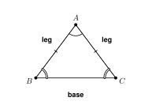
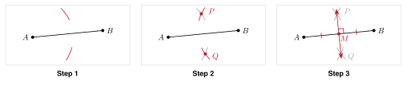

# Unit 4 Summary {.unnumbered}

:::{.guided-notes-link}
[Printable Unit 4 Summary](/guided_notes/Unit_4/Unit_4_Summary.html){target="_blank"} (a reference sheet to print and keep)
:::

## 4.1 - Congruent Figures and Rigid Motions

* **Congruent** figures have the same size and the same shape. Write $\triangle ABC \cong \triangle DEF$.
* The order of the letters shows the matching parts. $\overline{AB}$ matches $\overline{DE}$ and $\angle A$ matches $\angle D$.
* Matching parts of congruent figures are congruent. Use them to find missing sides and angles.
* A **rigid motion** keeps all lengths and angles. Translations, reflections, and rotations are rigid motions.
* Two figures are congruent if a sequence of rigid motions maps one onto the other.
* On a grid, use the distance formula to check that matching sides are equal.

{width=380px fig-align="center"}

Example: $\triangle ABC \cong \triangle DEF$, $AB = 2x + 1$, and $DE = 15$. Then $2x + 1 = 15$, so $x = 7$.

## 4.2 - Triangle Congruence

* **SSS**: three pairs of congruent sides.
* **SAS**: two pairs of congruent sides and the **included angle** (the angle between them).
* **ASA**: two pairs of congruent angles and the included side.
* **AAS**: two pairs of congruent angles and a side that is not between them.
* **HL**: right triangles with congruent hypotenuses and one pair of congruent legs.
* **SSA** and **AAA** are not enough. A counterexample shows it: AAA gives the same shape in different sizes.

{width=500px fig-align="center"}

Example: Two triangles have sides 6 and 9 and the included angle $50^\circ$ in each. They are congruent by SAS.

## 4.3 - Isosceles and Equilateral Triangles

* An **isosceles triangle** has two congruent sides, the **legs**. The third side is the **base**.
* **Base angles theorem**: the angles opposite the congruent sides are congruent.
* **Converse**: if two angles are congruent, the sides opposite them are congruent.
* The angles of a triangle add to $180^\circ$. Vertex angle $= 180^\circ -$ two base angles.
* An **equilateral triangle** has three congruent sides and three $60^\circ$ angles.
* On a grid, find the distances to show two sides are equal.

{width=300px fig-align="center"}

Example: The vertex angle is $48^\circ$. Each base angle is $\dfrac{180 - 48}{2} = 66^\circ$.

## 4.4 - Quadrilaterals and Their Properties

* The four angles of a **quadrilateral** add to $360^\circ$.
* **Parallelogram**: opposite sides and opposite angles are congruent. Consecutive angles add to $180^\circ$. The diagonals bisect each other.
* **Rectangle**: a parallelogram with four right angles. The diagonals are congruent.
* **Rhombus**: a parallelogram with four congruent sides. The diagonals are perpendicular and bisect the angles.
* **Square**: a rectangle and a rhombus.
* **Trapezoid**: exactly one pair of parallel sides. The **midsegment** is parallel to the bases. Its length is the average of the bases.
* **Kite**: two pairs of congruent sides that are next to each other. The diagonals are perpendicular.
* A **counterexample** shows a statement is not always true.

{width=460px fig-align="center"}

Example: The bases of a trapezoid are 10 and 18. The midsegment is $\dfrac{10 + 18}{2} = 14$.

## 4.5 - Constructions

* A **construction** uses only a **compass** and a **straightedge**.
* Copy a segment or an angle: use the same compass width for each arc.
* **Perpendicular bisector** of $\overline{AB}$: open the compass wider than half of $AB$. Draw arcs from $A$ and from $B$. Draw the line through the two crossing points.
* **Angle bisector**: draw an arc across both sides. Draw equal arcs from those two points. Draw the ray through the vertex and the crossing point.
* Perpendicular and parallel lines through a point $P$ use the same arcs and copy an angle.
* An equilateral triangle on $\overline{AB}$: arcs of width $AB$ from $A$ and from $B$. A regular hexagon: step the radius around a circle.
* A construction works because equal compass widths make congruent triangles (SSS).

{width=520px fig-align="center"}

Example: An angle of $84^\circ$ is bisected. Each new angle is $84 \div 2 = 42^\circ$.
