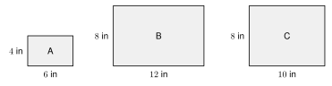
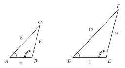
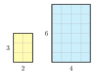

# 5.2 - Similar Figures and Scale Factor {.unnumbered}

You print a photo that is 4 inches by 6 inches. Then you enlarge it to 8 inches by 12 inches. It looks the same, only bigger. Now you enlarge it to 8 inches by 10 inches. This time the picture looks stretched.

{width=520px fig-align="center"}

Photos A and B have the same shape. Photo C does not. Figures with the same shape are **similar**. In this lesson you learn how to tell, and how to use the scale factor to find missing lengths.

:::{.objectives}
- [ ] I can decide whether two figures are similar.
- [ ] I can write a similarity statement and match corresponding parts.
- [ ] I can use a scale factor to find missing sides.
- [ ] I can find the perimeter and area of a similar figure.
:::

:::{.vocab}
,
,
,
,

:::

:::{.guided-notes-link}
[Printable Guided Notes for this lesson](/guided_notes/Unit_5/5.2_Similar_Figures_and_Scale_Factor.html){target="_blank"} (fill-in notes to print and write on)
:::



1. Solve $\dfrac{x}{6} = \dfrac{10}{4}$.

2. A segment is 8 cm long. A dilation with scale factor 2.5 is applied. How long is the image?

3. Find the area and perimeter of a rectangle that is 5 in by 3 in.



### 5.2.1 - What Similar Means

Two figures are **similar** ($\sim$) if one can be made from the other by a dilation and rigid motions. You studied both in Unit 3 and Unit 4. A dilation changes the size. Rigid motions move the figure. Neither one changes the shape.

Because of this, similar figures always have two things in common:

* **Corresponding angles are equal.**
* **Corresponding sides are proportional.** The ratio of each pair of matching sides is the same number.

The sides of triangle $ABC$ below are 4, 6, and 8. The sides of triangle $DEF$ are 6, 9, and 12. The matching angles have the same marks.

{width=500px fig-align="center"}

***

**Example 1:** Check the sides

Use the figure above. Show that the sides of $\triangle ABC$ and $\triangle DEF$ are proportional.

Match the shortest sides, the middle sides, and the longest sides.

$\dfrac{DE}{AB} = \dfrac{6}{4} = 1.5$

$\dfrac{EF}{BC} = \dfrac{9}{6} = 1.5$

$\dfrac{FD}{CA} = \dfrac{12}{8} = 1.5$

All three ratios are 1.5. The sides are proportional, and the angles match. The triangles are similar.

:::{.you-try-m title="Are the sides proportional?"}
Triangle 1 has sides 5, 7, and 9. Triangle 2 has sides 10, 14, and 18. Are the sides proportional?
:::

:::{.answer title="Answer"}
$\dfrac{10}{5} = 2$, $\dfrac{14}{7} = 2$, $\dfrac{18}{9} = 2$. Yes, the ratios are all 2.
:::

### 5.2.2 - Similarity Statements and Scale Factor

A **similarity statement** names the figures in matching order. $\triangle ABC \sim \triangle DEF$ says that $A$ matches $D$, $B$ matches $E$, and $C$ matches $F$. So $\overline{AB}$ matches $\overline{DE}$, and $\angle B$ matches $\angle E$.

The **scale factor** $k$ is the ratio of the new length to the old length. Always say which figure goes first.

$$
k = \dfrac{\text{length in the new figure}}{\text{length in the old figure}}
$$

***

**Example 3:** Write the statement and find $k$

Use the triangles in the figure above.

a. Write the similarity statement and name the side that matches $\overline{BC}$.

b. Find the scale factor from $\triangle ABC$ to $\triangle DEF$.

c. Find the scale factor from $\triangle DEF$ to $\triangle ABC$.

a. $\triangle ABC \sim \triangle DEF$. Side $\overline{BC}$ matches $\overline{EF}$.

b. $k = \dfrac{DE}{AB} = \dfrac{6}{4} = 1.5$. The new triangle is larger.

c. $k = \dfrac{AB}{DE} = \dfrac{4}{6} = \dfrac{2}{3}$. The new triangle is smaller.

The two scale factors are reciprocals. $1.5 \cdot \dfrac{2}{3} = 1$.

:::{.you-try-m title="$\triangle JKL \sim \triangle MNP$"}
a. Which angle matches $\angle L$?

b. $JK = 10$ and $MN = 4$. Find the scale factor from $\triangle JKL$ to $\triangle MNP$.
:::

:::{.answer title="Answer"}
a. $\angle P$

b. $k = \dfrac{MN}{JK} = \dfrac{4}{10} = \dfrac{2}{5} = 0.4$
:::

### 5.2.3 - Are Two Figures Similar?

To decide if two polygons are similar, check **both** things. Matching angles are not enough. Proportional sides are not enough either (a square and a rhombus have equal side ratios, but their angles differ). You need both.

***

**Example 5:** Are the photos similar?

{width=440px fig-align="center"}

All the angles are $90^\circ$.

a. Are photos A and B similar?

b. Are photos A and C similar?

a. Short sides: $\dfrac{8}{4} = 2$. Long sides: $\dfrac{12}{6} = 2$. The ratios are equal. **Yes**, A and B are similar, with $k = 2$.

b. Short sides: $\dfrac{8}{4} = 2$. Long sides: $\dfrac{10}{6} \approx 1.67$. The ratios are not equal. **No.**

Photos A and C have equal angles, but they are not similar. This is a **counterexample** to the claim "rectangles with equal angles are similar."

:::{.you-try-m title="Are they similar?"}
A photo is 6 in by 10 in. Another photo is 9 in by 15 in. Are they similar? If so, find $k$ from the small photo to the large one.
:::

:::{.answer title="Answer"}
$\dfrac{9}{6} = 1.5$ and $\dfrac{15}{10} = 1.5$. Yes, they are similar and $k = 1.5$.
:::

### 5.2.4 - Find a Missing Side

To find a missing side, write a proportion with two pairs of matching sides. Then use cross products.

***

**Example 7:** Find $x$

{width=360px fig-align="center"}

$\triangle ABC \sim \triangle DEF$. Find $EF$.

$\overline{AB}$ matches $\overline{DE}$. $\overline{BC}$ matches $\overline{EF}$.

$\dfrac{AB}{DE} = \dfrac{BC}{EF}$, so $\dfrac{6}{10} = \dfrac{9}{x}$.

$6x = 90$, so $x = 15$.

Check with $k$: $k = \dfrac{10}{6} = \dfrac{5}{3}$ and $9 \cdot \dfrac{5}{3} = 15$.

:::{.you-try-m title="$\triangle ABC \sim \triangle DEF$"}
$AB = 8$, $DE = 12$, and $BC = 14$. Find $EF$.
:::

:::{.answer title="Answer"}
$\dfrac{8}{12} = \dfrac{14}{x}$, so $8x = 168$ and $x = 21$.
:::

***

**Example 9:** Sides as expressions

$\triangle ABC \sim \triangle DEF$. $AB = 6$, $DE = 15$, $BC = x + 4$, and $EF = 5x$. Find $x$ and $EF$.

$\dfrac{AB}{DE} = \dfrac{BC}{EF}$, so $\dfrac{6}{15} = \dfrac{x + 4}{5x}$.

$6 \cdot 5x = 15(x + 4)$

$30x = 15x + 60$

$15x = 60$, so $x = 4$.

$EF = 5(4) = 20$.

Check: $BC = 8$, and $\dfrac{8}{20} = 0.4 = \dfrac{6}{15}$.

:::{.you-try-m title="$\triangle ABC \sim \triangle DEF$"}
$AB = 8$, $DE = 20$, $BC = x + 1$, and $EF = 3x + 1$. Find $x$.
:::

:::{.answer title="Answer"}
$\dfrac{8}{20} = \dfrac{x + 1}{3x + 1}$, so $8(3x + 1) = 20(x + 1)$.

$24x + 8 = 20x + 20$, so $4x = 12$ and $x = 3$.
:::

### 5.2.5 - Perimeter and Area

Look at the two rectangles. The small one is 2 by 3. The large one is 4 by 6. The scale factor is $k = 2$.

{width=300px fig-align="center"}

Count the grid squares. The small rectangle has 6. The large one has 24. The area is $4 = 2^2$ times as large. The perimeter goes from 10 to 20, which is 2 times as large.

* Perimeters are in the ratio $k$.
* Areas are in the ratio $k^2$.

***

**Example 11:** Perimeter and area

Two similar triangles have scale factor $k = 3$ from the small one to the large one. The small triangle has sides 3, 4, and 5 and area 6 square inches. Find the perimeter and the area of the large triangle.

Small perimeter: $3 + 4 + 5 = 12$ in.

Large perimeter: $3 \cdot 12 = 36$ in.

Large area: $3^2 \cdot 6 = 9 \cdot 6 = 54$ square in.

Check: the large sides are 9, 12, 15. $9 + 12 + 15 = 36$.

:::{.you-try-m title="The scale factor is $k = 5$."}
A small rectangle is 2 cm by 4 cm. A similar rectangle has $k = 5$. Find the perimeter and area of the large rectangle.
:::

:::{.answer title="Answer"}
Small perimeter: $12$ cm, so large: $60$ cm.

Small area: $8$ square cm, so large: $25 \cdot 8 = 200$ square cm.
:::

:::{.gotcha title="Do not use $k$ for area"}
If $k = 3$, the area is **not** 3 times as large. It is $3^2 = 9$ times as large.
:::



***

**Are the photos similar? Write yes or no. If yes, give $k$ from the small photo to the large one.**

1. 4 in by 6 in and 12 in by 18 in

2. 5 in by 7 in and 10 in by 12 in

3. 8 in by 10 in and 16 in by 20 in

4. 3 in by 5 in and 9 in by 12 in

***

**$\triangle ABC \sim \triangle XYZ$. Complete each match.**

5. $\angle B$ matches

6. $\overline{BC}$ matches

7. $\angle Z$ matches

8. $\overline{AC}$ matches

***

**Find the scale factor.**

9. $\triangle JKL \sim \triangle MNP$. $JK = 9$ and $MN = 6$. Find $k$ from $\triangle JKL$ to $\triangle MNP$.

10. Use the triangles in problem 9. Find $k$ from $\triangle MNP$ to $\triangle JKL$.

11. A side of 12 cm becomes 30 cm in a similar figure. Find $k$.

12. A side of 20 in becomes 5 in in a similar figure. Find $k$. Is the new figure larger or smaller?

***

**Find the missing length.**

13. $\triangle ABC \sim \triangle DEF$. $AB = 10$, $DE = 15$, and $BC = 14$. Find $EF$.

14. $\triangle ABC \sim \triangle DEF$. $AB = 12$, $DE = 9$, and $AC = 20$. Find $DF$.

15. Rectangle $ABCD \sim$ rectangle $EFGH$. $AB = 6$, $BC = 9$, and $EF = 10$. Find $FG$.

16. $\triangle ABC \sim \triangle DEF$. $AB = 9$, $DE = 6$, $BC = x + 3$, and $EF = x$. Find $x$.

17. $\triangle ABC \sim \triangle DEF$. $AB = x + 2$, $DE = 3x - 1$, $BC = 10$, and $EF = 20$. Find $x$ and $DE$.

***

**Real problems.**

18. A phone screen is 3 in wide and 6.5 in tall. A similar tablet screen is 4.5 in wide. How tall is the tablet screen?

19. A model car has the scale $1 : 24$. The real car is 15 feet long. How long is the model in inches?

20. The model car in problem 19 is 3 inches wide. How wide is the real car in feet?

***

**Perimeter and area.**

21. Two similar figures have $k = 4$. The small figure has perimeter 9 cm. Find the perimeter of the large figure.

22. The small figure in problem 21 has area 5 square cm. Find the area of the large figure.

23. A large triangle is similar to a small triangle. The scale factor from large to small is $k = \dfrac{1}{2}$. The large triangle has perimeter 30 in and area 48 square in. Find the perimeter and area of the small triangle.

24. Diego says, "If I double the sides of a square, its area doubles." Find his mistake. Use a square with side 3.

25. Two similar rectangles have areas 9 square in and 49 square in. The small one has perimeter 24 in. Find the perimeter of the large one.

***

**Shows or suggests? Explain.**

26. Ana says, "All rectangles are similar because all of their angles are $90^\circ$." Give a counterexample.

27. A rhombus has four equal sides and angles of $60^\circ$ and $120^\circ$. A square has four equal sides. All the side ratios are equal. Are the two figures similar?

***

**Test practice**

28. $\triangle ABC \sim \triangle DEF$. $AB = 6$ and $DE = 15$. The perimeter of $\triangle ABC$ is 20. What is the perimeter of $\triangle DEF$?

    A. 8\
    B. 35\
    C. 50\
    D. 125

29. Two similar figures have scale factor 3 from the small figure to the large one. The area of the small figure is 12 square feet. What is the area of the large figure?

    A. 36 square feet\
    B. 108 square feet\
    C. 72 square feet\
    D. 324 square feet

***

**Challenge**

30. A photo is 4 in by 6 in. An enlargement has twice the area and the same shape. Find $k$ to the nearest hundredth. Then find the new width and length to the nearest tenth of an inch.
