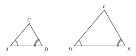
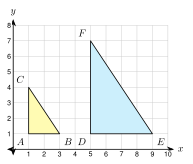

# 5.3 - Similar Triangles {.unnumbered}

A wheelchair ramp rises 1 foot over a length of 12 feet. A builder puts a support post under the ramp. Another post goes in at a different spot. The ramp, the ground, and each post make a triangle. All of these triangles have the same shape.

How can the builder be sure of this without measuring every angle? Triangles are special. You do not need to check every angle and every side. In this lesson you learn three short tests for similar triangles.

:::{.objectives}
- [ ] I can decide whether two triangles are similar by AA, SSS, or SAS.
- [ ] I can write a similarity statement in the right order.
- [ ] I can find missing sides in overlapping triangles.
- [ ] I can use distances and slopes on a grid to check similarity.
:::

:::{.vocab}
,
,
,
,

:::

:::{.guided-notes-link}
[Printable Guided Notes for this lesson](/guided_notes/Unit_5/5.3_Similar_Triangles.html){target="_blank"} (fill-in notes to print and write on)
:::



1. A triangle has angles of $48^\circ$ and $75^\circ$. Find the third angle.

2. Solve $\dfrac{x}{x + 4} = \dfrac{3}{5}$.

3. Two parallel lines are cut by a transversal. What can you say about corresponding angles?



### 5.3.1 - AA Similarity

In Unit 4 you learned that three equal angles (AAA) do not make triangles congruent. They can be different sizes. Now you know why. Triangles with three equal angles have the same shape. They are **similar**.

You only need two pairs of equal angles. The angles of a triangle add to $180^\circ$, so the third pair is equal for free.

:::{.remember title="AA similarity"}
If two angles of one triangle are equal to two angles of another triangle, the triangles are similar.
:::

***

**Example 1:** Use AA

{width=420px fig-align="center"}

In the figure, $m\angle A = m\angle D = 50^\circ$ and $m\angle B = m\angle E = 60^\circ$.

a. Find $m\angle C$ and $m\angle F$.

b. Are the triangles similar? Write the statement.

a. $m\angle C = 180 - 50 - 60 = 70^\circ$. $m\angle F = 180 - 50 - 60 = 70^\circ$.

b. Two pairs of angles are equal (and the third pair is too). The triangles are similar by AA.

$\triangle ABC \sim \triangle DEF$

:::{.you-try-m title="Are the triangles similar?"}
$\triangle PQR$ has $m\angle P = 48^\circ$ and $m\angle Q = 82^\circ$. $\triangle XYZ$ has $m\angle X = 48^\circ$ and $m\angle Z = 50^\circ$. Are they similar?
:::

:::{.answer title="Answer"}
$m\angle R = 180 - 48 - 82 = 50^\circ$ and $m\angle Y = 180 - 48 - 50 = 82^\circ$.

$\angle P = \angle X$ and $\angle R = \angle Z$ (and $\angle Q = \angle Y$). Yes, similar by AA. $\triangle PQR \sim \triangle XYZ$.
:::

### 5.3.2 - SSS and SAS Similarity

There are two more tests. They look like SSS and SAS for congruent triangles. The difference is that the sides do not have to be **equal**. They have to be **proportional**.

* **SSS similarity**: the ratios of all three pairs of matching sides are equal.
* **SAS similarity**: the ratios of two pairs of matching sides are equal, and the angles **between** those sides are equal.

***

**Example 3:** SSS

Triangle 1 has sides 4, 6, and 8. Triangle 2 has sides 10, 15, and 20. Are the triangles similar? Then try 6, 8, 10 and 9, 12, 16.

Match the shortest with the shortest, and so on.

$\dfrac{10}{4} = 2.5$, $\dfrac{15}{6} = 2.5$, $\dfrac{20}{8} = 2.5$

All three ratios are equal. The triangles are similar by SSS.

For 6, 8, 10 and 9, 12, 16: $\dfrac{9}{6} = 1.5$, $\dfrac{12}{8} = 1.5$, but $\dfrac{16}{10} = 1.6$. The ratios are not all equal. **Not similar.**

:::{.you-try-m title="Are the triangles similar?"}
Triangle 1 has sides 7, 9, and 12. Triangle 2 has sides 14, 18, and 24.
:::

:::{.answer title="Answer"}
$\dfrac{14}{7} = 2$, $\dfrac{18}{9} = 2$, $\dfrac{24}{12} = 2$. Similar by SSS, with $k = 2$.
:::

***

**Example 5:** SAS

In $\triangle ABC$, $AB = 6$, $AC = 9$, and $m\angle A = 40^\circ$. In $\triangle DEF$, $DE = 10$, $DF = 15$, and $m\angle D = 40^\circ$. Are the triangles similar?

The angle $A$ is between $\overline{AB}$ and $\overline{AC}$. The angle $D$ is between $\overline{DE}$ and $\overline{DF}$.

$\dfrac{DE}{AB} = \dfrac{10}{6} = \dfrac{5}{3}$ and $\dfrac{DF}{AC} = \dfrac{15}{9} = \dfrac{5}{3}$.

The ratios are equal and the included angles are equal. Similar by SAS. $\triangle ABC \sim \triangle DEF$.

:::{.you-try-m title="Are the triangles similar?"}
In $\triangle KLM$, $KL = 4$, $KM = 10$, and $m\angle K = 65^\circ$. In $\triangle RST$, $RS = 6$, $RT = 15$, and $m\angle R = 65^\circ$.
:::

:::{.answer title="Answer"}
$\dfrac{6}{4} = 1.5$ and $\dfrac{15}{10} = 1.5$. The angles $K$ and $R$ are between the sides. Similar by SAS. $\triangle KLM \sim \triangle RST$.
:::

### 5.3.3 - Which Test Works?

Here is how the tests for congruence (4.2) and similarity compare.

| Test | Congruent triangles | Similar triangles |
|:---:|:---:|:---:|
| SSS | all three sides **equal** | all three sides **proportional** |
| SAS | two sides equal, included angle equal | two sides proportional, included angle equal |
| AA | not enough alone (use ASA or AAS) | two angles equal is **enough** |

When you write the similarity statement, put matching vertices in the same position. $\triangle ABC \sim \triangle DEF$ means $A \to D$, $B \to E$, $C \to F$.

***

**Example 7:** Pick the test

For each pair, write AA, SSS, SAS, or not similar. If they are similar, write the statement.

a. $\triangle ABC$: $m\angle A = 55^\circ$, $m\angle B = 45^\circ$. $\triangle XYZ$: $m\angle X = 55^\circ$, $m\angle Y = 45^\circ$.

b. $\triangle ABC$: $AB = 6$, $BC = 8$, $AC = 12$. $\triangle DEF$: $DE = 9$, $EF = 12$, $DF = 18$.

c. $\triangle JKL$: $JK = 5$, $KL = 8$, $m\angle K = 70^\circ$. $\triangle MNP$: $MN = 10$, $NP = 12$, $m\angle N = 70^\circ$.

a. AA. $\triangle ABC \sim \triangle XYZ$.

b. $\dfrac{9}{6} = \dfrac{12}{8} = \dfrac{18}{12} = 1.5$. SSS. $\triangle ABC \sim \triangle DEF$.

c. The angles $K$ and $N$ are between the sides. $\dfrac{10}{5} = 2$ but $\dfrac{12}{8} = 1.5$. The ratios are not equal. **Not similar.**

:::{.you-try-m title="Pick the test"}
$\triangle ABC$: $AB = 9$, $BC = 12$, $m\angle B = 30^\circ$. $\triangle DEF$: $DE = 6$, $EF = 8$, $m\angle E = 30^\circ$. Which test works? Write the statement.
:::

:::{.answer title="Answer"}
$\dfrac{6}{9} = \dfrac{2}{3}$ and $\dfrac{8}{12} = \dfrac{2}{3}$. The angles are between the sides. SAS. $\triangle ABC \sim \triangle DEF$.
:::

### 5.3.4 - Overlapping Triangles

Sometimes one triangle sits inside another. They share an angle. If $\overline{DE} \parallel \overline{BC}$, then $\angle ADE$ and $\angle ABC$ are corresponding angles, so they are equal. With the shared $\angle A$, that is AA.

**Tip:** draw the two triangles apart. Then match the sides. Remember that the **big** triangle uses the whole side: $AB$, not $DB$.

***

**Example 9:** Nested triangles

{width=600px fig-align="center"}

$\overline{DE} \parallel \overline{BC}$. $AD = 6$, $DB = 3$, and $DE = 8$. Find $BC$.

$\angle A$ is shared. $\angle ADE = \angle ABC$ (corresponding angles). So $\triangle ADE \sim \triangle ABC$ by AA.

The big triangle uses the whole side: $AB = 6 + 3 = 9$.

$\dfrac{AD}{AB} = \dfrac{DE}{BC}$, so $\dfrac{6}{9} = \dfrac{8}{x}$.

$6x = 72$, so $x = 12$.

:::{.you-try-m title="$\overline{DE} \parallel \overline{BC}$"}
$AD = 9$, $DB = 3$, and $DE = 15$. Find $BC$.
:::

:::{.answer title="Answer"}
$AB = 12$. $\dfrac{9}{12} = \dfrac{15}{x}$, so $9x = 180$ and $x = 20$.
:::

***

**Example 11:** Nested triangles with expressions

{width=260px fig-align="center"}

$\overline{DE} \parallel \overline{BC}$. $AD = x$, $DB = 4$, $AE = 6$, and $EC = 3$. Find $x$.

$\triangle ADE \sim \triangle ABC$ by AA.

$AB = x + 4$ and $AC = 6 + 3 = 9$.

$\dfrac{AD}{AB} = \dfrac{AE}{AC}$, so $\dfrac{x}{x + 4} = \dfrac{6}{9}$.

$9x = 6(x + 4)$, so $9x = 6x + 24$ and $3x = 24$.

$x = 8$. Check: $\dfrac{8}{12} = \dfrac{6}{9}$.

:::{.you-try-m title="$\overline{DE} \parallel \overline{BC}$"}
$AD = 5$, $DB = x$, $AE = 4$, and $EC = 6$. Find $x$.
:::

:::{.answer title="Answer"}
$\dfrac{5}{5 + x} = \dfrac{4}{10}$, so $50 = 4(5 + x)$.

$50 = 20 + 4x$, so $x = 7.5$.
:::

### 5.3.5 - Similar Triangles on a Grid

On a coordinate grid, you can prove two triangles are similar with computation. Use the **distance formula** to check side ratios (SSS). Use **slopes** to check that sides are parallel (equal angles).

***

**Example 13:** Check with distances

{width=330px fig-align="center"}

Show that $\triangle ABC \sim \triangle DEF$. Find $k$.

$A(1, 1)$, $B(3, 1)$, $C(1, 4)$. $D(5, 1)$, $E(9, 1)$, $F(5, 7)$.

$AB = 2$, $AC = 3$, $BC = \sqrt{2^2 + 3^2} = \sqrt{13}$.

$DE = 4$, $DF = 6$, $EF = \sqrt{4^2 + 6^2} = \sqrt{52} = 2\sqrt{13}$.

$\dfrac{DE}{AB} = 2$, $\dfrac{DF}{AC} = 2$, $\dfrac{EF}{BC} = \dfrac{2\sqrt{13}}{\sqrt{13}} = 2$.

All ratios are 2. Similar by SSS, with $k = 2$.

:::{.you-try-m title="Show they are similar."}
$P(1, 1)$, $Q(4, 1)$, $R(1, 5)$ and $S(5, 1)$, $T(11, 1)$, $U(5, 9)$. Use the distance formula.
:::

:::{.answer title="Answer"}
$PQ = 3$, $PR = 4$, $QR = 5$. $ST = 6$, $SU = 8$, $TU = \sqrt{36 + 64} = 10$.

$\dfrac{6}{3} = \dfrac{8}{4} = \dfrac{10}{5} = 2$. Similar by SSS.
:::

***

**Example 15:** Check with slopes

$P(0, 0)$, $Q(4, 2)$, $R(2, 6)$ and $S(6, 1)$, $T(12, 4)$, $U(9, 10)$. Show that matching sides are parallel.

Slope of $\overline{PQ}$: $\dfrac{2 - 0}{4 - 0} = \dfrac{1}{2}$. Slope of $\overline{ST}$: $\dfrac{4 - 1}{12 - 6} = \dfrac{1}{2}$.

Slope of $\overline{QR}$: $\dfrac{6 - 2}{2 - 4} = -2$. Slope of $\overline{TU}$: $\dfrac{10 - 4}{9 - 12} = -2$.

Slope of $\overline{PR}$: $\dfrac{6}{2} = 3$. Slope of $\overline{SU}$: $\dfrac{9}{3} = 3$.

Every pair is parallel, so the angles are equal. The triangles are similar by AA.

:::{.real-world title="A pinhole camera"}
Light from the top of a tree goes through a tiny hole and lands on the back wall of a dark box. The tree and its image make similar triangles. The image is upside down and much smaller.
:::



***

**Are the triangles similar? If yes, write the statement and the test.**

1. $\triangle ABC$: $m\angle A = 62^\circ$, $m\angle B = 48^\circ$. $\triangle DEF$: $m\angle D = 62^\circ$, $m\angle E = 48^\circ$.

2. $\triangle GHJ$: $m\angle G = 90^\circ$, $m\angle H = 35^\circ$. $\triangle KLM$: $m\angle K = 90^\circ$, $m\angle M = 55^\circ$.

3. $\triangle NPQ$: $m\angle N = 70^\circ$, $m\angle P = 40^\circ$. $\triangle RST$: $m\angle R = 70^\circ$, $m\angle S = 60^\circ$.

4. One isosceles triangle has a vertex angle of $40^\circ$. Another isosceles triangle has base angles of $70^\circ$. Are they similar?

***

**Are the triangles similar by SSS? Give the ratios.**

5. Sides 3, 5, 7 and 9, 15, 21

6. Sides 4, 6, 9 and 6, 9, 14

7. Sides 5, 12, 13 and 15, 36, 39

8. Sides 8, 10, 12 and 12, 15, 19

***

**Are the triangles similar by SAS? If you cannot tell, explain.**

9. $AB = 6$, $AC = 10$, $m\angle A = 50^\circ$. $DE = 9$, $DF = 15$, $m\angle D = 50^\circ$.

10. $AB = 8$, $AC = 12$, $m\angle A = 70^\circ$. $DE = 12$, $DF = 20$, $m\angle D = 70^\circ$.

11. $JK = 5$, $KL = 7$, $m\angle J = 40^\circ$. $MN = 10$, $NP = 14$, $m\angle M = 40^\circ$.

12. $AB = 3$, $BC = 5$, $m\angle B = 100^\circ$. $DE = 9$, $EF = 15$, $m\angle E = 100^\circ$.

***

**Write the statement.**

13. $m\angle P = m\angle T$ and $m\angle Q = m\angle U$ in $\triangle PQR$ and $\triangle STU$. Write the similarity statement.

***

**Use the figure. $\overline{DE} \parallel \overline{BC}$.**

{width=260px fig-align="center"}

14. Explain why $\triangle ADE \sim \triangle ABC$. Name the test.

15. $AD = 4$, $DB = 2$, and $DE = 6$. Find $BC$.

16. $AD = 5$, $AB = 15$, and $AE = 4$. Find $AC$.

17. $AD = x$, $DB = 3$, $AE = 6$, and $EC = 4$. Find $x$.

18. Mohammed has $AD = 4$, $AB = 10$, and $DE = 3$. He writes $\dfrac{4}{10} = \dfrac{BC}{3}$ and gets $BC = 1.2$. Find his mistake and fix it.

***

**Use the coordinate plane.**

19. $A(0, 0)$, $B(6, 0)$, $C(0, 8)$ and $D(2, 2)$, $E(5, 2)$, $F(2, 6)$. Use the distance formula to show $\triangle ABC \sim \triangle DEF$. Find $k$ from $\triangle ABC$ to $\triangle DEF$.

20. $G(0, 0)$, $H(4, 0)$, $J(4, 3)$ and $K(1, -2)$, $L(9, -2)$, $M(9, 4)$. Use slopes to show the triangles are similar. Find $k$ from $\triangle GHJ$ to $\triangle KLM$.

21. $A(1, 1)$, $B(4, 1)$, $C(1, 5)$ and $D(6, 1)$, $E(10, 1)$, $F(6, 7)$. Both triangles have a right angle ($A$ and $D$). Are they similar? Use side ratios.

***

**Real problems.**

22. A ramp is 12 ft long and rises 1 ft. A post stands under the ramp 8 ft along its length. The post and the ramp make a triangle that is similar to the whole ramp triangle. How tall is the post in inches?

23. A pinhole camera is a box 0.2 m deep. A tree is 12 m tall and 30 m from the hole. The tree and its image make similar triangles. How tall is the image in centimeters?

24. Lucía says, "Any two right triangles that each have a $30^\circ$ angle are similar." Is she right? Explain.

***

**Test practice**

25. In $\triangle ABC$ and $\triangle DEF$, $m\angle A = m\angle D = 50^\circ$, $AB = 6$, $AC = 8$, and $DE = 9$. What value of $DF$ shows that $\triangle ABC \sim \triangle DEF$ by SAS?

    A. 10\
    B. 12\
    C. 14\
    D. 16

26. In $\triangle ABC$, point $D$ is on $\overline{AB}$ and point $E$ is on $\overline{AC}$. $\overline{DE} \parallel \overline{BC}$, $AD = 6$, $AB = 10$, and $DE = 9$. What is $BC$?

    A. 5.4\
    B. 12\
    C. 15\
    D. 25

***

**Challenge**

27. Jamal says, "Any two isosceles triangles are similar." Give a counterexample. Then tell one extra fact that would make two isosceles triangles similar.
