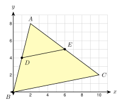

# 5.4 - Triangle Proportionality {.unnumbered}

A lot owner wants to divide a triangle-shaped yard with a fence. The fence must run parallel to the street side. Where should the fence meet the two other sides?

A line parallel to one side of a triangle cuts the other two sides in the same ratio. This is a very useful fact. You can use it to find lengths, to prove two lines are parallel, and to see why a segment joining two midpoints is half as long as the third side.

:::{.objectives}
- [ ] I can use a parallel line in a triangle to find lengths.
- [ ] I can decide if a segment in a triangle is parallel to a side.
- [ ] I can use the midsegment of a triangle.
- [ ] I can use three parallel lines to find lengths on two transversals.
:::

:::{.vocab}
,
,
,

:::

:::{.guided-notes-link}
[Printable Guided Notes for this lesson](/guided_notes/Unit_5/5.4_Triangle_Proportionality.html){target="_blank"} (fill-in notes to print and write on)
:::



1. Solve $\dfrac{x}{12} = \dfrac{5}{8}$.

2. Find the midpoint of $(2, 5)$ and $(8, -1)$.

3. $\triangle ADE \sim \triangle ABC$, $AD = 3$, $AB = 9$, and $DE = 5$. Find $BC$.



### 5.4.1 - A Line Parallel to a Side

In 5.3 you saw that a line parallel to a side makes a small triangle that is similar to the big one. That gives a new fact about the pieces of the sides.

**Triangle Proportionality Theorem.** If a line is parallel to one side of a triangle and meets the other two sides, it divides those sides in the same ratio.

$$
\dfrac{AD}{DB} = \dfrac{AE}{EC}
$$

Why? Look at the numbers. If $AD = 6$, $DB = 4$, $AE = 9$, and $EC = 6$, then $\dfrac{6}{4} = 1.5$ and $\dfrac{9}{6} = 1.5$. The two parts on each side have the same ratio. Also $\dfrac{AD}{AB} = \dfrac{6}{10}$ and $\dfrac{AE}{AC} = \dfrac{9}{15}$. Both are $0.6$, which is what similar triangles give.

***

**Example 1:** Find a missing part

{width=300px fig-align="center"}

$\overline{DE} \parallel \overline{BC}$. $AD = 6$, $DB = 4$, and $AE = 9$. Find $EC$.

$\dfrac{AD}{DB} = \dfrac{AE}{EC}$, so $\dfrac{6}{4} = \dfrac{9}{x}$.

$6x = 36$, so $x = 6$.

$EC = 6$.

:::{.you-try-m title="$\overline{DE} \parallel \overline{BC}$"}
$AD = 10$, $DB = 4$, and $EC = 6$. Find $AE$.
:::

:::{.answer title="Answer"}
$\dfrac{10}{4} = \dfrac{x}{6}$, so $4x = 60$ and $AE = 15$.
:::

***

**Example 3:** Expressions

{width=300px fig-align="center"}

$\overline{DE} \parallel \overline{BC}$. $AD = x$, $DB = 6$, $AE = x + 2$, and $EC = 9$. Find $x$.

$\dfrac{x}{6} = \dfrac{x + 2}{9}$

$9x = 6(x + 2)$

$9x = 6x + 12$, so $3x = 12$ and $x = 4$.

Check: $\dfrac{4}{6} = \dfrac{6}{9}$.

### 5.4.2 - The Converse

The converse also works. If a segment cuts two sides of a triangle in the same ratio, it is parallel to the third side. Look at the two triangles. Both look like they have a parallel segment. Only one does.

{width=520px fig-align="center"}

***

**Example 4:** Is it parallel?

Use the figure above.

a. In triangle (a), is $\overline{DE} \parallel \overline{BC}$?

b. In triangle (b), is $\overline{DE} \parallel \overline{BC}$?

a. $\dfrac{AD}{DB} = \dfrac{6}{9} = \dfrac{2}{3}$ and $\dfrac{AE}{EC} = \dfrac{8}{12} = \dfrac{2}{3}$. The ratios are equal. **Yes**, $\overline{DE} \parallel \overline{BC}$.

b. $\dfrac{AD}{DB} = \dfrac{4}{8} = \dfrac{1}{2}$ and $\dfrac{AE}{EC} = \dfrac{5}{15} = \dfrac{1}{3}$. The ratios are not equal. **No.**

:::{.gotcha title="Shows or suggests?"}
A segment that looks parallel may not be. Only numbers (equal ratios) or parallel marks tell you for sure.
:::

### 5.4.3 - The Midsegment of a Triangle

A **midsegment** of a triangle joins the midpoints of two sides. Each midpoint makes the ratio $\dfrac{AD}{DB} = 1$. So the converse says $\overline{DE} \parallel \overline{BC}$. The triangles $ADE$ and $ABC$ have scale factor $\dfrac{1}{2}$.

{width=300px fig-align="center"}

**Midsegment Theorem.** A midsegment is parallel to the third side. It is half as long: $DE = \dfrac{1}{2} BC$.

***

**Example 5:** Use the midsegment

$D$ and $E$ are the midpoints of $\overline{AB}$ and $\overline{AC}$.

a. $BC = 18$. Find $DE$.

b. $DE = 3x + 1$ and $BC = 5x + 12$. Find $x$ and $BC$.

a. $DE = \dfrac{1}{2}(18) = 9$.

b. $BC = 2 \cdot DE$, so $5x + 12 = 2(3x + 1)$.

$5x + 12 = 6x + 2$, so $x = 10$.

$BC = 5(10) + 12 = 62$. (Check: $DE = 31$.)

:::{.you-try-m title="$D$ and $E$ are midpoints."}
a. $DE = 7.5$. Find $BC$.

b. $DE = 2x + 4$ and $BC = 6x - 4$. Find $x$.
:::

:::{.answer title="Answer"}
a. $BC = 2(7.5) = 15$.

b. $6x - 4 = 2(2x + 4)$, so $6x - 4 = 4x + 8$, $2x = 12$, and $x = 6$.
:::

***

**Example 7:** Check with coordinates

{width=330px fig-align="center"}

$A(2, 8)$, $B(0, 0)$, $C(10, 2)$. $D$ is the midpoint of $\overline{AB}$. $E$ is the midpoint of $\overline{AC}$. Show that $\overline{DE} \parallel \overline{BC}$ and $DE = \dfrac{1}{2} BC$.

Midpoints: $D = \left(\dfrac{2 + 0}{2}, \dfrac{8 + 0}{2}\right) = (1, 4)$ and $E = \left(\dfrac{2 + 10}{2}, \dfrac{8 + 2}{2}\right) = (6, 5)$.

Slope of $\overline{DE}$: $\dfrac{5 - 4}{6 - 1} = \dfrac{1}{5}$. Slope of $\overline{BC}$: $\dfrac{2 - 0}{10 - 0} = \dfrac{1}{5}$. Equal slopes, so parallel.

$DE = \sqrt{5^2 + 1^2} = \sqrt{26}$ and $BC = \sqrt{10^2 + 2^2} = \sqrt{104} = 2\sqrt{26}$.

So $DE = \dfrac{1}{2} BC$.

### 5.4.4 - Parallel Lines and Transversals

Three parallel cross streets cut two avenues. The lots along the avenues are cut in proportion.

{width=520px fig-align="center"}

**If three or more parallel lines cut two transversals, the transversals are cut proportionally.**

***

**Example 8:** Lots on a street

Use the street map above. Pine St, Oak St, and Elm St are parallel. Find $x$.

$\dfrac{60}{90} = \dfrac{80}{x}$

$60x = 7200$, so $x = 120$.

The second lot on 2nd Ave is 120 ft long.

:::{.you-try-m title="Find the length."}
Three parallel streets cross two avenues. On one avenue, the lots are 45 ft and 75 ft. On the other, the first lot is 60 ft. How long is the second lot?
:::

:::{.answer title="Answer"}
$\dfrac{45}{75} = \dfrac{60}{x}$, so $45x = 4500$ and $x = 100$ ft.
:::



***

**Use the figure. $\overline{DE} \parallel \overline{BC}$. Find the missing length.**

{width=240px fig-align="center"}

1. $AD = 4$, $DB = 6$, $AE = 5$. Find $EC$.

2. $AD = 9$, $DB = 3$, $EC = 2$. Find $AE$.

3. $AD = 6$, $AB = 10$, $AE = 9$. Find $EC$.

4. $AB = 20$, $AD = 12$, $AE = 9$. Find $AC$.

5. $AD = x$, $DB = 8$, $AE = x + 3$, $EC = 12$. Find $x$.

6. $AD = 2x$, $DB = 9$, $AE = 8$, $EC = 6$. Find $x$ and $AD$.

***

**Is $\overline{DE} \parallel \overline{BC}$? Show the ratios.**

7. $AD = 6$, $DB = 8$, $AE = 9$, $EC = 12$

8. $AD = 5$, $DB = 7$, $AE = 10$, $EC = 15$

9. $AD = 3$, $AB = 9$, $AE = 4$, $AC = 12$

10. A triangle drawing has no marks and no numbers, but $\overline{DE}$ looks parallel to $\overline{BC}$. Can you say it is parallel?

***

**$D$ and $E$ are midpoints of $\overline{AB}$ and $\overline{AC}$.**

{width=200px fig-align="center"}

11. $BC = 26$. Find $DE$.

12. $DE = 8.5$. Find $BC$.

13. $DE = 3x - 2$ and $BC = 4x + 8$. Find $x$ and $DE$.

14. $D$, $E$, and $F$ are the midpoints of the three sides of a triangle with sides 14, 20, and 18. Find the perimeter of $\triangle DEF$.

***

**Use coordinates.**

15. $A(2, 1)$, $B(6, 9)$, $C(12, 3)$. $M$ is the midpoint of $\overline{AB}$ and $N$ is the midpoint of $\overline{BC}$. Show that $\overline{MN} \parallel \overline{AC}$ and $MN = \dfrac{1}{2} AC$.

***

**Parallel lines and transversals.**

16. Three parallel streets cross two avenues. On one avenue the lots are 50 ft and 70 ft. On the other avenue the first lot is 75 ft. Find the second lot.

17. Three parallel shelf boards are fixed to two slanted posts. On the left post the gaps are 12 in and 18 in. On the right post the first gap is 14 in. Find the second gap.

18. Four parallel lines cut two transversals. On the first, the parts are 2, 3, and 5. On the second, the first part is 6. Find the other two parts.

19. Three parallel lines cut two transversals. On one, the parts are 6 and 4. On the other, the parts are $x + 1$ and $x - 1$. Find $x$.

***

**Find the mistake.**

20. In a triangle, $\overline{DE} \parallel \overline{BC}$, $AD = 4$, $DB = 2$, and $DE = 6$. Hnin writes $\dfrac{AD}{DB} = \dfrac{DE}{BC}$ and gets $BC = 3$. Find her mistake. Then find $BC$.

***

**Test practice**

21. In $\triangle ABC$, $\overline{DE} \parallel \overline{BC}$, with $D$ on $\overline{AB}$ and $E$ on $\overline{AC}$. $AD = 4$, $DB = 6$, and $AE = 6$. What is the length of $\overline{AC}$?

    A. 9\
    B. 10\
    C. 15\
    D. 22.5

22. A midsegment of a triangle has length $2x + 3$. The side it is parallel to has length $5x - 6$. What is $x$?

    A. 4\
    B. 9\
    C. 12\
    D. 15

***

**Challenge**

23. $\triangle ABC$ has area 80 square inches. $D$, $E$, and $F$ are the midpoints of its sides. The midsegments make four small triangles that are all congruent. What is the area of $\triangle DEF$? Check with $k$: $\triangle ADE \sim \triangle ABC$ with $k = \dfrac{1}{2}$.
