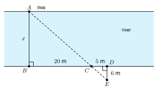

# 5.5 - Indirect Measurement {.unnumbered}

How tall is the tree in front of your school? You cannot climb it with a tape measure. How wide is a river? You cannot walk across it. In both cases you can still find the answer.

You measure things that are easy to reach. Then you use similar triangles to find the length you cannot reach. This is called **indirect measurement**. People who build bridges, make maps, and survey land use it every day.

:::{.objectives}
- [ ] I can use shadows to find a height.
- [ ] I can use a mirror to find a height.
- [ ] I can find a distance across a river with stakes.
- [ ] I can set up and solve real problems with similar triangles.
:::

:::{.vocab}
,
,

:::

:::{.guided-notes-link}
[Printable Guided Notes for this lesson](/guided_notes/Unit_5/5.5_Indirect_Measurement.html){target="_blank"} (fill-in notes to print and write on)
:::



1. Solve $\dfrac{6}{4} = \dfrac{h}{30}$.

2. Two right triangles each have a $35^\circ$ angle. Are they similar? Say why.

3. Change 5 ft 6 in to feet.



### 5.5.1 - Shadows

:::{.remember title="Four steps for every problem"}
**1.** Draw a sketch and label it.

**2.** Name the similar triangles.

**3.** Write a proportion with matching sides in the same positions.

**4.** Solve, and answer with units.
:::

At the same time of day, the sun hits everything at the same angle. A person and a tree each stand straight up. Each makes a right triangle with its shadow. Both triangles have a right angle and the same sun angle, so they are similar by AA.

***

**Example 1:** Height of a tree

{width=480px fig-align="center"}

A person 5 ft tall has a shadow 8 ft long. At the same time, a tree has a shadow 40 ft long. How tall is the tree?

The triangles are similar. Put height over shadow on both sides.

$\dfrac{5}{8} = \dfrac{h}{40}$

$8h = 200$, so $h = 25$.

The tree is **25 ft** tall.

:::{.you-try-m title="Find the height."}
A stick 3 ft tall casts a shadow 2 ft long. At the same time, a pole casts a shadow 18 ft long. How tall is the pole?
:::

:::{.answer title="Answer"}
$\dfrac{3}{2} = \dfrac{h}{18}$, so $2h = 54$ and $h = 27$ ft.
:::

### 5.5.2 - Mirrors

Put a mirror flat on the ground. Stand where you can see the top of the building in the mirror. The light from the top of the building hits the mirror and bounces to your eye. The two angles at the mirror are equal. The person and the building each make a right angle with the ground. So the two triangles are similar by AA.

***

**Example 3:** Height of a building

{width=480px fig-align="center"}

Mei's eyes are 1.6 m above the ground. She stands 2 m from a mirror on the ground and sees the top of a building in it. The mirror is 30 m from the building. How tall is the building?

The small triangle has legs 1.6 and 2. The large triangle has legs $h$ and 30.

$\dfrac{1.6}{2} = \dfrac{h}{30}$

$2h = 48$, so $h = 24$.

The building is **24 m** tall.

:::{.you-try-m title="Find the height."}
Daniel's eyes are 1.5 m above the ground. He stands 3 m from a mirror and sees the top of a tree. The mirror is 36 m from the tree. How tall is the tree?
:::

:::{.answer title="Answer"}
$\dfrac{1.5}{3} = \dfrac{h}{36}$, so $3h = 54$ and $h = 18$ m.
:::

### 5.5.3 - Across a River

You want to know the width of a river. A tree $A$ stands on the far bank. Follow these steps:

1. Stand at $B$ on your bank, straight across from the tree. This makes $\overline{AB}$ the width you want.
2. Walk along your bank and put a stake at $C$. Walk a little farther and put a stake at $D$.
3. At $D$, turn and walk straight away from the river to a point $E$ where you see the tree $A$ and the stake $C$ in a line.

Now $\triangle ABC \sim \triangle EDC$. Both have a right angle, and the angles at $C$ are vertical angles.

***

**Example 5:** Width of a river

{width=420px fig-align="center"}

$BC = 20$ m, $CD = 5$ m, and $DE = 6$ m. Find the width $AB$ of the river.

$\triangle ABC \sim \triangle EDC$. Match $\overline{AB}$ with $\overline{ED}$ and $\overline{BC}$ with $\overline{DC}$.

$\dfrac{AB}{DE} = \dfrac{BC}{CD}$, so $\dfrac{x}{6} = \dfrac{20}{5}$.

$5x = 120$, so $x = 24$.

The river is **24 m** wide.

:::{.you-try-m title="Find the width."}
$BC = 15$ m, $CD = 5$ m, and $DE = 4$ m. Find $AB$.
:::

:::{.answer title="Answer"}
$\dfrac{x}{4} = \dfrac{15}{5}$, so $5x = 60$ and $x = 12$ m.
:::

### 5.5.4 - Mixed Real Problems

Some problems hide which lengths match. Always draw the sketch. In the next example, the small triangle is Tomás and his shadow. The big triangle is the lamp and the whole ground length from the lamp to the tip of the shadow.

***

**Example 7:** Which lengths match?

{width=300px fig-align="center"}

A lamp stands on a level street. Tomás is 6 ft tall. He stands 10 ft from the base of the lamp. His shadow is 5 ft long. How tall is the lamp?

The small triangle: height 6, base 5 (the shadow).

The big triangle: height $h$, base $10 + 5 = 15$ (from the lamp to the tip of the shadow).

$\dfrac{6}{5} = \dfrac{h}{15}$

$5h = 90$, so $h = 18$.

The lamp is **18 ft** tall.

:::{.you-try-m title="Which lengths match?"}
Maria is 5 ft tall. She stands 12 ft from a lamp post. Her shadow is 6 ft long. How tall is the lamp post?
:::

:::{.answer title="Answer"}
Big base: $12 + 6 = 18$. $\dfrac{5}{6} = \dfrac{h}{18}$, so $6h = 90$ and $h = 15$ ft.
:::

***

**Example 9:** Test wording

A vertical post that is 2.5 feet tall casts a shadow that is 1.5 feet long. At the same time, a nearby tower casts a shadow that is 36 feet long. What is the height of the tower?

A. 21.6 ft  B. 40 ft  C. 60 ft  D. 100 ft

Draw the sketch. Height over shadow:

$\dfrac{2.5}{1.5} = \dfrac{h}{36}$, so $1.5h = 90$ and $h = 60$.

The answer is **C**, 60 ft.

:::{.note title="Class activity"}
Find the height of the school flagpole. Work with a partner. Measure your height, your shadow, and the flagpole's shadow with a tape measure. Write a proportion and solve. Then check with a mirror on the ground.
:::



***

**Shadows.**

1. A girl 5 ft tall casts a shadow 7.5 ft long. At the same time a tree casts a shadow 36 ft long. How tall is the tree?

2. A pole casts a shadow 21 ft long. At the same time a 3 ft stick casts a shadow 2 ft long. How tall is the pole?

3. Hnin is 1.6 m tall. Her shadow is 2.4 m long. A building casts a shadow 45 m long at the same time. How tall is the building?

4. A boy is 4 ft 6 in tall. His shadow is 6 ft long. A tree casts a shadow 40 ft long. How tall is the tree? Change inches to feet first.

5. A flagpole is 30 ft tall. Its shadow is 24 ft long. At the same time, a person 5 ft tall stands next to it. How long is the person's shadow?

6. A sign post 6 ft tall has a shadow 5 ft long. A building casts a shadow 90 ft long at the same time. How tall is the building?

***

**Mirrors.**

7. Eye height 1.5 m. The person stands 2 m from a mirror. The building is 40 m from the mirror. How tall is the building?

8. A person with eye height 5 ft stands 3 ft from a mirror. A tree is 24 ft from the mirror on the other side. How tall is the tree?

9. Samir is 1.8 m tall. His eyes are 1.7 m above the ground. He stands 2.5 m from a mirror. The tree is 20 m from the mirror. How tall is the tree? Which of his heights do you use?

10. Explain why the two triangles in a mirror problem are similar.

***

**Across a river. Use the stake method from 5.5.3. $\triangle ABC \sim \triangle EDC$.**

11. $BC = 30$ ft, $CD = 10$ ft, and $DE = 14$ ft. Find the width $AB$.

12. $BC = 24$ m, $CD = 6$ m, and $DE = 5$ m. Find the width $AB$.

***

**Mixed problems.**

13. A tree casts a shadow $(2x + 6)$ ft long. The tree is $(4x + 3)$ ft tall. At the same time a 6 ft person casts a shadow 4 ft long. Find $x$ and the height of the tree.

14. A lamp post is 20 ft tall. Ana is 5 ft tall and stands 15 ft from the post. How long is her shadow? Let $s$ be the length of her shadow.

15. A ramp rises 3 ft over a ground length of 36 ft. A support post stands 24 ft from the bottom, measured along the ground. How tall is the post?

16. Kofi is 4 ft tall. He stands 9 ft from a lamp. His shadow is 3 ft long. He writes $\dfrac{4}{3} = \dfrac{H}{9}$ and gets $H = 12$ ft. Find his mistake. Then find the height of the lamp.

17. A 2 m stick casts a shadow 1.5 m long. How long is the shadow of a 9 m tower at the same time?

***

**Test practice**

18. A vertical post that is 2.5 feet tall casts a shadow that is 1.5 feet long. At the same time, a vertical building casts a shadow that is 30 feet long. Which equation can you use to find the height $h$ of the building?

    A. $\dfrac{2.5}{30} = \dfrac{h}{1.5}$\
    B. $\dfrac{2.5}{1.5} = \dfrac{h}{30}$\
    C. $\dfrac{1.5}{2.5} = \dfrac{h}{30}$\
    D. $2.5 + 1.5 = h + 30$

19. Stakes $B$, $C$, and $D$ are in a line on one side of a river. $BC = 36$ m, $CD = 12$ m, and $DE = 8$ m. The triangles $ABC$ and $EDC$ are similar. How wide is the river, $AB$?

    A. 2.7 m\
    B. 16 m\
    C. 24 m\
    D. 96 m

***

**Challenge**

20. At 3:00 a 6 ft person has a shadow 9 ft long. A tree has a shadow 54 ft long. Find the height of the tree. Later the person's shadow is 12 ft long. How long is the tree's shadow then?
