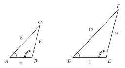

# Unit 5 Summary {.unnumbered}

:::{.guided-notes-link}
[Printable Unit 5 Summary](/guided_notes/Unit_5/Unit_5_Summary.html){target="_blank"} (a reference sheet to print and keep)
:::

## 5.1 - Ratios and Proportions

* A **ratio** compares two numbers by division: $2 : 3$, $\dfrac{2}{3}$, or "2 to 3". Use the same units.
* A **proportion** says that two ratios are equal. Cross products: $\dfrac{a}{b} = \dfrac{c}{d}$ means $ad = bc$.
* Put the same kind of number in the same place in both ratios.
* A **scale** like $1 \text{ in} : 20 \text{ ft}$ turns a drawing length into a real length, and the other way.
* To split a total in the ratio $3 : 5$, write the parts $3x$ and $5x$ and add them to the total.

{width=260px fig-align="center"}

Example: $\dfrac{x}{12} = \dfrac{5}{8}$ gives $8x = 60$, so $x = 7.5$. Angles in the ratio $2 : 3 : 4$: $9x = 180$, so $x = 20$ and the angles are $40^\circ$, $60^\circ$, $80^\circ$.

## 5.2 - Similar Figures and Scale Factor

* **Similar** figures ($\sim$) have the same shape. Matching angles are equal and matching sides are proportional.
* The order of the letters in $\triangle ABC \sim \triangle DEF$ shows which parts match.
* The **scale factor** $k$ is the new length divided by the old length. The other direction uses the reciprocal.
* To find a missing side, write a proportion with matching sides, then use cross products.
* Perimeters change by $k$. Areas change by $k^2$.
* Equal angles alone are not enough. Two rectangles with equal angles can be different shapes.

{width=420px fig-align="center"}

Example: If $k = 1.5$, a side of 4 becomes 6. A perimeter of 18 becomes 27. An area of 10 becomes $1.5^2 \cdot 10 = 22.5$.

## 5.3 - Similar Triangles

* **AA**: two pairs of equal angles make triangles similar.
* **SSS**: all three pairs of sides are proportional.
* **SAS**: two pairs of sides are proportional and the **included angles** are equal.
* If $\overline{DE} \parallel \overline{BC}$, then $\triangle ADE \sim \triangle ABC$. Draw the triangles apart and use the whole side $AB$ for the big triangle.
* On a grid, use the distance formula for side ratios and slopes for parallel sides.

{width=380px fig-align="center"}

Example: Sides 4, 6, 8 and 10, 15, 20 have equal ratios of 2.5. The triangles are similar by SSS.

## 5.4 - Triangle Proportionality

* If $\overline{DE} \parallel \overline{BC}$, then $\dfrac{AD}{DB} = \dfrac{AE}{EC}$.
* Converse: if the two ratios are equal, then $\overline{DE} \parallel \overline{BC}$.
* A **midsegment** joins the midpoints of two sides. It is parallel to the third side and half as long.
* Three parallel lines cut two transversals into proportional parts.
* On a grid, use the midpoint formula and slopes to check a midsegment.

{width=240px fig-align="center"}

Example: $AD = 6$, $DB = 4$, and $AE = 9$. Then $\dfrac{6}{4} = \dfrac{9}{x}$, so $x = 6$.

## 5.5 - Indirect Measurement

* Use similar triangles to find a length you cannot measure.
* Four steps: draw a sketch, name the similar triangles, write a proportion, solve and use units.
* **Shadows**: a person and a tree at the same time make similar right triangles.
* **Mirrors**: the angle in equals the angle out. Use eye height.
* **River**: with stakes $B$, $C$, $D$ and point $E$, $\dfrac{AB}{DE} = \dfrac{BC}{CD}$.

{width=460px fig-align="center"}

Example: A 5 ft person has an 8 ft shadow. A tree has a 40 ft shadow. $\dfrac{5}{8} = \dfrac{h}{40}$, so $h = 25$ ft.
