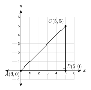

# 6.1 - Special Right Triangles {.unnumbered}

A baseball diamond is a square. Each side is $90$ feet. The catcher at home plate must throw the ball to second base. How far is that throw?

{width=300px fig-align="center"}

The throw is the diagonal of the square. It cuts the square into two right triangles. These triangles always have the same angles, so their sides always have the same pattern. In this lesson you learn two triangles whose sides you can find with no calculator and no table.

:::{.objectives}
- [ ] I can find the sides of a $45^\circ$-$45^\circ$-$90^\circ$ triangle from one side.
- [ ] I can find the sides of a $30^\circ$-$60^\circ$-$90^\circ$ triangle from one side.
- [ ] I can choose the correct special triangle and write exact answers and decimals.
- [ ] I can use special right triangles to solve real problems.
:::

:::{.vocab}
,
,
,
,
,

:::

:::{.guided-notes-link}
[Printable Guided Notes for this lesson](/guided_notes/Unit_6/6.1_Special_Right_Triangles.html){target="_blank"} (fill-in notes to print and write on)
:::



1. A right triangle has legs $5$ and $12$. Find the hypotenuse.

2. Simplify $\sqrt{48}$.

3. Solve $5x - 3 = 2x + 12$.



### 6.1.1 - The 45°-45°-90° Triangle

Cut a square in half along its diagonal. You get two identical right triangles.

{width=280px fig-align="center"}

Each triangle has a right angle at $B$. The two legs are sides of the square, so they are equal. That makes the other two angles equal, so each is $45^\circ$. This is a **$45^\circ$-$45^\circ$-$90^\circ$ triangle**. It is one kind of **special right triangle**.

Try a square with side $6$. The Pythagorean theorem gives the diagonal:

$$
d^2 = 6^2 + 6^2 = 72, \qquad d = \sqrt{72} = 6\sqrt{2}.
$$

Now use any side $s$:

$$
d^2 = s^2 + s^2 = 2s^2, \qquad d = s\sqrt{2}.
$$

{width=280px fig-align="center"}

:::{.remember title="The 45-45-90 rule"}
The two legs are equal. The hypotenuse is the leg times $\sqrt{2}$.

$$
\text{hypotenuse} = \text{leg} \cdot \sqrt{2}
$$
:::

***

**Example 1:** Find the hypotenuse from a leg

A $45^\circ$-$45^\circ$-$90^\circ$ triangle has a leg of $7$. Find the hypotenuse. Give the exact answer and the answer to the nearest tenth.

$$
\text{hypotenuse} = 7\sqrt{2} \approx 9.9
$$

The hypotenuse is $7\sqrt{2}$, or about $9.9$.

:::{.you-try title="A leg of a 45-45-90 triangle is 11. Find the hypotenuse, exact and to the nearest tenth."}
$11\sqrt{2} \approx 15.6$
:::

***

**Example 2:** The baseball diamond

The bases are $90$ feet apart. How far is it from home plate to second base? Round to the nearest tenth of a foot.

The path home, first, second makes a $45^\circ$-$45^\circ$-$90^\circ$ triangle. Its legs are $90$ feet. The throw is the hypotenuse.

$$
d = 90\sqrt{2} \approx 127.3
$$

The throw is about $127.3$ feet.

***

**Going the other way: from the hypotenuse**

If you know the hypotenuse, divide by $\sqrt{2}$ to find a leg. Then rationalize the denominator (Lesson 2.1).

**Example 3:** Find a leg from the hypotenuse

The hypotenuse of a $45^\circ$-$45^\circ$-$90^\circ$ triangle is $8$. Find each leg. Give the exact answer and the answer to the nearest tenth.

$$
\text{leg} = \frac{8}{\sqrt{2}} = \frac{8}{\sqrt{2}} \cdot \frac{\sqrt{2}}{\sqrt{2}} = \frac{8\sqrt{2}}{2} = 4\sqrt{2} \approx 5.7
$$

Each leg is $4\sqrt{2}$, or about $5.7$.

:::{.you-try title="The hypotenuse of a 45-45-90 triangle is 12. Find each leg, exact and to the nearest tenth."}
$\dfrac{12}{\sqrt{2}} = \dfrac{12\sqrt{2}}{2} = 6\sqrt{2} \approx 8.5$
:::

:::{.think title="A shortcut"}
Dividing by $\sqrt{2}$ is the same as multiplying by $\sqrt{2}$ and then dividing by $2$. Check with Example 3: $8 \cdot \sqrt{2} \div 2 = 4\sqrt{2}$.
:::

***

**Example 4:** Show it with coordinates

{width=260px fig-align="center"}

Points $A(0, 0)$, $B(5, 0)$, and $C(5, 5)$ make a triangle. Show that it is a $45^\circ$-$45^\circ$-$90^\circ$ triangle. Find $AC$.

* $\overline{AB}$ is horizontal and $\overline{BC}$ is vertical. So the angle at $B$ is $90^\circ$.
* $AB = 5$ and $BC = 5$. The legs are equal, so the other two angles are equal. Each is $(180^\circ - 90^\circ) \div 2 = 45^\circ$.
* Use the distance formula: $AC = \sqrt{5^2 + 5^2} = \sqrt{50} = 5\sqrt{2} \approx 7.1$.

This matches the rule: hypotenuse = leg $\cdot \sqrt{2}$.

:::{.you-try-m title="Points P(2, 1), Q(8, 1), and R(8, 7)"}
a. Show that $\triangle PQR$ is a $45^\circ$-$45^\circ$-$90^\circ$ triangle.

b. Find $PR$ exactly.
:::

:::{.answer title="Answer"}
a. $\overline{PQ}$ is horizontal and $\overline{QR}$ is vertical, so the angle at $Q$ is $90^\circ$. $PQ = 6$ and $QR = 6$, so the legs are equal.

b. $PR = 6\sqrt{2}$
:::

***

### 6.1.2 - The 30°-60°-90° Triangle

Start with an equilateral triangle. All sides are $2x$ and all angles are $60^\circ$. Draw the height $\overline{CM}$. It makes a right angle with the base and cuts the base in half.

{width=340px fig-align="center"}

Each half is a **$30^\circ$-$60^\circ$-$90^\circ$ triangle**. Its hypotenuse is $2x$. Its shortest leg is $x$. Use the Pythagorean theorem to find the height $h$:

$$
x^2 + h^2 = (2x)^2 \quad\Rightarrow\quad h^2 = 4x^2 - x^2 = 3x^2 \quad\Rightarrow\quad h = x\sqrt{3}.
$$

{width=330px fig-align="center"}

:::{.remember title="The 30-60-90 rule"}
* The **short leg** is across from the $30^\circ$ angle. Call it $x$.
* The **hypotenuse** is $2x$.
* The **long leg** is across from the $60^\circ$ angle. It is $x\sqrt{3}$.
:::

The shortest side is across from the smallest angle. The longest side is across from the largest angle. Always find the short leg first.

***

**Example 5:** Find the sides from the short leg

The short leg of a $30^\circ$-$60^\circ$-$90^\circ$ triangle is $5$. Find the other two sides.

* Hypotenuse: $2 \cdot 5 = 10$.
* Long leg: $5\sqrt{3} \approx 8.7$.

:::{.you-try title="The short leg of a 30-60-90 triangle is 9. Find the hypotenuse and the long leg (nearest tenth)."}
Hypotenuse: $2 \cdot 9 = 18$. Long leg: $9\sqrt{3} \approx 15.6$.
:::

***

**Example 6:** Find the sides from the hypotenuse

The hypotenuse of a $30^\circ$-$60^\circ$-$90^\circ$ triangle is $14$. Find the other two sides.

* Short leg: half the hypotenuse, $14 \div 2 = 7$.
* Long leg: $7\sqrt{3} \approx 12.1$.

:::{.you-try title="The hypotenuse of a 30-60-90 triangle is 20. Find the two legs (nearest tenth)."}
Short leg: $20 \div 2 = 10$. Long leg: $10\sqrt{3} \approx 17.3$.
:::

***

**Example 7:** Find the sides from the long leg

The long leg of a $30^\circ$-$60^\circ$-$90^\circ$ triangle is $6$. Find the other two sides.

The long leg is $x\sqrt{3}$. So $x\sqrt{3} = 6$. Divide by $\sqrt{3}$ and rationalize:

$$
x = \frac{6}{\sqrt{3}} = \frac{6\sqrt{3}}{3} = 2\sqrt{3} \approx 3.5
$$

* Short leg: $2\sqrt{3} \approx 3.5$.
* Hypotenuse: $2x = 4\sqrt{3} \approx 6.9$.

:::{.you-try title="The long leg of a 30-60-90 triangle is 9. Find the short leg and the hypotenuse, exact and to the nearest tenth."}
Short leg: $\dfrac{9}{\sqrt{3}} = \dfrac{9\sqrt{3}}{3} = 3\sqrt{3} \approx 5.2$. Hypotenuse: $2 \cdot 3\sqrt{3} = 6\sqrt{3} \approx 10.4$.
:::

:::{.gotcha title="Where the square root of 3 goes"}
The $\sqrt{3}$ belongs on the **long leg**. The hypotenuse is a whole number multiple of the short leg: $2x$. It never has $\sqrt{3}$ when you start from the short leg.
:::

***

### 6.1.3 - Choosing the Right Rule

Look at the angles first.

| The triangle has angles | Legs and hypotenuse |
|:---|:---|
| $45^\circ$, $45^\circ$, $90^\circ$ | $s$, $s$, $s\sqrt{2}$ |
| $30^\circ$, $60^\circ$, $90^\circ$ | $x$, $x\sqrt{3}$, $2x$ |

When a side is an expression, write an equation and solve for $x$.

**Example 8:** Sides that are expressions

{width=280px fig-align="center"}

a. A $45^\circ$-$45^\circ$-$90^\circ$ triangle has legs $3x - 2$ and $2x + 2$. Find $x$, the legs, and the hypotenuse.

   The legs are equal: $3x - 2 = 2x + 2$, so $x = 4$.

   Each leg is $3(4) - 2 = 10$. The hypotenuse is $10\sqrt{2} \approx 14.1$.

b. In the figure, the short leg is $x + 4$ and the hypotenuse is $3x - 1$. Find $x$ and all three sides.

   The hypotenuse is twice the short leg: $3x - 1 = 2(x + 4)$. So $3x - 1 = 2x + 8$ and $x = 9$.

   Short leg: $9 + 4 = 13$. Hypotenuse: $3(9) - 1 = 26$. Long leg: $13\sqrt{3} \approx 22.5$.

:::{.you-try-m title="Try both kinds"}
a. A $45^\circ$-$45^\circ$-$90^\circ$ triangle has legs $5x - 3$ and $2x + 9$. Find $x$ and the hypotenuse (nearest tenth).

b. A $30^\circ$-$60^\circ$-$90^\circ$ triangle has short leg $x + 6$ and hypotenuse $3x - 4$. Find $x$ and the long leg (nearest tenth).
:::

:::{.answer title="Answer"}
a. $5x - 3 = 2x + 9$, so $x = 4$. Each leg is $17$. The hypotenuse is $17\sqrt{2} \approx 24.0$.

b. $3x - 4 = 2(x + 6)$, so $x = 16$. The short leg is $22$. The long leg is $22\sqrt{3} \approx 38.1$.
:::

***

**Example 9:** Error analysis

Kofi says: "A $30^\circ$-$60^\circ$-$90^\circ$ triangle has a short leg of $6$. So the hypotenuse is $6\sqrt{3}$." Find his mistake and fix it.

Kofi put $\sqrt{3}$ on the hypotenuse. The hypotenuse is twice the short leg: $2 \cdot 6 = 12$. The long leg is $6\sqrt{3}$. Check: $6^2 + (6\sqrt{3})^2 = 36 + 108 = 144 = 12^2$.

***

### 6.1.4 - Special Triangles in the Real World

**Example 10:** A ramp

{width=330px fig-align="center"}

A ramp is $16$ feet long. It makes a $30^\circ$ angle with the ground. How high does it rise? How far does it reach along the ground? Round to the nearest tenth.

The ramp is the hypotenuse of a $30^\circ$-$60^\circ$-$90^\circ$ triangle. The rise $h$ is across from the $30^\circ$ angle, so it is the short leg.

* $h = 16 \div 2 = 8$ feet.
* $d = 8\sqrt{3} \approx 13.9$ feet.

The ramp rises $8$ feet and reaches about $13.9$ feet along the ground.

***

**Example 11:** A square tile

A square floor tile has sides of $18$ inches. A crack runs along the diagonal. How long is the crack? Round to the nearest tenth of an inch.

The diagonal is the hypotenuse of a $45^\circ$-$45^\circ$-$90^\circ$ triangle with legs $18$.

$$
18\sqrt{2} \approx 25.5 \text{ inches}
$$

:::{.you-try title="An equilateral roof truss has sides of 30 feet. How tall is it? Draw the height first. Round to the nearest tenth."}
The height cuts the triangle into two 30-60-90 triangles. The short leg is $30 \div 2 = 15$. The height is the long leg: $15\sqrt{3} \approx 26.0$ feet.
:::

:::{.real-world title="Hexagons and nuts"}
A hexagon is made of six equilateral triangles. The distance across a hexagon nut from one flat side to the opposite flat side is two heights of those triangles. Wrench makers use the $30^\circ$-$60^\circ$-$90^\circ$ rule to find it.
:::



**45°-45°-90°: find the hypotenuse.**

1. The leg is $4$. Give the exact hypotenuse.

2. The leg is $10$. Give the exact hypotenuse.

3. The leg is $15$. Round the hypotenuse to the nearest tenth.

4. The leg is $3\sqrt{2}$. Find the hypotenuse.

***

**45°-45°-90°: find the legs.**

5. The hypotenuse is $6$. Give the exact length of each leg.

6. The hypotenuse is $20$. Give the exact length of each leg.

7. The hypotenuse is $9$. Round each leg to the nearest tenth.

8. The hypotenuse is $5\sqrt{2}$. Find each leg.

***

**30°-60°-90°: the short leg is given. Find the other two sides.**

9. Short leg $3$.

10. Short leg $8$.

***

**30°-60°-90°: the hypotenuse is given. Find the legs.**

11. Hypotenuse $16$.

12. Hypotenuse $30$.

13. Hypotenuse $9$.

***

**30°-60°-90°: the long leg is given. Find the other sides.**

14. Long leg $4\sqrt{3}$.

15. Long leg $12$ (nearest tenth).

16. Long leg $7$ (nearest tenth).

***

**Find the missing sides.** Use the figure for problems 17 and 18. Figures are drawn to scale.

{width=420px fig-align="center"}

17. In triangle (a), find $x$ and $y$ exactly.

18. In triangle (b), find $x$ exactly and to the nearest tenth.

***

**Solve for $x$. Then find the hypotenuse.**

19. A $45^\circ$-$45^\circ$-$90^\circ$ triangle has legs $4x + 1$ and $2x + 13$. Round the hypotenuse to the nearest tenth.

20. A $30^\circ$-$60^\circ$-$90^\circ$ triangle has short leg $2x - 1$ and hypotenuse $x + 13$. Find the long leg to the nearest tenth.

***

**Real problems. Draw and label a triangle first. Round to the nearest tenth.**

21. A square tile has sides of $24$ inches. How long is its diagonal?

22. A roof truss is an equilateral triangle with sides of $20$ feet. Find its height $h$.

23. A hexagon nut has sides of $10$ millimeters. The distance $d$ across two flat sides is two heights of the equilateral triangles inside it. Find $d$.

24. A ramp is $20$ feet long and makes a $30^\circ$ angle with the ground. Find the rise and the distance it reaches along the ground.

25. A Little League diamond is a square with $60$-foot sides. How far is it from home plate to second base?

***

**Find the mistake.**

26. Amira says: "The hypotenuse of a $45^\circ$-$45^\circ$-$90^\circ$ triangle is $10$. So each leg is $10\sqrt{2}$." Find her mistake and fix it.

***

**Show it with coordinates.**

27. Points $P(-2, -1)$, $Q(6, -1)$, and $R(6, 7)$ form a triangle. Show that it is a $45^\circ$-$45^\circ$-$90^\circ$ triangle. Then find $PR$ exactly.

***

**Test practice**

28. A square garden has a diagonal path of $30$ meters. What is the length of one side of the garden, to the nearest tenth of a meter?

    A. $15.0$ m\
    B. $21.2$ m\
    C. $30.0$ m\
    D. $42.4$ m

29. An equilateral triangle has sides of $12$ inches. A line is drawn from one vertex straight down to the opposite side. It makes a right angle with that side and cuts it in half. What is the length of the line, to the nearest tenth of an inch?

    A. $6.0$ in.\
    B. $10.4$ in.\
    C. $13.9$ in.\
    D. $17.0$ in.

***

**Challenge**

30. A square has a diagonal of $14$. Find the side length and the area of the square. Give exact answers.

31. The height of an equilateral triangle is $9$. Find the side length to the nearest tenth. Hint: the height is the long leg of a $30^\circ$-$60^\circ$-$90^\circ$ triangle.

