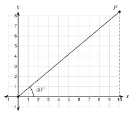
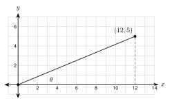

# 6.2 - The Trigonometric Ratios {.unnumbered}

A ramp rises $1$ foot for every $12$ feet of ground it covers. A roof rises $6$ inches for every $12$ inches across. A road climbs $6$ feet for every $100$ feet of flat ground.

All three are right triangles. In each one, the **ratio** of two sides tells how steep the slope is. Steeper slopes have bigger ratios. In this lesson you learn three ratios that connect the angles of a right triangle to its sides. They are the foundation of **trigonometry**.

:::{.objectives}
- [ ] I can name the opposite side, the adjacent side, and the hypotenuse for an acute angle.
- [ ] I can write the sine, cosine, and tangent of an angle from the side lengths.
- [ ] I can use a calculator in degree mode to find a trigonometric ratio.
- [ ] I can explain that the tangent of an angle is the slope of a line.
:::

:::{.vocab}
,
,
,
,
,
,
,

:::

:::{.guided-notes-link}
[Printable Guided Notes for this lesson](/guided_notes/Unit_6/6.2_The_Trigonometric_Ratios.html){target="_blank"} (fill-in notes to print and write on)
:::



1. Two right triangles each have a $35^\circ$ angle. Are they similar? Say why.

2. Find the hypotenuse of a right triangle with legs $6$ and $7$. Give the exact answer.

3. Write $\dfrac{3}{8}$ as a decimal, rounded to the nearest thousandth.



### 6.2.1 - Naming the Sides

Choose one acute angle in a right triangle. The three sides get names that depend on that angle.

* The **hypotenuse** is across from the right angle. It is always the longest side.
* The **opposite** side is across from the angle you chose. It does not touch the angle.
* The **adjacent** side is next to the angle you chose. It is the leg that touches the angle (the hypotenuse touches it too, but it is not called adjacent).

{width=330px fig-align="center"}

Now choose the other acute angle. The names of the two legs trade places.

{width=330px fig-align="center"}

:::{.gotcha title="The names depend on the angle"}
The hypotenuse never changes. The opposite and adjacent sides change when you pick a different angle. Always say which angle you are using.
:::

***

**Example 1:** Name the sides

{width=330px fig-align="center"}

a. For angle $A$, name the side with length $8$, the side with length $15$, and the side with length $17$.

   $BC = 8$ is across from $A$, so it is **opposite**. $AC = 15$ touches $A$, so it is **adjacent**. $AB = 17$ is **the hypotenuse**.

b. Now use angle $B$. Which side is opposite? Which is adjacent?

   $AC = 15$ is across from $B$, so it is **opposite**. $BC = 8$ touches $B$, so it is **adjacent**.

:::{.you-try-m title="Use the triangle in Example 1"}
a. For angle $B$, which side is the hypotenuse?

b. The side of length $8$ is adjacent to which angle?
:::

:::{.answer title="Answer"}
a. $\overline{AB}$, with length $17$. The hypotenuse is the same for both acute angles.

b. Angle $B$.
:::

***

### 6.2.2 - Why the Ratios Work

Look at three right triangles that share the $35^\circ$ angle at $A$. The figure is drawn to scale.

{width=420px fig-align="center"}

All three triangles have a $35^\circ$ angle and a right angle. By AA similarity (Lesson 5.3), they are similar. Similar triangles have **equal ratios** for matching sides. Here are the measurements, to the nearest hundredth.

| Triangle | Adjacent | Opposite | Hypotenuse | Opposite $\div$ Hypotenuse | Opposite $\div$ Adjacent | Adjacent $\div$ Hypotenuse |
|:---:|:---:|:---:|:---:|:---:|:---:|:---:|
| $\triangle AB_1C_1$ | $4$ | 2.80 | 4.88 | 0.57 | 0.70 | 0.82 |
| $\triangle AB_2C_2$ | $8$ | 5.60 | 9.77 | 0.57 | 0.70 | 0.82 |
| $\triangle AB_3C_3$ | $12$ | 8.40 | 14.65 | 0.57 | 0.70 | 0.82 |

The three ratios are the same in every row. They depend only on the angle, not on how big the triangle is. A $35^\circ$ angle always gives an opposite-to-hypotenuse ratio of about $0.57$. That is why one angle gives one number we can look up.

***

### 6.2.3 - Sine, Cosine, and Tangent

The three ratios have names. Use the angle $A$.

| Ratio | Name | Short form | Memory aid |
|:---:|:---:|:---:|:---:|
| $\dfrac{\text{opposite}}{\text{hypotenuse}}$ | **sine** | $\sin A$ | **SOH** |
| $\dfrac{\text{adjacent}}{\text{hypotenuse}}$ | **cosine** | $\cos A$ | **CAH** |
| $\dfrac{\text{opposite}}{\text{adjacent}}$ | **tangent** | $\tan A$ | **TOA** |

Say it as **SOH CAH TOA**: **S**ine is **O**pposite over **H**ypotenuse, **C**osine is **A**djacent over **H**ypotenuse, **T**angent is **O**pposite over **A**djacent.

:::{.remember title="Ratios are fractions"}
Write each ratio as a fraction first. Then divide to get a decimal. Round only at the end.
:::

***

**Example 2:** Ratios from the side lengths

Use the triangle in Example 1. Find $\sin A$, $\cos A$, and $\tan A$. Write each as a fraction and as a decimal rounded to four places.

$$
\sin A = \frac{\text{opp}}{\text{hyp}} = \frac{8}{17} \approx 0.4706 \qquad
\cos A = \frac{\text{adj}}{\text{hyp}} = \frac{15}{17} \approx 0.8824 \qquad
\tan A = \frac{\text{opp}}{\text{adj}} = \frac{8}{15} \approx 0.5333
$$

**Example 3:** Ratios for the other angle

Find $\sin B$, $\cos B$, and $\tan B$ in the same triangle.

For angle $B$, the opposite side is $15$ and the adjacent side is $8$.

$$
\sin B = \frac{15}{17} \approx 0.8824 \qquad
\cos B = \frac{8}{17} \approx 0.4706 \qquad
\tan B = \frac{15}{8} = 1.8750
$$

Notice that $\sin B = \cos A$. You will see why in Lesson 6.5.

:::{.you-try-m title="A right triangle has legs 7 and 24 and hypotenuse 25. Angle A is across from the leg of length 7."}
a. Write $\sin A$, $\cos A$, and $\tan A$ as fractions.

b. Write each as a decimal rounded to four places.
:::

:::{.answer title="Answer"}
a. $\sin A = \dfrac{7}{25}$, $\cos A = \dfrac{24}{25}$, $\tan A = \dfrac{7}{24}$

b. $\sin A = 0.2800$, $\cos A = 0.9600$, $\tan A = 0.2917$
:::

***

**Example 4:** Find the hypotenuse first

A right triangle has legs $6$ and $7$. Angle $A$ is across from the leg of length $6$. Find $\sin A$, $\cos A$, and $\tan A$ to four decimal places.

Use the Pythagorean theorem for the hypotenuse: $6^2 + 7^2 = 85$, so the hypotenuse is $\sqrt{85} \approx 9.2195$.

$$
\sin A = \frac{6}{\sqrt{85}} \approx 0.6508 \qquad
\cos A = \frac{7}{\sqrt{85}} \approx 0.7593 \qquad
\tan A = \frac{6}{7} \approx 0.8571
$$

:::{.you-try title="A right triangle has legs 9 and 12. Angle A is across from the leg of length 9. Find sin A, cos A, and tan A."}
The hypotenuse is $\sqrt{81 + 144} = 15$. So $\sin A = \dfrac{9}{15} = 0.6$, $\cos A = \dfrac{12}{15} = 0.8$, and $\tan A = \dfrac{9}{12} = 0.75$.
:::

***

**Example 5:** Error analysis

Hnin looks at the triangle in Example 1. She writes $\sin A = \dfrac{15}{17}$. Find her mistake.

For angle $A$, the side of length $15$ is **adjacent**, not opposite. $\dfrac{15}{17}$ is adjacent over hypotenuse, which is $\cos A$. The correct answer is $\sin A = \dfrac{8}{17}$.

***

### 6.2.4 - Using a Calculator

You do not need to measure a triangle to find a ratio. A scientific calculator has a $\boxed{\sin}$ key, a $\boxed{\cos}$ key, and a $\boxed{\tan}$ key.

:::{.gotcha title="Degree mode"}
A calculator can measure angles in degrees or in radians. In this book, always use **degree mode**. Check your calculator: $\sin 30^\circ$ must give $0.5$ and $\tan 45^\circ$ must give $1$. If you see $-0.9880$ for $\sin 30$, the calculator is in radian mode. Change the mode and try again.
:::

**Example 6:** Calculator values

Find each value to four decimal places.

a. $\sin 35^\circ \approx 0.5736$

b. $\cos 62^\circ \approx 0.4695$

c. $\tan 71^\circ \approx 2.9042$

Compare $\sin 35^\circ \approx 0.5736$ with the table in 6.2.2. The table gave $0.57$ for the same angle. The calculator is just a faster way to get the ratio.

:::{.you-try-m title="Use a calculator in degree mode. Round to four decimal places."}
a. $\sin 18^\circ$

b. $\cos 18^\circ$

c. $\tan 64^\circ$
:::

:::{.answer title="Answer"}
a. $0.3090$

b. $0.9511$

c. $2.0503$
:::

Look for patterns. As an angle gets bigger, its sine and tangent get bigger and its cosine gets smaller. The sine and cosine of an acute angle are always between $0$ and $1$ because a leg is shorter than the hypotenuse.

***

### 6.2.5 - Tangent Is Slope

Remember that slope is rise over run. In a right triangle, the opposite side is the rise and the adjacent side is the run. So

$$
\tan\theta = \frac{\text{opposite}}{\text{adjacent}} = \frac{\text{rise}}{\text{run}} = \text{slope}.
$$

(The Greek letter $\theta$, "theta," often names an angle.)

**Example 7:** A line on the coordinate plane

{width=330px fig-align="center"}

A line passes through the origin and makes a $40^\circ$ angle with the $x$-axis. What is its slope? Find the $y$-coordinate of point $P$ where $x = 10$.

The slope is $\tan 40^\circ \approx 0.8391$. Slope is rise over run, so $y = 10 \cdot \tan 40^\circ \approx 8.4$. Point $P$ is about $(10, 8.4)$.

:::{.you-try title="A line through the origin makes a 25-degree angle with the x-axis. Find its slope and the y-coordinate where x = 20 (nearest tenth)."}
Slope $= \tan 25^\circ \approx 0.4663$. At $x = 20$, $y \approx 20 \cdot 0.4663 \approx 9.3$.
:::

***

**Example 8:** Road grade

{width=420px fig-align="center"}

A road climbs $6$ feet for every $100$ feet of flat ground. The **grade** of a road is the slope written as a percent. Find the grade and write $\tan\theta$.

$$
\tan\theta = \frac{6}{100} = 0.06 \quad\text{so the grade is } 6\%.
$$

:::{.you-try title="A ramp rises 9 inches over a horizontal run of 120 inches. Find tan of the angle and the grade."}
$\tan\theta = \dfrac{9}{120} = 0.075$. The grade is $7.5\%$.
:::

:::{.real-world title="Why a ramp is long"}
The law says a wheelchair ramp must rise at most $1$ foot for each $12$ feet of run. That is $\tan\theta = \dfrac{1}{12} \approx 0.0833$, a grade of about $8.3\%$. To rise $3$ feet, the ramp needs $36$ feet of run.
:::



**Use the figure. Name the sides.** In triangle $DEF$, the right angle is at $F$. Side $d$ is across from $D$, side $e$ is across from $E$, and side $f$ is across from $F$.

{width=330px fig-align="center"}

1. For angle $D$, which side is opposite? Write the letter.

2. For angle $D$, which side is adjacent?

3. For angle $E$, which side is opposite?

4. Which side is the hypotenuse for both angles?

***

**Write $\sin A$, $\cos A$, and $\tan A$ as fractions, then as decimals to four places.** Use the figure for problems 5 and 6.

{width=260px fig-align="center"}

5. Use the triangle: $AC = 5$, $BC = 12$, $AB = 13$.

6. Same triangle. Write $\sin B$, $\cos B$, and $\tan B$.

7. A right triangle has legs $9$ and $40$ and hypotenuse $41$. Angle $A$ is across from the leg of length $9$.

8. A right triangle has legs $12$ and $35$. Find the hypotenuse. Then find $\sin A$ for the angle $A$ across from the leg of length $35$.

***

**Use a calculator in degree mode. Round to four decimal places.**

9. $\sin 20^\circ$

10. $\cos 20^\circ$

11. $\tan 20^\circ$

12. $\sin 55^\circ$

13. $\cos 55^\circ$

14. $\tan 55^\circ$

15. $\sin 80^\circ$

16. $\cos 80^\circ$

17. $\tan 12^\circ$

***

**Think about the ratios.**

18. What is $\tan 45^\circ$? Why does a $45^\circ$-$45^\circ$-$90^\circ$ triangle give this answer?

19. Which is larger, $\sin 10^\circ$ or $\sin 80^\circ$? Check with a calculator.

20. Can $\sin A$ ever be greater than $1$ for an acute angle $A$ in a right triangle? Explain.

***

**Tangent is slope.** Use the figure for problem 21.

{width=330px fig-align="center"}

21. Look at the grid figure. The line through the origin and $(12, 5)$ makes angle $\theta$ with the $x$-axis. Find $\tan\theta$ as a fraction and a decimal to four places.

22. A line through the origin makes a $30^\circ$ angle with the $x$-axis. What is its slope, to four places? What is $y$ when $x = 12$, to the nearest tenth?

23. A road climbs $14$ feet over a flat distance of $175$ feet. Find $\tan\theta$ and the grade as a percent.

***

**Real problems.**

24. A ladder reaches $12$ feet up a wall. Its base is $5$ feet from the wall. The ladder makes angle $\theta$ with the ground. Find the length of the ladder. Then find $\sin\theta$ and $\cos\theta$ to four places.

25. A roof has a $9/12$ pitch. That means it rises $9$ inches for every $12$ inches of run. Find $\tan\theta$. How many feet does the roof rise over a run of $14$ feet?

26. A ramp rises $2$ feet over $20$ feet of run. The legal limit is $\tan\theta = \frac{1}{12} \approx 0.0833$. Is this ramp steeper than the limit? Show with $\tan\theta$.

27. A skateboard ramp makes a $25^\circ$ angle with the ground. How many feet does it rise for each $10$ feet of horizontal run? Round to the nearest tenth.

***

**Find the mistake.**

28. Samir says: "$\cos 40^\circ \approx 0.7660$, so $\cos 80^\circ$ must be double that, $1.5320$." Find his mistake. Check with a calculator.

***

**Test practice**

29. In right triangle $ABC$, the right angle is at $C$. $AC = 21$, $BC = 20$, and $AB = 29$. Which fraction equals $\sin B$?

    A. $\dfrac{20}{29}$\
    B. $\dfrac{21}{29}$\
    C. $\dfrac{20}{21}$\
    D. $\dfrac{21}{20}$

30. A line passes through the origin and makes a $50^\circ$ angle with the positive $x$-axis. Which number is closest to the slope of the line?

    A. $0.6428$\
    B. $0.7660$\
    C. $1.1918$\
    D. $50$

***

**Challenge**

31. In a right triangle, $\sin A = \dfrac{20}{29}$. Draw the triangle and label two sides. Find $\cos A$ and $\tan A$ as fractions. Hint: use the Pythagorean theorem.

32. A calculator gives $\tan 85^\circ \approx 11.4301$. Describe the right triangle. What is true about its opposite and adjacent sides?

