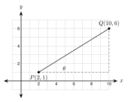

# 6.4 - Solving for an Angle {.unnumbered}

A roof must be steep enough to shed rain and snow. A wheelchair ramp must be gentle enough to climb. How steep is each one, in degrees?

{width=300px fig-align="center"}

So far you found sides from an angle. In this lesson you go the other way. You know two sides, and you find the angle. The tool is the **inverse** of sine, cosine, and tangent.

:::{.objectives}
- [ ] I can use $\sin^{-1}$, $\cos^{-1}$, and $\tan^{-1}$ on a calculator.
- [ ] I can choose the ratio and find an angle from two sides.
- [ ] I can solve a right triangle completely and check my work.
- [ ] I can find the angle for a roof pitch, ramp, road grade, stairs, or shadow.
:::

:::{.vocab}
,
,
,
,
,

:::

:::{.guided-notes-link}
[Printable Guided Notes for this lesson](/guided_notes/Unit_6/6.4_Solving_for_an_Angle.html){target="_blank"} (fill-in notes to print and write on)
:::



1. Find $\tan 40^\circ$ to four decimal places.

2. Solve $\dfrac{7}{x} = 0.8$.

3. Find the slope of the line through $(0, 0)$ and $(10, 4)$.



### 6.4.1 - Inverse Ratios

You know that $\sin 30^\circ = 0.5$. The **inverse sine** goes the other way. It starts with the ratio and gives the angle:

$$
\sin^{-1}(0.5) = 30^\circ
$$

Read $\sin^{-1}(0.5)$ as "the angle whose sine is $0.5$." There are three inverse keys: $\sin^{-1}$, $\cos^{-1}$, and $\tan^{-1}$. On most calculators you press $\boxed{2\text{nd}}$ or $\boxed{\text{shift}}$ and then the $\boxed{\sin}$, $\boxed{\cos}$, or $\boxed{\tan}$ key.

:::{.gotcha title="The -1 is not an exponent"}
$\sin^{-1}(0.5)$ does **not** mean $\dfrac{1}{\sin 0.5}$. The small $-1$ only says "inverse." Keep the calculator in **degree mode**. Check: $\sin^{-1}(0.5)$ must give $30$.
:::

**Example 1:** Inverse values

Find each angle to the nearest tenth of a degree.

a. $\sin^{-1}(0.4) \approx 23.6^\circ$

b. $\cos^{-1}(0.25) \approx 75.5^\circ$

c. $\tan^{-1}(1.5) \approx 56.3^\circ$

:::{.you-try-m title="Find each angle to the nearest tenth of a degree."}
a. $\sin^{-1}(0.3)$

b. $\cos^{-1}(0.8)$

c. $\tan^{-1}(0.7)$
:::

:::{.answer title="Answer"}
a. $17.5^\circ$

b. $36.9^\circ$

c. $35.0^\circ$
:::

***

### 6.4.2 - Find an Angle from Two Sides

Use the same steps as before. Label the sides for the angle you want. Pick the ratio that uses the two sides you know. Then use the inverse key.

**Example 2:** Opposite and hypotenuse

{width=300px fig-align="center"}

Find $m\angle A$ to the nearest tenth. The opposite side is $7$ and the hypotenuse is $13$. Use **sine**.

$$
\sin A = \frac{7}{13} \quad\Rightarrow\quad m\angle A = \sin^{-1}\left(\frac{7}{13}\right) \approx 32.6^\circ
$$

**Example 3:** Opposite and adjacent

{width=300px fig-align="center"}

Find $m\angle A$ to the nearest tenth. The opposite side is $9$ and the adjacent side is $12$. Use **tangent**.

$$
\tan A = \frac{9}{12} = 0.75 \quad\Rightarrow\quad m\angle A = \tan^{-1}(0.75) \approx 36.9^\circ
$$

**Example 4:** Adjacent and hypotenuse

{width=300px fig-align="center"}

Find $m\angle A$ to the nearest tenth. The adjacent side is $8$ and the hypotenuse is $11$. Use **cosine**.

$$
\cos A = \frac{8}{11} \quad\Rightarrow\quad m\angle A = \cos^{-1}\left(\frac{8}{11}\right) \approx 43.3^\circ
$$

:::{.you-try-m title="Find the angle A to the nearest tenth."}
a. The opposite side is $5$ and the adjacent side is $8$.

b. The adjacent side is $15$ and the hypotenuse is $17$.
:::

:::{.answer title="Answer"}
a. $\tan^{-1}\left(\dfrac{5}{8}\right) \approx 32.0^\circ$

b. $\cos^{-1}\left(\dfrac{15}{17}\right) \approx 28.1^\circ$
:::

:::{.gotcha title="Divide the sides, then use the inverse"}
Type the fraction in parentheses: $\sin^{-1}(7 \div 13)$. If you type $\sin^{-1}(7) \div 13$, you get an error, because a sine can never be greater than $1$.
:::

***

### 6.4.3 - Solve a Right Triangle

To **solve a triangle** means to find every missing side and every missing angle. Use the Pythagorean theorem for a side, trigonometry for an angle, and the angle sum ($90^\circ$ for the two acute angles) for the last angle.

**Example 5:** Solve a triangle from two legs

{width=330px fig-align="center"}

The legs are $10$ and $7$. Find $c$, $m\angle A$, and $m\angle B$.

* Hypotenuse: $c = \sqrt{10^2 + 7^2} = \sqrt{149} \approx 12.2$.
* Angle $A$ is opposite the leg $7$: $m\angle A = \tan^{-1}\left(\dfrac{7}{10}\right) \approx 35.0^\circ$.
* Angle $B$: $90^\circ - 35.0^\circ = 55.0^\circ$.
* **Check by a second method:** $m\angle B = \tan^{-1}\left(\dfrac{10}{7}\right) \approx 55.0^\circ$. It matches.

:::{.you-try title="The legs of a right triangle are 5 and 12. Find the hypotenuse and both acute angles to the nearest tenth."}
Hypotenuse: $13$. The angle opposite $5$: $\tan^{-1}\left(\dfrac{5}{12}\right) \approx 22.6^\circ$. The other angle: $90^\circ - 22.6^\circ = 67.4^\circ$.
:::

***

### 6.4.4 - Angles in the Real World

**Example 6:** Roof pitch

{width=330px fig-align="center"}

Builders say a roof has a **$6/12$ pitch** when it rises $6$ inches for every $12$ inches of run. Find the roof angle $\theta$.

$$
\tan\theta = \frac{6}{12} = 0.5 \quad\Rightarrow\quad \theta = \tan^{-1}(0.5) \approx 26.6^\circ
$$

**Example 7:** A wheelchair ramp

{width=330px fig-align="center"}

The most a ramp may rise is $1$ foot for each $12$ feet of run. What angle does it make with the ground?

$$
\theta = \tan^{-1}\left(\frac{1}{12}\right) \approx 4.8^\circ
$$

A ramp is gentle. It is less than $5^\circ$.

**Example 8:** Stairs

{width=330px fig-align="center"}

Each step rises $7$ inches and runs $11$ inches. Find the angle of the stairs.

$$
\theta = \tan^{-1}\left(\frac{7}{11}\right) \approx 32.5^\circ
$$

**Example 9:** The sun's angle

{width=330px fig-align="center"}

A person $6$ feet tall casts a shadow $9.5$ feet long. Find the angle of the sun above the ground.

$$
\theta = \tan^{-1}\left(\frac{6}{9.5}\right) \approx 32.3^\circ
$$

**Example 10:** Road grade

A road has a grade of $8\%$. Find the angle it makes with the horizontal. A grade of $8\%$ is a slope of $0.08$, so $\theta = \tan^{-1}(0.08) \approx 4.6^\circ$.

**Example 11:** The angle of a line

{width=330px fig-align="center"}

A line passes through $P(2, 1)$ and $Q(10, 6)$. What angle does it make with the $x$-axis?

The slope is $\dfrac{6 - 1}{10 - 2} = \dfrac{5}{8}$. So $\theta = \tan^{-1}\left(\dfrac{5}{8}\right) \approx 32.0^\circ$.

:::{.you-try title="A roof has a 9/12 pitch. Find the roof angle to the nearest tenth."}
$\theta = \tan^{-1}\left(\dfrac{9}{12}\right) = \tan^{-1}(0.75) \approx 36.9^\circ$.
:::

:::{.real-world title="Why pitch is a ratio"}
A carpenter does not carry a protractor to the roof. A $6/12$ pitch means rise $6$, run $12$. A framing square marks that triangle directly on the wood. The angle $26.6^\circ$ is what the ratio $\frac{6}{12}$ means in degrees.
:::

:::{.think title="Error analysis"}
Ana looks at a right triangle with an opposite side of $5$ and an adjacent side of $8$. She writes $\tan^{-1}\left(\dfrac{8}{5}\right) \approx 58.0^\circ$. What is wrong?

She flipped the fraction. Tangent is **opposite over adjacent**, so the fraction is $\dfrac{5}{8}$ and the angle is about $32.0^\circ$. Her answer is the other acute angle.
:::



**Use a calculator in degree mode. Round to the nearest tenth of a degree.**

1. $\sin^{-1}(0.8)$

2. $\cos^{-1}(0.35)$

3. $\tan^{-1}(2.4)$

4. $\sin^{-1}\left(\dfrac{3}{7}\right)$

5. $\tan^{-1}(1)$

6. Solve $\tan\theta = 0.0875$.

***

**Find the angle $A$ to the nearest tenth of a degree. Say which ratio you use.**

7. Opposite side $5$, hypotenuse $12$.

8. Adjacent side $6$, hypotenuse $10$.

9. Opposite side $11$, adjacent side $4$.

10. The legs are $9$ and $14$. Angle $A$ is opposite the leg of length $9$.

11. Opposite side $20$, hypotenuse $21$.

12. Adjacent side $7$, hypotenuse $25$.

***

**Solve each right triangle. Find every missing side and angle. Round to the nearest tenth.** Use the figure for problem 13.

{width=300px fig-align="center"}

13. A right triangle has legs $21$ and $20$ and hypotenuse $29$. Angle $A$ is opposite the leg of length $20$. Find both acute angles.

14. The hypotenuse is $20$ and one leg is $9$. Find the other leg and both acute angles.

15. An acute angle is $41^\circ$ and the opposite leg is $10$. Find the other acute angle, the adjacent leg, and the hypotenuse.

16. The acute angles of a right triangle measure $(2x + 5)^\circ$ and $(3x)^\circ$. Find $x$ and both angles.

***

**Lines on the coordinate plane. Round to the nearest tenth of a degree.**

17. A line passes through the origin and $(8, 3)$. What angle does it make with the $x$-axis?

18. A line passes through $(1, 2)$ and $(7, 6)$. What angle does it make with the $x$-axis?

***

**Real problems. Draw and label a triangle first. Round to the nearest tenth of a degree.**

19. A roof has an $8/12$ pitch. Find the roof angle.

20. A ramp rises $2$ feet over a run of $20$ feet. Find the angle with the ground.

21. A road has a grade of $12\%$. Find its angle with the horizontal.

22. A flagpole is $25$ feet tall. Its shadow is $40$ feet long. Find the angle of the sun above the ground.

23. Each step of a staircase rises $8$ inches and runs $9$ inches. Find the angle of the stairs.

24. A $15$-foot ladder reaches $14$ feet up a wall. What angle does the ladder make with the ground?

***

**Find the mistake.**

25. Hnin writes $\sin^{-1}(0.6) = \dfrac{1}{\sin 0.6} \approx 1.8$. Find her mistake. What is the correct answer?

26. Daniel finds the angle $A$ with opposite side $6$ and hypotenuse $10$. He writes $\tan^{-1}\left(\dfrac{6}{10}\right) \approx 31.0^\circ$. Find his mistake and fix it.

***

**Test practice**

27. Each step of a staircase rises $7.5$ inches and runs $10$ inches. Which is closest to the angle the staircase makes with the horizontal?

    A. $31.0^\circ$\
    B. $36.9^\circ$\
    C. $41.2^\circ$\
    D. $53.1^\circ$

28. In right triangle $ABC$, the right angle is at $C$. $AC = 9$ and $AB = 15$. What is $m\angle A$ to the nearest tenth of a degree?

    A. $36.9^\circ$\
    B. $31.0^\circ$\
    C. $53.1^\circ$\
    D. $59.0^\circ$

***

**Challenge**

29. A gable roof is $30$ feet wide and rises $9$ feet at the center. Find the angle of each side to the nearest tenth. Then find the length of one sloping side (the rafter) to the nearest tenth.

30. A student types $\sin^{-1}(1.2)$ and gets an error. Explain why using a right triangle.

