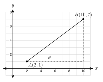

# 6.7 - Modeling with Right Triangles {.unnumbered}

A carpenter builds a ramp, a stair, and a roof. A pilot plans a route. A drone operator measures a field. None of them has a ready-made triangle. They draw one, name what they know, and choose the right tool.

{width=340px fig-align="center"}

In this lesson you put everything in Unit 6 together. You solve real problems with several steps.

:::{.objectives}
- [ ] I can choose among the Pythagorean theorem, special triangles, and trigonometry.
- [ ] I can solve problems about ramps, stairs, and roofs.
- [ ] I can solve problems about towers, drones, and navigation.
- [ ] I can check an answer against the situation and write it in a sentence.
:::

:::{.vocab}
,
,
,
,
,

:::

:::{.guided-notes-link}
[Printable Guided Notes for this lesson](/guided_notes/Unit_6/6.7_Modeling_with_Right_Triangles.html){target="_blank"} (fill-in notes to print and write on)
:::



1. Find $\sqrt{30^2 + 360^2}$. Round to the nearest tenth.

2. Find the angle: $\tan\theta = \dfrac{1}{12}$. Round to the nearest tenth of a degree.

3. A right triangle has a hypotenuse of $40$ and a $60^\circ$ angle. Find the leg opposite the $60^\circ$ angle.



### 6.7.1 - A Plan and a Choice of Tools

Every worked example in this lesson follows six steps.

1. **Sketch** the situation.
2. **Label** the right triangle with every number you know.
3. **Choose** a tool.
4. **Solve.**
5. **Check** that the answer makes sense.
6. **Say** the answer in a sentence with units.

Use this table to choose a tool.

| What you know | What you want | Tool |
|:---|:---|:---|
| two sides | the third side | Pythagorean theorem |
| one side and a $45^\circ$ or $30^\circ$-$60^\circ$ angle | the other sides | special right triangle |
| one angle and one side | another side | $\sin$, $\cos$, or $\tan$ |
| two sides | an angle | $\sin^{-1}$, $\cos^{-1}$, or $\tan^{-1}$ |
| two angles | the third angle | angle sum, $90^\circ$ for the acute angles |

***

### 6.7.2 - Ramps and Stairs

**Example 1:** A wheelchair ramp

{width=420px fig-align="center"}

A porch is $30$ inches above the ground. A ramp must rise at most $1$ inch for every $12$ inches of run. How long is the ramp? What angle does it make with the ground? Round to the nearest tenth.

1. **Sketch.** Done above. The figure is drawn to scale.
2. **Label.** Rise $30$ in. Run $12 \cdot 30 = 360$ in. Ramp length $L$ is the hypotenuse.
3. **Choose.** Two legs known: Pythagorean theorem for $L$. Two sides known: $\tan^{-1}$ for the angle.
4. **Solve.** $L = \sqrt{30^2 + 360^2} = \sqrt{130{,}500} \approx 361.2$ in. The angle is $\tan^{-1}\left(\dfrac{30}{360}\right) = \tan^{-1}\left(\dfrac{1}{12}\right) \approx 4.8^\circ$.
5. **Check.** The ramp ($361.2$ in) is a little longer than its run ($360$ in). The angle is small. Both fit a gentle ramp.
6. **Say.** The ramp is about $361.2$ inches, or $30.1$ feet, long. It makes an angle of about $4.8^\circ$ with the ground.

:::{.you-try title="A doorway is 18 inches above the ground. Find the run and the ramp length for a 1-to-12 ramp, in feet (nearest tenth)."}
Run: $12 \cdot 18 = 216$ in $= 18$ ft. Length: $\sqrt{18^2 + 216^2} \approx 18.1$ ft.
:::

***

**Example 2:** A staircase

{width=420px fig-align="center"}

A building code says each riser can be at most $7.75$ inches. A staircase must rise $108$ inches. Each tread is $10$ inches deep. How many risers? What is each riser? What angle do the stairs make? How long is the stringer (the sloping board)? Round to the nearest tenth.

1. **Sketch.** Done above.
2. **Label.** Total rise $108$ in. Tread $10$ in.
3. **Choose.** Division for the risers, tangent for the angle, Pythagorean theorem for the stringer.
4. **Solve.** $108 \div 7.75 \approx 13.9$, so the stairs need at least $14$ risers. With $14$ risers, each riser is $108 \div 14 \approx 7.7$ in. There is one fewer tread than risers, so there are $13$ treads and the run is $13 \cdot 10 = 130$ in. The angle is $\tan^{-1}\left(\dfrac{7.7}{10}\right) \approx 37.6^\circ$. The stringer is $\sqrt{108^2 + 130^2} \approx 169.0$ in.
5. **Check.** $14 \cdot 7.7 \approx 108$. A stair near $37.6^\circ$ is steep but common.
6. **Say.** The stairs have $14$ risers of about $7.7$ inches. They make an angle of about $37.6^\circ$. The stringer is about $169.0$ inches, or $14.1$ feet, long.

:::{.you-try title="A staircase must rise 96 inches with risers of at most 7.75 inches. Find the least number of risers, the exact riser height (nearest tenth), and the angle if each tread is 10 inches (nearest tenth)."}
$96 \div 7.75 \approx 12.4$, so $13$ risers. Riser: $96 \div 13 \approx 7.4$ in. Angle: $\tan^{-1}\left(\dfrac{7.4}{10}\right) \approx 36.4^\circ$.
:::

***

### 6.7.3 - Roofs

**Example 3:** A rafter with an overhang

{width=420px fig-align="center"}

A house is $28$ feet wide. The roof has a $7/12$ pitch and a $1$-foot overhang at each edge. Find the roof angle, the height $h$ of the peak above the walls, and the length $L$ of a rafter from the peak to the end of the overhang. Round to the nearest tenth.

1. **Sketch.** Done above.
2. **Label.** The peak is over the middle, so the run is $28 \div 2 = 14$ ft. The pitch means rise $7$ per run $12$.
3. **Choose.** Tangent for $h$ and the angle. Cosine for the rafter.
4. **Solve.** $\tan\theta = \dfrac{7}{12}$, so $\theta \approx 30.3^\circ$. $h = 14 \cdot \dfrac{7}{12} \approx 8.2$ ft. The overhang adds $1$ ft to the horizontal distance, so the rafter covers $14 + 1 = 15$ ft horizontally: $\cos\theta = \dfrac{15}{L}$, so $L = \dfrac{15}{\cos 30.3^\circ} \approx 17.4$ ft.
5. **Check.** Without the overhang the rafter is $\sqrt{14^2 + 8.2^2} \approx 16.2$ ft. The overhang adds a little, so $17.4$ ft is reasonable.
6. **Say.** The roof angle is about $30.3^\circ$. The peak is about $8.2$ feet above the walls. Each rafter is about $17.4$ feet long.

:::{.you-try title="A house is 24 feet wide. The roof has a 5/12 pitch and no overhang. Find the rise at the peak and the rafter length. Find the roof angle (nearest tenth)."}
Run $= 12$ ft. Rise $= 12 \cdot \dfrac{5}{12} = 5$ ft. Rafter $= \sqrt{12^2 + 5^2} = 13$ ft. Angle: $\tan^{-1}\left(\dfrac{5}{12}\right) \approx 22.6^\circ$.
:::

***

### 6.7.4 - Navigation and Maps

A **bearing** tells a direction. It is the angle measured **clockwise from north**. A bearing of $060^\circ$ means $60^\circ$ clockwise from north, toward the east.

**Example 4:** A ship's course

{width=380px fig-align="center"}

A ship leaves port and sails $40$ nautical miles on a bearing of $060^\circ$. How far north and how far east of the port is the ship? Round to the nearest tenth.

1. **Sketch.** Done above. The angle between north and the course is $60^\circ$.
2. **Label.** The north distance $n$ is adjacent to $60^\circ$. The east distance $e$ is opposite. The hypotenuse is $40$.
3. **Choose.** Cosine for $n$, sine for $e$.
4. **Solve.** $n = 40\cos 60^\circ = 20$. $e = 40\sin 60^\circ \approx 34.6$.
5. **Check.** $20^2 + 34.6^2 \approx 1600$. It matches $40^2$. (Also, the triangle is a $30^\circ$-$60^\circ$-$90^\circ$ triangle, so $n$ is half the hypotenuse.)
6. **Say.** The ship is $20$ nautical miles north and about $34.6$ nautical miles east of the port.

:::{.you-try title="A hiker walks 8 km on a bearing of 035 degrees. How far north and how far east is she from the start? Round to the nearest tenth."}
North: $8\cos 35^\circ \approx 6.6$ km. East: $8\sin 35^\circ \approx 4.6$ km.
:::

***

**Example 5:** A map on the coordinate plane

{width=400px fig-align="center"}

Airport $A$ is at $(2, 1)$ and town $B$ is at $(10, 7)$. One unit is $1$ mile. How far is the flight from $A$ to $B$? What is the bearing from $A$ to $B$? Round to the nearest tenth.

1. **Sketch.** Done above. The legs are $10 - 2 = 8$ and $7 - 1 = 6$.
2. **Label.** The angle $\theta$ at $A$ is measured from east. The bearing is measured from north.
3. **Choose.** Distance formula (the Pythagorean theorem). Inverse tangent for $\theta$.
4. **Solve.** $AB = \sqrt{8^2 + 6^2} = 10$. $\theta = \tan^{-1}\left(\dfrac{6}{8}\right) \approx 36.9^\circ$. Bearing $= 90^\circ - 36.9^\circ = 53.1^\circ$.
5. **Check.** The town is up and to the right, so the bearing is between $0^\circ$ and $90^\circ$. It is closer to east, so a bearing near $53.1^\circ$ fits.
6. **Say.** The flight is $10$ miles on a bearing of about $53.1^\circ$.

:::{.you-try title="Airport A is at (2, 3) and town B is at (9, 7). One unit is 1 mile. Find the distance from A to B, the angle from east, and the bearing from A to B (nearest tenth)."}
$AB = \sqrt{7^2 + 4^2} = \sqrt{65} \approx 8.1$ mi. $\theta = \tan^{-1}\left(\dfrac{4}{7}\right) \approx 29.7^\circ$. Bearing $= 90^\circ - 29.7^\circ = 60.3^\circ$.
:::

***

### 6.7.5 - Drones, Ladders, and Checking

**Example 6:** A drone surveys a field

{width=420px fig-align="center"}

A drone hovers $60$ meters above a field. It sees marker $M_1$ to the left at an angle of depression of $50^\circ$. It sees marker $M_2$ to the right at an angle of depression of $30^\circ$. How far apart are the markers? Round to the nearest tenth.

1. **Sketch.** Done above.
2. **Label.** The height $60$ is opposite each angle at the markers (alternate interior angles).
3. **Choose.** Tangent in each right triangle. Then add.
4. **Solve.** Left: $\dfrac{60}{\tan 50^\circ} \approx 50.34$ m. Right: $\dfrac{60}{\tan 30^\circ} \approx 103.92$ m. Add the unrounded values: $50.34 + 103.92 = 154.26$, which is about $154.3$ m.
5. **Check.** The $30^\circ$ marker is farther away than the $50^\circ$ marker, since a smaller angle means a longer ground distance. Yes.
6. **Say.** The markers are about $154.3$ meters apart.

:::{.you-try title="A drone hovers 80 meters above a field. It sees marker M1 to the left at an angle of depression of 40 degrees and marker M2 to the right at 25 degrees. How far apart are the markers? (nearest tenth)"}
$\dfrac{80}{\tan 40^\circ} + \dfrac{80}{\tan 25^\circ} \approx 95.34 + 171.56 = 266.90 \approx 266.9$ m.
:::

***

**Example 7:** Is the ladder safe?

{width=300px fig-align="center"}

A safety rule says a ladder's base should be $1$ foot from the wall for every $4$ feet of height. Ahmad places a $20$-foot ladder so that the top reaches $18$ feet up a wall. Does it follow the rule? Round to the nearest tenth.

1. **Sketch.** Done above.
2. **Label.** Hypotenuse $20$. Height $18$. Base $b$.
3. **Choose.** Pythagorean theorem for $b$.
4. **Solve.** $b = \sqrt{20^2 - 18^2} = \sqrt{76} \approx 8.7$ ft. The rule needs $18 \div 4 = 4.5$ ft.
5. **Check.** $8.7$ ft is much more than $4.5$ ft. The ladder lies too flat. The angle with the ground is $\sin^{-1}\left(\dfrac{18}{20}\right) \approx 64.2^\circ$. The rule gives $\tan^{-1}(4) \approx 76.0^\circ$.
6. **Say.** No. The ladder is too flat. The base is about $8.7$ feet from the wall, not $4.5$ feet. At $76.0^\circ$, the same ladder would reach about $19.4$ feet.

:::{.think title="Error analysis"}
Fatima finds the length of a ramp with a rise of $2$ feet and a run of $24$ feet. She writes $2 + 24 = 26$ feet. What is wrong?

She added the legs. The ramp is the hypotenuse, so she must use the Pythagorean theorem: $\sqrt{2^2 + 24^2} \approx 24.1$ feet. A ramp cannot be longer than the two legs combined, but it is almost as long as the run.
:::

:::{.real-world title="Why checking matters"}
Builders check answers against the situation. A roof rafter longer than the whole house, a ramp shorter than its run, or a ladder that lies almost flat are all warnings. The number on the calculator is only the first step.
:::



**Choose the tool. Write one: Pythagorean theorem, special triangle, SOH CAH TOA, or inverse trig. Do not solve.**

1. Two legs are known. Find the hypotenuse.

2. A $45^\circ$-$45^\circ$-$90^\circ$ triangle has a leg of $12$. Find the hypotenuse.

3. A right triangle has a $33^\circ$ angle and a hypotenuse of $40$. Find the opposite leg.

4. The legs of a right triangle are $9$ and $14$. Find an acute angle.

5. A $30^\circ$-$60^\circ$-$90^\circ$ triangle has a hypotenuse of $14$. Find the long leg.

6. The hypotenuse is $26$ and one leg is $10$. Find the other leg.

***

**Ramps and stairs. Sketch, label, solve, check, and answer in a sentence. Round to the nearest tenth.**

7. A doorway is $27$ inches above the ground. A ramp rises $1$ inch for every $12$ inches of run. Find the run in feet and the ramp length in feet.

8. A skate ramp is $8$ feet long and rises $3$ feet. Find the angle of the ramp and the horizontal distance it covers.

9. A staircase must rise $114$ inches. Each riser can be at most $7.75$ inches. Find the least number of risers and the riser height. Then find the angle if each tread is $10$ inches.

10. A ramp with a rise of $2$ feet must follow the $1$-to-$12$ rule. How long is the run? Is the ramp longer or shorter than $24$ feet? Explain.

***

**Roofs. Round to the nearest tenth.**

11. A house is $30$ feet wide. The roof has an $8/12$ pitch and no overhang. Find the roof angle and the rafter length.

12. A house is $26$ feet wide. The roof angle is $28^\circ$ and the overhang is $1.5$ feet on each side. Find the rise at the peak and the rafter length from the peak to the end of the overhang.

13. A carport roof rises $2.5$ feet over a run of $10$ feet. Write the pitch as rise per $12$ feet of run. Find the roof angle.

***

**Towers and wires.**

14. A radio tower is $120$ feet tall. A wire runs from the top to an anchor $50$ feet from the base. Find the wire length and the angle the wire makes with the ground (nearest tenth).

15. A pole is $60$ feet tall. One wire makes a $45^\circ$ angle with the ground. Another makes a $60^\circ$ angle. Find both wire lengths. Give exact answers (use special triangles).

16. From a point $150$ feet from a cell tower, the angle of elevation to the top is $55^\circ$. The angle of elevation to a light below the top is $40^\circ$. How far is the light below the top? Round to the nearest tenth.

***

**Navigation and maps. Round to the nearest tenth.**

17. A boat sails $25$ km on a bearing of $070^\circ$. How far north and how far east of its start is it?

18. A plane flies $120$ miles east and then $50$ miles north. How far is it from the start? What is the bearing from the start to the plane?

19. On a map, camp $A$ is at $(1, 1)$ and camp $B$ is at $(10, 8)$. One unit is $1$ kilometer. Find $AB$ and the angle at $A$ above the east direction.

20. A hiker starts at $(0, 0)$ and walks to $(6, -8)$. One unit is $1$ kilometer. How far did she walk? What angle does her path make with the $x$-axis?

***

**Drones, boats, and ladders. Round to the nearest tenth.** Use the figure for problem 24.

{width=380px fig-align="center"}

21. A drone is $90$ meters above the ground. It sees two cars on the same side, in a line. The angles of depression are $40^\circ$ and $20^\circ$. How far apart are the cars?

22. A boat is $200$ feet from the base of a lighthouse. The angle of elevation from the boat to the top is $22^\circ$. How tall is the lighthouse? How far is the boat from the top?

23. A $16$-foot ladder has its base $3$ feet from a wall. How high does it reach? What angle does it make with the ground?

24. A zip line makes a $12^\circ$ angle with the ground. It covers $180$ feet of horizontal distance. Find the length $L$ of the cable and the drop $h$.

***

**Find the mistake.**

25. Kofi says a roof with a $6/12$ pitch has an angle of $\dfrac{6}{12} = 0.5^\circ$. Find his mistake and give the correct angle.

26. Lucía says: "A ladder $20$ feet long reaches $18$ feet up. So its base is $20 - 18 = 2$ feet from the wall." Find her mistake and fix it.

***

**Algebra.**

27. A pole and its support wire make a right triangle with legs $3x$ feet (the pole) and $4x$ feet (the ground). The wire is $35$ feet long. Find $x$ and the angle the wire makes with the ground (nearest tenth).

***

**Test practice**

28. A wheelchair ramp must rise no more than $1$ inch for every $12$ inches of horizontal run. A doorway is $30$ inches above the ground. What is the shortest horizontal run the ramp can have?

    A. $2.5$ feet\
    B. $30$ feet\
    C. $36$ feet\
    D. $360$ feet

29. A ship leaves a port and sails $60$ miles on a bearing of $030^\circ$, measured clockwise from north. How many miles north of the port is the ship, to the nearest tenth?

    A. $30.0$ mi\
    B. $34.6$ mi\
    C. $52.0$ mi\
    D. $69.3$ mi

***

**Challenge**

30. A zip line starts on a platform $40$ feet above the ground. It ends $300$ feet away horizontally, at a point $10$ feet above the ground. Find the length of the cable and the angle it makes with the horizontal, to the nearest tenth.

31. A house is $32$ feet wide. The roof has a $6/12$ pitch and a $1$-foot overhang on each side. Find the length of one rafter to the nearest tenth. Boards come in lengths of $12$, $14$, $16$, $18$, and $20$ feet. What is the shortest board that works?

