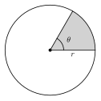
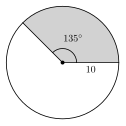
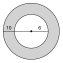
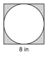
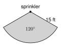
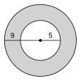
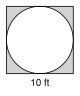
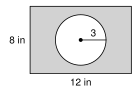
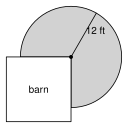

# 7.2 - Area of Circles and Sectors {.unnumbered}

A pizza shop sells a 10-inch pizza for $\$8$ and a 14-inch pizza for $\$14$. Which one is the better deal?

{width=300px fig-align="center"}

You pay for the pizza that you can eat. That is the area of the circle, not the distance across. In this lesson you learn how to find the area of a circle, the area of one slice, and the area of shapes made from circles.

:::{.objectives}
- [ ] I can find the area of a circle from its radius or diameter, and find the radius from the area.
- [ ] I can find the area of a sector, and find a missing angle or radius.
- [ ] I can find the area of a ring and of shapes made from circles and other figures.
- [ ] I can use area to solve real problems.
:::

:::{.vocab}
,
,
,

:::

:::{.guided-notes-link}
[Printable Guided Notes for this lesson](/guided_notes/Unit_7/7.2_Area_of_Circles_and_Sectors.html){target="_blank"} (fill-in notes to print and write on)
:::



1. Find the circumference of a circle with radius $4$. Give the exact answer.

2. Find $\pi r^2$ when $r = 3$. Give the exact answer.

3. Solve $\dfrac{x}{360} \cdot 16\pi = 4\pi$.



### 7.2.1 - Area of a Circle

The **area** of a circle is the number of square units inside it. Here is why the formula works.

Cut a circle into thin wedges, like pizza slices. Then slide the wedges together, one pointing up and the next pointing down.

{width=600px fig-align="center"}

The new shape looks like a parallelogram. Its base is half of the circumference, $\frac{1}{2}(2\pi r) = \pi r$. Its height is $r$. The area of a parallelogram is base times height:

$$
A = \pi r \cdot r = \pi r^2.
$$

If you cut thinner wedges, the shape gets closer to a real parallelogram.

:::{.remember title="Area of a circle"}
$$
A = \pi r^2
$$
Use the **radius**, not the diameter. Area is in **square** units.
:::

***

**Example 1:** Area from the radius

A circle has a radius of $5$ inches. Find its area.

$$
A = \pi r^2 = \pi(5)^2 = 25\pi \approx 78.54 \text{ square inches}
$$

**Example 2:** Area from the diameter

A circle has a diameter of $12$ feet. Find its area.

The radius is half of the diameter: $r = 6$ feet.

$$
A = \pi(6)^2 = 36\pi \approx 113.10 \text{ square feet}
$$

:::{.you-try-m title="Give the exact answer and a decimal rounded to the nearest hundredth."}
a. $r = 7$ inches

b. $d = 6$ meters
:::

:::{.answer title="Answer"}
a. $A = 49\pi \approx 153.94$ square inches

b. $r = 3$, so $A = 9\pi \approx 28.27$ square meters
:::

***

**Example 3:** Find the radius from the area

a. A circle has an area of $49\pi$ square meters. Find the radius.

   $\pi r^2 = 49\pi$. Divide both sides by $\pi$: $r^2 = 49$. So $r = 7$ meters.

b. A circle has an area of $100$ square feet. Find the radius. Round to the nearest hundredth.

   $\pi r^2 = 100$, so $r^2 = \dfrac{100}{\pi}$ and $r = \sqrt{\dfrac{100}{\pi}} \approx 5.64$ feet.

:::{.you-try-m title="Find the radius."}
a. $A = 144\pi$ square inches

b. $A = 150$ square centimeters. Round to the nearest tenth.
:::

:::{.answer title="Answer"}
a. $r^2 = 144$, so $r = 12$ inches

b. $r^2 = \dfrac{150}{\pi}$, so $r = \sqrt{\dfrac{150}{\pi}} \approx 6.9$ centimeters
:::

***

### 7.2.2 - Area of a Sector

A **sector** is the region inside a circle between two radii and the arc they cut off. A slice of pizza is a sector.

{width=250px fig-align="center"}

A sector is a fraction of the whole circle. The fraction is the central angle over $360^\circ$. So the sector is that fraction of the circle's area.

:::{.remember title="Area of a sector"}
$$
\text{sector area} = \frac{\text{central angle}}{360^\circ} \cdot \pi r^2
$$
Compare with 7.1: arc length uses $2\pi r$ and is a **distance**. Sector area uses $\pi r^2$ and is an **area**.
:::

***

**Example 4:** Find a sector area

{width=240px fig-align="center"}

The radius is $10$ inches and the central angle is $135^\circ$. Find the area of the sector. Give the exact answer and a decimal rounded to the nearest hundredth.

$$
A = \frac{135}{360} \cdot \pi(10)^2 = \frac{3}{8} \cdot 100\pi = 37.5\pi
$$

The area is $37.5\pi$ square inches, or about $117.81$ square inches.

**Example 5:** Another sector

A sector has radius $6$ feet and a central angle of $60^\circ$.

$$
A = \frac{60}{360} \cdot \pi(6)^2 = \frac{1}{6} \cdot 36\pi = 6\pi \approx 18.85 \text{ square feet}
$$

:::{.you-try-m title="Find the sector area."}
$r = 9$ meters and the central angle is $120^\circ$. Give the exact answer and a decimal rounded to the nearest hundredth.
:::

:::{.answer title="Answer"}
$\dfrac{120}{360} \cdot \pi(9)^2 = \dfrac{1}{3} \cdot 81\pi = 27\pi \approx 84.82$ square meters
:::

***

**Example 6:** Find the central angle

A sector of a circle with radius $6$ inches has an area of $12\pi$ square inches. Find the central angle.

$$
\frac{x}{360} \cdot \pi(6)^2 = 12\pi \quad\Rightarrow\quad \frac{x}{360} \cdot 36\pi = 12\pi \quad\Rightarrow\quad \frac{x}{360} = \frac{1}{3} \quad\Rightarrow\quad x = 120.
$$

The central angle is $120^\circ$.

:::{.you-try-m title="Find the central angle."}
A sector of a circle with radius $4$ meters has an area of $6\pi$ square meters.
:::

:::{.answer title="Answer"}
$\dfrac{x}{360} \cdot 16\pi = 6\pi$, so $\dfrac{x}{360} = \dfrac{6}{16} = \dfrac{3}{8}$ and $x = 135^\circ$.
:::

***

**Example 7:** Find the radius

a. A $90^\circ$ sector has an area of $25\pi$ square centimeters. Find the radius.

$$
\frac{90}{360} \cdot \pi r^2 = 25\pi \quad\Rightarrow\quad \frac{1}{4}\pi r^2 = 25\pi \quad\Rightarrow\quad r^2 = 100 \quad\Rightarrow\quad r = 10.
$$

b. A $60^\circ$ sector has an area of $30$ square feet. Find the radius. Round to the nearest hundredth.

$$
\frac{1}{6}\pi r^2 = 30 \quad\Rightarrow\quad r^2 = \frac{180}{\pi} \quad\Rightarrow\quad r = \sqrt{\frac{180}{\pi}} \approx 7.57 \text{ feet}.
$$

:::{.you-try-m title="Find the radius."}
a. A $60^\circ$ sector has an area of $6\pi$ square inches.

b. A $120^\circ$ sector has an area of $20$ square meters. Round to the nearest tenth.
:::

:::{.answer title="Answer"}
a. $\dfrac{1}{6}\pi r^2 = 6\pi$, so $r^2 = 36$ and $r = 6$ inches.

b. $\dfrac{1}{3}\pi r^2 = 20$, so $r^2 = \dfrac{60}{\pi}$ and $r = \sqrt{\dfrac{60}{\pi}} \approx 4.4$ meters.
:::

:::{.gotcha title="Radius, not diameter, and square units"}
Use the radius in $\pi r^2$. If you are given the diameter, cut it in half first. Do not double the answer at the end. Area is in **square** units, such as $\text{ft}^2$. Arc length is in plain units, such as $\text{ft}$.
:::

***

### 7.2.3 - Shaded Regions and Composite Shapes

To find the area of a **shaded region**, add or subtract the areas of simple shapes.

**Example 8:** A ring

{width=230px fig-align="center"}

A ring, or **annulus**, has two circles with the same center. The outer radius is $10$ feet. The inner radius is $6$ feet. Find the area of the ring.

Subtract the inner circle from the outer circle.

$$
A = \pi(10)^2 - \pi(6)^2 = 100\pi - 36\pi = 64\pi \approx 201.06 \text{ square feet}
$$

:::{.gotcha title="Do not subtract the radii first"}
The ring is $\pi(10)^2 - \pi(6)^2$. It is **not** $\pi(10 - 6)^2$. That would be $16\pi$, which is far too small. Square each radius first, then subtract.
:::

:::{.you-try-m title="Find the area of the ring."}
The outer radius is $8$ inches and the inner radius is $3$ inches. Give the exact answer and a decimal rounded to the nearest hundredth.
:::

:::{.answer title="Answer"}
$64\pi - 9\pi = 55\pi \approx 172.79$ square inches
:::

***

**Example 9:** A square with a circle cut out

{width=190px fig-align="center"}

A square has sides of $8$ inches. A circle with a diameter of $8$ inches is cut out of it. Find the shaded area. Round to the nearest hundredth.

The square has area $8^2 = 64$. The circle has $r = 4$, so its area is $\pi(4)^2 = 16\pi$.

$$
A = 64 - 16\pi \approx 64 - 50.27 = 13.73 \text{ square inches}
$$

:::{.you-try-m title="Find the shaded area."}
A square has sides of $6$ feet. A circle with a diameter of $6$ feet is cut out of it. Round to the nearest hundredth.
:::

:::{.answer title="Answer"}
$36 - 9\pi \approx 36 - 28.27 = 7.73$ square feet
:::

***

**Example 10:** A window

{width=190px fig-align="center"}

A window is a rectangle $4$ feet wide and $6$ feet tall, with a half circle on top. The diameter of the half circle is the $4$-foot top side. Find the area of the window. Round to the nearest hundredth.

* Rectangle: $4 \cdot 6 = 24$ square feet.
* Half circle: $r = 2$, so $\dfrac{1}{2}\pi(2)^2 = 2\pi \approx 6.28$ square feet.

$$
A = 24 + 2\pi \approx 30.28 \text{ square feet}
$$

:::{.you-try-m title="Find the area."}
A window is a rectangle $3$ feet wide and $5$ feet tall, with a half circle on top. The diameter of the half circle is the $3$-foot side. Round to the nearest hundredth.
:::

:::{.answer title="Answer"}
Rectangle: $15$. Half circle: $r = 1.5$, so $\dfrac{1}{2}\pi(1.5)^2 = 1.125\pi \approx 3.53$. Total: $15 + 3.53 = 18.53$ square feet.
:::

***

### 7.2.4 - Using Area

**Example 11:** The better deal

A 10-inch pizza costs $\$8$. A 14-inch pizza costs $\$14$. Which gives more pizza for each dollar?

* 10-inch: $r = 5$, $A = 25\pi \approx 78.54$ square inches. Per dollar: $78.54 \div 8 \approx 9.82$ square inches.
* 14-inch: $r = 7$, $A = 49\pi \approx 153.94$ square inches. Per dollar: $153.94 \div 14 \approx 11.00$ square inches.

The 14-inch pizza is the better deal.

:::{.think title="Why does a bigger pizza give so much more?"}
The 14-inch pizza is only $1.4$ times as wide as the 10-inch pizza. But its area is about $1.96$ times as big. Area grows with the **square** of the radius.
:::

:::{.you-try-m title="Which is the better deal?"}
An 8-inch pizza costs $\$6$. A 12-inch pizza costs $\$12$. Round to the nearest hundredth.
:::

:::{.answer title="Answer"}
8-inch: $16\pi \approx 50.27$ square inches, and $50.27 \div 6 \approx 8.38$ per dollar. 12-inch: $36\pi \approx 113.10$, and $113.10 \div 12 \approx 9.42$ per dollar. The 12-inch pizza is the better deal.
:::

***

**Example 12:** A sprinkler

{width=250px fig-align="center"}

A sprinkler sprays water $15$ feet. It turns back and forth through an angle of $120^\circ$. How much grass does it water? Round to the nearest hundredth.

$$
A = \frac{120}{360} \cdot \pi(15)^2 = \frac{1}{3} \cdot 225\pi = 75\pi \approx 235.62 \text{ square feet}
$$

:::{.you-try-m title="Find the watered area."}
A sprinkler sprays $12$ feet and turns through $150^\circ$. Round to the nearest hundredth.
:::

:::{.answer title="Answer"}
$\dfrac{150}{360} \cdot \pi(12)^2 = \dfrac{5}{12} \cdot 144\pi = 60\pi \approx 188.50$ square feet
:::

:::{.think title="Error analysis"}
Fatima says: "A circle has a diameter of $10$ inches, so its area is $\pi(10)^2 = 100\pi$." What is wrong?

She used the diameter. The radius is $5$, so $A = \pi(5)^2 = 25\pi$.
:::



**Area of a circle.** Give the exact answer and a decimal rounded to the nearest hundredth.

1. $r = 9$ inches

2. $r = 2.5$ feet

3. $d = 14$ centimeters

4. $d = 30$ meters

***

**Find the radius.**

5. $A = 64\pi$ square feet

6. $A = 121\pi$ square meters

7. $A = 200$ square inches. Round to the nearest tenth.

***

**Area of a sector.** Give the exact answer and a decimal rounded to the nearest hundredth.

8. $r = 12$ feet, central angle $30^\circ$

9. $r = 8$ inches, central angle $270^\circ$

10. $r = 5$ meters, central angle $72^\circ$

11. $d = 20$ centimeters, central angle $36^\circ$

***

**Find the central angle or the radius.**

12. A sector with radius $15$ feet has an area of $25\pi$ square feet. Find the central angle.

13. A sector with radius $8$ inches has an area of $20\pi$ square inches. Find the central angle.

14. A $45^\circ$ sector has an area of $8\pi$ square meters. Find the radius.

***

**Shaded regions.** Round to the nearest hundredth.

15. {width=170px}\
    Find the area of the ring. The radii are $9$ and $5$ feet.

16. {width=170px}\
    A circle with diameter $10$ feet is cut out of a square with sides of $10$ feet. Find the shaded area.

17. {width=190px}\
    A tunnel opening is a rectangle $8$ feet wide and $5$ feet tall, with a half circle on top. Find the area of the opening.

18. {width=210px}\
    A circle with radius $3$ inches is cut out of a $12$ by $8$ inch rectangle. Find the shaded area.

***

**Real problems.**

19. A 12-inch pizza costs $\$9$. A 16-inch pizza costs $\$15$. Which is the better deal? Round to the nearest hundredth.

20. Daniel paints the top of a round table with a diameter of $6$ feet. He puts on $2$ coats. A can of paint covers $50$ square feet. Is one can enough? Explain.

21. A sprinkler sprays $20$ feet and turns through $150^\circ$. How much grass does it water? Round to the nearest tenth.

22. A round pond has a radius of $10$ feet. A path $3$ feet wide goes all the way around it. Find the area of the path. Round to the nearest hundredth.

***

**Find the mistake.**

23. Lucía finds the area of a ring with outer radius $7$ and inner radius $4$. She writes $\pi(7 - 4)^2 = 9\pi$. Find her mistake. What is the correct area?

***

**Test practice**

24. A sector has a central angle of $90^\circ$ and a radius of $8$ inches. What is its area?

    A. $4\pi$ square inches\
    B. $16\pi$ square inches\
    C. $32\pi$ square inches\
    D. $64\pi$ square inches

25. A circular garden with radius $4$ meters sits inside a square fence with sides of $10$ meters. About how many square meters are inside the fence but outside the garden?

    A. $49.7$\
    B. $74.9$\
    C. $87.4$\
    D. $100.0$

***

**Challenge**

26. {width=210px}\
    A cow is tied with a $12$-foot rope to the outside corner of a very large barn. The cow can reach three quarters of a circle. Find the area where the cow can graze. Round to the nearest hundredth.

27. A circle has radius $3$. Another circle has radius $6$. Find both areas. How many times as big is the second area? Explain why the answer is not $2$.
