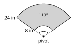

# 7.3 - Radians {.unnumbered}

Take a piece of string as long as the radius of a pizza. Lay it along the crust. The string covers a piece of the edge. The angle at the center of the pizza is about $57^\circ$.

{width=300px fig-align="center"}

That angle is called **one radian**. It is a way to measure angles that uses the circle itself, not the number $360$. Math, science, and engineering use radians. In this lesson you learn what a radian is, how to change between degrees and radians, and two short formulas that work with radians.

:::{.objectives}
- [ ] I can explain what a radian is.
- [ ] I can change degrees to radians and radians to degrees.
- [ ] I can use $s = r\theta$ and $A = \frac{1}{2}r^2\theta$ with an angle in radians.
- [ ] I can tell when an angle must be in radians.
:::

:::{.vocab}
,
,
,

:::

:::{.guided-notes-link}
[Printable Guided Notes for this lesson](/guided_notes/Unit_7/7.3_Radians.html){target="_blank"} (fill-in notes to print and write on)
:::



1. A circle has radius $5$. Find its circumference. Give the exact answer.

2. Simplify $\dfrac{120}{180}$.

3. Solve $\dfrac{x}{180} = \dfrac{2}{3}$.



### 7.3.1 - What Is a Radian?

Lay the radius along the edge of a circle, again and again. Each time, the string makes the same angle at the center. That angle is **1 radian**.

{width=260px fig-align="center"}

The radius fits around the circle a little more than $6$ times. In fact, the circumference is $2\pi r$, so exactly $2\pi \approx 6.28$ radii fit around. So a full turn is $2\pi$ radians.

:::{.remember title="Radian measure"}
The **radian measure** of a central angle is the arc length divided by the radius:
$$
\theta = \frac{s}{r}
$$
where $s$ is the arc length and $r$ is the radius. A full turn is $2\pi$ radians.
:::

A radian has no unit like inches. The inches cancel when you divide $s$ by $r$.

***

**Example 1:** Find the angle in radians

An arc is $12$ centimeters long on a circle with radius $4$ centimeters. Find the central angle in radians.

$$
\theta = \frac{s}{r} = \frac{12}{4} = 3 \text{ radians}
$$

**Example 2:** A full turn

The whole circle has arc length $s = 2\pi r$. So

$$
\theta = \frac{2\pi r}{r} = 2\pi \text{ radians}.
$$

:::{.you-try-m title="Find the central angle in radians."}
a. $s = 10$ inches and $r = 2.5$ inches

b. $s = 9$ feet and $r = 6$ feet
:::

:::{.answer title="Answer"}
a. $\theta = \dfrac{10}{2.5} = 4$ radians

b. $\theta = \dfrac{9}{6} = 1.5$ radians
:::

***

### 7.3.2 - Degrees and Radians

A full turn is $360^\circ$, and it is also $2\pi$ radians. Half of each gives the key fact:

:::{.remember title="Degrees and radians"}
$$
180^\circ = \pi \text{ radians}
$$
To change **degrees to radians**, multiply by $\dfrac{\pi}{180}$.

To change **radians to degrees**, multiply by $\dfrac{180}{\pi}$.
:::

{width=360px fig-align="center"}

Here are some angles you will use again and again.

| Degrees | $30^\circ$ | $45^\circ$ | $60^\circ$ | $90^\circ$ | $180^\circ$ | $360^\circ$ |
|:---:|:---:|:---:|:---:|:---:|:---:|:---:|
| Radians | $\dfrac{\pi}{6}$ | $\dfrac{\pi}{4}$ | $\dfrac{\pi}{3}$ | $\dfrac{\pi}{2}$ | $\pi$ | $2\pi$ |

***

**Example 3:** Degrees to radians

Change $45^\circ$ to radians.

$$
45 \cdot \frac{\pi}{180} = \frac{45\pi}{180} = \frac{\pi}{4}
$$

**Example 4:** Degrees to radians

Change $150^\circ$ to radians.

$$
150 \cdot \frac{\pi}{180} = \frac{150\pi}{180} = \frac{5\pi}{6}
$$

**Example 5:** Radians to degrees

Change $\dfrac{5\pi}{3}$ radians to degrees.

$$
\frac{5\pi}{3} \cdot \frac{180}{\pi} = \frac{5 \cdot 180}{3} = 300^\circ
$$

The $\pi$ cancels.

**Example 6:** A decimal number of radians

Change $2$ radians to degrees. Round to the nearest hundredth.

$$
2 \cdot \frac{180}{\pi} \approx 114.59^\circ
$$

**Example 7:** Degrees to a decimal

Change $70^\circ$ to radians. Give the exact answer and a decimal rounded to the nearest hundredth.

$$
70 \cdot \frac{\pi}{180} = \frac{7\pi}{18} \approx 1.22 \text{ radians}
$$

:::{.you-try-m title="Change the angle."}
a. $36^\circ$ to radians (exact)

b. $225^\circ$ to radians (exact)

c. $\dfrac{7\pi}{6}$ radians to degrees

d. $1.5$ radians to degrees (nearest hundredth)
:::

:::{.answer title="Answer"}
a. $36 \cdot \dfrac{\pi}{180} = \dfrac{\pi}{5}$

b. $225 \cdot \dfrac{\pi}{180} = \dfrac{5\pi}{4}$

c. $\dfrac{7\pi}{6} \cdot \dfrac{180}{\pi} = 210^\circ$

d. $1.5 \cdot \dfrac{180}{\pi} \approx 85.94^\circ$
:::

***

### 7.3.3 - Arc Length and Sector Area in Radians

In 7.1 and 7.2 you used the central angle in degrees. With radians, the formulas are shorter.

**Arc length.** From $\theta = \dfrac{s}{r}$, multiply both sides by $r$:

$$
s = r\theta.
$$

**Sector area.** A sector is the fraction $\dfrac{\theta}{2\pi}$ of the circle:

$$
A = \frac{\theta}{2\pi} \cdot \pi r^2 = \frac{1}{2}r^2\theta.
$$

:::{.remember title="With the angle in radians"}
$$
s = r\theta \qquad\qquad A = \frac{1}{2}r^2\theta
$$
Compare with degrees:

| | Degrees ($n^\circ$) | Radians ($\theta$) |
|:---|:---:|:---:|
| arc length | $\dfrac{n}{360} \cdot 2\pi r$ | $r\theta$ |
| sector area | $\dfrac{n}{360} \cdot \pi r^2$ | $\dfrac{1}{2}r^2\theta$ |
:::

***

**Example 8:** Arc length and sector area

{width=260px fig-align="center"}

The radius is $8$ centimeters and $\theta = \dfrac{3\pi}{4}$. Find the arc length and the sector area. Give the exact answers and decimals rounded to the nearest hundredth.

$$
s = r\theta = 8 \cdot \frac{3\pi}{4} = 6\pi \approx 18.85 \text{ cm}
$$

$$
A = \frac{1}{2}r^2\theta = \frac{1}{2}(8)^2 \cdot \frac{3\pi}{4} = 32 \cdot \frac{3\pi}{4} = 24\pi \approx 75.40 \text{ cm}^2
$$

**Example 9:** An angle that is a plain number

A sector has radius $6$ inches and $\theta = 2.5$ radians. Find $s$ and $A$.

$$
s = 6(2.5) = 15 \text{ inches} \qquad A = \frac{1}{2}(6)^2(2.5) = 45 \text{ square inches}
$$

**Example 10:** Find the angle

An arc is $14$ feet long on a circle with radius $8$ feet. Find $\theta$ in radians. Then change it to degrees. Round to the nearest hundredth.

$$
\theta = \frac{s}{r} = \frac{14}{8} = 1.75 \text{ radians} \qquad 1.75 \cdot \frac{180}{\pi} \approx 100.27^\circ
$$

**Example 11:** Find the radius

A sector with $\theta = \dfrac{\pi}{2}$ has an area of $36\pi$ square meters. Find $r$.

$$
\frac{1}{2}r^2 \cdot \frac{\pi}{2} = 36\pi \quad\Rightarrow\quad \frac{\pi r^2}{4} = 36\pi \quad\Rightarrow\quad r^2 = 144 \quad\Rightarrow\quad r = 12 \text{ meters}
$$

:::{.you-try-m title="Find the arc length and the sector area."}
$r = 10$ inches and $\theta = \dfrac{2\pi}{5}$. Give the exact answers and decimals rounded to the nearest hundredth.
:::

:::{.answer title="Answer"}
$s = 10 \cdot \dfrac{2\pi}{5} = 4\pi \approx 12.57$ inches.

$A = \dfrac{1}{2}(10)^2 \cdot \dfrac{2\pi}{5} = 50 \cdot \dfrac{2\pi}{5} = 20\pi \approx 62.83$ square inches.
:::

:::{.think title="Error analysis"}
Hnin has a circle with $r = 5$ and a central angle of $60^\circ$. She writes $s = r\theta = 5 \cdot 60 = 300$. What is wrong?

The formula $s = r\theta$ needs $\theta$ in **radians**. Change first: $60^\circ = \dfrac{\pi}{3}$. Then $s = 5 \cdot \dfrac{\pi}{3} = \dfrac{5\pi}{3} \approx 5.24$.
:::

***

### 7.3.4 - Using Radians

**Example 12:** A point on a wheel

A wheel has a radius of $13$ inches. A point on the rim turns through $3$ radians. How far does the point travel?

$$
s = r\theta = 13 \cdot 3 = 39 \text{ inches}
$$

**Example 13:** A windshield wiper

{width=260px fig-align="center"}

A wiper blade covers the part of the arm from $8$ inches to $24$ inches from the pivot. The wiper swings through $110^\circ$. How much glass does the blade clean? Round to the nearest tenth.

The cleaned area is a big sector minus a small sector. First change the angle:

$$
110^\circ = 110 \cdot \frac{\pi}{180} = \frac{11\pi}{18} \text{ radians}.
$$

$$
A = \frac{1}{2}(24)^2\theta - \frac{1}{2}(8)^2\theta = \frac{1}{2}(576 - 64)\theta = 256 \cdot \frac{11\pi}{18} \approx 491.5 \text{ square inches}
$$

:::{.you-try-m title="Find the distance."}
A point on the rim of a wheel with radius $15$ inches turns through $\dfrac{4\pi}{3}$ radians. How far does it travel? Give the exact answer and a decimal rounded to the nearest tenth.
:::

:::{.answer title="Answer"}
$s = 15 \cdot \dfrac{4\pi}{3} = 20\pi \approx 62.8$ inches.
:::



**Find the central angle in radians.**

1. $s = 15$ inches, $r = 5$ inches

2. $s = 7$ feet, $r = 2$ feet

3. $s = 3$ meters, $r = 1.2$ meters

***

**Change to radians.** Give the exact answer in terms of $\pi$.

4. $30^\circ$

5. $120^\circ$

6. $135^\circ$

7. $300^\circ$

8. $18^\circ$

9. $80^\circ$

***

**Change to degrees.**

10. $\dfrac{\pi}{3}$

11. $\dfrac{7\pi}{4}$

12. $\dfrac{3\pi}{10}$

13. $\dfrac{4\pi}{3}$

***

**Decimals.** Round to the nearest hundredth.

14. Change $3$ radians to degrees.

15. Change $0.8$ radians to degrees.

16. Change $200^\circ$ to radians.

***

**Arc length and sector area.** Give the exact answers and decimals rounded to the nearest hundredth.

17. $r = 9$ inches, $\theta = \dfrac{\pi}{3}$

18. $r = 4$ feet, $\theta = 2.5$

19. $r = 10$ meters, $\theta = \dfrac{7\pi}{6}$

20. An arc is $18$ centimeters long on a circle with radius $6$ centimeters. Find $\theta$ and the sector area.

21. A sector with radius $6$ inches has an area of $12\pi$ square inches. Find $\theta$ in radians and in degrees.

***

**Real problems.**

22. A Ferris wheel has a radius of $30$ feet. A seat turns through $\dfrac{4\pi}{3}$ radians. How far does the seat travel? Round to the nearest hundredth.

23. A wiper blade covers the part of the arm from $6$ inches to $22$ inches from the pivot. The wiper swings through $120^\circ$. How much glass does it clean? Round to the nearest hundredth.

24. A pendulum $50$ centimeters long swings through an angle of $0.4$ radians. How far does the tip travel?

***

**Find the mistake.**

25. Daniel says that an arc on a circle with $r = 12$ and a central angle of $30^\circ$ has length $12 \cdot 30 = 360$. Find his mistake. What is the correct arc length? Round to the nearest hundredth.

***

**Test practice**

26. What is $\dfrac{11\pi}{6}$ radians in degrees?

    A. $165^\circ$\
    B. $210^\circ$\
    C. $330^\circ$\
    D. $660^\circ$

27. A circle has radius $12$ centimeters. An arc on it is $18$ centimeters long. What is the central angle in radians?

    A. $0.67$\
    B. $1.5$\
    C. $6$\
    D. $216$

***

**Challenge**

28. Put $\theta = 2\pi$ into $s = r\theta$ and into $A = \frac{1}{2}r^2\theta$. What do you get? Explain.

29. The minute hand of a clock is $6$ inches long. How many radians does it turn in $1$ minute? How far does the tip travel in $1$ minute? Round to the nearest hundredth.
