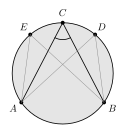
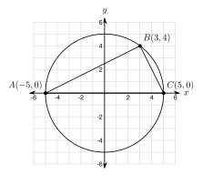
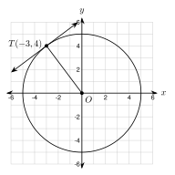

# 7.4 - Inscribed Angles and Tangents {.unnumbered}

A camera stands on the edge of a round stage. It looks at two spotlights, $A$ and $B$, on the edge of the stage on the other side. The camera sees the angle between the two lights.

{width=280px fig-align="center"}

Now move the camera along the edge, to any other seat on the same arc. The angle between the lights does not change. In this lesson you learn why. You also learn what happens when a line just touches a circle.

:::{.objectives}
- [ ] I can find an inscribed angle from its arc, and an arc from its inscribed angle.
- [ ] I can use the fact that an angle inscribed in a semicircle is a right angle.
- [ ] I can use the opposite angles of a quadrilateral inscribed in a circle.
- [ ] I can use a tangent line and the radius to the point of tangency.
:::

:::{.vocab}
,
,
,
,

:::

:::{.guided-notes-link}
[Printable Guided Notes for this lesson](/guided_notes/Unit_7/7.4_Inscribed_Angles_and_Tangents.html){target="_blank"} (fill-in notes to print and write on)
:::



1. A central angle measures $84^\circ$. What is the measure of its arc?

2. Find the slope of the line through $(-2, 1)$ and $(4, 5)$.

3. Solve $2x + 7 = 4x - 9$.



### 7.4.1 - Inscribed Angles

A central angle has its vertex at the center. An **inscribed angle** has its vertex **on** the circle, and both sides are chords. The arc that lies inside the angle is its **intercepted arc**.

{width=300px fig-align="center"}

In the figure, $\angle ABC$ is an inscribed angle. It intercepts $\overset{\frown}{AC}$. The central angle $\angle AOC$ also intercepts $\overset{\frown}{AC}$. The arc is $80^\circ$. The central angle is $80^\circ$, but the inscribed angle is only $40^\circ$.

:::{.remember title="Inscribed angle"}
An inscribed angle is **half** of its intercepted arc.
$$
m\angle ABC = \frac{1}{2}\, m\overset{\frown}{AC}
$$
Two inscribed angles that intercept the same arc are equal.
:::

**Why it works.** Look at the case where one side of the angle is a diameter.

{width=300px fig-align="center"}

$OA$ and $OB$ are both radii, so triangle $OAB$ is isosceles. Its base angles at $A$ and $B$ are both $x$. The angle $\angle AOC$ is an outside angle of the triangle. It equals the two far angles added together: $x + x = 2x$. So the inscribed angle $x$ is half of the central angle $2x$, and half of the arc.

***

**Example 1:** Angle to arc, arc to angle

a. An inscribed angle measures $35^\circ$. Find its intercepted arc.

   The arc is twice the angle: $2(35^\circ) = 70^\circ$.

b. An arc measures $130^\circ$. Find the inscribed angle that intercepts it.

   The angle is half the arc: $\dfrac{1}{2}(130^\circ) = 65^\circ$.

:::{.you-try-m title="Find the missing measure."}
a. An inscribed angle measures $62^\circ$. Find its arc.

b. An arc measures $150^\circ$. Find the inscribed angle.
:::

:::{.answer title="Answer"}
a. $124^\circ$

b. $75^\circ$
:::

***

**Example 2:** Two angles on the same arc

{width=300px fig-align="center"}

$\overset{\frown}{AB}$ measures $100^\circ$. Find $m\angle ACB$ and $m\angle ADB$.

Both angles intercept $\overset{\frown}{AB}$. Each is half of $100^\circ$.

$$
m\angle ACB = m\angle ADB = 50^\circ
$$

This is why the camera sees the same angle from every seat on the arc.

:::{.you-try-m title="The arc intercepted by two inscribed angles measures 84 degrees."}
Find the measure of each angle.
:::

:::{.answer title="Answer"}
$\dfrac{1}{2}(84^\circ) = 42^\circ$ for each angle.
:::

***

**Example 3:** Solve for $x$

{width=300px fig-align="center"}

a. $m\angle ABC = (3x + 5)^\circ$ and $m\overset{\frown}{AC} = (10x - 30)^\circ$. Find $x$ and both measures.

The angle is half the arc:

$$
3x + 5 = \frac{1}{2}(10x - 30) \quad\Rightarrow\quad 3x + 5 = 5x - 15 \quad\Rightarrow\quad 20 = 2x \quad\Rightarrow\quad x = 10.
$$

The angle is $3(10) + 5 = 35^\circ$. The arc is $10(10) - 30 = 70^\circ$.

b. Two inscribed angles intercept the same arc. They measure $(2x + 14)^\circ$ and $(5x - 4)^\circ$. Find $x$.

They are equal: $2x + 14 = 5x - 4$, so $18 = 3x$ and $x = 6$. Each angle is $26^\circ$.

:::{.you-try-m title="Solve for x."}
a. An inscribed angle measures $(2x + 20)^\circ$ and its arc measures $(6x - 20)^\circ$. Find $x$ and both measures.

b. Two inscribed angles intercept the same arc. They measure $(3x + 7)^\circ$ and $(5x - 9)^\circ$. Find $x$.
:::

:::{.answer title="Answer"}
a. $2x + 20 = \dfrac{1}{2}(6x - 20) = 3x - 10$, so $x = 30$. The angle is $80^\circ$ and the arc is $160^\circ$.

b. $3x + 7 = 5x - 9$, so $x = 8$. Each angle is $31^\circ$.
:::

***

### 7.4.2 - Angles in a Semicircle

A diameter cuts a circle into two semicircles. Each semicircle is an arc of $180^\circ$. An angle that intercepts a semicircle is half of $180^\circ$.

{width=300px fig-align="center"}

:::{.remember title="Angle in a semicircle"}
An angle inscribed in a semicircle is a **right angle**. If $\overline{AC}$ is a diameter and $B$ is on the circle, then $m\angle ABC = 90^\circ$.
:::

**Check it on the coordinate plane.** Slopes tell us if two lines are perpendicular (Lesson 2.6).

***

**Example 4:** Show it with slopes

{width=330px fig-align="center"}

The circle has center $(0, 0)$ and radius $5$. The diameter is $\overline{AC}$ with $A(-5, 0)$ and $C(5, 0)$. Point $B(3, 4)$ is on the circle. Show that $\angle ABC$ is a right angle.

First, $B$ is on the circle. Its distance from the center is $\sqrt{3^2 + 4^2} = \sqrt{25} = 5$.

The slopes of the two sides:

$$
\text{slope of } \overline{BA} = \frac{4 - 0}{3 - (-5)} = \frac{4}{8} = \frac{1}{2} \qquad \text{slope of } \overline{BC} = \frac{4 - 0}{3 - 5} = \frac{4}{-2} = -2
$$

The product is $\dfrac{1}{2} \cdot (-2) = -1$. The slopes are opposite reciprocals, so $\overline{BA} \perp \overline{BC}$. The angle is a right angle.

:::{.you-try-m title="Use slopes."}
The circle has center $(0, 0)$ and radius $5$. Point $B(-4, 3)$ is on the circle. Show that $\angle ABC$ is a right angle for $A(-5, 0)$ and $C(5, 0)$.
:::

:::{.answer title="Answer"}
Slope of $\overline{BA} = \dfrac{3 - 0}{-4 - (-5)} = \dfrac{3}{1} = 3$. Slope of $\overline{BC} = \dfrac{3 - 0}{-4 - 5} = -\dfrac{1}{3}$. The product is $3 \cdot \left(-\dfrac{1}{3}\right) = -1$, so the sides are perpendicular.
:::

***

**Example 5:** Angles of a triangle in a semicircle

$\overline{AC}$ is a diameter and $B$ is on the circle.

a. $m\angle A = 28^\circ$. Find $m\angle C$.

   $\angle B = 90^\circ$, so $\angle A + \angle C = 90^\circ$. Then $m\angle C = 90^\circ - 28^\circ = 62^\circ$.

b. $m\angle A = (4x + 2)^\circ$ and $m\angle C = (5x + 7)^\circ$. Find $x$ and both angles.

   $(4x + 2) + (5x + 7) = 90$, so $9x + 9 = 90$ and $x = 9$. The angles are $38^\circ$ and $52^\circ$.

:::{.you-try-m title="Find the angles."}
a. $m\angle A = 51^\circ$. Find $m\angle C$.

b. $m\angle A = (x + 12)^\circ$ and $m\angle C = (2x + 3)^\circ$. Find $x$ and both angles.
:::

:::{.answer title="Answer"}
a. $90^\circ - 51^\circ = 39^\circ$

b. $(x + 12) + (2x + 3) = 90$, so $3x + 15 = 90$ and $x = 25$. The angles are $37^\circ$ and $53^\circ$.
:::

***

### 7.4.3 - Inscribed Quadrilaterals

A polygon is **inscribed** in a circle if all its vertices are on the circle. A four-sided one is an **inscribed quadrilateral**.

{width=300px fig-align="center"}

Each angle is half of the arc it intercepts. Angles $A$ and $C$ intercept two arcs that together make the whole circle, $360^\circ$. Half of $360^\circ$ is $180^\circ$.

:::{.remember title="Inscribed quadrilateral"}
Opposite angles of an inscribed quadrilateral are **supplementary**. They add to $180^\circ$.
$$
m\angle A + m\angle C = 180^\circ \qquad m\angle B + m\angle D = 180^\circ
$$
:::

***

**Example 6:** Find the angles

An inscribed quadrilateral $ABCD$ has $m\angle A = 100^\circ$ and $m\angle B = 85^\circ$. Find $m\angle C$ and $m\angle D$.

$\angle C$ is opposite $\angle A$: $m\angle C = 180^\circ - 100^\circ = 80^\circ$.

$\angle D$ is opposite $\angle B$: $m\angle D = 180^\circ - 85^\circ = 95^\circ$.

**Example 7:** Solve for $x$

In the figure above, $m\angle A = (3x + 10)^\circ$ and $m\angle C = (5x + 10)^\circ$. Find $x$ and both angles.

$$
(3x + 10) + (5x + 10) = 180 \quad\Rightarrow\quad 8x + 20 = 180 \quad\Rightarrow\quad 8x = 160 \quad\Rightarrow\quad x = 20.
$$

$m\angle A = 70^\circ$ and $m\angle C = 110^\circ$. They add to $180^\circ$.

:::{.you-try-m title="Find the missing values."}
a. An inscribed quadrilateral has $m\angle A = 71^\circ$ and $m\angle D = 108^\circ$. Find $m\angle C$ and $m\angle B$.

b. $m\angle B = (4x - 6)^\circ$ and $m\angle D = (2x + 24)^\circ$. Find $x$ and both angles.
:::

:::{.answer title="Answer"}
a. $m\angle C = 180^\circ - 71^\circ = 109^\circ$. $m\angle B = 180^\circ - 108^\circ = 72^\circ$.

b. $(4x - 6) + (2x + 24) = 180$, so $6x + 18 = 180$ and $x = 27$. The angles are $102^\circ$ and $78^\circ$.
:::

:::{.think title="Counterexample: can every quadrilateral be inscribed?"}
A rhombus has angles $60^\circ$, $120^\circ$, $60^\circ$, $120^\circ$. Its opposite angles are equal, so each pair adds to $60 + 60 = 120$. That is not $180$. So this rhombus **cannot** be inscribed in a circle. A square can, because opposite angles are $90^\circ + 90^\circ = 180^\circ$.
:::

***

### 7.4.4 - Tangent Lines

A line is **tangent to a circle** if it touches the circle at exactly one point. That point is the **point of tangency**.

{width=300px fig-align="center"}

:::{.remember title="Tangent and radius"}
A tangent line is **perpendicular** to the radius at the point of tangency.
:::

***

**Example 8:** Show it with slopes

{width=330px fig-align="center"}

A circle has center $O(0, 0)$ and radius $5$. A tangent line touches the circle at $T(-3, 4)$. Find the slope of the tangent line and write its equation.

Slope of radius $\overline{OT}$: $\dfrac{4 - 0}{-3 - 0} = -\dfrac{4}{3}$.

The tangent is perpendicular to the radius, so its slope is the opposite reciprocal, $\dfrac{3}{4}$.

Use point-slope form through $T$:

$$
y - 4 = \frac{3}{4}(x + 3).
$$

:::{.you-try-m title="Find the slope."}
A circle has center $(0, 0)$ and radius $10$. A tangent line touches it at $T(6, 8)$. Find the slope of the radius and the slope of the tangent.
:::

:::{.answer title="Answer"}
Radius: $\dfrac{8}{6} = \dfrac{4}{3}$. Tangent: $-\dfrac{3}{4}$.
:::

***

**Example 9:** Tangent and the Pythagorean theorem

{width=300px fig-align="center"}

$\overline{PT}$ is tangent to the circle at $T$. The radius is $OT = 5$ and $OP = 13$. Find $PT$.

The tangent is perpendicular to the radius, so triangle $OTP$ has a right angle at $T$. The hypotenuse is $OP$.

$$
5^2 + PT^2 = 13^2 \quad\Rightarrow\quad PT^2 = 169 - 25 = 144 \quad\Rightarrow\quad PT = 12.
$$

:::{.you-try-m title="Find the missing length."}
$\overline{PT}$ is tangent to a circle at $T$. The radius is $6$ and $PT = 8$. Find $OP$.
:::

:::{.answer title="Answer"}
$6^2 + 8^2 = OP^2$, so $OP^2 = 100$ and $OP = 10$.
:::

***

**Two tangents from one point.** From a point outside a circle, you can draw two tangent segments. They are equal in length.

**Example 10:** Equal tangents

{width=300px fig-align="center"}

$\overline{PA}$ and $\overline{PB}$ are tangent to the circle. $PA = 3x + 4$ and $PB = 5x - 10$. Find $x$ and $PA$.

$$
3x + 4 = 5x - 10 \quad\Rightarrow\quad 14 = 2x \quad\Rightarrow\quad x = 7.
$$

$PA = 3(7) + 4 = 25$. **Check:** $PB = 5(7) - 10 = 25$.

:::{.you-try-m title="Solve for x."}
Two tangent segments from one point measure $(2x + 9)$ and $(4x - 3)$. Find $x$ and the length.
:::

:::{.answer title="Answer"}
$2x + 9 = 4x - 3$, so $12 = 2x$ and $x = 6$. Each length is $2(6) + 9 = 21$.
:::

***

**Example 11:** A belt around two pulleys

{width=330px fig-align="center"}

Two pulleys each have a radius of $3$ inches. Their centers are $10$ inches apart. A belt goes around both. How long is the belt? Round to the nearest hundredth.

The two straight parts of the belt are tangent to both circles. They are each $10$ inches long. The two curved parts are half a circle each, so together they make one full circle:

$$
2\pi(3) = 6\pi.
$$

$$
\text{belt} = 10 + 10 + 6\pi = 20 + 6\pi \approx 38.85 \text{ inches}
$$

:::{.you-try-m title="Find the belt length."}
Two pulleys each have a radius of $4$ inches. Their centers are $12$ inches apart. Round to the nearest hundredth.
:::

:::{.answer title="Answer"}
$12 + 12 + 2\pi(4) = 24 + 8\pi \approx 49.13$ inches.
:::



**Inscribed angles.**

1. An inscribed angle measures $48^\circ$. Find its intercepted arc.

2. An arc measures $140^\circ$. Find the inscribed angle that intercepts it.

3. An inscribed angle intercepts a major arc that measures $250^\circ$. Find the angle.

4. An inscribed angle measures $90^\circ$. Find its intercepted arc. What kind of arc is it?

***

**Solve for $x$.**

5. {width=260px}\
   The two inscribed angles intercept the same arc. Find $x$ and the measure of each angle.

6. An inscribed angle measures $(4x + 6)^\circ$. Its intercepted arc measures $(10x - 2)^\circ$. Find $x$ and both measures.

7. {width=260px}\
   A triangle is inscribed in a circle. The three arcs between its vertices are $100^\circ$, $130^\circ$, and $130^\circ$. Find the three angles of the triangle. Check that they add to $180^\circ$.

***

**Angles in a semicircle.**

8. The circle $x^2 + y^2 = 169$ has diameter $\overline{AC}$ with $A(-13, 0)$ and $C(13, 0)$. Point $B(5, 12)$ is on the circle. Show that $5^2 + 12^2 = 169$. Then use slopes to show that $\angle ABC$ is a right angle.

9. {width=260px}\
   $\overline{AC}$ is a diameter. Find $x$ and both angles.

10. $\overline{AC}$ is a diameter and $B$ is on the circle. $m\angle A = 47^\circ$. Find $m\angle C$.

11. Triangle $ABC$ is drawn inside a circle with all three vertices on the circle. Side $\overline{AC}$ looks like a diameter, but the center is not marked. Can you say that $\angle B$ is a right angle? Explain.

***

**Inscribed quadrilaterals.**

12. An inscribed quadrilateral $ABCD$ has $m\angle A = 88^\circ$ and $m\angle B = 104^\circ$. Find $m\angle C$ and $m\angle D$.

13. $m\angle A = (6x + 4)^\circ$ and $m\angle C = (4x + 16)^\circ$ in an inscribed quadrilateral. Find $x$ and both angles.

14. $m\angle B = (2x + 30)^\circ$ and $m\angle D = (7x - 12)^\circ$ in an inscribed quadrilateral. Find $x$ and both angles.

15. A parallelogram has angles of $70^\circ$ and $110^\circ$. Can it be inscribed in a circle? Explain.

***

**Tangent lines.**

16. The circle $x^2 + y^2 = 289$ has a tangent line at $T(8, 15)$. Show that $T$ is on the circle. Find the slope of the radius and the slope of the tangent.

17. $\overline{PT}$ is tangent to a circle at $T$. The radius is $9$ and $OP = 15$. Find $PT$.

18. $\overline{PT}$ is tangent to a circle at $T$. The radius is $7$ and $PT = 24$. Find $OP$.

19. $\overline{PT}$ is tangent to a circle at $T$. $PT = 15$ and $OP = 17$. Find the radius.

20. Two tangent segments from one point measure $(4x - 7)$ and $(x + 11)$. Find $x$ and the length.

***

**Real problems.**

21. Two pulleys each have a radius of $5$ inches. Their centers are $18$ inches apart. How long is the belt around them? Round to the nearest hundredth.

22. Two spotlights $A$ and $B$ are on the edge of a round stage. $\overset{\frown}{AB}$ measures $110^\circ$. A camera stands at seat $C$ on the far side of the edge. Another camera stands at seat $D$, also on the far side. What angle does each camera see?

23. A road touches a circular track at point $T$. The track has a radius of $200$ meters. A bus stop $P$ is on the road, $150$ meters from $T$. How far is the bus stop from the center of the track? How far is it from the nearest point on the track? 

***

**Find the mistake.**

24. Amira says: "$\angle ABC$ intercepts a $70^\circ$ arc, so $m\angle ABC = 70^\circ$." Find her mistake. What is the correct measure?

***

**Test practice**

25. An inscribed angle intercepts an arc that measures $118^\circ$. What is the measure of the angle?

    A. $59^\circ$\
    B. $62^\circ$\
    C. $118^\circ$\
    D. $236^\circ$

26. Quadrilateral $WXYZ$ is inscribed in a circle. $m\angle W = 72^\circ$ and $m\angle X = 95^\circ$. What is $m\angle Y$?

    A. $85^\circ$\
    B. $95^\circ$\
    C. $108^\circ$\
    D. $118^\circ$

***

**Challenge**

27. A circle has the equation $x^2 + y^2 = 25$. A tangent segment goes from $P(10, 0)$ to the circle at $T$. Find $PT$. Then find $m\angle OPT$. Hint: triangle $OTP$ has a right angle at $T$. Round $PT$ to the nearest hundredth.

28. A square is inscribed in a circle with radius $5$. The diagonal of the square is a diameter. Find the side length and the area of the square.
