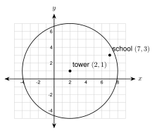
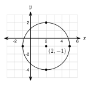
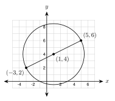
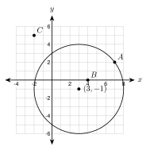
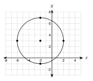

# 7.5 - The Equation of a Circle {.unnumbered}

A cell tower stands at $(2, 1)$ on a town map. Each unit is one mile. The tower reaches $6$ miles in every direction. The school is at $(7, 3)$. Does the signal reach the school?

{width=340px fig-align="center"}

The edge of the signal is a circle. In this lesson you use the distance formula to write the equation of a circle. Then you use it to answer questions like this one.

:::{.objectives}
- [ ] I can write the equation of a circle from its center and radius, from its center and a point, and from the ends of a diameter.
- [ ] I can read the center and radius from an equation and graph the circle.
- [ ] I can change an equation to standard form by completing the square.
- [ ] I can tell if a point is on, inside, or outside a circle.
:::

:::{.vocab}
,
,
,

:::

:::{.guided-notes-link}
[Printable Guided Notes for this lesson](/guided_notes/Unit_7/7.5_The_Equation_of_a_Circle.html){target="_blank"} (fill-in notes to print and write on)
:::



1. Find the distance between $(1, 2)$ and $(4, 6)$.

2. Find the midpoint of the segment with endpoints $(-2, 4)$ and $(6, -2)$.

3. Write $x^2 + 8x + 16$ as the square of a sum.



### 7.5.1 - Where the Equation Comes From

A circle is all the points that are the same distance $r$ from the center. Let the center be $(h, k)$. Let $(x, y)$ be any point on the circle.

{width=280px fig-align="center"}

The distance formula (Lesson 2.4) gives the distance from the center to $(x, y)$. It must equal $r$:

$$
\sqrt{(x - h)^2 + (y - k)^2} = r.
$$

Square both sides to remove the square root:

:::{.remember title="Equation of a circle"}
$$
(x - h)^2 + (y - k)^2 = r^2
$$
The center is $(h, k)$. The radius is $r$. For a circle centered at the origin, $x^2 + y^2 = r^2$.
:::

***

**Example 1:** Build the equation

A circle has center $(2, 1)$ and radius $6$. Write its equation.

$$
(x - 2)^2 + (y - 1)^2 = 6^2 = 36
$$

Check a point: $(2, 7)$ is $6$ units above the center. Put it in: $(2 - 2)^2 + (7 - 1)^2 = 0 + 36 = 36$. It works.

:::{.you-try-m title="Write the equation."}
A circle has center $(-1, 3)$ and radius $4$.
:::

:::{.answer title="Answer"}
$(x + 1)^2 + (y - 3)^2 = 16$
:::

***

### 7.5.2 - Read and Graph

Watch the signs. The equation has $x - h$ and $y - k$. A plus sign inside means the center coordinate is **negative**.

| Equation | Center | Radius |
|:---|:---:|:---:|
| $(x - 4)^2 + (y - 3)^2 = 25$ | $(4, 3)$ | $5$ |
| $(x + 4)^2 + (y + 3)^2 = 25$ | $(-4, -3)$ | $5$ |

The number on the right is $r^2$. Take the square root to get $r$.

***

**Example 2:** Read the center and radius

a. $(x - 4)^2 + (y + 2)^2 = 25$

   $x - 4$ gives $h = 4$. $y + 2 = y - (-2)$ gives $k = -2$. The center is $(4, -2)$. The radius is $\sqrt{25} = 5$.

b. $(x + 6)^2 + (y - 1)^2 = 18$

   The center is $(-6, 1)$. The radius is $\sqrt{18} = 3\sqrt{2} \approx 4.24$.

**Example 3:** Graph a circle

{width=340px fig-align="center"}

Graph $(x - 2)^2 + (y + 1)^2 = 9$.

The center is $(2, -1)$ and the radius is $3$. Plot the center. Then plot points $3$ units right, left, up, and down: $(5, -1)$, $(-1, -1)$, $(2, 2)$, $(2, -4)$. Draw a smooth circle through them.

:::{.you-try-m title="Find the center and radius."}
a. $(x + 3)^2 + (y - 2)^2 = 16$

b. $x^2 + y^2 = 36$
:::

:::{.answer title="Answer"}
a. Center $(-3, 2)$, radius $4$.

b. Center $(0, 0)$, radius $6$.
:::

***

### 7.5.3 - Write the Equation

**Example 4:** From a center and a radius

Center $(-2, 5)$, radius $3$:

$$
(x + 2)^2 + (y - 5)^2 = 9.
$$

**Example 5:** From a center and a point on the circle

A circle has center $(1, -2)$ and passes through $(4, 2)$. Find $r^2$ with the distance formula. You do not need to take the square root, because the equation needs $r^2$.

$$
r^2 = (4 - 1)^2 + (2 - (-2))^2 = 3^2 + 4^2 = 9 + 16 = 25
$$

$$
(x - 1)^2 + (y + 2)^2 = 25
$$

**Example 6:** From the ends of a diameter

{width=330px fig-align="center"}

A diameter has endpoints $(-3, 2)$ and $(5, 6)$. The center is the midpoint (Lesson 2.5):

$$
\left(\frac{-3 + 5}{2}, \frac{2 + 6}{2}\right) = (1, 4).
$$

The radius is the distance from the center to an endpoint, $(5, 6)$:

$$
r^2 = (5 - 1)^2 + (6 - 4)^2 = 16 + 4 = 20.
$$

$$
(x - 1)^2 + (y - 4)^2 = 20
$$

**Check:** the distance from $(1, 4)$ to the other end $(-3, 2)$ is also $r^2 = 16 + 4 = 20$.

:::{.you-try-m title="Write the equation."}
a. Center $(4, -1)$ and radius $7$.

b. Center $(-3, 0)$, passing through $(1, 6)$.

c. A diameter with endpoints $(-2, -1)$ and $(6, 5)$.
:::

:::{.answer title="Answer"}
a. $(x - 4)^2 + (y + 1)^2 = 49$

b. $r^2 = (1 + 3)^2 + (6 - 0)^2 = 16 + 36 = 52$. So $(x + 3)^2 + y^2 = 52$.

c. Center $(2, 2)$. $r^2 = (6 - 2)^2 + (5 - 2)^2 = 16 + 9 = 25$. So $(x - 2)^2 + (y - 2)^2 = 25$.
:::

***

### 7.5.4 - Completing the Square

Sometimes the equation is multiplied out. To find the center and radius, complete the square for $x$ and for $y$ (Algebra 1, Lesson 6.5). To complete $x^2 + bx$, add $\left(\dfrac{b}{2}\right)^2$.

**Example 7:** Standard form

Write $x^2 + y^2 - 6x + 4y - 12 = 0$ in standard form. Find the center and radius.

1. Group the $x$ terms and the $y$ terms. Move the number to the right: $(x^2 - 6x) + (y^2 + 4y) = 12$.
2. Half of $-6$ is $-3$, and $(-3)^2 = 9$. Half of $4$ is $2$, and $2^2 = 4$. Add both numbers to **both sides**:

$$
(x^2 - 6x + 9) + (y^2 + 4y + 4) = 12 + 9 + 4
$$

3. Factor and add:

$$
(x - 3)^2 + (y + 2)^2 = 25
$$

The center is $(3, -2)$ and the radius is $5$.

**Example 8:** Another one

Write $x^2 + y^2 + 8x - 10y + 5 = 0$ in standard form.

$$
(x^2 + 8x + 16) + (y^2 - 10y + 25) = -5 + 16 + 25
$$

$$
(x + 4)^2 + (y - 5)^2 = 36
$$

The center is $(-4, 5)$ and the radius is $6$.

:::{.you-try-m title="Write in standard form. Find the center and radius."}
a. $x^2 + y^2 + 4x - 2y - 4 = 0$

b. $x^2 + y^2 + 6x + 10y + 18 = 0$
:::

:::{.answer title="Answer"}
a. $(x^2 + 4x + 4) + (y^2 - 2y + 1) = 4 + 4 + 1$, so $(x + 2)^2 + (y - 1)^2 = 9$. Center $(-2, 1)$, radius $3$.

b. $(x^2 + 6x + 9) + (y^2 + 10y + 25) = -18 + 9 + 25$, so $(x + 3)^2 + (y + 5)^2 = 16$. Center $(-3, -5)$, radius $4$.
:::

:::{.think title="Is it always a circle?"}
Try $x^2 + y^2 + 4x - 6y + 20 = 0$. Completing the square gives $(x + 2)^2 + (y - 3)^2 = -20 + 4 + 9 = -7$. A square cannot add to a negative number. This is **not** a circle. No points make it true.
:::

***

### 7.5.5 - On, Inside, or Outside?

A point is $r$ away from the center if it is **on** the circle. Put the point in the left side of the equation and compare with $r^2$.

:::{.remember title="Compare with r squared"}
Compute $(x - h)^2 + (y - k)^2$ for the point.

* equal to $r^2$: the point is **on** the circle
* less than $r^2$: the point is **inside**
* greater than $r^2$: the point is **outside**
:::

***

**Example 9:** Does the signal reach the school?

The tower is at $(2, 1)$ with a reach of $6$ miles, so the edge is $(x - 2)^2 + (y - 1)^2 = 36$. The school is at $(7, 3)$.

$$
(7 - 2)^2 + (3 - 1)^2 = 25 + 4 = 29
$$

$29 < 36$, so the school is inside the circle. **Yes**, the signal reaches the school.

**Example 10:** Three points

{width=330px fig-align="center"}

The circle is $(x - 3)^2 + (y + 1)^2 = 25$. Is each point on, inside, or outside?

* $A(7, 2)$: $(4)^2 + (3)^2 = 25$. Equal to $25$, so **on** the circle.
* $B(4, 0)$: $(1)^2 + (1)^2 = 2$. Less than $25$, so **inside**.
* $C(-2, 5)$: $(-5)^2 + (6)^2 = 61$. More than $25$, so **outside**.

**Example 11:** An earthquake

An earthquake is felt up to $10$ miles from the epicenter at $(-4, 3)$. The equation is $(x + 4)^2 + (y - 3)^2 = 100$. Which towns feel it?

* Town $(4, 6)$: $8^2 + 3^2 = 73 < 100$. Inside. It feels the earthquake.
* Town $(2, -5)$: $6^2 + (-8)^2 = 100$. On the circle. It is exactly $10$ miles away, at the edge.
* Town $(6, -9)$: $10^2 + (-12)^2 = 244 > 100$. Outside. It does not feel it.

:::{.you-try-m title="On, inside, or outside?"}
The circle is $(x + 1)^2 + (y - 2)^2 = 25$. Test $(2, 6)$, $(-3, 5)$, and $(4, -2)$.
:::

:::{.answer title="Answer"}
$(2, 6)$: $9 + 16 = 25$, on the circle.

$(-3, 5)$: $4 + 9 = 13 < 25$, inside.

$(4, -2)$: $25 + 16 = 41 > 25$, outside.
:::



**Read the center and radius.**

1. $(x - 5)^2 + (y - 2)^2 = 49$

2. $(x + 4)^2 + (y + 1)^2 = 36$

3. $x^2 + (y - 7)^2 = 25$

4. $(x - 3)^2 + y^2 = 81$

5. $(x + 2)^2 + (y - 6)^2 = 20$. Give the radius as a square root and as a decimal rounded to the nearest hundredth.

***

**Write the equation.**

6. Center $(2, -3)$, radius $5$.

7. Center $(0, 0)$, radius $9$.

8. Center $(-6, 4)$, radius $2.5$.

9. {width=290px}\
   Use the graph. The center and the four marked points are on grid points.

10. Center $(3, -4)$, passing through $(9, 4)$.

11. Center $(-1, -2)$, passing through $(2, 3)$.

12. A diameter has endpoints $(2, 3)$ and $(8, 11)$.

13. A diameter has endpoints $(-7, 2)$ and $(3, 8)$.

***

**Complete the square.** Write in standard form. Give the center and radius.

14. $x^2 + y^2 - 8x + 6y + 9 = 0$

15. $x^2 + y^2 + 12x - 4y + 31 = 0$

16. $x^2 + y^2 - 2x + 14y + 14 = 0$

17. $x^2 + y^2 + 6x - 8y + 30 = 0$. Is this a circle? Explain.

***

**On, inside, or outside?**

18. The circle is $(x - 1)^2 + (y + 3)^2 = 49$. Test each point.

    a. $(8, -3)$

    b. $(4, 1)$

    c. $(-5, -9)$

***

**Real problems.**

19. A cell tower is at $(4, -2)$ and reaches $8$ miles. Write the equation of the edge of the signal. Does it reach the school at $(10, 4)$? Does it reach the hospital at $(8, 2)$?

20. A sprinkler at $(6, 5)$ on a yard plan waters a circle with radius $7$ feet. Write the equation. Is the flower bed at $(10, 10)$ watered?

21. An earthquake is felt up to $15$ miles from the epicenter at $(-3, -4)$. Write the equation. Is a city at $(9, 5)$ inside, on, or outside the circle?

***

**Find the mistake.**

22. Jamal says: "The circle $(x - 3)^2 + (y + 5)^2 = 16$ has center $(-3, 5)$ and radius $16$." Find his two mistakes.

***

**Test practice**

23. Which is the equation of a circle with center $(-2, 5)$ and radius $3$?

    A. $(x - 2)^2 + (y + 5)^2 = 9$\
    B. $(x + 2)^2 + (y - 5)^2 = 9$\
    C. $(x + 2)^2 + (y - 5)^2 = 3$\
    D. $(x - 2)^2 + (y + 5)^2 = 3$

24. Which point is on the circle $(x - 1)^2 + (y - 2)^2 = 25$?

    A. $(5, 5)$\
    B. $(6, 7)$\
    C. $(3, -1)$\
    D. $(2, 7)$

***

**Challenge**

25. A circle has center $(3, 4)$ and touches the $x$-axis at one point. Write its equation. Hint: the radius is the distance from the center to the $x$-axis.

26. Find where the circle $(x - 2)^2 + (y - 1)^2 = 25$ crosses the $x$-axis. Hint: put $y = 0$ and solve for $x$. Round to the nearest hundredth.
