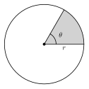

# Unit 7 Summary {.unnumbered}

:::{.guided-notes-link}
[Printable Unit 7 Summary](/guided_notes/Unit_7/Unit_7_Summary.html){target="_blank"} (a reference sheet to print and keep)
:::

## 7.1 - Circumference and Arc Length

* A **circle** is all the points the same distance from the **center**. A **radius** goes from the center to the circle. A **diameter** is a chord through the center, so $d = 2r$.
* A **central angle** has its vertex at the center. A **minor arc** is less than $180^\circ$. A **semicircle** is $180^\circ$. A **major arc** is more than $180^\circ$ and has three letters in its name.
* **Circumference**: $C = \pi d = 2\pi r$. For a circle, $C \div d = \pi \approx 3.14159$.
* **Arc measure** is in degrees and equals the central angle. **Arc length** is a distance: $\dfrac{\text{central angle}}{360^\circ} \cdot 2\pi r$.
* The arcs around a circle add to $360^\circ$.

{width=260px fig-align="center"}

Example: $r = 9$ ft and the central angle is $70^\circ$. The arc length is $\dfrac{70}{360} \cdot 18\pi = 3.5\pi \approx 10.99$ ft.

## 7.2 - Area of Circles and Sectors

* **Area of a circle**: $A = \pi r^2$. Use the radius, not the diameter. Area is in square units.
* A **sector** is a slice between two radii. **Sector area** $= \dfrac{\text{central angle}}{360^\circ} \cdot \pi r^2$.
* A ring (**annulus**) has area $\pi R^2 - \pi r^2$. Square each radius first, then subtract.
* For a shaded region, add or subtract the areas of simple shapes.

{width=220px fig-align="center"}

Example: $r = 6$ in and the central angle is $60^\circ$. The sector area is $\dfrac{60}{360} \cdot 36\pi = 6\pi \approx 18.85$ square inches.

## 7.3 - Radians

* **One radian** is the central angle whose arc is as long as the radius. $\theta = \dfrac{s}{r}$.
* A full turn is $2\pi$ radians. $180^\circ = \pi$ radians.
* Degrees to radians: multiply by $\dfrac{\pi}{180}$. Radians to degrees: multiply by $\dfrac{180}{\pi}$.
* With $\theta$ in radians: arc length $s = r\theta$ and sector area $A = \dfrac{1}{2}r^2\theta$.

| Degrees | $30^\circ$ | $45^\circ$ | $60^\circ$ | $90^\circ$ | $180^\circ$ | $360^\circ$ |
|:---:|:---:|:---:|:---:|:---:|:---:|:---:|
| Radians | $\dfrac{\pi}{6}$ | $\dfrac{\pi}{4}$ | $\dfrac{\pi}{3}$ | $\dfrac{\pi}{2}$ | $\pi$ | $2\pi$ |

Example: $r = 8$ and $\theta = \dfrac{3\pi}{4}$. Then $s = 8 \cdot \dfrac{3\pi}{4} = 6\pi$ and $A = \dfrac{1}{2}(64)\dfrac{3\pi}{4} = 24\pi$.

## 7.4 - Inscribed Angles and Tangents

* An **inscribed angle** has its vertex on the circle. It is **half** of its intercepted arc. Two inscribed angles on the same arc are equal.
* An angle inscribed in a semicircle is a right angle.
* Opposite angles of an inscribed quadrilateral are supplementary.
* A tangent line touches the circle at one point and is perpendicular to the radius there. Two tangent segments from one outside point are equal.

{width=240px fig-align="center"}

Example: an inscribed angle that intercepts an $80^\circ$ arc measures $40^\circ$. A tangent segment $PT$ with radius $5$ and $OP = 13$ has $PT = \sqrt{13^2 - 5^2} = 12$.

## 7.5 - The Equation of a Circle

* **Standard form**: $(x - h)^2 + (y - k)^2 = r^2$. The center is $(h, k)$. The radius is $r$.
* A plus sign inside means a negative coordinate: $(x + 3)^2$ has $h = -3$.
* From a center and a point: find $r^2$ with the distance formula. From the ends of a diameter: the center is the midpoint.
* To change $x^2 + y^2 + bx + cy + d = 0$ to standard form, complete the square for $x$ and for $y$. Add the same numbers to both sides.
* Compare $(x - h)^2 + (y - k)^2$ with $r^2$: equal is on the circle, less is inside, more is outside.

{width=240px fig-align="center"}

Example: $x^2 + y^2 - 6x + 4y - 12 = 0$ becomes $(x - 3)^2 + (y + 2)^2 = 25$. The center is $(3, -2)$ and the radius is $5$.
