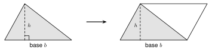
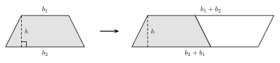
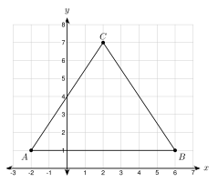
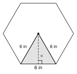
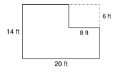
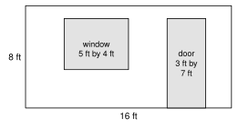

# 8.1 - Area of Polygons and Composite Figures {.unnumbered}

Diego is putting new flooring in a room. The flooring costs $\$3.50$ for each square foot. Before he buys any, he has to know how many square feet the floor has.

That number is the **area** of the floor. In this lesson you find the area of rectangles, parallelograms, triangles, trapezoids, and regular polygons. Then you put the pieces together to find the area of whole rooms, walls, and yards.

:::{.objectives}
- [ ] I can find the area of a parallelogram, triangle, and trapezoid.
- [ ] I can find the area of a regular polygon with its apothem.
- [ ] I can find the area of a composite figure by adding and subtracting.
- [ ] I can find a missing length when I know the area.
:::

:::{.vocab}
,
,
,
,
,

:::

:::{.guided-notes-link}
[Printable Guided Notes for this lesson](/guided_notes/Unit_8/8.1_Area_of_Polygons_and_Composite_Figures.html){target="_blank"} (fill-in notes to print and write on)
:::



1. A rectangle is $7$ feet long and $4.5$ feet wide. Find its area.

2. Simplify $\sqrt{27}$.

3. Solve $5(2x + 3) = 55$.



### 8.1.1 - Parallelograms, Triangles, and Trapezoids

Area tells how many **square units** cover a flat shape. A rectangle with base $b$ and height $h$ has area $A = bh$. The other shapes come from the rectangle.

The **base** is a side you choose. The **height** is the distance from the base to the opposite side, measured at a right angle. A dashed line with a square mark shows the height.

**Parallelogram.** Cut a triangle off one end and move it to the other end. You get a rectangle with the same base and height.

{width=520px fig-align="center"}

**Triangle.** Two copies of a triangle make a parallelogram. The triangle is half of it.

{width=520px fig-align="center"}

**Trapezoid.** Two copies of a trapezoid make a parallelogram. Its base is $b_1 + b_2$. The trapezoid is half of it.

{width=560px fig-align="center"}

| Shape | Area |
|:---|:---:|
| rectangle | $A = bh$ |
| parallelogram | $A = bh$ |
| triangle | $A = \dfrac{1}{2}bh$ |
| trapezoid | $A = \dfrac{1}{2}(b_1 + b_2)h$ |

:::{.gotcha title="Height is not the slanted side"}
The height makes a right angle with the base. A slanted side is longer than the height, so never use it in these formulas.
:::

***

**Example 1:** Area of a parallelogram

{width=340px fig-align="center"}

Find the area.

The base is $14$ ft. The height is $9$ ft (the dashed line). The $10$ ft side is slanted, so we do not use it.

$$
A = bh = 14 \cdot 9 = 126 \text{ square feet}
$$

:::{.you-try title="A parallelogram has base 9 ft, height 6 ft, and a slanted side of 7 ft. Find the area."}
$A = bh = 9 \cdot 6 = 54$ square feet. The $7$ ft side is not used.
:::

***

**Example 2:** Find the mistake

Amira finds the area of the parallelogram in Example 1. She writes $A = 14 \cdot 10 = 140$ square feet. What is her mistake?

She used the slanted side ($10$ ft) as the height. The height is the dashed line, $9$ ft. The correct area is $14 \cdot 9 = 126$ square feet.

:::{.you-try-m title="Find the mistake"}
Kofi finds the area of a triangle with base $10$ cm and height $6$ cm. He writes $A = 10 \cdot 6 = 60$ square centimeters. What did he forget? What is the correct area?
:::

:::{.answer title="Answer"}
He forgot the $\frac{1}{2}$. The correct area is $\frac{1}{2}(10)(6) = 30$ square centimeters.
:::

***

**Example 3:** A triangle on the coordinate plane

{width=330px fig-align="center"}

Find the area of $\triangle ABC$ with $A(-2, 1)$, $B(6, 1)$, and $C(2, 7)$.

Points $A$ and $B$ have the same $y$-coordinate, so $\overline{AB}$ is horizontal. Use it as the base.

$$
b = 6 - (-2) = 8
$$

The height goes straight up from the base to $C$. It is the difference in $y$-coordinates.

$$
h = 7 - 1 = 6
$$

$$
A = \tfrac{1}{2}bh = \tfrac{1}{2}(8)(6) = 24 \text{ square units}
$$

:::{.you-try title="Find the area of the triangle with P(-3, -2), Q(5, -2), and R(1, 5)."}
$PQ$ is horizontal: $b = 5 - (-3) = 8$. The height is $5 - (-2) = 7$.

$A = \frac{1}{2}(8)(7) = 28$ square units.
:::

***

**Example 4:** A trapezoid

{width=400px fig-align="center"}

A garden bed is a trapezoid. Find its area.

The parallel sides are $b_1 = 12$ ft and $b_2 = 20$ ft. The height is $8$ ft.

$$
A = \tfrac{1}{2}(b_1 + b_2)h = \tfrac{1}{2}(12 + 20)(8) = \tfrac{1}{2}(32)(8) = 128 \text{ square feet}
$$

:::{.you-try title="A trapezoid has parallel sides 9 ft and 15 ft. The height is 6 ft. Find the area."}
$A = \frac{1}{2}(9 + 15)(6) = \frac{1}{2}(24)(6) = 72$ square feet.
:::

***

### 8.1.2 - Regular Polygons

A **regular polygon** has equal sides and equal angles. The **apothem** $a$ is the distance from the center to the middle of a side. It makes a right angle with the side.

Draw lines from the center to every corner. The polygon is cut into triangles. Each triangle has a base that is one side and a height that is the apothem. Add them up:

$$
A = \tfrac{1}{2}a \cdot (\text{side}) \cdot (\text{number of sides}) = \tfrac{1}{2}aP
$$

:::{.remember title="Area of a regular polygon"}
$A = \dfrac{1}{2}aP$, where $a$ is the apothem and $P$ is the perimeter.
:::

***

**Example 5:** A regular hexagon

{width=300px fig-align="center"}

A regular hexagon has side $6$ in. Find its area. Give the exact answer and a decimal rounded to the nearest tenth.

The lines from the center to the corners cut the hexagon into $6$ equilateral triangles. So the distance from the center to each corner is also $6$ in.

The apothem cuts one triangle into two $30^\circ$-$60^\circ$-$90^\circ$ triangles. The short leg is $3$ in. From Lesson 6.1, the long leg is the short leg times $\sqrt{3}$:

$$
a = 3\sqrt{3} \text{ in}
$$

The perimeter is $P = 6 \cdot 6 = 36$ in.

$$
A = \tfrac{1}{2}aP = \tfrac{1}{2}(3\sqrt{3})(36) = 54\sqrt{3} \approx 93.5 \text{ square inches}
$$

:::{.you-try title="Find the area of a regular hexagon with side 10 cm. Give the exact answer and a decimal rounded to the nearest tenth."}
Short leg $= 5$, so $a = 5\sqrt{3}$ cm. $P = 6 \cdot 10 = 60$ cm.

$A = \frac{1}{2}(5\sqrt{3})(60) = 150\sqrt{3} \approx 259.8$ square centimeters.
:::

***

**Example 6:** A stop sign

{width=260px fig-align="center"}

A stop sign is a regular octagon. Each side is $12.5$ in. The apothem is $15.1$ in. Find the area of the sign. Round to the nearest square inch.

$$
P = 8 \cdot 12.5 = 100 \text{ in}
$$

$$
A = \tfrac{1}{2}aP = \tfrac{1}{2}(15.1)(100) = 755 \text{ square inches}
$$

:::{.you-try title="A regular pentagon has side 8 in and apothem 5.5 in. Find its area."}
$P = 5 \cdot 8 = 40$ in. $A = \frac{1}{2}(5.5)(40) = 110$ square inches.
:::

***

### 8.1.3 - Composite Figures

A **composite figure** is made of simple shapes. There are two ways to find its area:

* **Add** the areas of the parts.
* **Subtract** a missing part from a bigger shape.

Always say which shapes you see before you start.

***

**Example 7:** An L-shaped room

{width=340px fig-align="center"}

Diego wants flooring for this room. The flooring costs $\$3.50$ per square foot. Find the area and the cost.

The room is a $20$ ft by $14$ ft rectangle with an $8$ ft by $6$ ft corner missing.

$$
A = 20 \cdot 14 - 8 \cdot 6 = 280 - 48 = 232 \text{ square feet}
$$

$$
\text{Cost} = 232 \cdot 3.50 = \$812
$$

:::{.you-try title="A room is 12 ft by 10 ft. A closet 4 ft by 3 ft is cut out of one corner. Find the floor area."}
$A = 12 \cdot 10 - 4 \cdot 3 = 120 - 12 = 108$ square feet.
:::

***

**Example 8:** Paint for a wall

{width=420px fig-align="center"}

Moses will paint this wall. He does not paint the window or the door. Find the area he paints.

Wall: $16 \cdot 8 = 128$ square feet.

Window: $5 \cdot 4 = 20$ square feet.

Door: $3 \cdot 7 = 21$ square feet.

$$
128 - 20 - 21 = 87 \text{ square feet}
$$

:::{.you-try title="A wall is 14 ft by 9 ft. It has one window 4 ft by 3 ft and one door 3 ft by 7 ft. Find the area to paint."}
Wall: $14 \cdot 9 = 126$. Window: $12$. Door: $21$.

$126 - 12 - 21 = 93$ square feet.
:::

***

**Example 9:** A garden with a rounded end

{width=400px fig-align="center"}

A garden is a rectangle with a semicircle on one end. The rectangle is $24$ ft by $10$ ft. The diameter of the semicircle is $10$ ft. Find the area. Give the exact answer and a decimal rounded to the nearest tenth.

Rectangle: $24 \cdot 10 = 240$ square feet.

The radius is $5$ ft. A semicircle is half a circle (Lesson 7.2):

$$
\tfrac{1}{2}\pi r^2 = \tfrac{1}{2}\pi(5)^2 = 12.5\pi \text{ square feet}
$$

$$
A = 240 + 12.5\pi \approx 279.3 \text{ square feet}
$$

:::{.you-try title="A rectangle is 18 ft by 8 ft. A semicircle with diameter 8 ft is added to one end. Find the area. Give the exact answer and a decimal rounded to the nearest tenth."}
Rectangle: $18 \cdot 8 = 144$. Semicircle: $r = 4$, $\frac{1}{2}\pi(4)^2 = 8\pi$.

$A = 144 + 8\pi \approx 169.1$ square feet.
:::

***

### 8.1.4 - Finding a Missing Length

Sometimes you know the area and need a length. Write the area formula with the lengths you know. Put in the area. Then solve the equation.

**Example 10:** A trapezoid with a missing base

{width=360px fig-align="center"}

A trapezoid has bases $x$ and $x + 4$ and height $6$ ft. The area is $66$ square feet. Find $x$.

$$
\tfrac{1}{2}(x + (x + 4))(6) = 66
$$

$$
3(2x + 4) = 66
$$

$$
6x + 12 = 66
$$

$$
6x = 54
$$

$$
x = 9
$$

The bases are $9$ ft and $13$ ft. Check: $\frac{1}{2}(9 + 13)(6) = 66$.

:::{.you-try title="A trapezoid has bases x and x + 6 and height 5 ft. The area is 55 square feet. Find x."}
$\frac{1}{2}(2x + 6)(5) = 55$, so $5x + 15 = 55$, so $x = 8$.

The bases are $8$ ft and $14$ ft.
:::

:::{.think title="Why can you pick any side as the base?"}
A triangle has three sides. Each one can be the base, with its own height. All three choices give the same area. Try it with a $3$-$4$-$5$ right triangle: use leg $3$ with height $4$, then use leg $4$ with height $3$.
:::



**Parallelograms, triangles, and trapezoids. Give each area with units.**

1. A parallelogram has base $11$ cm, height $6$ cm, and a slanted side of $7$ cm.

2. A triangle has base $15$ m and height $8$ m.

3. A trapezoid has parallel sides $7$ in and $13$ in. The height is $5$ in.

4. A rectangle is $3.5$ ft by $12$ ft.

5. Find the area of the triangle with vertices $D(1, 2)$, $E(9, 2)$, and $F(4, 8)$.

6. Find the area of the trapezoid with vertices $(0, 0)$, $(8, 0)$, $(6, 5)$, and $(2, 5)$.

7. Find the mistake. Hnin says a parallelogram with base $10$ in, slanted side $6$ in, and height $5$ in has area $10 \cdot 6 = 60$ square inches. What is the correct area?

***

**Regular polygons. Use $A = \frac{1}{2}aP$.**

8. A regular hexagon has side $8$ in. Find the exact area and the area rounded to the nearest tenth.

9. A regular octagon has side $10$ cm and apothem $12.1$ cm. Find its area.

10. A regular pentagon has side $14$ cm and apothem $9.6$ cm. Find its area.

11. A regular polygon has perimeter $60$ in and area $150$ square inches. Find its apothem.

***

**Composite figures. Use the figure when there is one.**

{width=300px fig-align="center"}

12. Find the area of this L-shaped floor.

{width=260px fig-align="center"}

13. Find the area of this shape (a rectangle with a triangle on top).

{width=160px fig-align="center"}

14. This window is a rectangle with a semicircle on top. Find the area. Round to the nearest tenth.

15. A wall is $20$ ft by $9$ ft. It has two windows, each $3$ ft by $4$ ft, and a door $3$ ft by $7$ ft. Find the area to paint.

16. A yard is $40$ ft by $30$ ft. A patio $12$ ft by $10$ ft is in the yard. Sod covers the rest. Sod costs $\$0.45$ per square foot. How much does the sod cost?

17. Hnin tiles a floor that is $18$ ft by $15$ ft. She buys $10\%$ more tile than the floor area to allow for cuts. The tile costs $\$2.75$ per square foot. How much does she pay?

18. A stop sign is cut from a square sheet of metal $30$ in by $30$ in. The sign is a regular octagon with side $12.4$ in and apothem $15$ in. How many square inches of metal are left over?

***

**Missing lengths. Write an equation and solve.**

{width=300px fig-align="center"}

19. The area of this trapezoid is $120$ square feet. Find $x$.

20. A trapezoid has bases $2x$ and $4$, and the height is $6$. The area is $60$. Find $x$.

21. A parallelogram has area $84$ square meters, base $12$ m, and height $(x + 3)$ m. Find $x$.

22. A rectangle has perimeter $36$ ft. Its length is twice its width. Find its area.

***

**What does the figure show?**

23. A four-sided figure looks like a rectangle $8$ ft by $5$ ft. No angles are marked. Can you say its area is $40$ square feet? Explain.

***

**Test practice**

24. A garden is a trapezoid. Its parallel sides are $9$ m and $15$ m. The distance between them is $7$ m. One bag of soil covers $4$ square meters. How many bags are needed to cover the garden?

    A. 16\
    B. 21\
    C. 42\
    D. 84

25. A regular hexagon has side $4$ in and apothem $2\sqrt{3}$ in. What is its area, rounded to the nearest tenth?

    A. 27.7 square inches\
    B. 41.6 square inches\
    C. 55.4 square inches\
    D. 83.1 square inches

***

**Challenge**

26. A triangle has sides $13$, $14$, and $15$. Use the $14$ side as the base. The height splits the base into pieces of $5$ and $9$. Use the Pythagorean theorem to find the height. Then find the area.

27. A square has side $s$. A circle fits inside it and touches all four sides. Write the area inside the square but outside the circle in terms of $s$.
