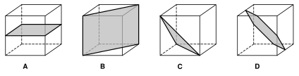
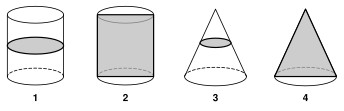
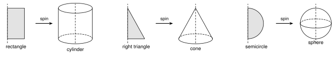
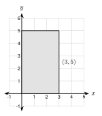
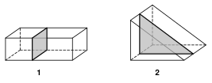

# 8.2 - Cross Sections and Solids of Revolution {.unnumbered}

A baker cuts a round loaf of bread. The cut face is a flat shape. A potter spins a lump of clay on a wheel. The clay becomes a round bowl.

Both jobs connect flat shapes and solids. A slice turns a solid into a flat shape. A spin turns a flat shape into a solid. In this lesson you learn to see both.

:::{.objectives}
- [ ] I can name solids and count their faces, edges, and vertices.
- [ ] I can describe the cross section made when a plane slices a solid.
- [ ] I can tell which solid a flat shape makes when it spins.
- [ ] I can find lengths in a cross section or a solid of revolution.
:::

:::{.vocab}
,
,
,
,
,
,
,
,
,
,
,
,

:::

:::{.guided-notes-link}
[Printable Guided Notes for this lesson](/guided_notes/Unit_8/8.2_Cross_Sections_and_Solids_of_Revolution.html){target="_blank"} (fill-in notes to print and write on)
:::



1. Find the area of a circle with radius $5$. Give the exact answer.

2. A right triangle has legs $6$ and $8$. Find the hypotenuse.

3. Solve $x + 8 - 12 = 2$.



### 8.2.1 - Solids

A **solid** is a three-dimensional shape. These are the five solids we study.

{width=600px fig-align="center"}

A **polyhedron** has only flat faces. Prisms and pyramids are polyhedrons. Cylinders, cones, and spheres are not, because they have curved surfaces.

* A **face** is a flat surface.
* An **edge** is where two faces meet.
* A **vertex of a solid** is a corner where edges meet.

A **prism** has two parallel bases that are the same shape. A **pyramid** has one base and triangle faces that meet at a point. We name each by its base, such as a *triangular prism* or a *square pyramid*.

***

**Example 1:** Count the parts

{width=260px fig-align="center"}

Name the solid. Count its faces, vertices, and edges.

The two bases are triangles, so this is a **triangular prism**.

* Faces: $2$ triangles and $3$ rectangles, so $5$ faces.
* Vertices: $3$ on each base, so $6$ vertices.
* Edges: $3$ on each base and $3$ going between them, so $9$ edges.

:::{.you-try title="Name this solid. Count its faces, vertices, and edges."}
{width=240px fig-align="center"}

A **square pyramid**. Faces: $1$ square and $4$ triangles, so $5$. Vertices: $4$ at the base and $1$ on top, so $5$. Edges: $4$ at the base and $4$ going up, so $8$.
:::

***

Leonhard Euler saw a pattern in these counts. Look at the last column.

| Solid | Faces $F$ | Vertices $V$ | Edges $E$ | $F + V - E$ |
|:---|:---:|:---:|:---:|:---:|
| cube | $6$ | $8$ | $12$ | $2$ |
| triangular prism | $5$ | $6$ | $9$ | $2$ |
| square pyramid | $5$ | $5$ | $8$ | $2$ |
| pentagonal prism | $7$ | $10$ | $15$ | $2$ |

:::{.remember title="Euler's formula"}
For a polyhedron with no holes, $F + V - E = 2$.
:::

***

**Example 2:** Use the pattern

A polyhedron has $9$ faces and $14$ vertices. How many edges does it have?

$$
F + V - E = 2
$$

$$
9 + 14 - E = 2
$$

$$
23 - E = 2
$$

$$
E = 21
$$

It has $21$ edges.

:::{.you-try title="A polyhedron has 8 faces and 12 vertices. How many edges does it have?"}
$8 + 12 - E = 2$, so $20 - E = 2$, so $E = 18$.
:::

***

### 8.2.2 - Cross Sections

Imagine a plane (a flat sheet) cutting through a solid. The flat shape on the cut is the **cross section**. The shape depends on how you cut.

**Example 3:** Slicing a cube

{width=600px fig-align="center"}

Name the cross section in each cube.

* **A**: the plane is parallel to the top. The cross section is a **square**.
* **B**: the plane goes through two opposite edges. The cross section is a **rectangle** that is not a square.
* **C**: the plane cuts off a corner. The cross section is a **triangle**.
* **D**: the plane cuts through the middle of six edges. The cross section is a **hexagon**.

:::{.think title="Is every slice of a cube a square?"}
No. Cubes A and B are both cube slices, but B is a rectangle that is longer than it is wide. One example like this is a **counterexample**. It shows that "every slice is a square" is false.
:::

***

**Example 4:** Slicing a cylinder and a cone

{width=600px fig-align="center"}

Name the cross section in each picture.

* **1**: a cut parallel to the base of a cylinder is a **circle**.
* **2**: a cut straight through the axis of a cylinder is a **rectangle**.
* **3**: a cut parallel to the base of a cone is a **circle** (smaller than the base).
* **4**: a cut through the apex and the center of the base of a cone is a **triangle**.

Every cut of a sphere is a circle.

:::{.you-try title="A square pyramid is cut parallel to its base. What is the cross section? What if it is cut straight down through the apex and the middle of two opposite base edges?"}
Parallel to the base: a **square**, smaller than the base.

Straight down through the apex: a **triangle**.
:::

***

**Example 5:** A slice of a sphere

{width=460px fig-align="center"}

A sphere has radius $5$ in. A plane cuts it $3$ in from the center. Find the area of the cross section. Give the exact answer and a decimal rounded to the nearest tenth.

The cross section is a circle. Look at the side view. The radius of the sphere ($5$) is the hypotenuse of a right triangle. One leg is $3$. The other leg is the radius $r$ of the cross section.

$$
r^2 + 3^2 = 5^2
$$

$$
r^2 = 25 - 9 = 16
$$

$$
r = 4
$$

$$
A = \pi r^2 = 16\pi \approx 50.3 \text{ square inches}
$$

:::{.you-try title="A sphere has radius 13 cm. A plane cuts it 5 cm from the center. Find the area of the cross section. Give the exact answer and a decimal rounded to the nearest tenth."}
$r^2 + 5^2 = 13^2$, so $r^2 = 169 - 25 = 144$ and $r = 12$.

$A = 144\pi \approx 452.4$ square centimeters.
:::

***

**Example 6:** Real slices

A deli cuts a round block of cheese. The block is a cylinder. The cut is straight across, parallel to the flat ends. What shape is each slice? Another cut goes at a slant through the block. What shape is that slice?

Parallel to the ends: a **circle**. A slanted cut makes a longer, rounder shape called an **ellipse** (an oval).

:::{.you-try title="Samir slices an orange (a sphere) through its center. What shape is the cut face?"}
A **circle**. Every slice of a sphere is a circle.
:::

***

### 8.2.3 - Solids of Revolution

Spin a flat shape around a line. The shape sweeps out a solid. The line is the **axis of revolution**. The solid is a **solid of revolution**.

{width=640px fig-align="center"}

| Flat shape | Spin around | Solid |
|:---|:---|:---|
| rectangle | one side | cylinder |
| right triangle | one leg | cone |
| semicircle | its diameter | sphere |

***

**Example 7:** Spin a rectangle

{width=300px fig-align="center"}

The rectangle has vertices $(0, 0)$, $(3, 0)$, $(3, 5)$, and $(0, 5)$. It spins around the $y$-axis. Describe the solid.

The $y$-axis is the side from $(0, 0)$ to $(0, 5)$. The solid is a **cylinder**.

* The radius is the distance from the axis to the far side: $r = 3$.
* The height is the length along the axis: $h = 5$.

:::{.you-try title="The same rectangle spins around the x-axis instead. Describe the solid."}
A **cylinder**. The side along the $x$-axis has length $3$, so the height is $h = 3$. The far side is $5$ away from the axis, so the radius is $r = 5$.
:::

***

**Example 8:** Spin a triangle

{width=300px fig-align="center"}

The triangle has vertices $(0, 0)$, $(4, 0)$, and $(0, 6)$. It spins around the $y$-axis. Describe the solid. Find the slant height. Give the exact answer and a decimal rounded to the nearest tenth.

The solid is a **cone**. The radius is $r = 4$ and the height is $h = 6$.

The slant height $\ell$ is the hypotenuse of the triangle (the slanted side of the cone):

$$
\ell^2 = 4^2 + 6^2 = 16 + 36 = 52
$$

$$
\ell = \sqrt{52} = 2\sqrt{13} \approx 7.2
$$

:::{.you-try title="A triangle with vertices (0, 0), (5, 0), and (0, 12) spins around the y-axis. Find the radius, height, and slant height of the cone."}
$r = 5$, $h = 12$. $\ell^2 = 25 + 144 = 169$, so $\ell = 13$.
:::



**Name each solid.**

1. It has two parallel circular bases and one curved surface.

2. It has five faces: one square and four triangles.

3. It has one circular base and one point (apex).

***

**Faces, vertices, and edges.**

4. A rectangular prism has how many faces, vertices, and edges?

5. A hexagonal prism has how many faces, vertices, and edges?

6. A polyhedron has $10$ faces and $16$ vertices. How many edges does it have?

7. A polyhedron has $12$ edges and $7$ vertices. How many faces does it have?

8. A student draws a solid with $5$ faces, $6$ vertices, and $10$ edges. Use $F + V - E$ to show that no polyhedron with no holes has these numbers.

***

**Cross sections.**

{width=440px fig-align="center"}

9. A plane cuts the rectangular prism (picture 1) parallel to its ends. What shape is the cross section?

10. A plane cuts the triangular prism (picture 2) parallel to its triangle ends. What shape is the cross section?

11. A cylinder is cut parallel to its bases. What is the cross section?

12. A cylinder is cut straight through its axis. What is the cross section?

13. A cone is cut parallel to its base. What is the cross section?

14. A cone is cut straight through its apex and the center of its base. What is the cross section?

15. Thu says, "Every slice of a cube is a square." Give one slice of a cube that is not a square.

16. A sphere has radius $10$ in. A plane cuts it $6$ in from the center. Find the area of the cross section. Give the exact answer and a decimal rounded to the nearest tenth.

17. A sphere has radius $25$ cm. A plane cuts it $24$ cm from the center. Find the area of the cross section. Give the exact answer and a decimal rounded to the nearest tenth.

18. A cylinder has radius $4$ ft and height $10$ ft. It is cut straight through its axis. Find the area of the rectangle that you see.

***

**Solids of revolution.**

19. A rectangle with vertices $(0, 0)$, $(4, 0)$, $(4, 7)$, and $(0, 7)$ spins around the $y$-axis. Name the solid. Give its radius and height.

20. The same rectangle spins around the $x$-axis. Name the solid. Give its radius and height.

21. A triangle with vertices $(0, 0)$, $(3, 0)$, and $(0, 4)$ spins around the $y$-axis. Name the solid. Give its radius, height, and slant height.

22. The same triangle spins around the $x$-axis. Name the solid. Give its radius, height, and slant height.

23. A semicircle with radius $6$ cm spins around its diameter. What solid does it make? What is the radius of the solid?

24. Which flat shape spins to make each object? (a) a soup can (b) a party hat (c) a basketball

***

**Real situations.**

25. Fatima cuts a round loaf of bread (a cylinder lying on its side) straight across, at a right angle to its length. What shape is each slice?

26. An orange is a sphere with radius $4$ cm. Daniel cuts it through its center. Find the area of the cut face. Give the exact answer and a decimal rounded to the nearest tenth.

***

**Test practice**

27. A right triangle has legs $5$ in and $12$ in. The triangle spins around its $12$ in leg. Which describes the solid it makes?

    A. a cone with radius $12$ in and height $5$ in\
    B. a cone with radius $5$ in and height $12$ in\
    C. a cylinder with radius $5$ in and height $12$ in\
    D. a sphere with radius $5$ in

28. A plane cuts a cone parallel to its base, between the base and the apex. Which statement describes the cross section?

    A. It is a triangle.\
    B. It is a rectangle.\
    C. It is a circle smaller than the base.\
    D. It is a circle the same size as the base.

***

**Challenge**

29. A polyhedron has $12$ faces. Every face is a pentagon, and every edge is shared by two faces. How many edges does it have? How many vertices?

30. A plane cuts a cube so that the cross section is a regular hexagon (like cube D). How many of the cube's faces does the plane cut through?
