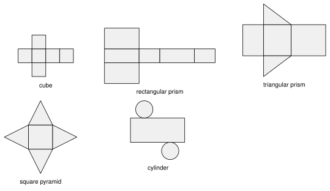
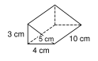
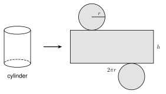
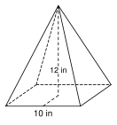
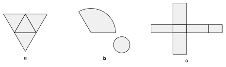
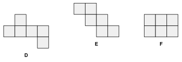

# 8.3 - Surface Area and Nets {.unnumbered}

Lucía wraps a gift box. She cuts wrapping paper that covers every side of the box, and nothing more. Paper that is too small leaves a gap. Paper that is too big is wasted.

The amount of paper is the **surface area** of the box. In this lesson you unfold solids into flat patterns, and you find the surface area of prisms, cylinders, pyramids, cones, and spheres.

:::{.objectives}
- [ ] I can match a net to a solid and tell if a net folds into a cube.
- [ ] I can find the surface area of a prism and a cylinder.
- [ ] I can find the slant height and the surface area of a pyramid and a cone.
- [ ] I can find the surface area of a sphere.
:::

:::{.vocab}
,
,
,

:::

:::{.guided-notes-link}
[Printable Guided Notes for this lesson](/guided_notes/Unit_8/8.3_Surface_Area_and_Nets.html){target="_blank"} (fill-in notes to print and write on)
:::



1. Find the area of a rectangle $9$ in by $4$ in, and of a triangle with base $6$ ft and height $5$ ft.

2. Find the circumference of a circle with radius $3$. Give the exact answer.

3. A right triangle has legs $5$ and $12$. Find the hypotenuse.



### 8.3.1 - Nets

A **net** is a solid cut open and laid flat. Every face shows. If you fold the net, you get the solid back.

{width=620px fig-align="center"}

Surface area is the area of the net. Add the areas of all the pieces.

***

**Example 1:** Does the net fold into a cube?

{width=520px fig-align="center"}

A cube has $6$ faces. All three nets have $6$ squares, but they do not all fold into a cube.

* **A** folds into a cube. Four squares make a band around the cube. One square is the top and one is the bottom.
* **B** does **not** fold into a cube. Four squares make a band. The two extra squares are both on the top side. They land on the same face, and the bottom face is empty.
* **C** folds into a cube. One extra square is the top and the other is the bottom.

:::{.you-try title="A net has two triangles and three rectangles. Which solid does it fold into?"}
A **triangular prism**. The triangles are the two bases. The rectangles are the sides.
:::

***

### 8.3.2 - Prisms

The surface area of a prism has two parts.

* The **lateral area** $L$ is the area of the sides (the rectangles). Unrolled, the sides make one big rectangle with width $P$ (the perimeter of the base) and height $h$. So $L = Ph$.
* The two bases each have area $B$.

:::{.remember title="Surface area of a prism"}
$SA = L + 2B = Ph + 2B$
:::

For a box, you can also add the area of the three different faces and double it.

***

**Example 2:** A box

{width=300px fig-align="center"}

Find the surface area of the box. It is $8$ in long, $5$ in wide, and $3$ in tall.

Three pairs of faces:

* top and bottom: $2(8 \cdot 5) = 80$
* front and back: $2(8 \cdot 3) = 48$
* left and right: $2(5 \cdot 3) = 30$

$$
SA = 80 + 48 + 30 = 158 \text{ square inches}
$$

:::{.you-try title="Find the surface area of a box that is 9 in by 6 in by 4 in."}
$2(9 \cdot 6) + 2(9 \cdot 4) + 2(6 \cdot 4) = 108 + 72 + 48 = 228$ square inches.
:::

***

**Example 3:** A triangular prism

{width=300px fig-align="center"}

The bases are right triangles with sides $3$, $4$, and $5$ cm. The prism is $10$ cm long. Find the surface area.

Base area: $B = \frac{1}{2}(4)(3) = 6$.

Base perimeter: $P = 3 + 4 + 5 = 12$.

Lateral area: $L = Ph = 12 \cdot 10 = 120$.

$$
SA = L + 2B = 120 + 2(6) = 132 \text{ square centimeters}
$$

:::{.you-try title="The bases of a prism are right triangles with sides 5, 12, and 13 cm. The prism is 8 cm long. Find the surface area."}
$B = \frac{1}{2}(12)(5) = 30$. $P = 5 + 12 + 13 = 30$. $L = 30 \cdot 8 = 240$.

$SA = 240 + 2(30) = 300$ square centimeters.
:::

***

### 8.3.3 - Cylinders

Take the label off a can. Lay it flat. It is a rectangle. Its width is the distance around the can, $2\pi r$. Its height is the height of the can, $h$.

{width=560px fig-align="center"}

The lateral area is $2\pi r h$. The two circles each have area $\pi r^2$.

:::{.remember title="Surface area of a cylinder"}
$SA = 2\pi r^2 + 2\pi r h$
:::

***

**Example 4:** A cylinder

{width=170px fig-align="center"}

Find the surface area of a cylinder with $r = 3$ ft and $h = 8$ ft. Give the exact answer and a decimal rounded to the nearest tenth.

$$
SA = 2\pi(3)^2 + 2\pi(3)(8) = 18\pi + 48\pi = 66\pi \approx 207.3 \text{ square feet}
$$

:::{.you-try title="Find the surface area of a cylinder with r = 4 in and h = 11 in. Give the exact answer and a decimal rounded to the nearest tenth."}
$SA = 2\pi(4)^2 + 2\pi(4)(11) = 32\pi + 88\pi = 120\pi \approx 377.0$ square inches.
:::

***

**Example 5:** Paint for a tank

{width=240px fig-align="center"}

A closed water tank has radius $10$ ft and height $12$ ft. One gallon of paint covers $350$ square feet. How many whole gallons does Samir need to paint the whole outside? Round the surface area to the nearest tenth.

$$
SA = 2\pi(10)^2 + 2\pi(10)(12) = 200\pi + 240\pi = 440\pi \approx 1382.3 \text{ square feet}
$$

$$
1382.3 \div 350 \approx 3.95
$$

He needs $4$ gallons. (He cannot buy $0.95$ of a gallon more than he needs, so round **up**.)

:::{.you-try title="A can has radius 4 cm and height 12 cm. The paper label covers only the side. Find the area of the label. Give the exact answer and a decimal rounded to the nearest tenth."}
Label $= 2\pi r h = 2\pi(4)(12) = 96\pi \approx 301.6$ square centimeters.
:::

***

### 8.3.4 - Pyramids, Cones, and Spheres

The **slant height** $\ell$ is measured along a slanted face. In a pyramid, it goes from the middle of a base edge up to the apex. In a cone, it goes from the edge of the base up to the apex.

The slant height, the height, and half of the base make a right triangle. Use the Pythagorean theorem to find any missing side.

:::{.remember title="Surface area of a pyramid, a cone, and a sphere"}
Regular pyramid: $SA = B + \frac{1}{2}P\ell$

Cone: $SA = \pi r^2 + \pi r \ell$

Sphere: $SA = 4\pi r^2$
:::

The triangle faces of a regular pyramid each have base (one edge) and height $\ell$. All the faces together have area $\frac{1}{2}P\ell$.

***

**Example 6:** A square pyramid with the slant height given

{width=280px fig-align="center"}

The base is a square with side $6$ ft. The slant height is $5$ ft. Find the surface area.

$B = 6 \cdot 6 = 36$. $P = 4 \cdot 6 = 24$.

$$
SA = B + \tfrac{1}{2}P\ell = 36 + \tfrac{1}{2}(24)(5) = 36 + 60 = 96 \text{ square feet}
$$

:::{.you-try title="A square pyramid has base side 10 ft and slant height 8 ft. Find the surface area."}
$B = 100$. $P = 40$. $SA = 100 + \frac{1}{2}(40)(8) = 100 + 160 = 260$ square feet.
:::

***

**Example 7:** A square pyramid with the height given

{width=300px fig-align="center"}

The base is a square with side $10$ in. The height is $12$ in. Find the surface area.

First find the slant height. Half the base is $5$. The right triangle has legs $5$ and $12$:

$$
\ell^2 = 5^2 + 12^2 = 169, \quad \ell = 13
$$

$B = 100$ and $P = 40$.

$$
SA = 100 + \tfrac{1}{2}(40)(13) = 100 + 260 = 360 \text{ square inches}
$$

:::{.you-try title="A square pyramid has base side 12 in and height 8 in. Find the surface area."}
Half the base is $6$. $\ell^2 = 6^2 + 8^2 = 100$, so $\ell = 10$.

$SA = 144 + \frac{1}{2}(48)(10) = 144 + 240 = 384$ square inches.
:::

***

**Example 8:** A cone

{width=300px fig-align="center"}

A cone has radius $4$ in and height $3$ in. Find the surface area. Give the exact answer and a decimal rounded to the nearest tenth.

Find the slant height: $\ell^2 = 4^2 + 3^2 = 25$, so $\ell = 5$.

$$
SA = \pi r^2 + \pi r \ell = \pi(4)^2 + \pi(4)(5) = 16\pi + 20\pi = 36\pi \approx 113.1 \text{ square inches}
$$

:::{.you-try title="Find the surface area of a cone with r = 9 cm and h = 12 cm. Give the exact answer and a decimal rounded to the nearest tenth."}
$\ell^2 = 81 + 144 = 225$, so $\ell = 15$.

$SA = \pi(81) + \pi(9)(15) = 81\pi + 135\pi = 216\pi \approx 678.6$ square centimeters.
:::

***

**Example 9:** Find the mistake

Kofi finds the surface area of the cone in Example 8. He writes $SA = \pi(4)^2 + \pi(4)(3) = 28\pi$. What is his mistake?

He used the height $3$ in the formula. The formula needs the **slant height** $\ell = 5$. The correct answer is $36\pi$.

***

**Example 10:** A sphere

A basketball has radius $12$ cm. Find the area of its surface. Give the exact answer and a decimal rounded to the nearest tenth.

$$
SA = 4\pi r^2 = 4\pi(12)^2 = 576\pi \approx 1809.6 \text{ square centimeters}
$$

:::{.you-try title="A soccer ball has radius 11 cm. Find its surface area. Give the exact answer and a decimal rounded to the nearest tenth."}
$SA = 4\pi(11)^2 = 484\pi \approx 1520.5$ square centimeters.
:::

:::{.note title="Why 4 pi r squared?"}
Peel an orange. Press the peel flat. It covers about $4$ circles that have the same radius as the orange. One circle has area $\pi r^2$, so the peel has area $4\pi r^2$.
:::



**Nets.**

{width=520px fig-align="center"}

1. Name the solid that each net folds into: **a**, **b**, and **c**.

{width=520px fig-align="center"}

2. Which of the nets D, E, and F fold into a cube? Explain what is wrong with the other one.

3. A net is two circles and one rectangle. The circles have radius $3$ in. How long is the rectangle? Give the exact answer and a decimal rounded to the nearest tenth.

***

**Prisms.**

4. Find the surface area of a box that is $10$ cm by $6$ cm by $4$ cm.

5. Find the surface area of a cube with edge $7.5$ in.

6. The bases of a prism are right triangles with sides $6$, $8$, and $10$ ft. The prism is $15$ ft long. Find the surface area.

7. A rectangular prism has a base $12$ in by $5$ in and a height of $9$ in. Find the lateral area.

8. Lucía wraps a gift box that is $14$ in by $10$ in by $6$ in. She buys $10\%$ more paper than the surface area, to allow for overlap. How much paper does she buy? Round to the nearest square inch.

9. A box has a base $6$ ft by $4$ ft and a surface area of $148$ square feet. Find its height.

10. Find the mistake. Moses says the surface area of a box $5$ ft by $3$ ft by $2$ ft is $5 \cdot 3 \cdot 2 = 30$ square feet. What did he find, and what is the correct surface area?

***

**Cylinders.**

11. Find the surface area of a cylinder with $r = 5$ in and $h = 9$ in. Give the exact answer and a decimal rounded to the nearest tenth.

12. A soup can has radius $3.4$ cm and height $10$ cm. Find the area of its label (the side only). Give the exact answer and a decimal rounded to the nearest tenth.

13. A closed tank has radius $6$ ft and height $15$ ft. One gallon of paint covers $300$ square feet. How many whole gallons are needed to paint the whole outside?

14. A cylinder with radius $4$ m has a surface area of $96\pi$ square meters. Find its height.

***

**Pyramids, cones, and spheres.**

15. A square pyramid has base side $8$ in and slant height $7$ in. Find the surface area.

16. A square pyramid has base side $16$ cm and height $15$ cm. Find the slant height and the surface area.

17. A cone has radius $3$ ft and slant height $7$ ft. Find the surface area. Give the exact answer and a decimal rounded to the nearest tenth.

18. A cone has radius $8$ cm and height $15$ cm. Find the surface area. Give the exact answer and a decimal rounded to the nearest tenth.

19. The triangle with vertices $(0, 0)$, $(6, 0)$, and $(0, 8)$ spins around the $y$-axis. Find the surface area of the cone. Give the exact answer and a decimal rounded to the nearest tenth.

20. Find the mistake. Ana says a cone with $r = 5$ and $h = 12$ has $SA = \pi(5)^2 + \pi(5)(12) = 85\pi$. Find the correct surface area.

21. A tent is a cone with no floor. The radius is $7$ ft and the height is $24$ ft. How much fabric does it use? Give the exact answer and a decimal rounded to the nearest tenth.

22. A sphere has radius $9$ in. Find its surface area. Give the exact answer and a decimal rounded to the nearest tenth.

23. A sphere has surface area $100\pi$ square centimeters. Find its radius.

24. A dome is half a sphere with radius $12$ ft. It has no floor. Find the area of the curved surface. Give the exact answer and a decimal rounded to the nearest tenth.

***

**Test practice**

25. A cylinder has radius $5$ in and height $10$ in. What is its surface area, rounded to the nearest tenth?

    A. 314.2 square inches\
    B. 471.2 square inches\
    C. 785.4 square inches\
    D. 942.5 square inches

26. A cube has a surface area of $150$ square inches. What is the length of one edge?

    A. 5 in\
    B. 6.5 in\
    C. 25 in\
    D. 50 in

***

**Challenge**

27. A box is $2$ by $3$ by $4$. Find its surface area. Then double every length and find the new surface area. How many times larger is it?

28. The side of a cone unrolls into part of a circle with radius $\ell$ and arc length $2\pi r$. A cone has $r = 3$ and $\ell = 9$. What fraction of a full circle with radius $9$ is the unrolled side? What is the angle of that piece?
