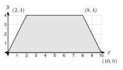

# 8.4 - Volume of Prisms and Cylinders {.unnumbered}

A truck pulls up to a house. It brings concrete for a new patio. The driver asks one question: "How many cubic yards do you need?" If the order is too small, the patio is not finished. If it is too big, money is wasted.

The answer is a **volume**. In this lesson you find the volume of prisms and cylinders. You also change units, so you can order concrete in cubic yards or fill a pool with gallons of water.

:::{.objectives}
- [ ] I can find the volume of a prism with $V = Bh$.
- [ ] I can find the volume of a cylinder with $V = \pi r^2 h$.
- [ ] I can find the volume of a slanted (oblique) prism or cylinder.
- [ ] I can change cubic units and solve real volume problems.
:::

:::{.vocab}
,
,
,

:::

:::{.guided-notes-link}
[Printable Guided Notes for this lesson](/guided_notes/Unit_8/8.4_Volume_of_Prisms_and_Cylinders.html){target="_blank"} (fill-in notes to print and write on)
:::



1. Find the area of a circle with radius $3$. Give the exact answer.

2. Find the area of a trapezoid with parallel sides $6$ and $10$ and height $4$.

3. Solve $x^2 + 5x - 14 = 0$.



### 8.4.1 - Volume of a Prism

**Volume** is the amount of space inside a solid. We count **cubic units**. One cubic unit is a cube with edges of $1$ unit.

{width=360px fig-align="center"}

This box is $4$ units long, $3$ units wide, and $2$ units tall. Each layer has $4 \cdot 3 = 12$ cubes. There are $2$ layers. So the box holds $12 \cdot 2 = 24$ cubes.

The $12$ is the area of the base. The $2$ is the height. This works for every prism, not only boxes.

:::{.remember title="Volume of a prism"}
$V = Bh$, where $B$ is the area of the base and $h$ is the height of the prism.
:::

***

**Example 1:** A box

{width=280px fig-align="center"}

Find the volume of a box that is $6$ ft long, $4$ ft wide, and $3$ ft tall.

$B = 6 \cdot 4 = 24$ square feet.

$$
V = Bh = 24 \cdot 3 = 72 \text{ cubic feet}
$$

:::{.you-try title="Find the volume of a box that is 7 m long, 5 m wide, and 2 m tall."}
$B = 7 \cdot 5 = 35$. $V = 35 \cdot 2 = 70$ cubic meters.
:::

***

**Example 2:** A triangular prism

{width=280px fig-align="center"}

The base is a right triangle with legs $6$ in and $4$ in. The prism is $9$ in long. Find the volume.

The base is the triangle. $B = \frac{1}{2}(6)(4) = 12$ square inches. The height of the prism is the length, $9$ in.

$$
V = Bh = 12 \cdot 9 = 108 \text{ cubic inches}
$$

:::{.you-try title="The base of a prism is a right triangle with legs 5 ft and 12 ft. The prism is 6 ft long. Find the volume."}
$B = \frac{1}{2}(5)(12) = 30$. $V = 30 \cdot 6 = 180$ cubic feet.
:::

***

**Example 3:** A base on the coordinate plane

{width=420px fig-align="center"}

The base of a prism is the trapezoid with vertices $(0, 0)$, $(10, 0)$, $(8, 4)$, and $(2, 4)$. Each unit is $1$ foot. The prism is $6$ ft tall. Find the volume.

The parallel sides are horizontal. The bottom is $10 - 0 = 10$ ft. The top is $8 - 2 = 6$ ft. The height of the trapezoid is $4$ ft.

$$
B = \tfrac{1}{2}(10 + 6)(4) = 32 \text{ square feet}
$$

$$
V = Bh = 32 \cdot 6 = 192 \text{ cubic feet}
$$

:::{.you-try title="The base of a prism is the triangle with vertices (0, 0), (8, 0), and (0, 5). Each unit is 1 foot. The prism is 10 ft tall. Find the volume."}
$B = \frac{1}{2}(8)(5) = 20$. $V = 20 \cdot 10 = 200$ cubic feet.
:::

***

### 8.4.2 - Volume of a Cylinder

A cylinder is like a prism with a round base. The base is a circle, so $B = \pi r^2$.

:::{.remember title="Volume of a cylinder"}
$V = \pi r^2 h$
:::

***

**Example 4:** A cylinder

{width=170px fig-align="center"}

Find the volume of a cylinder with $r = 3$ cm and $h = 10$ cm. Give the exact answer and a decimal rounded to the nearest tenth.

$$
V = \pi(3)^2(10) = 90\pi \approx 282.7 \text{ cubic centimeters}
$$

:::{.you-try title="A cylinder has diameter 10 in and height 4 in. Find the volume. Give the exact answer and a decimal rounded to the nearest tenth."}
The radius is half the diameter, $r = 5$. $V = \pi(5)^2(4) = 100\pi \approx 314.2$ cubic inches.
:::

***

### 8.4.3 - Slanted Solids (Cavalieri's Principle)

Make a stack of coins. Push the stack so it leans. You used the same coins, so the volume is the same. The height of the stack did not change.

{width=520px fig-align="center"}

This idea is **Cavalieri's principle**. If two solids have the same height and the same cross-section area at every level, they have the same volume. A leaning prism or cylinder is **oblique**.

:::{.gotcha title="Use the straight-up height"}
For an oblique solid, the height is the straight-up distance between the bases, at a right angle to them. It is **not** the slanted side. Look for the dashed line with the square mark.
:::

***

**Example 5:** An oblique cylinder

{width=220px fig-align="center"}

The base has radius $4$ ft. The slanted side is $13$ ft. The straight-up height is $12$ ft. Find the volume. Give the exact answer and a decimal rounded to the nearest tenth.

The slanted side ($13$) is not used.

$$
V = \pi r^2 h = \pi(4)^2(12) = 192\pi \approx 603.2 \text{ cubic feet}
$$

:::{.you-try title="An oblique prism has a rectangular base 6 ft by 5 ft. The slanted edge is 12 ft. The straight-up height is 9 ft. Find the volume."}
$B = 6 \cdot 5 = 30$. $V = 30 \cdot 9 = 270$ cubic feet. The $12$ ft edge is not used.
:::

***

### 8.4.4 - Changing Units

Volume units are cubes, so conversion numbers are cubed.

| Fact | Why |
|:---|:---|
| $1 \text{ yd}^3 = 27 \text{ ft}^3$ | $3 \cdot 3 \cdot 3 = 27$ |
| $1 \text{ ft}^3 = 1728 \text{ in}^3$ | $12 \cdot 12 \cdot 12 = 1728$ |
| $1 \text{ ft}^3 \approx 7.48$ gallons | measured |

:::{.gotcha title="Make the units match first"}
Change every length to the same unit **before** you multiply. A slab that is $4$ inches thick is $\frac{1}{3}$ foot thick.
:::

***

**Example 6:** Concrete

Moses is pouring a patio. It is $12$ ft by $20$ ft and $4$ in thick. How many cubic yards of concrete does he need? Round to the nearest tenth.

$4$ in $= \frac{1}{3}$ ft.

$$
V = 12 \cdot 20 \cdot \tfrac{1}{3} = 80 \text{ cubic feet}
$$

$$
80 \div 27 \approx 3.0 \text{ cubic yards}
$$

:::{.you-try title="A patio is 10 ft by 15 ft and 4 in thick. How many cubic yards of concrete are needed? Round to the nearest tenth."}
$V = 10 \cdot 15 \cdot \frac{1}{3} = 50$ cubic feet. $50 \div 27 \approx 1.9$ cubic yards.
:::

***

**Example 7:** Water in a pool

A round pool has a diameter of $24$ ft. The water is $4$ ft deep. How many gallons does it hold? Use $1 \text{ ft}^3 \approx 7.48$ gallons. Round to the nearest hundred gallons.

$r = 12$ ft.

$$
V = \pi(12)^2(4) = 576\pi \approx 1809.6 \text{ cubic feet}
$$

$$
1809.6 \cdot 7.48 \approx 13{,}535 \text{ gallons} \approx 13{,}500 \text{ gallons}
$$

:::{.you-try title="A round tub has radius 3 ft. The water is 2 ft deep. How many gallons does it hold? Round to the nearest gallon."}
$V = \pi(3)^2(2) = 18\pi \approx 56.5$ cubic feet. $56.5 \cdot 7.48 \approx 423$ gallons.
:::

***

### 8.4.5 - Finding a Missing Dimension

When you know the volume, write $V = Bh$ with the numbers you know. Then solve.

**Example 8:** The height of a tank

A tank is a cylinder with radius $4$ ft. It holds $5000$ gallons. How tall is it? Round to the nearest tenth.

First change gallons to cubic feet: $5000 \div 7.48 \approx 668.4$ cubic feet.

$$
\pi(4)^2 h = 668.4
$$

$$
h = \frac{668.4}{16\pi} \approx 13.3 \text{ feet}
$$

:::{.you-try title="A cylinder tank has radius 3 ft. It holds 2000 gallons. How tall is it? Round to the nearest tenth."}
$2000 \div 7.48 \approx 267.4$ cubic feet. $h = \frac{267.4}{9\pi} \approx 9.5$ feet.
:::

***

**Example 9:** Volume with algebra

A box has length $x + 3$, width $x$, and height $4$. The volume is $160$ cubic units. Find $x$.

$$
4x(x + 3) = 160
$$

$$
x^2 + 3x = 40
$$

$$
x^2 + 3x - 40 = 0
$$

$$
(x + 8)(x - 5) = 0
$$

$x = -8$ or $x = 5$. A length cannot be negative, so $x = 5$. The box is $8$ by $5$ by $4$. Check: $8 \cdot 5 \cdot 4 = 160$.

:::{.you-try title="A box has length x + 2, width x, and height 3. The volume is 105 cubic units. Find x."}
$3x(x + 2) = 105$, so $x^2 + 2x - 35 = 0$, so $(x + 7)(x - 5) = 0$. Length must be positive, so $x = 5$.
:::



**Volume of prisms. Give each volume with units.**

1. A box is $9$ cm by $5$ cm by $4$ cm.

2. A cube has edge $6.5$ m. Round to the nearest tenth.

3. The base of a prism is a right triangle with legs $7$ in and $24$ in. The prism is $10$ in long.

4. The base of a prism is a trapezoid with parallel sides $6$ ft and $10$ ft. The trapezoid is $5$ ft tall. The prism is $12$ ft long.

5. The base of a prism is the triangle with vertices $(0, 0)$, $(6, 0)$, and $(2, 5)$. Each unit is $1$ ft. The prism is $10$ ft tall.

6. The base of a prism is a regular hexagon with side $4$ cm. The prism is $10$ cm tall. Give the exact answer and a decimal rounded to the nearest tenth.

7. A box has a base $9$ ft by $5$ ft and a volume of $180$ cubic feet. Find its height.

8. A box has length $x + 1$, width $x$, and height $6$. The volume is $336$ cubic units. Find $x$.

***

**Volume of cylinders. Give the exact answer and a decimal rounded to the nearest tenth.**

9. $r = 6$ ft and $h = 5$ ft.

10. The diameter is $14$ cm and the height is $20$ cm.

11. A cylinder with radius $5$ in has volume $250\pi$ cubic inches. Find its height.

12. A cylinder with height $6$ m has volume $96\pi$ cubic meters. Find its radius.

13. Find the mistake. Esperanza finds the volume of a cylinder with diameter $10$ cm and height $4$ cm. She writes $V = \pi(10)^2(4) = 400\pi$. What is the correct volume?

{width=240px fig-align="center"}

14. Six cans fit in a box, as in the top view. Each can has diameter $4$ in and height $6$ in. The box is $12$ in by $8$ in by $6$ in. What percent of the box do the cans fill? Round to the nearest tenth of a percent.

***

**Slanted solids.**

15. An oblique cylinder has radius $3$ in, a slanted side of $10$ in, and a straight-up height of $8$ in. Find the volume. Give the exact answer and a decimal rounded to the nearest tenth.

16. An oblique prism has a rectangular base $6$ m by $5$ m. The slanted edge is $12$ m. The straight-up height is $9$ m. Find the volume.

***

**Real problems.**

17. A slab is $15$ ft by $10$ ft and $6$ in thick. How many cubic yards of concrete? Round to the nearest tenth.

18. A driveway is $24$ ft by $10$ ft and $5$ in thick. How many cubic yards of concrete? Round to the nearest tenth.

19. A raised garden bed is $8$ ft by $4$ ft and filled $1.5$ ft deep with soil. A bag of soil holds $2$ cubic feet. How many bags are needed?

20. An aquarium is $48$ in long, $18$ in wide, and $24$ in tall. How many gallons does it hold when it is full? Use $1 \text{ ft}^3 \approx 7.48$ gallons. Round to the nearest gallon.

21. A round pool has diameter $15$ ft and water $3.5$ ft deep. How many gallons does it hold? Use $1 \text{ ft}^3 \approx 7.48$ gallons. Round to the nearest hundred.

{width=360px fig-align="center"}

22. This is the side view of a pool. The pool is $15$ ft wide. Find the area of the side view, then the volume, then the gallons. Round the gallons to the nearest hundred.

23. A cylinder tank has radius $5$ ft and holds $4000$ gallons. How tall is it? Round to the nearest tenth.

***

**Test practice**

24. A water tank is a cylinder with diameter $12$ ft and height $10$ ft. About how many gallons does it hold when it is full? (One cubic foot holds about $7.48$ gallons.)

    A. 2,100 gallons\
    B. 8,500 gallons\
    C. 33,800 gallons\
    D. 34,000 gallons

25. A concrete slab is $20$ ft long, $9$ ft wide, and $6$ in thick. How many cubic yards of concrete are needed, to the nearest tenth?

    A. 3.3\
    B. 6.7\
    C. 40.0\
    D. 90.0

***

**Challenge**

26. A cylinder has radius $r$ and height $h$. How many times larger is the volume when the radius is doubled and the height stays the same? When both are doubled?

27. A metal pipe is a cylinder with a smaller cylinder cut out of it. The outer radius is $3$ cm, the inner radius is $2$ cm, and the pipe is $10$ cm long. Find the volume of metal. Give the exact answer and a decimal rounded to the nearest tenth.
