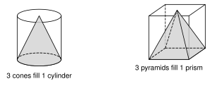
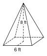
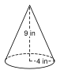
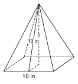
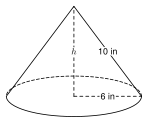
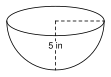
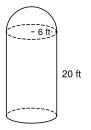
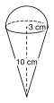
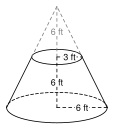

# 8.5 - Volume of Pyramids, Cones, and Spheres {.unnumbered}

A truck dumps a pile of sand. The pile has the shape of a cone. How much sand is in it? A farm has a grain silo with a round dome on top. How much grain can it hold?

These solids come to a point or curve all around. They need new formulas. In this lesson you find the volume of pyramids, cones, spheres, and solids made from them.

:::{.objectives}
- [ ] I can find the volume of a pyramid and a cone.
- [ ] I can use the Pythagorean theorem to find the height first.
- [ ] I can find the volume of a sphere and a hemisphere.
- [ ] I can find the volume of a composite solid and use volume in real problems.
:::

:::{.vocab}
,
,
,
,
,

:::

:::{.guided-notes-link}
[Printable Guided Notes for this lesson](/guided_notes/Unit_8/8.5_Volume_of_Pyramids_Cones_and_Spheres.html){target="_blank"} (fill-in notes to print and write on)
:::



1. Find the volume of a cylinder with radius $3$ and height $5$. Give the exact answer.

2. A right triangle has one leg $5$ and hypotenuse $13$. Find the other leg.

3. Solve $\frac{4}{3}x = 36$.



### 8.5.1 - Pyramids and Cones

Take a pyramid and a prism with the same base and the same height. Fill the pyramid with water and pour it into the prism. You need to pour **three** times to fill the prism. The same is true for a cone and a cylinder.

{width=520px fig-align="center"}

So a pyramid or cone holds one third as much as the prism or cylinder with the same base and height.

:::{.remember title="Volume of a pyramid and a cone"}
Pyramid: $V = \dfrac{1}{3}Bh$

Cone: $V = \dfrac{1}{3}\pi r^2 h$

$B$ is the area of the base. $h$ is the straight-up height, not the slant height.
:::

***

**Example 1:** A square pyramid

{width=260px fig-align="center"}

The base is a square with side $6$ ft. The height is $8$ ft. Find the volume.

$B = 6 \cdot 6 = 36$ square feet.

$$
V = \tfrac{1}{3}Bh = \tfrac{1}{3}(36)(8) = 96 \text{ cubic feet}
$$

:::{.you-try title="A pyramid has a rectangular base 5 ft by 8 ft and a height of 6 ft. Find the volume."}
$B = 5 \cdot 8 = 40$. $V = \frac{1}{3}(40)(6) = 80$ cubic feet.
:::

***

**Example 2:** A cone

{width=230px fig-align="center"}

A cone has radius $4$ in and height $9$ in. Find the volume. Give the exact answer and a decimal rounded to the nearest tenth.

$$
V = \tfrac{1}{3}\pi(4)^2(9) = \tfrac{1}{3}\pi(16)(9) = 48\pi \approx 150.8 \text{ cubic inches}
$$

:::{.you-try title="A cone has radius 3 cm and height 7 cm. Find the volume. Give the exact answer and a decimal rounded to the nearest tenth."}
$V = \frac{1}{3}\pi(9)(7) = 21\pi \approx 66.0$ cubic centimeters.
:::

***

### 8.5.2 - Finding the Height First

Often a problem gives the slant height, not the height. The height, half of the base (or the radius), and the slant height make a right triangle. Use the Pythagorean theorem to find the height. Then use the volume formula.

**Example 3:** A pyramid with the slant height given

{width=300px fig-align="center"}

A square pyramid has base side $10$ in and slant height $13$ in. Find the volume.

Half of the base is $5$. The right triangle has leg $5$, leg $h$, and hypotenuse $13$:

$$
h^2 + 5^2 = 13^2
$$

$$
h^2 = 169 - 25 = 144, \quad h = 12
$$

$$
V = \tfrac{1}{3}(10 \cdot 10)(12) = 400 \text{ cubic inches}
$$

:::{.you-try title="A square pyramid has base side 18 cm and slant height 15 cm. Find the volume."}
Half of the base is $9$. $h^2 = 15^2 - 9^2 = 144$, so $h = 12$.

$V = \frac{1}{3}(18 \cdot 18)(12) = 1296$ cubic centimeters.
:::

***

**Example 4:** A cone with the slant height given

{width=300px fig-align="center"}

A cone has radius $6$ in and slant height $10$ in. Find the volume. Give the exact answer and a decimal rounded to the nearest tenth.

$$
h^2 + 6^2 = 10^2, \quad h^2 = 64, \quad h = 8
$$

$$
V = \tfrac{1}{3}\pi(6)^2(8) = 96\pi \approx 301.6 \text{ cubic inches}
$$

:::{.you-try title="A cone has radius 9 ft and slant height 15 ft. Find the volume. Give the exact answer and a decimal rounded to the nearest tenth."}
$h^2 = 15^2 - 9^2 = 144$, so $h = 12$. $V = \frac{1}{3}\pi(81)(12) = 324\pi \approx 1017.9$ cubic feet.
:::

***

### 8.5.3 - Spheres and Hemispheres

:::{.remember title="Volume of a sphere and a hemisphere"}
Sphere: $V = \dfrac{4}{3}\pi r^3$

Hemisphere (half a sphere): $V = \dfrac{2}{3}\pi r^3$
:::

The radius is **cubed**, not squared. Cube the radius first, then multiply.

:::{.note title="Why two thirds?"}
Take a cylinder with radius $r$ and height $r$. Cut out a cone with the same radius and height. What is left has the same cross-section area at every level as a hemisphere (Cavalieri's principle). So the hemisphere has volume $\pi r^3 - \frac{1}{3}\pi r^3 = \frac{2}{3}\pi r^3$.
:::

***

**Example 5:** A sphere

Find the volume of a sphere with radius $6$ cm. Give the exact answer and a decimal rounded to the nearest tenth.

$$
V = \tfrac{4}{3}\pi(6)^3 = \tfrac{4}{3}\pi(216) = 288\pi \approx 904.8 \text{ cubic centimeters}
$$

:::{.you-try title="Find the volume of a sphere with radius 9 in. Give the exact answer and a decimal rounded to the nearest tenth."}
$V = \frac{4}{3}\pi(729) = 972\pi \approx 3053.6$ cubic inches.
:::

***

**Example 6:** A hemisphere

{width=260px fig-align="center"}

A bowl is a hemisphere with radius $5$ in. How much water does it hold when full? Give the exact answer and a decimal rounded to the nearest tenth.

$$
V = \tfrac{2}{3}\pi(5)^3 = \tfrac{250}{3}\pi \approx 261.8 \text{ cubic inches}
$$

:::{.you-try title="A dome is a hemisphere with radius 12 ft. Find its volume. Give the exact answer and a decimal rounded to the nearest tenth."}
$V = \frac{2}{3}\pi(1728) = 1152\pi \approx 3619.1$ cubic feet.
:::

***

**Example 7:** Find the radius

A sphere has volume $36\pi$ cubic inches. Find its radius.

$$
\tfrac{4}{3}\pi r^3 = 36\pi
$$

Divide both sides by $\pi$, then multiply by $\frac{3}{4}$:

$$
r^3 = 36 \cdot \tfrac{3}{4} = 27
$$

$$
r = 3 \text{ inches}
$$

:::{.you-try title="A sphere has volume 500π/3 cubic centimeters. Find its radius."}
$\frac{4}{3}r^3 = \frac{500}{3}$, so $4r^3 = 500$, so $r^3 = 125$ and $r = 5$ cm.
:::

***

### 8.5.4 - Composite Solids

Break the solid into pieces you know. Find each volume. Then add the pieces (or subtract a piece that was removed).

**Example 8:** A silo

{width=180px fig-align="center"}

A grain silo is a cylinder with a hemisphere on top. The cylinder has radius $6$ ft and height $20$ ft. Find the volume. Give the exact answer and a decimal rounded to the nearest tenth.

Cylinder: $\pi(6)^2(20) = 720\pi$.

Hemisphere: $\frac{2}{3}\pi(6)^3 = 144\pi$.

$$
V = 720\pi + 144\pi = 864\pi \approx 2714.3 \text{ cubic feet}
$$

:::{.you-try title="A capsule is a cylinder with radius 2 cm and height 6 cm, with a hemisphere on each end. Find the volume. Give the exact answer and a decimal rounded to the nearest tenth."}
Cylinder: $\pi(4)(6) = 24\pi$. Two hemispheres make one sphere: $\frac{4}{3}\pi(8) = \frac{32}{3}\pi$.

$V = 24\pi + \frac{32}{3}\pi = \frac{104}{3}\pi \approx 108.9$ cubic centimeters.
:::

***

**Example 9:** An ice cream cone

{width=170px fig-align="center"}

The cone has radius $3$ cm and height $10$ cm. A scoop shaped like a hemisphere with radius $3$ cm sits on top. Find the total volume. Give the exact answer and a decimal rounded to the nearest tenth.

Cone: $\frac{1}{3}\pi(9)(10) = 30\pi$.

Hemisphere: $\frac{2}{3}\pi(27) = 18\pi$.

$$
V = 30\pi + 18\pi = 48\pi \approx 150.8 \text{ cubic centimeters}
$$

:::{.you-try title="A cone has radius 2 cm and height 8 cm. A hemisphere with radius 2 cm sits on top. Find the volume. Give the exact answer and a decimal rounded to the nearest tenth."}
Cone: $\frac{1}{3}\pi(4)(8) = \frac{32}{3}\pi$. Hemisphere: $\frac{2}{3}\pi(8) = \frac{16}{3}\pi$. Total: $16\pi \approx 50.3$ cubic centimeters.
:::

***

**Example 10:** A frustum

{width=240px fig-align="center"}

A funnel is a cone with the tip cut off. The whole cone has radius $6$ ft and height $12$ ft. The tip that was cut off has radius $3$ ft and height $6$ ft. Find the volume of the funnel. Give the exact answer and a decimal rounded to the nearest tenth.

Whole cone: $\frac{1}{3}\pi(36)(12) = 144\pi$.

Tip: $\frac{1}{3}\pi(9)(6) = 18\pi$.

$$
V = 144\pi - 18\pi = 126\pi \approx 395.8 \text{ cubic feet}
$$

:::{.you-try title="Find the mistake. Ana says a cone with radius 3 and height 5 has volume π(3)²(5) = 45π. What is the correct volume?"}
She forgot the $\frac{1}{3}$. $V = \frac{1}{3}\pi(9)(5) = 15\pi \approx 47.1$.
:::

***

### 8.5.5 - Real Problems

**Example 11:** A pile of sand

A pile of sand is a cone. The diameter is $12$ ft and the height is $5$ ft. How many cubic yards of sand is it? Round to the nearest tenth.

$r = 6$ ft.

$$
V = \tfrac{1}{3}\pi(6)^2(5) = 60\pi \approx 188.5 \text{ cubic feet}
$$

$$
188.5 \div 27 \approx 7.0 \text{ cubic yards}
$$

:::{.you-try title="A pile of salt is a cone with radius 8 ft and height 6 ft. How many cubic yards is it? Round to the nearest tenth."}
$V = \frac{1}{3}\pi(64)(6) = 128\pi \approx 402.1$ cubic feet. $402.1 \div 27 \approx 14.9$ cubic yards.
:::



**Pyramids and cones. Give each volume with units.**

1. A square pyramid has base side $9$ in and height $10$ in.

2. A pyramid has a rectangular base $7$ m by $6$ m and a height of $9$ m.

3. The base of a pyramid is a right triangle with legs $6$ ft and $8$ ft. The height is $10$ ft.

4. A cone has radius $5$ cm and height $9$ cm. Give the exact answer and a decimal rounded to the nearest tenth.

5. A cone has diameter $14$ in and height $15$ in. Give the exact answer and a decimal rounded to the nearest tenth.

6. Find the mistake. Kofi says a pyramid with a $6$ by $6$ base and height $5$ has volume $36 \cdot 5 = 180$. What is the correct volume?

7. A cone has volume $96\pi$ cubic feet and radius $6$ ft. Find its height.

8. A square pyramid has base side $6$ cm and volume $84$ cubic centimeters. Find its height.

***

**Find the height first.**

9. A square pyramid has base side $24$ ft and slant height $13$ ft. Find the volume.

10. A square pyramid has base side $14$ cm and slant height $25$ cm. Find the volume.

11. A cone has radius $8$ in and slant height $17$ in. Find the volume. Give the exact answer and a decimal rounded to the nearest tenth.

12. The triangle with vertices $(0, 0)$, $(5, 0)$, and $(0, 12)$ spins around the $y$-axis. Find the volume of the cone. Give the exact answer and a decimal rounded to the nearest tenth.

***

**Spheres and hemispheres. Give the exact answer and a decimal rounded to the nearest tenth.**

13. A sphere has radius $3$ ft.

14. A sphere has diameter $20$ cm.

15. A hemisphere has radius $6$ in.

16. A sphere has volume $\frac{32}{3}\pi$ cubic meters. Find its radius.

17. A basketball has radius $12$ cm. Find the volume of air inside, ignoring the thickness of the ball.

***

**Composite solids. Give the exact answer and a decimal rounded to the nearest tenth when there is a $\pi$.**

18. A silo is a cylinder with radius $5$ ft and height $12$ ft, with a hemisphere on top.

19. An ice cream cone has radius $4$ cm and height $6$ cm. A scoop shaped like a hemisphere with radius $4$ cm sits on top. Find the total volume.

20. A cone with radius $10$ cm and height $15$ cm has its top cut off. The tip that was removed has radius $4$ cm and height $6$ cm. Find the volume that is left.

21. A cube has edge $6$ in. A square pyramid with height $4$ in sits on top with the same base. Find the total volume.

22. A cylinder has radius $4$ m and height $9$ m. A cone with the same radius and height is cut out of it. Find the volume that is left.

***

**Real problems.**

23. A pile of sand is a cone with diameter $10$ ft and height $4$ ft. How many cubic yards is it? Round to the nearest tenth.

24. A pile of road salt is a cone with radius $7$ ft and height $5$ ft. A truck carries $4$ cubic yards. How many truck loads are needed to move the pile?

25. A coffee filter is a cone with radius $5$ cm and height $12$ cm. How many milliliters of water does it hold when full? ($1 \text{ cm}^3 = 1 \text{ mL}$.) Round to the nearest milliliter.

26. A beach ball has radius $30$ cm. How many liters of air does it hold? ($1000 \text{ cm}^3 = 1$ liter.) Round to the nearest tenth.

***

**Test practice**

27. A cone has radius $12$ in and slant height $13$ in. What is its volume, rounded to the nearest tenth?

    A. 754.0 cubic inches\
    B. 1,960.4 cubic inches\
    C. 2,261.9 cubic inches\
    D. 5,880.0 cubic inches

28. A prism and a pyramid have the same base and the same height. The volume of the prism is $90$ cubic feet. What is the volume of the pyramid?

    A. 30 cubic feet\
    B. 45 cubic feet\
    C. 60 cubic feet\
    D. 270 cubic feet

***

**Challenge**

29. A cylinder has radius $r$ and height $r$. A cone with the same radius and height is cut out. Write the volume that is left as a multiple of $\pi r^3$. What solid has the same volume?

30. A sphere has radius $3$. Another sphere has radius $6$. How many times larger is the volume of the larger sphere? Check by finding both volumes.
