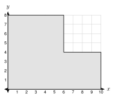
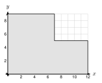

# 8.6 - Density and Modeling {.unnumbered}

Moses pours a concrete patio. The truck brings the concrete, but a bigger question is the weight. A cubic foot of concrete is heavy. Will the ground hold it? Will the truck's load limit allow it?

Volume alone does not answer these questions. You also need **density**, which tells how heavy a material is for its size. In this lesson you use density to find weight, population density to compare places, scale factors to compare models with real things, and you plan real jobs.

:::{.objectives}
- [ ] I can use density to find mass or weight, and decide if an object floats.
- [ ] I can find and compare population densities.
- [ ] I can explain how scale factor $k$ changes length, area, and volume.
- [ ] I can plan a job with area, volume, density, and unit conversions.
:::

:::{.vocab}
,
,
,

:::

:::{.guided-notes-link}
[Printable Guided Notes for this lesson](/guided_notes/Unit_8/8.6_Density_and_Modeling.html){target="_blank"} (fill-in notes to print and write on)
:::



1. Find the volume of a box $4$ ft by $2$ ft by $2$ ft.

2. A rectangle is $12$ ft by $20$ ft. Find its area.

3. Two similar triangles have scale factor $3$. A side of the small triangle is $5$. What is the matching side of the large triangle?



### 8.6.1 - Density and Weight

**Density** compares mass (or weight) to volume:

$$
\text{density} = \frac{\text{mass}}{\text{volume}}
$$

Rearranged: $\text{weight} = \text{density} \times \text{volume}$.

| Material | Density |
|:---|:---|
| water | $62.4$ lb per ft$^3$ (or $1$ g per cm$^3$) |
| concrete | about $150$ lb per ft$^3$ |

An object **floats** in water if its density is less than the density of water. It **sinks** if its density is greater.

***

**Example 1:** Weight of a slab

{width=380px fig-align="center"}

A concrete slab is $12$ ft by $20$ ft and $4$ in thick. Concrete weighs about $150$ lb per cubic foot. Find the weight.

$4$ in $= \frac{1}{3}$ ft.

$$
V = 12 \cdot 20 \cdot \tfrac{1}{3} = 80 \text{ ft}^3
$$

$$
\text{weight} = 150 \cdot 80 = 12{,}000 \text{ pounds}
$$

That is $6$ tons.

:::{.you-try title="A concrete slab is 10 ft by 15 ft and 4 in thick. Find its weight."}
$V = 10 \cdot 15 \cdot \frac{1}{3} = 50$ cubic feet. Weight $= 150 \cdot 50 = 7500$ pounds.
:::

***

**Example 2:** Weight of water

An aquarium is $4$ ft long, $2$ ft wide, and $2$ ft tall. It is full of water. Find the weight of the water.

$V = 4 \cdot 2 \cdot 2 = 16$ cubic feet.

$$
\text{weight} = 62.4 \cdot 16 = 998.4 \text{ pounds}
$$

:::{.you-try title="An aquarium is 3 ft by 1.5 ft by 2 ft and full of water. Find the weight of the water."}
$V = 3 \cdot 1.5 \cdot 2 = 9$ cubic feet. Weight $= 62.4 \cdot 9 = 561.6$ pounds.
:::

***

**Example 3:** Will it float?

{width=300px fig-align="center"}

A wood block is $10$ cm by $6$ cm by $4$ cm. Its mass is $168$ g. Does it float in water? (Water has density $1$ g per cm$^3$.)

$V = 10 \cdot 6 \cdot 4 = 240$ cm$^3$.

$$
\text{density} = \frac{168}{240} = 0.7 \text{ g per cm}^3
$$

$0.7 < 1$, so the block **floats**.

:::{.you-try title="A metal cube has edge 5 cm and mass 1000 g. Does it float?"}
$V = 5^3 = 125$ cm$^3$. Density $= \frac{1000}{125} = 8$ g per cm$^3$. $8 > 1$, so it **sinks**.
:::

***

### 8.6.2 - Population Density

**Population density** is people per square mile:

$$
\text{population density} = \frac{\text{number of people}}{\text{area in square miles}}
$$

**Example 4:** Compare two cities

City A has $120{,}000$ people in $40$ square miles. City B has $75{,}000$ people in $15$ square miles. Which is more crowded?

A: $120{,}000 \div 40 = 3000$ people per square mile.

B: $75{,}000 \div 15 = 5000$ people per square mile.

City B is more crowded, even though City A has more people.

:::{.you-try title="Town C has 90,000 people in 36 square miles. Town D has 48,000 people in 20 square miles. Which has the greater population density?"}
C: $90{,}000 \div 36 = 2500$. D: $48{,}000 \div 20 = 2400$. Town C has the greater density.
:::

***

**Example 5:** A county on a map grid

{width=360px fig-align="center"}

Each unit on the grid is $1$ mile. The county has $22{,}400$ people. Find the population density.

Split the county into two rectangles. The bottom one is $10$ by $4$. The top one is $6$ by $4$.

$$
A = 10 \cdot 4 + 6 \cdot 4 = 40 + 24 = 64 \text{ square miles}
$$

$$
\text{density} = \frac{22{,}400}{64} = 350 \text{ people per square mile}
$$

:::{.you-try title="A county has the vertices (0, 0), (9, 0), (9, 3), (5, 3), (5, 7), and (0, 7). Each unit is 1 mile. It has 14,100 people. Find the population density."}
Bottom rectangle $9 \cdot 3 = 27$. Top rectangle $5 \cdot 4 = 20$. $A = 47$ square miles.

$14{,}100 \div 47 = 300$ people per square mile.
:::

***

### 8.6.3 - Scaling Lengths, Areas, and Volumes

In Lesson 5.2 you learned that if lengths scale by $k$, then areas scale by $k^2$. Volumes scale by $k^3$.

:::{.remember title="Scale factor k"}
Lengths: $\times k$

Surface areas and other areas: $\times k^2$

Volumes (and weights of the same material): $\times k^3$
:::

**Example 6:** Two cubes

{width=380px fig-align="center"}

A cube has edge $2$ in. A larger cube has edge $6$ in. The scale factor is $k = 3$.

| | Small cube | Large cube | Ratio |
|:---|:---:|:---:|:---:|
| edge | $2$ | $6$ | $3$ |
| surface area | $6 \cdot 4 = 24$ | $6 \cdot 36 = 216$ | $9 = 3^2$ |
| volume | $2^3 = 8$ | $6^3 = 216$ | $27 = 3^3$ |

:::{.you-try title="A cylinder has r = 3 and h = 5. A larger cylinder has r = 6 and h = 10. Find the scale factor. Then find the ratio of their volumes by calculating both volumes."}
$k = 2$. Small: $\pi(9)(5) = 45\pi$. Large: $\pi(36)(10) = 360\pi$. Ratio $= 8 = 2^3$.
:::

***

**Example 7:** A model boat

A model boat is $\frac{1}{20}$ of the size of the real boat. The real boat has $600$ square feet of hull to paint. The real boat holds $2400$ gallons of water. Its mass is $3000$ pounds.

The scale factor from the real boat to the model is $\frac{1}{20}$.

* Hull area: $600 \cdot \left(\frac{1}{20}\right)^2 = 600 \cdot \frac{1}{400} = 1.5$ square feet.
* Volume: $2400 \cdot \left(\frac{1}{20}\right)^3 = 2400 \cdot \frac{1}{8000} = 0.3$ gallon.
* Mass, if made of the same material: $3000 \cdot \frac{1}{8000} = 0.375$ pound.

:::{.you-try title="A real statue is 12 ft tall and weighs 2400 lb. A model is 1 ft tall and made of the same material. How much does the model weigh?"}
$k = \frac{1}{12}$. Weight $= 2400 \cdot \left(\frac{1}{12}\right)^3 = \frac{2400}{1728} \approx 1.4$ pounds.
:::

:::{.think title="Find the mistake"}
Samir says, "If I double every side of a box, the volume doubles." Test his claim on a box $2$ by $3$ by $4$.

The box has volume $24$. The doubled box is $4$ by $6$ by $8$ and has volume $192$. That is $8$ times larger, not $2$ times. The volume is multiplied by $2^3 = 8$.
:::

:::{.note title="Why do big animals have thick legs?"}
Make an animal $10$ times as tall in every direction. Its weight grows like volume, so $10^3 = 1000$ times. The strength of a leg grows like the area of its cross section, so only $10^2 = 100$ times. The legs must be thicker than a simple enlargement, or they will break.
:::

***

### 8.6.4 - Modeling and Design

Real jobs combine area, volume, density, and unit conversion. Plan in steps: draw it, make the units match, find the volume, then use what you need (cost, weight, bags, or trips).

**Example 8:** Bags of concrete

{width=360px fig-align="center"}

A slab is $12$ ft by $10$ ft and $4$ in thick. One $80$ lb bag of mix makes about $0.6$ cubic feet of concrete. How many bags are needed?

$V = 12 \cdot 10 \cdot \frac{1}{3} = 40$ cubic feet.

$$
40 \div 0.6 \approx 66.7
$$

Round **up**: $67$ bags. The bags weigh $67 \cdot 80 = 5360$ pounds.

:::{.you-try title="A slab is 12 ft by 16 ft and 4 in thick. How many 80 lb bags are needed? How much do the bags weigh?"}
$V = 12 \cdot 16 \cdot \frac{1}{3} = 64$ cubic feet. $64 \div 0.6 \approx 106.7$, so $107$ bags. They weigh $107 \cdot 80 = 8560$ pounds.
:::

***

**Example 9:** Which can uses less metal?

{width=300px fig-align="center"}

Two soup can designs each hold $500$ cm$^3$. Design A has radius $4$ cm. Design B has radius $5$ cm. Which uses less metal? Round to the nearest tenth.

Find the height from $V = \pi r^2 h$:

* A: $h = \dfrac{500}{16\pi} \approx 9.95$ cm. $SA = 2\pi(4)^2 + 2\pi(4)(9.95) \approx 350.5$ cm$^2$.
* B: $h = \dfrac{500}{25\pi} \approx 6.37$ cm. $SA = 2\pi(5)^2 + 2\pi(5)(6.37) \approx 357.1$ cm$^2$.

Design A uses less metal.

:::{.you-try title="Two cans each hold 400 cm³. Can A has radius 4 cm. Can B has radius 6 cm. Which uses less metal? Round to the nearest tenth."}
A: $h = \frac{400}{16\pi} \approx 7.96$, $SA \approx 300.5$ cm$^2$. B: $h = \frac{400}{36\pi} \approx 3.54$, $SA \approx 359.5$ cm$^2$. Can A uses less.
:::

***

**Example 10:** How many trips?

A pickup truck carries at most $2000$ lb. Dry sand weighs about $100$ lb per cubic foot. A play area is $12$ ft by $10$ ft and the sand is $6$ in deep. How many trips does the truck make?

$V = 12 \cdot 10 \cdot 0.5 = 60$ cubic feet.

$\text{weight} = 100 \cdot 60 = 6000$ pounds.

$6000 \div 2000 = 3$ trips.

:::{.you-try title="The same truck brings sand for a play area 10 ft by 9 ft and 8 in deep. How many trips? (Sand is 100 lb per cubic foot.)"}
$V = 10 \cdot 9 \cdot \frac{2}{3} = 60$ cubic feet. $6000 \div 2000 = 3$ trips.
:::



**Density and weight.**

1. Concrete weighs $150$ lb per cubic foot. A slab is $15$ ft by $10$ ft and $6$ in thick. Find its weight.

2. A pool is $20$ ft by $10$ ft and the water is $5$ ft deep. Water weighs $62.4$ lb per cubic foot. Find the weight of the water.

3. A steel bar is $2$ in by $2$ in by $36$ in. Steel weighs $0.284$ lb per cubic inch. Find the weight of the bar. Round to the nearest tenth.

4. An aquarium is $36$ in by $15$ in by $18$ in and full of water. Find the volume in cubic feet, then the weight of the water. (There are $1728$ cubic inches in $1$ cubic foot.)

5. An object has mass $540$ g and volume $200$ cm$^3$. Find its density. Does it float in water?

6. A block of wood is $20$ cm by $10$ cm by $5$ cm with mass $700$ g. Find its density. Does it float?

7. A log is a cylinder with radius $0.5$ ft and length $8$ ft. Wood weighs $40$ lb per cubic foot. Find the weight of the log. Round to the nearest tenth. Does it float?

***

**Population density.**

8. A city has $90{,}000$ people in $36$ square miles. Find its population density.

9. County A has $48{,}000$ people in $80$ square miles. County B has $63{,}000$ people in $90$ square miles. Which county is more crowded?

{width=360px fig-align="center"}

10. Each unit on the grid is $1$ mile. The county has $26{,}400$ people. Find the area and the population density.

11. A town has population density $480$ people per square mile and an area of $25$ square miles. How many people live there?

12. A village has $7200$ people and a density of $90$ people per square mile. Find its area.

***

**Scaling.**

13. Box A is $2$ by $3$ by $4$. Box B is $6$ by $9$ by $12$. Find the surface area and volume of each. How many times larger is each for Box B?

14. A model ship is $\frac{1}{100}$ of the size of a real ship. The real ship has a hull surface of $25{,}000$ m$^2$ and a volume of $90{,}000$ m$^3$. Find the hull area and volume of the model.

15. A dollhouse is $\frac{1}{12}$ of the size of a real house. A real room has a floor area of $120$ square feet. Find the floor area of the model room in square inches. (There are $144$ square inches in $1$ square foot.)

16. A cone-shaped candle $4$ in tall holds $6$ oz of wax. A similar candle $8$ in tall is made of the same wax. How much wax does it hold?

17. A sphere has radius $3$ and another has radius $9$. Find the surface areas and volumes of both. Check that the ratios are $3^2$ and $3^3$.

***

**Modeling and design.**

18. A slab is $15$ ft by $14$ ft and $4$ in thick. One $80$ lb bag makes $0.6$ cubic feet. How many bags are needed?

19. A road is $200$ ft long and $12$ ft wide. It is covered with gravel $6$ in deep. A dump truck carries $10$ cubic yards. How many truck loads are needed?

20. A pool is $25$ ft by $12$ ft and the water is $4.5$ ft deep. Find the number of gallons ($1$ ft$^3 \approx 7.48$ gallons) and the weight of the water ($62.4$ lb per cubic foot). Round the gallons to the nearest gallon and the weight to the nearest ton ($2000$ lb).

21. Two cans each hold $350$ cm$^3$. Can A has radius $3$ cm. Can B has radius $5$ cm. Which uses less metal? Round to the nearest tenth.

22. A grain silo is a cylinder with radius $8$ ft and height $30$ ft, with a hemisphere on top. Grain weighs about $45$ lb per cubic foot. How many pounds of grain fill the silo? Round to the nearest thousand pounds.

***

**Test practice**

23. A concrete wall is $30$ ft long, $8$ ft high, and $8$ in thick. Concrete weighs $150$ lb per cubic foot. What is the weight of the wall?

    A. 24,000 lb\
    B. 36,000 lb\
    C. 288,000 lb\
    D. 1,440,000 lb

24. Two cylinders are similar. The scale factor from the small one to the large one is $3$. The small cylinder has volume $50$ cm$^3$. What is the volume of the large cylinder?

    A. 150 cm$^3$\
    B. 450 cm$^3$\
    C. 1,350 cm$^3$\
    D. 4,050 cm$^3$

***

**Challenge**

25. A model animal is made $10$ times as tall, wide, and long. By what factor does its weight grow? By what factor does the area of a leg's cross section grow? Which grows more, and what does that mean for the legs?

26. A can with a given volume uses the least metal when its height equals its diameter ($h = 2r$). Find the radius, height, and surface area of the best can that holds $500$ cm$^3$. Round to the nearest tenth. Compare to Design A in Example 9.
