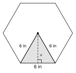
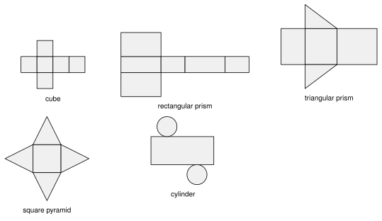
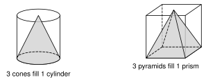

# Unit 8 Summary {.unnumbered}

:::{.guided-notes-link}
[Printable Unit 8 Summary](/guided_notes/Unit_8/Unit_8_Summary.html){target="_blank"} (a reference sheet to print and keep)
:::

## 8.1 - Area of Polygons and Composite Figures

* **Parallelogram**: $A = bh$. **Triangle**: $A = \dfrac{1}{2}bh$. **Trapezoid**: $A = \dfrac{1}{2}(b_1 + b_2)h$. The height is perpendicular to the base.
* **Regular polygon**: $A = \dfrac{1}{2}aP$. The **apothem** $a$ goes from the center to the middle of a side. $P$ is the perimeter. Use a $30^\circ$-$60^\circ$-$90^\circ$ triangle to find $a$ for a hexagon.
* A **composite figure** is made of simple shapes. **Add** the parts, or **subtract** a missing part from a bigger shape.
* To find a missing length, put the known numbers in the formula and solve.

{width=200px fig-align="center"}

Example: a regular hexagon has sides of $6$ in. Then $a = 3\sqrt{3}$ and $A = \dfrac{1}{2}(3\sqrt{3})(36) = 54\sqrt{3} \approx 93.5$ square inches.

## 8.2 - Cross Sections and Solids of Revolution

* A **polyhedron** has flat **faces**, **edges** and **vertices**. **Euler's formula**: $F + V - E = 2$.
* A **prism** has two matching bases. A **pyramid** has one base and a point (the apex). A **cylinder** and a **cone** have circular bases. A **sphere** is all the points the same distance from the center.
* A **cross section** is the shape a plane makes when it cuts a solid. A cut parallel to the base of a cylinder or cone is a circle. A cut through the axis of a cylinder is a rectangle. A cut through the apex of a cone is a triangle. Every cut of a sphere is a circle.
* A **solid of revolution** is made by spinning a flat shape about an **axis**. A rectangle makes a cylinder. A right triangle makes a cone.

{width=300px fig-align="center"}

Example: a solid has $6$ faces and $8$ vertices. $6 + 8 - E = 2$, so $E = 12$.

## 8.3 - Surface Area and Nets

* A **net** is a solid unfolded flat. **Surface area** is the area of the net.
* **Prism**: $SA = 2B + Ph$. The **lateral area** $L = Ph$ is the sides only.
* **Cylinder**: $SA = 2\pi r^2 + 2\pi r h$.
* **Pyramid**: $SA = B + \dfrac{1}{2}P\ell$. **Cone**: $SA = \pi r^2 + \pi r \ell$. The **slant height** $\ell$ is along a face, not the inside height. Find $h$ or $\ell$ with the Pythagorean theorem.
* **Sphere**: $SA = 4\pi r^2$.

{width=300px fig-align="center"}

Example: a cylinder with $r = 3$ and $h = 10$ has $SA = 2\pi(9) + 2\pi(3)(10) = 78\pi \approx 245.0$.

## 8.4 - Volume of Prisms and Cylinders

* **Volume** is the number of cubic units that fill a solid.
* **Prism**: $V = Bh$. **Cylinder**: $V = \pi r^2 h$. $B$ is the area of the base.
* **Cavalieri's principle**: solids with the same height and the same cross-section area at every level have the same volume. A slanted (**oblique**) prism or cylinder uses the **vertical** height.
* Change units with a ratio: $1$ yd$^3$ = $27$ ft$^3$. $1$ ft$^3$ $\approx$ $7.48$ gallons.

{width=220px fig-align="center"}

Example: a slab is $30$ ft by $12$ ft by $\dfrac{1}{3}$ ft. $V = 120$ ft$^3$, and $120 \div 27 \approx 4.4$ yd$^3$.

## 8.5 - Volume of Pyramids, Cones, and Spheres

* **Pyramid**: $V = \dfrac{1}{3}Bh$. **Cone**: $V = \dfrac{1}{3}\pi r^2 h$. Each is one third of the prism or cylinder with the same base and height.
* **Sphere**: $V = \dfrac{4}{3}\pi r^3$. A **hemisphere** is half: $V = \dfrac{2}{3}\pi r^3$.
* Use the **height**, not the slant height. If you are given the slant height, find $h$ first.
* A **frustum** is a cone or pyramid with the top cut off. Subtract the small solid from the large one.
* For a composite solid, add or subtract the volumes of the parts.

{width=300px fig-align="center"}

Example: a cone with $r = 6$ and $\ell = 10$ has $h = 8$ and $V = \dfrac{1}{3}\pi(36)(8) = 96\pi \approx 301.6$.

## 8.6 - Density and Modeling

* **Density** $= \dfrac{\text{mass}}{\text{volume}}$. Weight = density $\cdot$ volume. Water: $62.4$ lb per ft$^3$, or $1$ g per cm$^3$. Concrete: about $150$ lb per ft$^3$. An object **floats** if its density is less than water.
* **Population density** $= \dfrac{\text{people}}{\text{square miles}}$.
* If lengths are multiplied by $k$, areas are multiplied by $k^2$ and volumes by $k^3$.
* For a plan: draw it, make the units match, find the volume, then find the cost, weight, bags or trips. Round **up** for whole items.

{width=260px fig-align="center"}

Example: a slab is $10$ ft by $15$ ft by $\dfrac{1}{3}$ ft. $V = 50$ ft$^3$ and the weight is $150 \cdot 50 = 7500$ lb.
